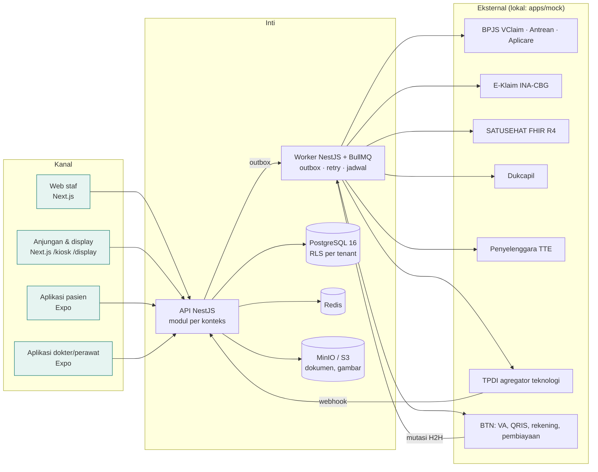

# 01 · Arsitektur

## 1. Gambaran

Satu backend API melayani empat kanal. Semua efek ke sistem luar keluar lewat **outbox** yang diproses worker, sehingga layanan klinis tetap jalan saat sistem luar gangguan.

## 2. Lapisan dan bounded context

| Lapisan | Kode | Modul API (`apps/api/src/modules/…`) |
|---|---|---|
| 1 Platform inti | P01–P13 | `tenancy`, `iam`, `authz`, `audit`, `mpi`, `master-data`, `forms`, `numbering`, `documents`, `signature`, `notification`, `settings`, `sync` |
| 2 Front office | F01–F08 | `scheduling`, `booking`, `registration`, `queue`, `kiosk`, `sep`, `referral`, `patient-portal-gateway` |
| 3 Klinis RME | K01–K15 | `worklist`, `encounter`, `triage`, `adt`, `assessment`, `cppt`, `diagnosis`, `orders` (CPOE), `cds`, `consult`, `consent`, `nursing` (askep + eMAR), `discharge`, `summary`, `care-packages` |
| 4 Penunjang | S01–S10 | `lab`, `micro-pa`, `radiology`, `pharmacy-clinical`, `dispensing`, `surgery`, `nutrition`, `blood-bank`, `critical-results`, `diagnostics` |
| 5 Keuangan | U01–U10 | `tariff`, `charge-capture`, `billing`, `guarantor`, `claims`, `coding`, `accounting`, `fee-sharing`, `cash-bank`, `payables` |
| 6 Back office | B01–B13 | `supply-chain`, `assets`, `hr`, `credentialing`, `payroll`, `quality`, `ipc`, `ams`, `medical-records-admin`, `education`, `oncology`, `regulatory-docs`, `patient-experience` |
| 7 Integrasi & data | I01–I12 | `integration-hub`, `satusehat`, `bpjs`, `kemenkes`, `support-connectors` (Dukcapil, bank/TPDI, TTE, WA), `device-gateway`, `patient-app`, `clinician-app`, `executive-dashboard`, `costing`, `warehouse`, `fhir-server` |

Detail fungsi dan dependensi tiap kode ada di `02-katalog-komponen.md`. Tambahan khusus proyek ini: **`payments`** (TPDI × BTN) dan **`financing`** (pembiayaan BTN) di bawah lapisan 5 + I05, lihat `07-pembayaran-btn-tpdi.md`.

Aturan dependensi antar-modul:
- Modul hanya memanggil modul lain lewat **service publik** yang diekspor dari `index.ts` modul tersebut atau lewat **event domain**. Tidak boleh mengimpor repository modul lain.
- Lapisan atas boleh bergantung pada lapisan bawah, tidak sebaliknya. Contoh: `billing` mendengarkan event `OrderPlaced`, `MedicationAdministered`, dan `BedOccupied`; modul klinis tidak tahu soal billing.

## 3. Multi-tenant

- **Model**: shared database, shared schema, kolom `tenant_id` + **PostgreSQL RLS** (ADR-0002).
- Role DB aplikasi `simrs_app` tanpa `BYPASSRLS`. Setiap request membuka transaksi dan menjalankan `select set_config('app.tenant_id', $1, true)`. Kebijakan RLS: `tenant_id = current_setting('app.tenant_id')::uuid`.
- Role `simrs_migrator` (pemilik tabel) hanya untuk migrasi dan seed.
- Data rujukan global (ICD-10, ICD-9-CM, LOINC, KFA, wilayah) ada di skema `ref` tanpa `tenant_id`, read-only bagi aplikasi.
- Tenant punya: faskes (kode RS Kemenkes, kode PPK BPJS, organization ID SATUSEHAT), cabang, unit, modul aktif, parameter (jam layanan, aturan nomor RM, kebijakan password).
- Tes wajib: pengguna tenant A tidak dapat membaca/menulis data tenant B, meskipun ID-nya ditebak.

## 4. Pola teknis inti

| Kebutuhan | Pola |
|---|---|
| Efek ke sistem luar | Transactional outbox: tabel `outbox_messages` ditulis dalam transaksi yang sama; worker mengirim, retry eksponensial (maks 8×), lalu DLQ + alarm. |
| Webhook masuk (TPDI, BTN) | Endpoint `/api/v1/webhooks/<sumber>` memverifikasi HMAC → simpan `inbound_events` (unik per idempotency key) → 200 → diproses worker. |
| Versi rekam medis | Tabel entri klinis append-only + kolom `version`, `supersedes_id`; view `*_current` untuk versi terbaru. |
| Audit | Interceptor Nest menulis `audit_events` (aktor, peran, tenant, pasien, sumber, aksi, alasan, ip, user-agent, hash sebelumnya, hash). |
| Form klinis dinamis | `form_definitions` berversi (JSON schema + layout + aturan skor) dan `form_responses` terikat versi definisi (P07). |
| CDS | Mesin aturan deklaratif (JSON) dievaluasi saat order/resep; hasil `cds_alerts` dengan tingkat `info/warn/block` dan override beralasan. |
| Charge capture | Event domain → `charge_items` dengan referensi sumber (order, eMAR, ADT, tindakan) → invoice. Kasir tidak membuat item manual tanpa alasan. |
| Real-time | Server-Sent Events untuk display antrean, papan IGD, papan bed, dan notifikasi nilai kritis. |
| Dokumen & TTE | PDF dibangkitkan server (template), disimpan di MinIO, ditandatangani lewat konektor TTE (mock lokal), hash disimpan di DB. |
| Pencarian | Postgres `pg_trgm` + `unaccent` untuk nama pasien/obat; indeks per tenant. |
| Konfigurasi per RS | `tenant_settings` + feature flag modul; tidak ada percabangan kode berdasarkan nama RS. |

## 5. Deployment

**Tahap 1 (sekarang): localhost.** Semua layanan jalan di satu mesin: Docker untuk infra, `pnpm dev` untuk aplikasi. Mock menggantikan seluruh sistem luar.

**Tahap berikutnya (target produksi, hibrida):**
- **Cloud** (region Indonesia): API multi-tenant, portal pasien, integrasi nasional, backup, analitik.
- **Server edge per RS**: instans API + DB replika untuk operasional harian dan **mode downtime** (MRMIK 13.1). Edge tetap melayani pendaftaran, CPPT, eMAR, dan cetak darurat saat internet putus; sinkron dua arah dengan resolusi konflik berbasis versi.
- **Backup tiga lokasi** (MRMIK 5): edge RS, cloud utama, salinan terenkripsi di lokasi lain; uji restore terjadwal.
Sinkronisasi edge (komponen P13) dirancang di fase 10 dan tidak boleh memengaruhi skema: semua ID UUID v7, semua entri berversi, dan stempel waktu dari server.

## 6. Observabilitas

- Log terstruktur JSON (pino) dengan `tenant_id`, `request_id`, `user_id`; **tanpa** PHI di log aplikasi (nama/NIK disamarkan).
- Metrik: latensi API, antrean outbox, DLQ, waktu proses webhook, TAT lab, kepatuhan pelaporan nilai kritis.
- Health check `/health` (liveness) dan `/ready` (DB, Redis, MinIO).
- Lokal: cukup log konsol + halaman status di panel mock; OpenTelemetry disiapkan saat menuju produksi.
