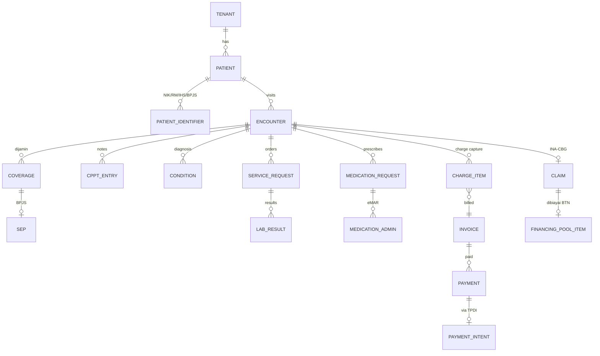

# 04 · Data model

Panduan, bukan skema final. Claude Code menerjemahkannya ke `packages/db/prisma/schema/<domain>.prisma` (skema multi-berkas) per fase, dengan migrasi kecil bertahap.

## 1. Konvensi wajib

| Aturan | Rincian |
|---|---|
| PK | `id uuid` (UUID v7, dibangkitkan aplikasi) |
| Tenant | `tenant_id uuid not null` di semua tabel domain + RLS; indeks komposit diawali `tenant_id` |
| Jejak | `created_at timestamptz`, `created_by uuid`, `updated_at`, `updated_by` (untuk tabel non-klinis) |
| Entri klinis | append-only: `version int`, `supersedes_id uuid null`, `status` (`draft`/`final`/`entered-in-error`), `correction_reason text null`, `signed_at`, `signature_id` |
| Hapus | tidak ada hard delete untuk data pasien; tabel master memakai `active boolean` |
| Uang | `bigint` rupiah |
| Kode baku | kolom `system` + `code` + `display` (mis. `http://hl7.org/fhir/sid/icd-10`, `J18.9`) |
| ID eksternal | tabel `external_ids(entity, entity_id, system, value)` untuk IHS, no. SEP, ID resource SATUSEHAT, ID transaksi TPDI |
| Enkripsi kolom | NIK, no. peserta BPJS, no. HP, alamat: dienkripsi di aplikasi (AES-256-GCM, kunci per tenant di KMS/lokal `.env`) + kolom `*_hash` (HMAC) untuk pencarian sama-persis |

## 2. Entitas per konteks

### Platform (P)
- `tenants` (kode RS Kemenkes, kode PPK BPJS, organization ID SATUSEHAT, nama, kelas RS, status) · `tenant_modules` · `tenant_settings`
- `facilities` (cabang) · `units` (instalasi/poli/bangsal/depo) · `locations` (ruang, kamar, bed; kelas; ID Location SATUSEHAT)
- `users` · `credentials` (argon2id) · `mfa_factors` (TOTP) · `sessions` · `practitioners` (NIK, STR/SIP, IHS practitioner ID, spesialisasi) · `staff_assignments` (user × unit × peran × periode)
- `roles` · `permissions` · `role_permissions` · `access_relationships` (DPJP, perawat penanggung jawab, rawat bersama) · `break_glass_events`
- `audit_events` (append-only, `prev_hash`, `hash`) · `record_versions` (opsional, snapshot JSON entri klinis)
- `patients` · `patient_identifiers` (NIK, RM, IHS, BPJS, paspor) · `patient_contacts` · `patient_links` (merge: survivor/merged, alasan, pelaku) · `privacy_consents`
- `form_definitions` (kode, versi, schema JSON, layout, skor, status terbit) · `form_responses`
- `number_sequences` (per tenant × jenis × periode) · `documents` (objek MinIO, hash, jenis) · `signatures` (penanda tangan, waktu, sertifikat, hash dokumen) · `notifications`
- `outbox_messages` · `delivery_attempts` · `inbound_events` (webhook mentah + idempotency key unik)

### Front office (F)
- `practitioner_schedules` (hari, jam, kuota JKN/non-JKN, sinkron HFIS) · `schedule_exceptions` (cuti)
- `appointments` (kode booking, sumber: Mobile JKN/aplikasi RS/anjungan/loket) · `queue_tickets` (nomor, layanan, status, waktu panggil)
- `bpjs_queue_tasks` (kode booking × task id 1–7/99 × waktu × status kirim)
- `encounters` (kelas: rawat jalan/IGD/rawat inap; unit; DPJP; penjamin; status; waktu mulai/selesai; ID Encounter SATUSEHAT)
- `coverages` (penjamin per encounter: BPJS/asuransi/umum/perusahaan; hak kelas; kelas rawat) · `seps` (no. SEP, jenis, rujukan, diagnosa awal, status) · `referrals`

### Klinis (K)
- `triages` (level, tanda vital, saran sistem, alasan override) · `bed_assignments` (ADT: admit/transfer/discharge, bed, waktu)
- `assessments` (form_response klinis: awal medis/keperawatan, risiko jatuh, nyeri, gizi) · `observations` (tanda vital, skor EWS; LOINC)
- `cppt_entries` (PPA, S/O/A/P, instruksi, perlu co-sign, `cosigned_by`, `cosigned_at`)
- `conditions` (ICD-10, peran: utama/sekunder/komplikasi, status klinis) · `procedures` (ICD-9-CM) · `allergies`
- `service_requests` (lab/rad/tindakan/konsul; prioritas; order set asal) · `order_sets` · `medication_requests` (KFA, dosis, rute, frekuensi, durasi, racikan)
- `cds_rules` · `cds_alerts` (aturan, tingkat, keputusan, alasan override, pelaku)
- `medication_administrations` (jadwal, diberikan/ditunda/ditolak, pemindaian gelang OK, alasan terlambat)
- `consents` (jenis, isi versi, penanda tangan pasien/wali/saksi, TTE dokter, status, penolakan)
- `discharge_summaries` (resume; rekonsiliasi obat; kondisi pulang; tindak lanjut) · `care_plans` · `nursing_care` (diagnosa keperawatan, intervensi)

### Penunjang (S)
- `specimens` (barcode, jenis, waktu ambil/terima) · `lab_results` (LOINC, nilai, satuan, rujukan, flag, delta, validasi teknis/klinis) · `critical_result_reports` (penerima, read-back, waktu lapor, durasi)
- `imaging_studies` (accession, modalitas, worklist DICOM, ekspertise)
- `drugs` (KFA, Fornas, high alert) · `stock_locations` · `stock_batches` (batch, ED) · `stock_movements` · `prescription_reviews` (telaah 3 aspek) · `dispenses`
- `surgery_cases` (jadwal kamar, tim) · `surgical_safety_checks` (sign in/time out/sign out, item, pelaku, waktu) · `surgical_counts`

### Keuangan (U)
- `tariffs` (komponen jasa sarana/jasa pelayanan, kelas, penjamin) · `charge_items` (sumber, kuantitas, harga, status) · `invoices` · `invoice_lines`
- `deposits` · `payments` (metode, jumlah, referensi TPDI/BTN, status) · `refunds` (persetujuan bertingkat)
- `guarantor_splits` (porsi pasien vs penjamin, selisih naik kelas, dasar aturan)
- `claims` (SEP, berkas, status: draf/terkirim/pending/layak bayar/dispute/dibayar) · `claim_codings` · `grouper_results` (kode CBG, tarif, special CMG)
- `coa_accounts` · `journal_entries` · `journal_lines` · `fiscal_periods` (terbuka/tertutup)
- `bank_accounts` (BTN operasional, BTN penampungan klaim) · `bank_statement_lines` (mutasi H2H) · `reconciliation_items`

### Pembayaran & pembiayaan (lihat 07)
- `payment_intents` (invoice/deposit; kanal VA/QRIS/EDC; nomor VA/QR; kedaluwarsa; status) · `payment_events` (webhook TPDI, idempotency key)
- `financing_facilities` (plafon, advance rate, margin, masa berlaku) · `financing_pool_items` (klaim layak bayar) · `financing_drawdowns` · `financing_repayments`
- `patient_financing_applications` (nilai, tenor, status, akad, pencairan)

## 3. Inti relasi

## 4. Pemetaan ke FHIR R4 (SATUSEHAT)

| Domain | Resource | Kapan dikirim |
|---|---|---|
| Kunjungan | `Encounter` (status arrived → in-progress → finished; class AMB/EMER/IMP) | saat dibuat, berubah status, selesai |
| Diagnosis | `Condition` (ICD-10) | saat final / koreksi |
| Tanda vital, hasil lab | `Observation` (LOINC) | saat tervalidasi |
| Order penunjang | `ServiceRequest` | saat dikirim |
| Laporan lab/rad | `DiagnosticReport`, `Specimen`, `ImagingStudy` | saat dirilis |
| Tindakan | `Procedure` (ICD-9-CM) | saat selesai |
| Resep, pemberian, penyerahan | `MedicationRequest`, `MedicationAdministration`, `MedicationDispense` (KFA) | saat final |
| Alergi | `AllergyIntolerance` | saat dicatat |
| Resume | `Composition` | saat TTE |

Pemetaan ditulis di `packages/fhir` sebagai fungsi murni `toFhir<Resource>(entity, ctx)` dengan tes snapshot. Nilai ID referensi (Patient IHS, Practitioner IHS, Organization, Location) diambil dari `external_ids`.

## 5. Penomoran

| Dokumen | Pola contoh (dapat diatur per tenant) |
|---|---|
| No. RM | `00-41-27-88` (8 digit, berurutan, tidak pernah dipakai ulang) |
| Kunjungan | `RJ-2610-000123`, `IGD-…`, `RI-…` |
| Antrean | `<kode poli>-<3 digit>` per hari |
| Invoice | `INV-2610-02217` |
| Jurnal | `JU-26100388` |
| Tagihan pembayaran | `INV-DP-2610-0412` |

## 6. Retensi (ringkas; detail di 03-regulasi-mrmik.md)

- Rekam medis disimpan sesuai ketentuan masa simpan, lalu diproses pemusnahan berjejak (komponen B09). Tidak ada penghapusan otomatis di aplikasi.
- Log audit: minimal sepanjang masa simpan rekam medis terkait.
- Data pembayaran dan jurnal: mengikuti ketentuan arsip keuangan dan perpajakan.
