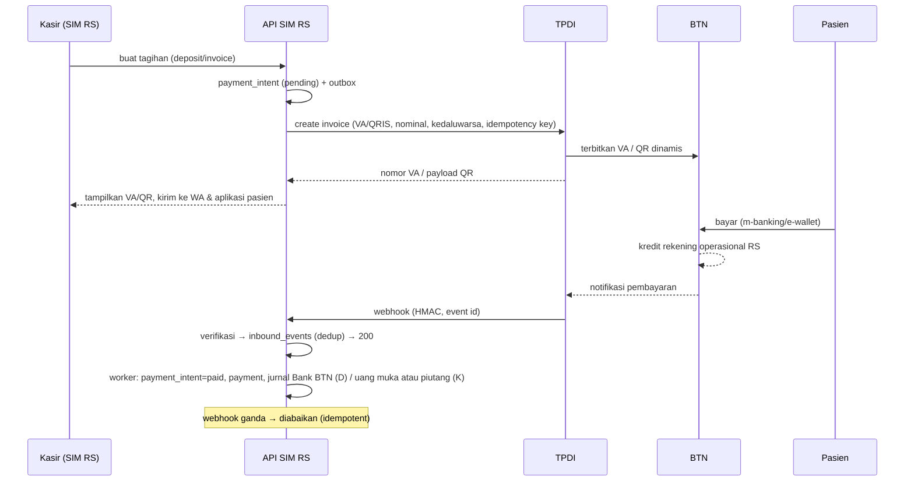
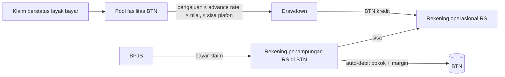

# 07 · Pembayaran TPDI × BTN dan pembiayaan BTN

Desain layar: `design/mockups/PembayaranBTN.dc.html`, `PembiayaanBTN.dc.html`, `Kasir.dc.html`, dan skenario "Elektif · TPDI × BTN" di `Simulasi.dc.html`.
Keputusan struktur: ADR-0005.

## 1. Pihak dan peran

| Pihak | Peran |
|---|---|
| Pasien | Membayar deposit/tagihan; dapat mengajukan cicilan |
| RS (tenant) | Merchant; pemilik rekening di BTN; pencatat tagihan dan jurnal |
| TPDI | Agregator **teknologi**: API tagihan, halaman bayar, webhook, laporan transaksi. **Tidak menampung dana.** |
| BTN | Penerbit VA, acquirer QRIS, EDC, bank rekening RS, pemberi pembiayaan (cicilan pasien, piutang BPJS) |
| BPJS | Membayar klaim ke rekening penampungan RS di BTN |

Rekening RS di BTN:
- **Operasional** (contoh `••••4417`): penerimaan pasien, pencairan pembiayaan.
- **Penampungan klaim BPJS** (contoh `••••9021`): menerima pembayaran klaim; dipakai auto-debit pelunasan pembiayaan piutang.

## 2. Alur pembayaran pasien



### Status `payment_intents`
`draft → pending → paid` · `pending → expired` · `pending → failed` · `paid → refund_requested → refunded` (refund parsial dimungkinkan).

### Kanal
| Kanal | Catatan |
|---|---|
| VA BTN | closed amount; masa berlaku dapat diatur (default deposit 24 jam) |
| QRIS dinamis | acquirer BTN; berlaku 10 menit; satu QR per tagihan |
| EDC BTN | kasir mencatat approval code; rekonsiliasi dari settlement EDC |
| Tunai | tidak lewat TPDI; tetap dijurnal dan direkonsiliasi dengan setoran kas |
| Cicilan BTN | lihat bagian 4 |

### Webhook TPDI → SIM RS (kontrak usulan, disepakati dengan TPDI)
```
POST /api/v1/webhooks/tpdi
Headers: X-TPDI-Event-Id, X-TPDI-Timestamp, X-TPDI-Signature: hex(HMAC-SHA256(timestamp + "." + body, webhook_secret))
Body: { event: "payment.paid" | "payment.expired" | "payment.failed" | "refund.completed",
        merchant_id, invoice_id, external_ref, channel, amount, paid_at, bank_ref }
```
Aturan: tolak bila timestamp > 5 menit; simpan mentah; unik per `X-TPDI-Event-Id`; cocokkan `amount` dengan intent; selisih nominal → pengecualian rekonsiliasi, bukan lunas otomatis.

## 3. Rekonsiliasi 3 arah (U09)

Sumber harian:
1. **Kasir SIM RS**: `payments` per kanal.
2. **Laporan TPDI**: API laporan transaksi per tanggal.
3. **Mutasi BTN**: H2H/API mutasi rekening operasional dan penampungan.

Pencocokan: `bank_ref`/`invoice_id` → nominal → tanggal. Hasil: `cocok`, `hanya di kasir`, `hanya di TPDI`, `hanya di bank`, `nominal beda`. Pengecualian butuh tindakan (tautkan, koreksi, refund, eskalasi) dan tercatat di audit. Rekonsiliasi lolos → jurnal final dan periode bisa ditutup.

## 4. Cicilan biaya pasien (pembiayaan BTN)

```
diajukan → verifikasi_btn → disetujui → akad_ttd → dicairkan   (RS lunas)
         ↘ ditolak (alasan)
```
- Pemicu: kasir (selisih naik kelas, pasien umum) atau aplikasi pasien.
- Data yang dikirim minimal dan dengan persetujuan pasien (UU PDP): identitas, kontak, nilai, tenor, referensi tagihan. Data penghasilan diisi pasien langsung di kanal BTN/TPDI bila memungkinkan.
- Saat `dicairkan`: BTN mengkredit rekening operasional RS → `payment` metode `financing_btn` → invoice lunas. Angsuran pasien ke BTN, **bukan** urusan RS.
- Produk dan parameter (tenor, margin, syarat) milik BTN; di SIM RS hanya ditampilkan sebagai estimasi berlabel.

## 5. Pembiayaan piutang klaim BPJS (supply chain financing)


- `financing_facilities`: plafon, advance rate (contoh 90%), margin (contoh 8% p.a.; **simulasi**), masa berlaku, nomor perjanjian.
- Eligibility: klaim `layak bayar`, belum dibiayai, belum dibayar BPJS, tidak dispute.
- Jurnal: pencairan → Bank (D) / Utang pembiayaan (K). Pelunasan → Utang pembiayaan (D) + Beban margin (D) / Bank penampungan (K). Pembayaran BPJS → Bank penampungan (D) / Piutang BPJS (K).
- Dasbor: plafon, outstanding, sisa plafon, umur piutang, rata-rata hari cair BPJS.

## 6. Mock TPDI dan BTN

| Endpoint mock | Fungsi |
|---|---|
| `POST /tpdi/v1/invoices` | buat VA/QRIS (nomor VA fiktif awalan `8808 0127`), kedaluwarsa |
| `GET /tpdi/v1/invoices/:id` | status |
| `GET /tpdi/v1/reports/transactions?date=` | laporan harian |
| `POST /tpdi/v1/refunds` | refund |
| Panel: "Bayar", "Kirim webhook ulang", "Kedaluwarsakan" | memicu webhook ke SIM RS |
| `GET /btn/v1/accounts/:no/statements?date=` | mutasi H2H fiktif |
| `POST /btn/v1/financing/patient-applications` + panel setujui/tolak/cairkan | cicilan pasien |
| `POST /btn/v1/financing/receivables/drawdowns` + panel "BPJS bayar klaim" | pembiayaan piutang |

## 7. Pertanyaan terbuka (untuk TPDI/BTN)
1. Format resmi API TPDI (endpoint, tanda tangan, event) dan SLA webhook.
2. Apakah VA BTN mendukung open amount untuk deposit fleksibel.
3. Mekanisme mutasi BTN: H2H file (MT940/CSV) atau API real-time.
4. Produk pembiayaan BTN yang tersedia untuk RS (nama, plafon, advance rate, margin, dokumen jaminan) dan untuk pasien.
5. Konfirmasi hukum struktur non-custodial TPDI (ADR-0005).
