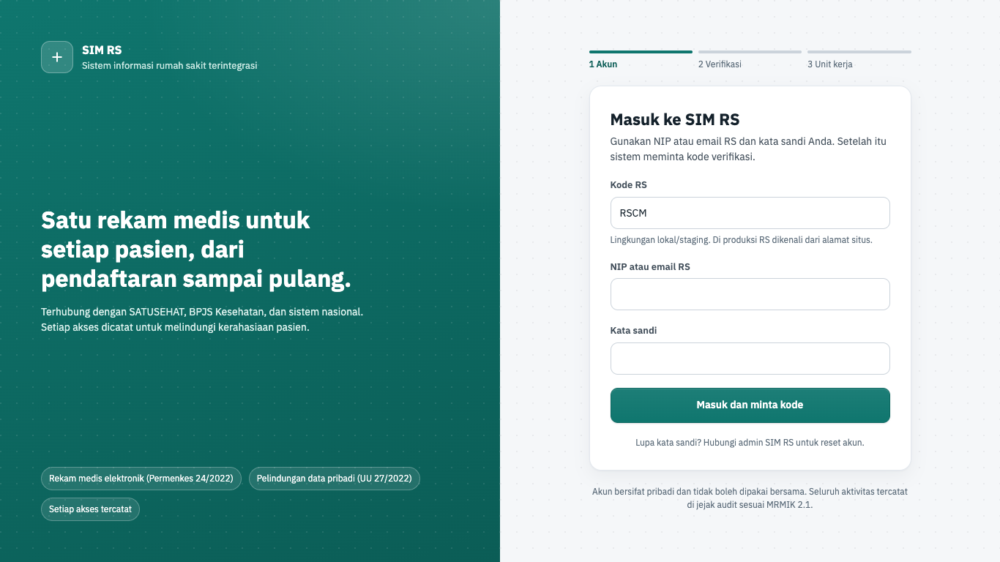
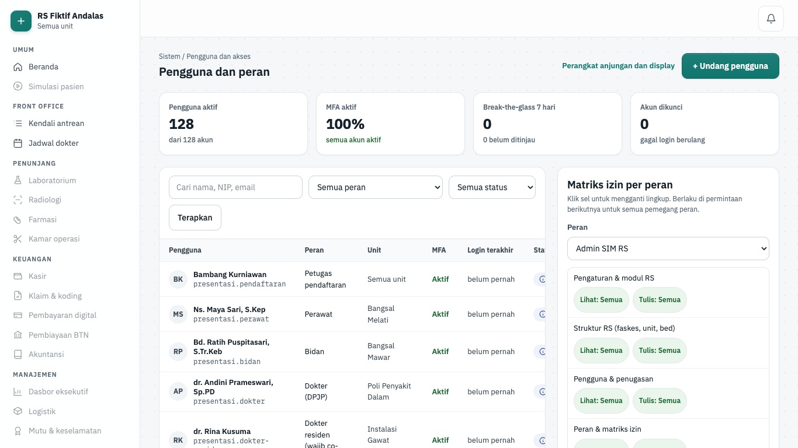
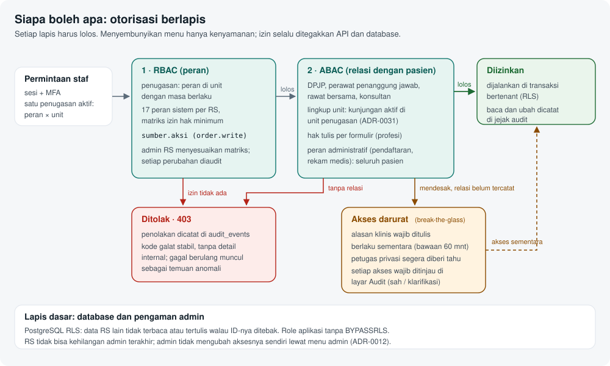
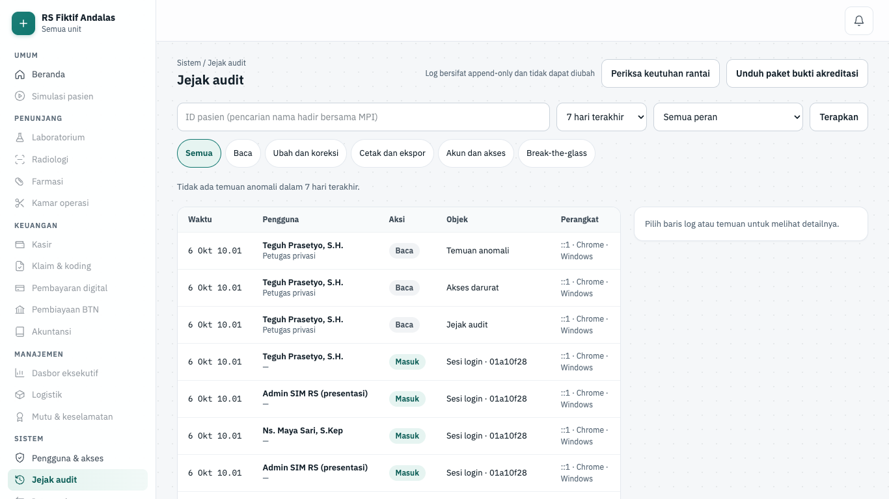
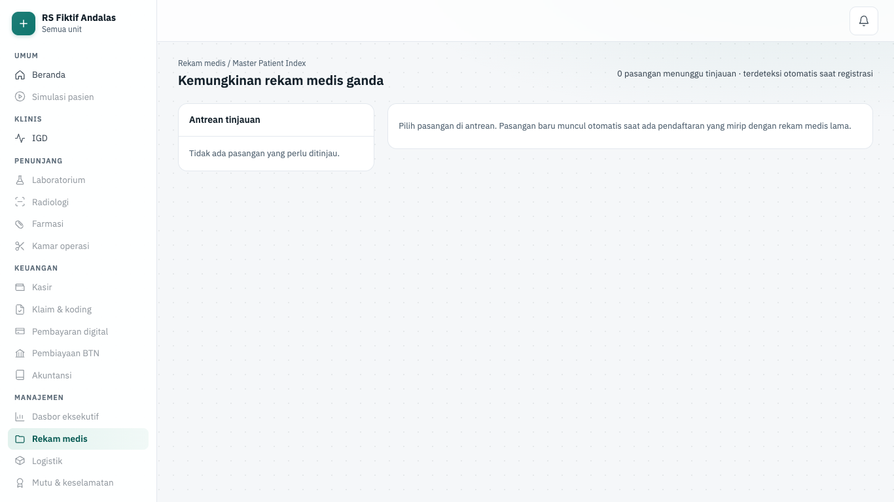
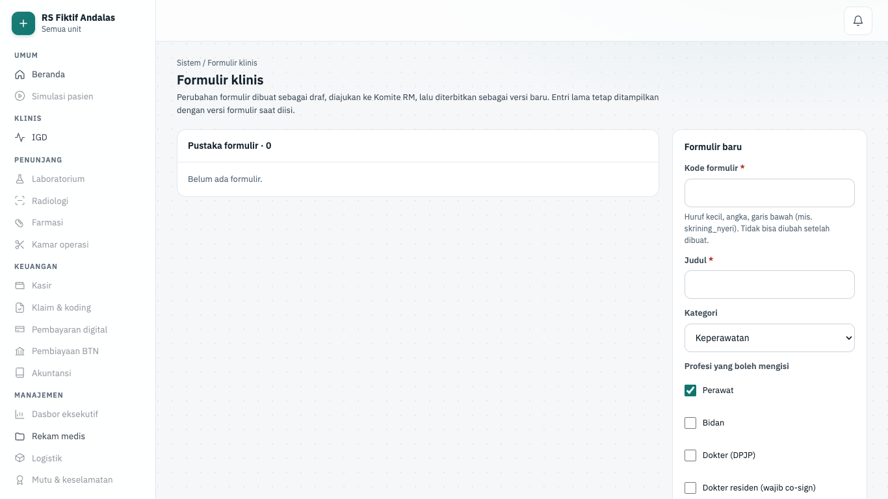
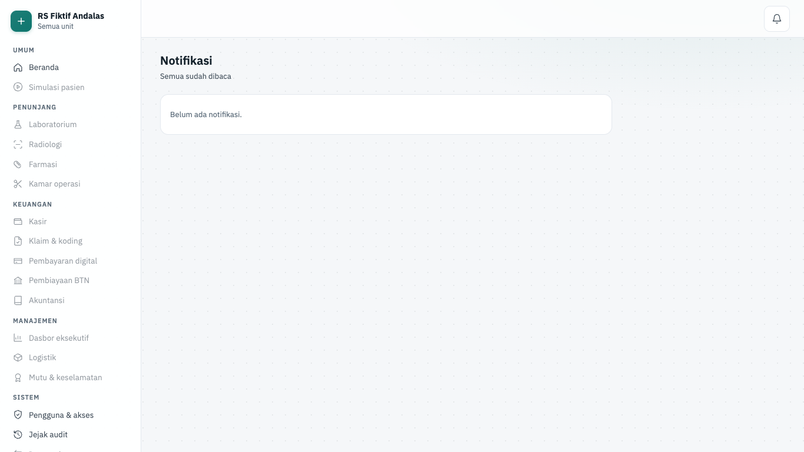
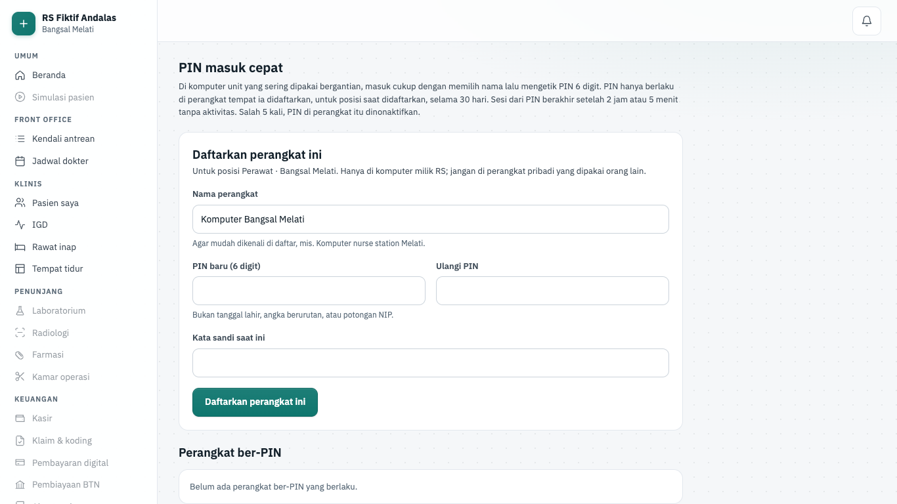
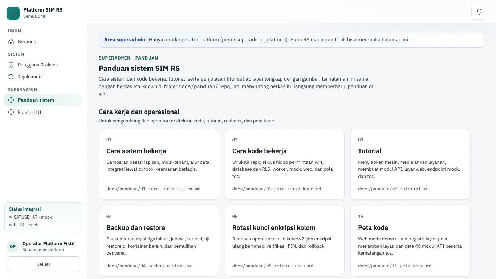

# Fitur platform

Halaman ini menjelaskan layar platform fase 1 dari sisi pemakai: tujuan, alur langkah demi langkah, dan aturan yang dijaga sistem. Semua layar di sini tersambung ke API sungguhan (mode api). Cara kerja di balik layar ada di [Cara sistem bekerja](./01-cara-kerja-sistem.md) dan [Cara kode bekerja](./02-cara-kerja-kode.md); halaman ini hanya meringkas dan menautkannya.

> Status 6 Okt 2026: fase 1 selesai (5 Okt 2026). Semua layar di bawah tersambung ke API di semua lingkungan dan dijaga tes E2E. Menu dan tombol hanya kenyamanan; izin selalu ditegakkan ulang oleh API.

## Ringkasan layar

| Layar                          | Rute                                          | Peran                                                  | Komponen | Status |
| ------------------------------ | --------------------------------------------- | ------------------------------------------------------ | -------- | ------ |
| Masuk                          | `/masuk`                                      | semua staf                                             | P02, P03 | api    |
| Beranda                        | `/`                                           | semua staf                                             | P02, P03 | api    |
| Pengguna dan akses             | `/sistem/akses`                               | admin_tenant, petugas_privasi (baca)                   | P02, P03 | api    |
| Perangkat anjungan dan display | `/sistem/akses/perangkat`                     | admin_tenant                                           | P02, P03 | api    |
| Jejak audit                    | `/sistem/audit`                               | petugas_privasi, auditor_mutu, admin_tenant, manajemen | P04      | api    |
| Rekam medis ganda (MPI)        | `/rekam-medis/mpi`                            | petugas_rm                                             | P05      | api    |
| Formulir klinis                | `/sistem/formulir`, `/sistem/formulir/[code]` | petugas_rm (ubah), klinisi (baca)                      | P07      | api    |
| Notifikasi                     | `/notifikasi`                                 | semua staf                                             | P09      | api    |
| PIN masuk cepat                | `/akun/pin`                                   | posisi layanan berunit                                 | P02      | api    |
| Ganti posisi                   | `/akun/posisi`                                | akun dengan lebih dari satu posisi                     | P03      | api    |
| Verifikasi QR dokumen          | `/verifikasi/[code]`                          | publik, tanpa login                                    | P08      | api    |
| Pendaftaran perangkat          | `/perangkat/daftar`                           | perangkat anjungan/TV, tanpa login                     | P02      | api    |
| Panduan superadmin             | `/superadmin/panduan`                         | superadmin_platform                                    | —        | api    |
| Fondasi UI                     | `/dev/ui`                                     | superadmin_platform                                    | —        | api    |

Kolom Peran memakai peran bawaan (`DEFAULT_ROLE_GRANTS` di `packages/shared/src/authz.ts`). Admin RS bisa mengubah matriks itu, jadi yang menentukan tetap izinnya.

## Masuk

| Hal      | Isi                                                                       |
| -------- | ------------------------------------------------------------------------- |
| Rute     | `/masuk` (publik; halaman staf tanpa sesi dialihkan ke `/masuk?lanjut=…`) |
| Pemakai  | semua staf RS dan operator platform                                       |
| Komponen | P02, P03                                                                  |
| Status   | api (tersambung)                                                          |
| Mockup   | `design/mockups/Login.dc.html`                                            |
| Kode web | `apps/web/src/app/masuk/`                                                 |
| Kode API | `apps/api/src/modules/auth/`                                              |

**Tujuan.** Staf masuk dengan kata sandi dan kode verifikasi dua langkah (MFA), lalu memilih posisi kerja. Langkah ditentukan server dari cookie dan sesi, jadi memuat ulang halaman selalu menampilkan langkah yang benar.

**Alur.**

1. Langkah **1 Akun**: isi **Kode RS** (hanya tampil di luar produksi; di lokal terisi dari `LOGIN_TENANT_CODE`), **NIP atau email RS**, dan **Kata sandi**, lalu tekan **Masuk dan minta kode**.
2. Langkah **2 Verifikasi** ("Verifikasi dua langkah"): ketik 6 digit dari aplikasi autentikator. Centang **Percayai perangkat ini selama 12 jam (hanya komputer milik RS)** bila perlu. Tekan **Verifikasi dan lanjut**.
3. Ponsel tertinggal: pakai tautan **Kirim kode lewat WhatsApp** atau **email**. Tautan hanya muncul bila RS mengizinkan kanal itu dan akun tidak memegang peran wajib-autentikator (`login.totp_only_roles`).
4. Akun baru: layar **Aktifkan verifikasi dua langkah** → **Tampilkan kode QR** → pindai → ketik kode → **Aktifkan dan lanjut**. Bila sandinya sementara, lanjut ke **Buat kata sandi baru** → **Simpan dan lanjut**.
5. Langkah **3 Unit kerja** ("Pilih posisi dan unit kerja"): muncul bila akun punya lebih dari satu penugasan. Pilih posisi, lalu **Masuk sebagai <peran>**. Satu penugasan langsung dipakai.
6. Sistem membuka tujuan di `?lanjut` (hanya path internal) atau Beranda.
7. Peramban yang mengingat akun ber-PIN menampilkan kartu **Masuk dengan PIN** di atas formulir: pilih nama, ketik PIN 6 digit, tekan **Masuk dengan PIN**. Langkah 2 dan 3 dilewati.
8. **Kembali ke halaman masuk** membatalkan langkah yang setengah jadi dan mulai dari langkah 1.

**Gerbang keselamatan dan aturan bisnis.**

- Sandi salah memberi pesan seragam "NIP/email atau kata sandi salah"; percobaan gagal dihitung dan diaudit.
- Tantangan MFA berlaku 5 menit, maksimal 5 percobaan. Kode cadangan maksimal 3 kali dengan jeda 30 detik.
- Sesi tanpa MFA atau dengan sandi sementara hanya bisa membuka endpoint akun (`MFA_REQUIRED`, `PASSWORD_CHANGE_REQUIRED`).
- Token hanya di cookie httpOnly (`simrs_at`, `simrs_rt`); browser tidak pernah memegangnya. Keluar mencabut sesi di API.
- `?lanjut` berisi URL luar diabaikan (tidak ada open redirect).
- PIN salah 5 kali menonaktifkan PIN di perangkat itu; halaman kembali dengan `?alasan=pin-nonaktif` dan meminta login penuh.

Rincian: [Autentikasi dan sesi](./02-cara-kerja-kode.md#autentikasi-dan-sesi-p02) dan [Sesi web dan alur masuk](./02-cara-kerja-kode.md#sesi-web-dan-alur-masuk).

**Mode presentasi.** Di `pnpm dev:demo` layar ini menambah kartu **Masuk cepat · mode presentasi**: satu klik per posisi untuk akun fiktif. Kartu itu menjalankan login biasa di server (sandi + kode TOTP dari berkas lokal `pnpm db:akun-presentasi`), jadi batas laju, MFA, dan audit tetap berlaku. Di staging dan produksi kartu itu tidak ada.

## Beranda

| Hal      | Isi                                                                 |
| -------- | ------------------------------------------------------------------- |
| Rute     | `/`                                                                 |
| Pemakai  | semua staf yang sudah masuk                                         |
| Komponen | P02, P03                                                            |
| Status   | api (tersambung)                                                    |
| Mockup   | —                                                                   |
| Kode web | `apps/web/src/app/(staf)/page.tsx` · menu `apps/web/src/lib/nav.ts` |
| Kode API | `apps/api/src/modules/auth/` (`/auth/me`)                           |

**Tujuan.** Titik awal setelah masuk. Menampilkan sapaan, tanggal, nama RS, dan posisi aktif ("Anda masuk sebagai <peran> di <unit>").

**Alur.**

1. Baca kartu posisi. Hak akses mengikuti peran dan unit itu.
2. Pilih layar dari menu samping. Menu hanya memuat layar yang izinnya dimiliki posisi aktif.
3. Operator platform melihat kartu status layanan (hasil `/ready`: PostgreSQL, Redis, dan penyimpanan berkas, masing-masing "Siap · N ms" atau "Gagal") dengan tautan ke **Panduan sistem** dan **Fondasi UI**.

**Gerbang keselamatan dan aturan bisnis.**

- Menu ber-`requires` disembunyikan bila izinnya tidak ada; tenant PLATFORM hanya melihat Beranda, Akses, dan Audit.
- Halaman tetap memanggil `requireSession()` sendiri; menu tidak pernah jadi satu-satunya penjaga.

**Mode presentasi.** Beranda menampilkan pemberitahuan "Mode presentasi" dengan tautan ke Simulasi pasien, dan header selalu memuat lencana "Mode presentasi · data fiktif".

## Pengguna dan akses

| Hal      | Isi                                                                            |
| -------- | ------------------------------------------------------------------------------ |
| Rute     | `/sistem/akses` (`?pengguna=<id>` membuka detail)                              |
| Pemakai  | admin_tenant (baca + ubah); petugas_privasi (baca saja, izin `iam.users.read`) |
| Komponen | P02, P03                                                                       |
| Status   | api (tersambung)                                                               |
| Mockup   | `design/mockups/Akses.dc.html`                                                 |
| Kode web | `apps/web/src/app/(staf)/sistem/akses/`                                        |
| Kode API | `apps/api/src/modules/iam/` · `apps/api/src/modules/authz/`                    |

**Tujuan.** Admin RS mengelola akun, penugasan, perangkat login, dan matriks izin per peran. KPI di atas dipakai untuk reviu akses bulanan.

**Alur.**

1. Baca KPI: **Pengguna aktif**, **MFA aktif**, **Break-the-glass 7 hari** (dengan jumlah belum ditinjau), dan **Akun dikunci**.
2. Cari lewat **Cari pengguna** (nama, NIP, email), pilih **Peran** dan **Status** (termasuk **Belum diaktifkan**), lalu **Terapkan**.
3. Undang staf: **+ Undang pengguna** → isi **NIP atau email RS**, **Nama tampilan**, **Peran** → **Buat akun**. Dialog **Akun dibuat** menampilkan sandi sementara satu kali. Tekan **Selesai**.
4. Klik nama untuk membuka detail. Bagian **Penugasan**: **+ Tambah penugasan** (peran, unit, tanggal mulai dan akhir) → **Tambahkan**, atau **Akhiri penugasan**.
5. Bagian **Perangkat**: lihat perangkat tepercaya dan PIN milik akun, lalu **Cabut perangkat** atau **Cabut PIN**.
6. Bagian **Kontak notifikasi**: isi **Email** dan **No. HP / WhatsApp** → **Simpan kontak**. No. HP lalu tampil tersamar.
7. Bagian **Tindakan akun**: **Reset kata sandi**, **Reset verifikasi dua langkah**, atau **Nonaktifkan akun** / **Aktifkan kembali**. Setiap tindakan minta konfirmasi **Ya, lanjutkan**.
8. Matriks: di panel **Matriks izin per peran**, pilih **Peran**, klik sel untuk memutar lingkup (— → Relasi → Unit → Semua), lalu **Simpan perubahan**.
9. Tautan **Perangkat anjungan dan display** membuka [layar perangkat](#perangkat-anjungan-dan-display).

**Gerbang keselamatan dan aturan bisnis.**

- Admin tidak bisa mengubah akses akunnya sendiri ("Ini akun Anda sendiri.", tanpa tombol aksi).
- Selalu tersisa minimal satu admin aktif. Izin kelola akses tidak bisa dicabut dari peran admin (sel terkunci).
- Pemegang izin kelola pengguna yang didelegasikan tidak bisa menyentuh akun atau peran setara admin.
- Sandi sementara tampil sekali, tidak masuk log atau audit, dan wajib diganti saat login pertama. Reset dan nonaktif mencabut semua sesi akun itu.
- Staf seed tanpa sandi tampil **Belum diaktifkan**; **Reset kata sandi** sekaligus mengaktifkannya.
- Perubahan matriks diaudit sebagai selisih dan berlaku di permintaan berikutnya di semua instans API.
- Selama ada perubahan matriks yang belum disimpan, pilihan **Peran** dikunci.

Rincian: [Siapa boleh apa](./01-cara-kerja-sistem.md#siapa-boleh-apa) dan [Otorisasi](./02-cara-kerja-kode.md#otorisasi-p03).

**Mode presentasi.** Tidak ada jalur data dummy. Layar ini memanggil API yang sama di kedua mode.

## Perangkat anjungan dan display

| Hal      | Isi                                                           |
| -------- | ------------------------------------------------------------- |
| Rute     | `/sistem/akses/perangkat`                                     |
| Pemakai  | admin_tenant (`iam.users.write`); baca untuk `iam.users.read` |
| Komponen | P02, P03                                                      |
| Status   | api (tersambung)                                              |
| Mockup   | —                                                             |
| Kode web | `apps/web/src/app/(staf)/sistem/akses/perangkat/`             |
| Kode API | `apps/api/src/modules/devices/`                               |

**Tujuan.** Mendaftarkan anjungan mandiri dan TV antrean sebagai perangkat per unit, bukan akun staf (ADR-0027).

**Alur.**

1. Di **Daftarkan perangkat**, pilih **Jenis** (Anjungan mandiri atau Display antrean (TV)), isi **Nama perangkat**, pilih **Unit**.
2. Tekan **Buat kode pendaftaran**. Kode `XXXXX-XXXXX` tampil sekali dan berlaku 15 menit.
3. Ketik kode itu di perangkatnya lewat [Pendaftaran perangkat](#pendaftaran-perangkat).
4. Pantau tabel: status **Menunggu pendaftaran**, **Aktif**, **Kedaluwarsa**, atau **Dicabut**, serta **Terakhir dipakai**.
5. Untuk menghentikan perangkat: tombol cabut di barisnya → **Cabut perangkat**. Pencabutan berlaku seketika.

**Gerbang keselamatan dan aturan bisnis.**

- Perangkat hanya memegang izin tetap jenisnya (`kiosk.use` atau `queue.display.read`) dan tidak bisa membuka layar staf.
- Kode disimpan sebagai HMAC dan hanya bisa dipakai sekali.
- TV harus terikat ke satu papan display. Formulir web belum punya pilihan papan; ikatan `queueDisplayId` saat ini hanya lewat API `POST /api/v1/iam/devices`.

**Mode presentasi.** Tidak dipakai. Di mode presentasi anjungan dan TV dibuka dengan login staf, bukan perangkat.

## Jejak audit

| Hal      | Isi                                                                                                    |
| -------- | ------------------------------------------------------------------------------------------------------ |
| Rute     | `/sistem/audit` (`?kejadian=<seq>`, `?temuan=<kunci>`, `?tinjau=<id>`, `?verifikasi=1\|penuh`)         |
| Pemakai  | petugas_privasi (baca, tinjau, ekspor); auditor_mutu (baca, ekspor); admin_tenant dan manajemen (baca) |
| Komponen | P04                                                                                                    |
| Status   | api (tersambung)                                                                                       |
| Mockup   | `design/mockups/Audit.dc.html`                                                                         |
| Kode web | `apps/web/src/app/(staf)/sistem/audit/`                                                                |
| Kode API | `apps/api/src/modules/audit/` · `apps/api/src/modules/authz/` (akses darurat)                          |

**Tujuan.** Petugas privasi dan auditor mutu menelusuri siapa membuka atau mengubah apa, memeriksa keutuhan rantai hash, meninjau temuan anomali dan akses darurat, serta mengunduh bukti akreditasi.

**Alur.**

1. Saring lewat **ID pasien**, **Rentang waktu** (Hari ini, 7, 30, atau 90 hari terakhir), dan **Peran pengguna**, lalu **Terapkan**. Chip **Jenis aksi** menyaring kelompok aksi.
2. Klik baris di **Log aktivitas** untuk membuka panel **Detail** ("Detail aktivitas · entri #…") berisi hash entri.
3. Tekan **Periksa keutuhan rantai** (mulai dari jangkar terakhir, cepat). Untuk hitung ulang semua, pilih **Periksa penuh (hitung ulang seluruh rantai)**.
4. **Temuan anomali**: lima kartu pertama tampil; sisanya lewat **Tampilkan semua N temuan**. Buka kartu, isi **Catatan (opsional)**, lalu **Ditinjau: akses sah** atau **Ditinjau: perlu klarifikasi**.
5. Ubah keputusan dengan **Buka kembali tinjauan**. Bagian **Riwayat tinjauan** menandai yang **Berlaku** dan yang **Digantikan**.
6. Akses darurat (dari tautan notifikasi `?tinjau=`): baca **ALASAN AKSES DARURAT (WAJIB)**, lalu beri keputusan yang sama. Hasilnya tampil di **Laporan harian akses darurat**.
7. Koreksi isian formulir tampil sebagai **Versi 1 → versi 2**: alasan, nilai lama dan baru, penulis asli, pengoreksi.
8. **Unduh paket bukti akreditasi** mengunduh CSV sesuai filter.

**Gerbang keselamatan dan aturan bisnis.**

- Log append-only; membuka detail, meninjau, dan mengunduh juga diaudit.
- Peninjau tidak boleh meninjau temuan atau akses darurat miliknya sendiri (`409`).
- Ekspor maksimal 92 hari / 10.000 baris, ber-BOM UTF-8, sel berawalan `= + - @` dinetralkan. Permintaan ekspor dari situs lain ditolak `403`.
- Tanpa `audit.export` tombol unduh tidak tampil dan rute ekspor menjawab `403`.

Rincian: [Rekam medis dan jejak audit](./01-cara-kerja-sistem.md#rekam-medis-dan-jejak-audit) dan [Layar Audit](./02-cara-kerja-kode.md#layar-audit-p04).

**Mode presentasi.** Tidak ada jalur data dummy; isinya jejak sungguhan dari database pengembangan.

## Rekam medis ganda (MPI)

| Hal      | Isi                                              |
| -------- | ------------------------------------------------ |
| Rute     | `/rekam-medis/mpi` (`?pasangan=<id>`)            |
| Pemakai  | petugas_rm (izin `patient.merge`, lingkup `all`) |
| Komponen | P05                                              |
| Status   | api (tersambung)                                 |
| Mockup   | `design/mockups/MPI.dc.html`                     |
| Kode web | `apps/web/src/app/(staf)/rekam-medis/mpi/`       |
| Kode API | `apps/api/src/modules/mpi/`                      |

**Tujuan.** Petugas rekam medis memutuskan apakah dua rekam medis milik orang yang sama ("Kemungkinan rekam medis ganda"). Pasangan masuk antrean otomatis saat pendaftaran mirip dengan rekam medis lama.

**Alur.**

1. Pilih pasangan di **Antrean tinjauan**. Pasangan terbuka diurutkan menurut skor kemiripan.
2. Bandingkan atribut di tabel: kolom **Rekam medis A · dipertahankan** dan **Rekam medis B · digabungkan**. Nilai identitas tampil tersamar.
3. Klik nilai di kolom B untuk memakainya (mis. "Nama dari B"). Kalimat "Diambil dari B: …" merangkum pilihan.
4. Isi **Alasan keputusan** beserta dasar verifikasi (mis. KTP, wawancara), minimal 10 karakter.
5. Tekan **Gabungkan ke <RM A>** atau **Bukan orang yang sama**.
6. Status **Berhasil digabung** menjelaskan RM B kini dialihkan ke A. **Lihat di jejak audit** membuka entri audit.
7. Keliru? Isi **Alasan pembatalan** lalu **Batalkan keputusan**.

**Gerbang keselamatan dan aturan bisnis.**

- Penggabungan tidak menghapus atau memindah data: B hanya ditandai digabung ke A dan tetap terbaca sebagai riwayat A.
- Batal gabung hanya dalam 30 hari; nilai A dipulihkan dari snapshot terenkripsi.
- Tombol keputusan nonaktif sampai alasan cukup panjang.
- Setiap pasangan yang tampil dan setiap keputusan diaudit untuk kedua pasien.
- Peran tanpa `patient.merge` melihat "Tinjauan rekam medis ganda khusus petugas rekam medis." dan menu **Rekam medis** tidak tampil.

Rincian: [Data pasien (MPI)](./01-cara-kerja-sistem.md#data-pasien-mpi) dan [Master Patient Index](./02-cara-kerja-kode.md#master-patient-index-p05).

**Mode presentasi.** Tidak ada jalur data dummy; layar memanggil API yang sama di kedua mode.

## Formulir klinis

| Hal      | Isi                                                                                    |
| -------- | -------------------------------------------------------------------------------------- |
| Rute     | `/sistem/formulir` (pustaka) · `/sistem/formulir/[code]` (pembuat)                     |
| Pemakai  | petugas_rm (`forms.definition.write` + `publish`); admin_tenant dan klinisi hanya baca |
| Komponen | P07                                                                                    |
| Status   | api (tersambung)                                                                       |
| Mockup   | `design/mockups/Formulir.dc.html`                                                      |
| Kode web | `apps/web/src/app/(staf)/sistem/formulir/`                                             |
| Kode API | `apps/api/src/modules/forms/`                                                          |

**Tujuan.** Komite rekam medis mengubah formulir asesmen sebagai data berversi, tanpa rilis aplikasi. Isian lama selalu tampil dengan versi formulir saat diisi.

**Alur.**

1. Di pustaka (**Pustaka formulir · N**), lihat kolom **Versi berlaku** dan **Draf**. Klik judul untuk membuka pembuat.
2. Formulir baru: di panel **Formulir baru** isi **Kode formulir** (huruf kecil, angka, garis bawah; tidak bisa diubah setelah dibuat), **Judul**, **Kategori**, dan centang **Profesi yang boleh mengisi** → **Buat draf formulir**.
3. Tambah field dari palet (Teks pendek, Pilihan tunggal, Pilihan ganda, Skor terhitung, Diagnosis ICD-10, dan lainnya). Field masuk ke **Kanvas formulir**.
4. Atur field di **Properti field terpilih**: **Label**, opsi dan skornya, **Atur kategori skor**, **Aturan tindak lanjut**.
5. Coba skor di kanvas: pilih jawaban, lihat skor total dan "Aturan aktif".
6. **Simpan draf** sampai muncul "Semua perubahan tersimpan".
7. **Ajukan persetujuan komite**. Status jadi **Diajukan**; **Tarik pengajuan** membatalkannya.
8. **Terbitkan vN**. Versi lama diarsipkan.
9. Untuk perubahan berikutnya: **Buat draf vN+1**. **Riwayat versi** menampilkan semua versi.

**Gerbang keselamatan dan aturan bisnis.**

- Draf dengan field tanpa label tidak bisa diajukan ("Belum bisa diajukan").
- Versi terbit dibekukan trigger database; perubahan hanya lewat draf versi berikutnya.
- Field dari versi berlaku tidak bisa dihapus di draf baru (kuncinya tetap antar versi).
- Simpan serentak dari dua penyunting ditolak lewat token `baseUpdatedAt`.
- Hanya profesi yang dicentang (`write_roles`) yang boleh mengisi, dan hanya untuk pasien yang mereka rawat.
- Isian pasien append-only: koreksi = versi baru dengan alasan wajib, tampil di Jejak audit.

Rincian: [Formulir klinis](./01-cara-kerja-sistem.md#formulir-klinis) dan [Form engine](./02-cara-kerja-kode.md#form-engine-p07).

**Mode presentasi.** Tidak ada jalur data dummy. Menu **Formulir klinis** hanya tampil bagi pemegang `forms.definition.write`; peran lain yang membuka rute melihat pustaka tanpa panel **Formulir baru**.

## Notifikasi

| Hal      | Isi                                                                                     |
| -------- | --------------------------------------------------------------------------------------- |
| Rute     | `/notifikasi` · lonceng di header                                                       |
| Pemakai  | semua staf (hanya notifikasi milik sendiri)                                             |
| Komponen | P09                                                                                     |
| Status   | api (tersambung)                                                                        |
| Mockup   | —                                                                                       |
| Kode web | `apps/web/src/app/(staf)/notifikasi/` · `apps/web/src/components/notification-bell.tsx` |
| Kode API | `apps/api/src/modules/notifications/`                                                   |

**Tujuan.** Memberi tahu kejadian penting tanpa membawa data pasien, lalu mengarahkan ke layar yang berizin.

**Alur.**

1. Lihat lonceng di header ("Notifikasi, N baru").
2. Buka **Notifikasi**. Header menulis "N belum dibaca" atau "Semua sudah dibaca".
3. Klik notifikasi: ia ditandai dibaca dan membuka tautannya (mis. Jejak audit untuk akses darurat).
4. **Tandai semua dibaca** mengosongkan hitungan.

**Gerbang keselamatan dan aturan bisnis.**

- Isi tanpa PHI; tautan hanya path internal.
- Salinan email/WhatsApp dikirim lewat outbox bila akun punya alamatnya. Di lokal pesan masuk kotak masuk panel mock.

Rincian: [Notifikasi](./01-cara-kerja-sistem.md#notifikasi).

**Mode presentasi.** Tidak ada jalur data dummy.

## PIN masuk cepat

| Hal      | Isi                                                                                                             |
| -------- | --------------------------------------------------------------------------------------------------------------- |
| Rute     | `/akun/pin` (menu akun **PIN masuk cepat**)                                                                     |
| Pemakai  | dokter, dokter_residen, perawat, bidan, apoteker, analis_lab, radiografer, petugas_pendaftaran (posisi berunit) |
| Komponen | P02                                                                                                             |
| Status   | api (tersambung)                                                                                                |
| Mockup   | — (kotak PIN mengikuti `design/mockups/Login.dc.html`)                                                          |
| Kode web | `apps/web/src/app/(staf)/akun/pin/` · `apps/web/src/app/masuk/pin-login.tsx`                                    |
| Kode API | `apps/api/src/modules/auth/` (`pin.controller.ts`)                                                              |

**Tujuan.** Di komputer unit yang dipakai bergantian, petugas masuk cukup dengan memilih nama dan mengetik PIN 6 digit (ADR-0024).

**Alur.**

1. Masuk penuh dulu (sandi + kode), di posisi yang akan dipakai.
2. Buka **PIN masuk cepat**. Di **Daftarkan perangkat ini**, isi **Nama perangkat**, **PIN baru (6 digit)**, **Ulangi PIN**, dan **Kata sandi saat ini**.
3. Tekan **Daftarkan perangkat ini** (atau **Ganti PIN** bila peramban ini sudah terdaftar).
4. Daftar **Perangkat ber-PIN** menampilkan posisi, tanggal daftar, terakhir dipakai, dan masa berlaku. Hapus dengan tombol **Hapus PIN di <nama>**.

**Gerbang keselamatan dan aturan bisnis.**

- PIN berlaku di peramban dan posisi saat didaftarkan, selama 30 hari. Sesi PIN maksimal 2 jam, idle 5 menit.
- PIN lemah ditolak (mis. "PIN tidak boleh angka berurutan."); sandi salah ditolak "Kata sandi saat ini salah.".
- Posisi tanpa unit tidak bisa mendaftarkan PIN ("PIN hanya untuk posisi yang terikat ke unit kerja…").
- Peran sensitif tidak ditawari PIN ("Posisi Kasir tidak bisa memakai PIN masuk cepat…"). RS bisa mematikan atau membatasi PIN lewat pengaturan.
- Sesi yang dibuka dengan PIN tidak bisa mendaftarkan PIN baru ("Anda sedang masuk dengan PIN").
- PIN dicabut otomatis saat sandi/MFA direset, akun dinonaktifkan, atau penugasan berakhir. Admin juga bisa mencabutnya di Pengguna dan akses.

Rincian: [Siapa boleh apa](./01-cara-kerja-sistem.md#siapa-boleh-apa) dan [Tahap E rotasi kunci](./05-rotasi-kunci.md#tahap-e-pin-masuk-cepat).

**Mode presentasi.** Tidak ada jalur data dummy.

## Ganti posisi

| Hal      | Isi                                                    |
| -------- | ------------------------------------------------------ |
| Rute     | `/akun/posisi` (tautan **Ganti posisi** di header)     |
| Pemakai  | akun dengan lebih dari satu penugasan aktif            |
| Komponen | P03                                                    |
| Status   | api (tersambung)                                       |
| Mockup   | —                                                      |
| Kode web | `apps/web/src/app/(staf)/akun/posisi/`                 |
| Kode API | `apps/api/src/modules/auth/` (`POST /auth/assignment`) |

**Tujuan.** Berpindah posisi (peran + unit) tanpa keluar dan masuk lagi.

**Alur.**

1. Klik **Ganti posisi**. Posisi yang sedang dipakai bertanda "· sedang dipakai".
2. Pilih posisi lain, lalu **Pindah ke <peran>**.
3. Beranda terbuka dengan menu dan izin posisi baru.

**Gerbang keselamatan dan aturan bisnis.**

- Tautan tidak tampil untuk akun satu posisi ("Akun ini hanya punya satu posisi.").
- API memastikan penugasan milik pengguna dan masih berlaku; pergantian diaudit.
- Sesi PIN hanya melihat posisi pendaftaran PIN-nya, jadi posisi sensitif tetap wajib login penuh.

**Mode presentasi.** Layar ini juga dipakai untuk pindah ke posisi pemakai layar dummy (ajakan "Ganti posisi" di layar yang tidak cocok).

## Verifikasi QR dokumen

| Hal      | Isi                                                                      |
| -------- | ------------------------------------------------------------------------ |
| Rute     | `/verifikasi/[code]` (publik, dikecualikan dari login, `noindex`)        |
| Pemakai  | siapa pun yang memindai QR pada dokumen ber-TTE                          |
| Komponen | P08                                                                      |
| Status   | api (tersambung)                                                         |
| Mockup   | —                                                                        |
| Kode web | `apps/web/src/app/verifikasi/[code]/`                                    |
| Kode API | `apps/api/src/modules/documents/` (`GET /verification/signatures/:code`) |

**Tujuan.** Membuktikan keaslian tanda tangan elektronik tanpa membuka isi dokumen.

**Alur.**

1. Pindai QR pada dokumen. Peramban membuka `/verifikasi/<kode>`.
2. Baca judul hasil: **Tanda tangan elektronik sah**, **Tanda tangan sedang diproses**, **Tanda tangan tidak valid**, **Dokumen sudah dibatalkan**, atau **Kode verifikasi tidak dikenal**.
3. Cocokkan **Penanda tangan**, **Waktu tanda tangan**, **Sertifikat**, dan **Sidik digital dokumen (SHA-256)**.

**Gerbang keselamatan dan aturan bisnis.**

- Halaman hanya menampilkan jenis dokumen dan RS; judul dokumen dan identitas pasien tidak pernah tampil.
- Kode berformat salah diperlakukan sama dengan kode tidak dikenal.

Rincian: [Dokumen dan tanda tangan elektronik](./01-cara-kerja-sistem.md#dokumen-dan-tanda-tangan-elektronik).

**Mode presentasi.** Tidak ada jalur data dummy.

## Pendaftaran perangkat

| Hal      | Isi                                                                                                    |
| -------- | ------------------------------------------------------------------------------------------------------ |
| Rute     | `/perangkat/daftar` (publik; `/kiosk` dan `/display/antrean` tanpa cookie perangkat dialihkan ke sini) |
| Pemakai  | anjungan mandiri dan TV antrean, tanpa akun staf                                                       |
| Komponen | P02                                                                                                    |
| Status   | api (tersambung)                                                                                       |
| Mockup   | —                                                                                                      |
| Kode web | `apps/web/src/app/perangkat/daftar/`                                                                   |
| Kode API | `apps/api/src/modules/devices/` (`POST /devices/enrol`)                                                |

**Tujuan.** Menukar kode sekali pakai dari admin dengan token perangkat, sehingga anjungan atau TV bisa membuka layarnya tanpa login staf.

**Alur.**

1. Di perangkat, buka `/perangkat/daftar` (atau buka `/kiosk` / `/display/antrean` dan biarkan dialihkan).
2. Isi **Kode RS** (di luar produksi) dan **Kode pendaftaran perangkat** dari admin.
3. Tekan **Daftarkan perangkat ini**. Perangkat langsung membuka layar jenisnya.

**Gerbang keselamatan dan aturan bisnis.**

- Kode salah, terpakai, atau lewat 15 menit: "Kode pendaftaran salah atau sudah kedaluwarsa".
- Token disimpan di cookie httpOnly `simrs_device`; browser tidak bisa membacanya.
- Perangkat jenis lain melihat "Perangkat untuk layar lain". Perangkat yang dicabut admin dialihkan kembali ke halaman ini.
- Perangkat yang sudah terdaftar melihat "Perangkat sudah terdaftar"; kode baru menggantikan pendaftaran lama di peramban itu.

Rincian: [Prinsipal perangkat](./02-cara-kerja-kode.md#prinsipal-perangkat-anjungan-dan-display-adr-0027).

**Mode presentasi.** Tidak dipakai; anjungan dan TV dummy dibuka dengan login staf.

## Panduan superadmin

| Hal      | Isi                                                                                                                  |
| -------- | -------------------------------------------------------------------------------------------------------------------- |
| Rute     | `/superadmin/panduan` · `/superadmin/panduan/[slug]`                                                                 |
| Pemakai  | superadmin_platform di tenant PLATFORM (izin `platform.guide.read`)                                                  |
| Komponen | —                                                                                                                    |
| Status   | api (tersambung)                                                                                                     |
| Mockup   | —                                                                                                                    |
| Kode web | `apps/web/src/app/(staf)/superadmin/panduan/` · `apps/web/src/lib/guide.ts` · `apps/web/src/components/markdown.tsx` |
| Kode API | — (isi dibaca dari `docs/panduan/*.md`)                                                                              |

**Tujuan.** Menampilkan panduan pengembang ini di dalam aplikasi. Isinya sama dengan berkas Markdown di repo.

**Alur.**

1. Buka menu **SUPERADMIN → Panduan sistem**.
2. Pilih kartu halaman. Di halaman, pakai **Daftar isi** (heading level 2–3) untuk melompat.
3. Pindah halaman lewat tautan sebelumnya/berikutnya di bawah.

**Gerbang keselamatan dan aturan bisnis.**

- Akun RS mana pun mendapat `404`, termasuk admin RS.
- Slug dicocokkan dengan daftar tetap `GUIDE_PAGES`; slug tak dikenal dan path traversal `404`.
- HTML mentah di Markdown tidak dirender. Gambar hanya dari `docs/panduan/gambar/` dan wajib punya teks alt.
- Tautan `./NN-nama.md#anchor` diubah menjadi rute aplikasi.

Rincian: [Panduan superadmin](./02-cara-kerja-kode.md#panduan-superadmin-halaman-ini).

**Mode presentasi.** Sama di kedua mode.

## Fondasi UI

| Hal      | Isi                                                |
| -------- | -------------------------------------------------- |
| Rute     | `/dev/ui`                                          |
| Pemakai  | superadmin_platform                                |
| Komponen | —                                                  |
| Status   | api (tersambung)                                   |
| Mockup   | `design/mockups/Fondasi.dc.html`                   |
| Kode web | `apps/web/src/app/(staf)/dev/ui/` · `packages/ui/` |
| Kode API | —                                                  |

**Tujuan.** Galeri token dan komponen sistem desain "Klinis Bersih" untuk pengembang.

**Alur.**

1. Buka menu **SUPERADMIN → Fondasi UI**.
2. Telusuri bagian **1. Warna**, **2. Tipografi, spasi, radius**, dan **3. Komponen** (tombol, input, chip, peringatan klinis 4 tingkat, toggle, tab, segmen, banner pasien, tabel data).
3. Coba gerbang alasan: **Batalkan tindakan** → isi **Alasan pembatalan** → **Ya, batalkan**.

**Gerbang keselamatan dan aturan bisnis.**

- Setiap kontrol interaktif ≥ 44 px dan halaman tanpa scroll horizontal (dijaga tes).
- Akun RS mendapat `404`.

Rincian: [UI dan sistem desain](./02-cara-kerja-kode.md#ui-dan-sistem-desain).

**Mode presentasi.** Sama di kedua mode.

## Tes yang menjaga layar ini

| Layar                               | E2E (`apps/web/e2e/`)                                                                     | Tes lain                                                                                                           |
| ----------------------------------- | ----------------------------------------------------------------------------------------- | ------------------------------------------------------------------------------------------------------------------ |
| Masuk                               | `auth.spec.ts`, `login-cadangan.spec.ts`, `smoke.spec.ts`, `demo/akun-presentasi.spec.ts` | `apps/api/test/auth.test.ts`, `login-backup.test.ts`, `login-policy.test.ts`, `apps/web/src/lib/session.test.ts`   |
| Beranda                             | `smoke.spec.ts`, `demo/fondasi.spec.ts`                                                   | `apps/web/src/lib/nav.test.ts`                                                                                     |
| Pengguna dan akses                  | `akses.spec.ts`, `notifikasi.spec.ts` (kontak)                                            | `apps/api/test/iam-screen.test.ts`, `authz.test.ts`, `permission-matrix.test.ts`, `apps/web/src/lib/akses.test.ts` |
| Perangkat dan pendaftaran perangkat | `perangkat.spec.ts`                                                                       | `apps/api/test/device-principals.test.ts`, `iam-devices.test.ts`, `apps/web/src/lib/perangkat.test.ts`             |
| Jejak audit                         | `audit.spec.ts`, `formulir.spec.ts` (diff koreksi)                                        | `apps/api/test/audit-screen.test.ts`, `audit.test.ts`, `audit-anchor.test.ts`, `apps/web/src/lib/audit.test.ts`    |
| MPI                                 | `mpi.spec.ts`                                                                             | `apps/api/test/mpi-match.test.ts`, `patients.test.ts`, `apps/web/src/lib/mpi.test.ts`                              |
| Formulir klinis                     | `formulir.spec.ts`                                                                        | `apps/api/test/forms.test.ts`, `apps/web/src/lib/forms.test.ts`                                                    |
| Notifikasi                          | `notifikasi.spec.ts`                                                                      | `apps/api/test/notifications.test.ts`                                                                              |
| PIN masuk cepat                     | `pin.spec.ts`                                                                             | `apps/api/test/pin-login.test.ts`, `apps/web/src/lib/pin-cookie.test.ts`                                           |
| Ganti posisi                        | `posisi.spec.ts`                                                                          | `apps/api/test/authz.test.ts`, `pin-login.test.ts` (sesi PIN)                                                      |
| Verifikasi QR                       | `verifikasi.spec.ts`                                                                      | `apps/api/test/documents.suite.ts` (lewat `documents.test.ts` dan `documents-s3.test.ts`)                          |
| Panduan superadmin                  | `panduan.spec.ts`                                                                         | `apps/web/src/lib/guide.test.ts`                                                                                   |
| Fondasi UI                          | `smoke.spec.ts` (`/dev/ui`), `demo/fondasi.spec.ts`                                       | —                                                                                                                  |

Cara menjalankan dan aturan stack E2E: [Strategi tes](./02-cara-kerja-kode.md#strategi-tes).

## Lihat juga

- [Cara sistem bekerja](./01-cara-kerja-sistem.md): [Siapa boleh apa](./01-cara-kerja-sistem.md#siapa-boleh-apa), [Keamanan berlapis](./01-cara-kerja-sistem.md#keamanan-berlapis)
- [Cara kode bekerja](./02-cara-kerja-kode.md): [Web](./02-cara-kerja-kode.md#web), [Mode presentasi dan data dummy](./02-cara-kerja-kode.md#mode-presentasi-dan-data-dummy-adr-0023)
- [Tutorial](./03-tutorial.md): [Buat akun untuk masuk](./03-tutorial.md#buat-akun-untuk-masuk)
- [Rotasi kunci enkripsi kolom](./05-rotasi-kunci.md)
- [Fitur front office](./11-fitur-front-office.md)
- [Fitur klinis](./12-fitur-klinis.md)
- [Peta kode](./19-peta-kode.md)
