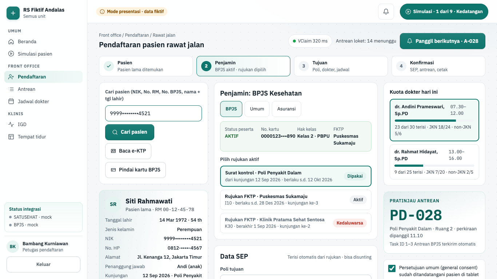
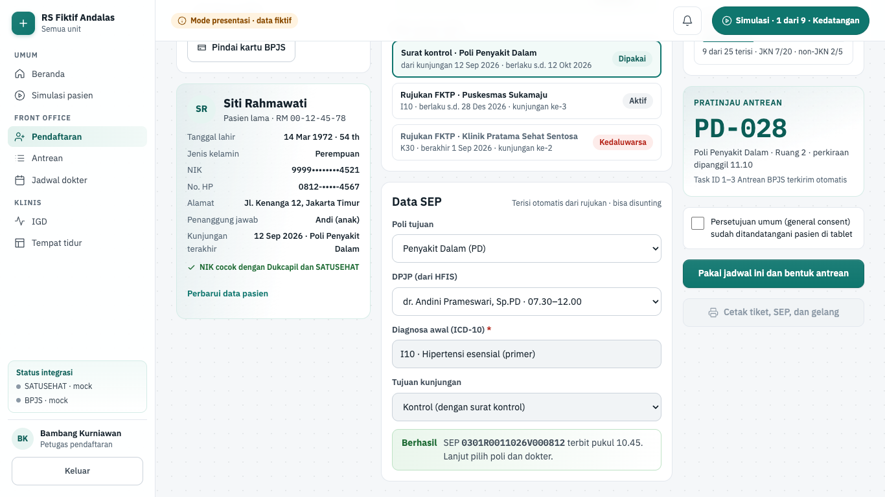
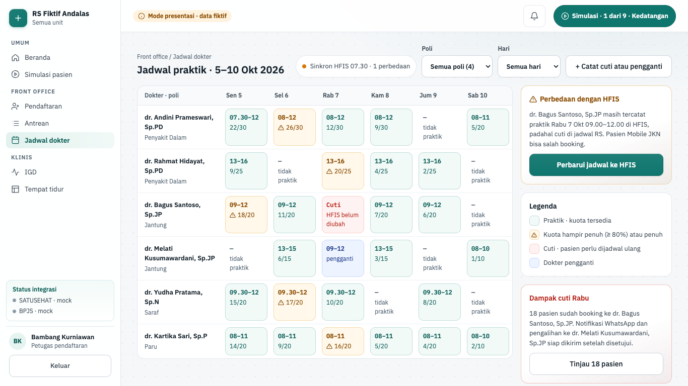
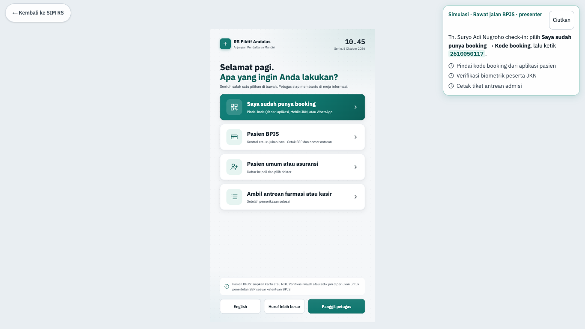
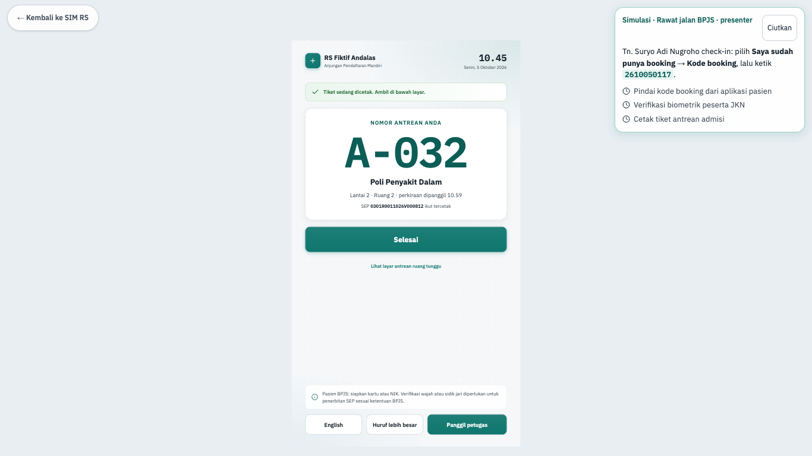
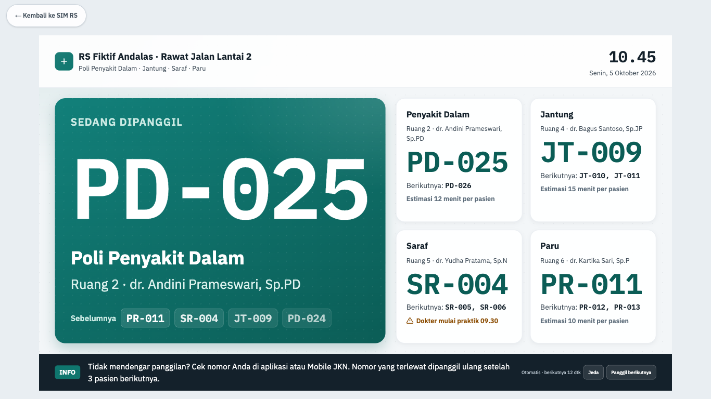
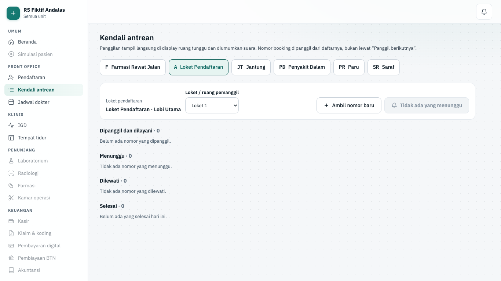

# Fitur front office

Halaman ini menjelaskan layar front office fase 2: jadwal dokter, anjungan mandiri, kendali antrean, pendaftaran + SEP, dan display TV. Setiap layar punya dua mode: mode presentasi (data dummy fiktif) dan mode api (tersambung ke backend). Cara kerja di balik layar ada di [Cara kode bekerja](./02-cara-kerja-kode.md); halaman ini meringkas dan menautkannya.

> Status 6 Okt 2026: fase 2 selesai (5 Okt 2026, 4/4 kriteria). Backend F01–F08 tersambung; rantai anjungan → loket → SEP → display → task ID 1–3 dan pendaftaran saat BPJS mati diuji E2E dengan mock. Booking (F02) belum punya layar web sendiri: booking dibuat lewat API `/api/v1/booking/appointments` atau otomatis saat walk-in didaftarkan.

## Ringkasan layar

| Layar            | Rute               | Peran                                                                              | Komponen | Status                     |
| ---------------- | ------------------ | ---------------------------------------------------------------------------------- | -------- | -------------------------- |
| Pendaftaran      | `/pendaftaran`     | petugas_pendaftaran                                                                | F03, F06 | hibrida (presentasi + api) |
| Jadwal dokter    | `/jadwal`          | petugas_pendaftaran, admin_tenant (ubah); dokter, perawat, bidan, manajemen (baca) | F01      | hibrida (presentasi + api) |
| Anjungan mandiri | `/kiosk`           | perangkat anjungan terdaftar                                                       | F05      | hibrida (presentasi + api) |
| Display antrean  | `/display/antrean` | perangkat TV terdaftar                                                             | F04      | hibrida (presentasi + api) |
| Kendali antrean  | `/antrean`         | petugas_pendaftaran, klinisi poli (panggil); admin_tenant (lihat)                  | F04      | api saja                   |

Registri layar ada di `apps/web/src/lib/screens.ts` (id `daftar`, `jadwal`, `kiosk`, `antrean`, `kendali`). Empat layar pertama berstatus `demo` dengan `permission`, artinya hibrida: `requireScreen(id)` memilih jalurnya.

- **Mode presentasi** hidup hanya bila `APP_ENV=local` dan `DATA_SOURCE=demo` (`pnpm dev:demo`). Layar memakai data dummy dari `apps/web/src/lib/demo/fixtures/`, dibuka dengan login staf sesuai posisi pemakai, dan ikut skenario rawat jalan Simulasi pasien. Jalur ini dibekukan di `demo-*.tsx` (ditambah `actions-demo.ts` untuk Pendaftaran dan Jadwal).
- **Mode api** berlaku di semua lingkungan lain. Layar staf memeriksa sesi + izin sungguhan (tanpa izin: "Akses ditolak"). Anjungan dan TV dibuka **perangkat terdaftar**, bukan akun staf. Data per layar lewat `apps/web/src/lib/server/data/front-office/`.

Rincian: [Mode presentasi dan data dummy](./02-cara-kerja-kode.md#mode-presentasi-dan-data-dummy-adr-0023) dan [Front office: perjalanan pasien rawat jalan](./01-cara-kerja-sistem.md#front-office-perjalanan-pasien-rawat-jalan-fase-2).

## Pendaftaran

| Hal      | Isi                                                                                                                                                          |
| -------- | ------------------------------------------------------------------------------------------------------------------------------------------------------------ |
| Rute     | `/pendaftaran` · hasil `/pendaftaran?kunjungan=<id>` · cetak `/cetak/pendaftaran/[encounterId]`                                                              |
| Pemakai  | petugas_pendaftaran (izin layar `encounter.write`; panggil loket `queue.call`; kirim ulang SEP `coverage.write`; cetak `documents.print`)                    |
| Komponen | F03, F06                                                                                                                                                     |
| Status   | hibrida: presentasi + api (tersambung)                                                                                                                       |
| Mockup   | `design/mockups/Registrasi.dc.html`                                                                                                                          |
| Kode web | `apps/web/src/app/(staf)/pendaftaran/` (api: `api-pendaftaran.tsx`, `pendaftaran-api-client.tsx`, `actions-api.ts`) · `apps/web/src/lib/registration-api.ts` |
| Kode API | `apps/api/src/modules/registration/` · `apps/api/src/modules/sep/` · `apps/api/src/modules/queue/` · worker `apps/worker/src/outbox/sep.ts`                  |

**Tujuan.** Petugas loket mendaftarkan kunjungan rawat jalan: pasien, penjamin, dokter tujuan, persetujuan umum, lalu SEP untuk pasien BPJS. SEP dikirim ke BPJS lewat outbox, jadi pendaftaran tidak menunggu BPJS.

**Alur.**

1. Di grup **Antrean loket** di header, pilih **Loket pemanggil**, lalu **Panggil berikutnya · A-0xx**. Tiket itu ditautkan ke pendaftaran (task 2).
2. Ikuti stepper **Pasien → Penjamin → Tujuan → Konfirmasi**. Tombol utama menjelaskan langkah yang belum lengkap.
3. Isi **Cari pasien (NIK, No. RM, No. BPJS, atau nama)** → **Cari pasien**. Cari dengan no. kartu BPJS (13 digit) atau NIK (16 digit) yang cocok dengan satu pasien langsung membuka pasien itu dan mengisi no. kartu untuk cek kepesertaan. Pencarian lain tampil sebagai daftar; pilih pasiennya.
4. Pasien baru: **Pasien baru** → isi **NIK** → **Ambil data Dukcapil** ("Terisi dari Dukcapil") → **Periksa duplikat dan simpan pasien**. Bila muncul **Kemungkinan duplikat**, pilih **Pakai pasien ini**.
5. Pilih penjamin: **BPJS**, **Umum**, atau **Asuransi**. Pasien tanpa no. kartu BPJS otomatis umum (tombol BPJS nonaktif).
6. BPJS: isi **No. kartu BPJS atau NIK** → **Cek kepesertaan** (status, no. kartu tersamar, hak kelas). Pilih rujukan aktif; rujukan kedaluwarsa tidak bisa dipilih. **Diagnosa awal (ICD-10)** terisi dari rujukan.
7. VClaim tidak terjangkau: layar menulis "VClaim tidak terjangkau" dan mencentang **Isi nomor rujukan / surat kontrol manual**. Isi **No. rujukan / surat kontrol** dan diagnosa awal.
8. Di **Tujuan dan kuota dokter hari ini**, pilih dokter. Dokter dengan kuota penuh tidak bisa dipilih.
9. **Penanggung jawab**: pilih yang ada atau **Tambah penanggung jawab baru** (**Nama penanggung jawab**, **No. HP (opsional)**).
10. Centang **Persetujuan umum sudah ditandatangani…** dan pilih **Ditandatangani oleh** (Pasien atau Wali / keluarga + **Nama wali**). Bila sudah ada, layar menulis "Persetujuan umum rawat jalan berlaku".
11. Tekan **Daftarkan dan terbitkan SEP** (BPJS) atau **Daftarkan** (umum/asuransi).
12. Layar hasil **Pendaftaran rawat jalan selesai**: "Terdaftar pukul HH.MM · RJ-YYMM-NNNNNN", nomor poli (mis. PD-0xx), dan bagian **Status SEP dan Antrean BPJS**.
13. Pantau chip SEP: **SEP menunggu BPJS**, **SEP terbit**, **SEP ditolak BPJS** (alasan baku + kode), atau **SEP gagal dikirim**. Untuk dua yang terakhir tekan **Kirim ulang SEP**. Daftar **Task ID 1–3** menulis status kirim tiap task.
14. **Cetak tiket dan SEP** (atau **Cetak tiket**) membuka lembar 80 mm di tab baru. **Pasien berikutnya** kembali ke meja kosong.

**Gerbang keselamatan dan aturan bisnis.**

- Saat BPJS mati, kunjungan tetap tercatat dan nomor poli terbit. SEP berstatus menunggu ("Pasien tetap boleh ke poli") dan worker mencoba ulang sampai terbit atau ditolak.
- SEP tidak pernah terbit dua kali: jawaban SEP ganda dicocokkan ke histori pelayanan. SEP terbit beku; revisi = versi baru beralasan.
- Teks asli penolakan BPJS tidak pernah tampil; layar memakai pesan baku dari kode galat.
- Persetujuan umum wajib sebelum mendaftar (`GENERAL_CONSENT_REQUIRED`); untuk rawat jalan cukup sekali sampai dicabut.
- Satu kunjungan aktif per booking (`ENCOUNTER_DUPLICATE`). Kuota tidak bisa terlampaui (`QUOTA_FULL`).
- Kirim dobel aman: klien memakai `Idempotency-Key` yang sama selama isi sama; isi berbeda dengan kunci sama ditolak `409`.
- NIK dan no. kartu selalu di body, tidak di URL. Identitas tampil tersamar; lembar cetak tidak memuat no. kartu utuh. Setiap cetak diaudit `print`.
- Halaman hasil memuat ulang sendiri tiap 3 detik (20 detik setelah 5 menit) sampai SEP dan task selesai.

Rincian: [Registrasi rawat jalan dan SEP](./02-cara-kerja-kode.md#registrasi-rawat-jalan-dan-sep-f03-f06-fase-2-potongan-5a) dan [Integrasi lewat outbox](./01-cara-kerja-sistem.md#integrasi-lewat-outbox).

**Mode presentasi.** Data pasien, kepesertaan, rujukan, dan SEP berasal dari fixture; tidak ada panggilan ke BPJS atau API registrasi. Urutan tombolnya mengikuti mockup: **Terbitkan SEP dan daftarkan** → **Pakai jadwal ini dan bentuk antrean** → **Kirim antrean dan selesaikan** → **Cetak tiket, SEP, dan gelang**. Pasien skenario (Tn. Suryo) muncul setelah dipanggil dari nomor loket anjungan.

## Jadwal dokter

| Hal      | Isi                                                                                                                                            |
| -------- | ---------------------------------------------------------------------------------------------------------------------------------------------- |
| Rute     | `/jadwal` (`?minggu=YYYY-MM-DD`, `?pilih=<id sel>`)                                                                                            |
| Pemakai  | `schedule.read` untuk melihat; `schedule.write` (kuota, cuti) dan `schedule.sync` (HFIS) untuk petugas_pendaftaran dan admin_tenant            |
| Komponen | F01                                                                                                                                            |
| Status   | hibrida: presentasi + api (tersambung)                                                                                                         |
| Mockup   | `design/mockups/Jadwal.dc.html`                                                                                                                |
| Kode web | `apps/web/src/app/(staf)/jadwal/` (api: `api-jadwal.tsx`, `jadwal-api-client.tsx`, `actions-api.ts`) · `apps/web/src/components/front-office/` |
| Kode API | `apps/api/src/modules/scheduling/` · worker `apps/worker/src/outbox/hfis.ts`, `schedule-changed.ts`, `jobs/scheduling-jobs.ts`                 |

**Tujuan.** Melihat jadwal praktik dan kuota per dokter per minggu, mengubah kuota, mencatat cuti dan pengganti, serta menyelaraskan jadwal dengan HFIS BPJS.

**Alur.**

1. Judul **Jadwal praktik · <rentang minggu>**. Pindah minggu lewat **← Minggu sebelumnya**, **Minggu ini**, **Minggu berikutnya →**.
2. Saring dengan **Poli** dan **Hari**. Chip status menulis keadaan sinkron HFIS.
3. Klik sel dokter × hari. Panel **Detail slot jadwal** menampilkan booking dan kuota.
4. Ubah kuota dengan **Tambah kuota JKN**, **Kurangi kuota non-JKN**, dan tombol sejenis, lalu **Simpan kuota**.
5. Cuti: **+ Catat cuti atau pengganti** → pilih **Dokter**, **Hari praktik**, **Dokter pengganti** (atau **Tanpa pengganti · pasien dijadwal ulang**), isi **Alasan cuti** → **Catat cuti**.
6. Panel **Dampak cuti** menghitung pasien yang sudah booking. **Tinjau N pasien** → **Setujui pengalihan dan kirim notifikasi**.
7. HFIS: **Tarik dari HFIS** membaca jadwal BPJS untuk panel perbedaan. **Perbarui jadwal ke HFIS** mengantrekan jadwal ke outbox.

**Gerbang keselamatan dan aturan bisnis.**

- Kuota tidak pernah di bawah jumlah booking (`409 QUOTA_BELOW_BOOKED`, juga CHECK database).
- Perubahan berversi: sesi yang diubah petugas lain ditolak "Sesi sudah diubah petugas lain. Muat ulang lalu ulangi."
- Cuti hanya untuk sesi praktik hari ini atau ke depan. Pengganti harus dokter lain yang praktik di poli yang sama.
- Pengalihan memindahkan semua booking atau tidak sama sekali (`409 QUOTA_FULL`). Kode booking dan nomor antrean tetap.
- WhatsApp ke pasien berisi RS, tanggal, jam, dan kode booking saja (tanpa poli/dokter), dikirim lewat outbox.
- Cuti per tanggal dan kapasitas tidak bisa dikirim lewat web service HFIS: catat di aplikasi HFIS, lalu tarik ulang.
- Sesi praktik dibangkitkan job malam dari templat untuk 30 hari ke depan (`booking.max_days_ahead`).
- Dokter hanya melihat: tanpa tombol cuti dan HFIS ("Pengiriman ke HFIS dilakukan petugas pendaftaran atau admin.").

Rincian: [Front office, skema](./02-cara-kerja-kode.md#front-office-fase-2-skema-potongan-0b) dan [Booking](./02-cara-kerja-kode.md#booking-f02-fase-2-potongan-3).

**Mode presentasi.** Minggu demo tetap (5–10 Okt 2026) dari fixture. Simpan kuota dan kirim HFIS hanya mengubah tampilan ("simulasi"), tanpa outbox. Posisi pemakai: petugas pendaftaran, dokter, manajemen.

## Anjungan mandiri

| Hal      | Isi                                                                                                                                                                   |
| -------- | --------------------------------------------------------------------------------------------------------------------------------------------------------------------- |
| Rute     | `/kiosk` (tanpa cookie perangkat dialihkan ke `/perangkat/daftar`)                                                                                                    |
| Pemakai  | perangkat anjungan terdaftar (izin tetap `kiosk.use`); pasien menyentuh layar                                                                                         |
| Komponen | F05                                                                                                                                                                   |
| Status   | hibrida: presentasi + api (tersambung)                                                                                                                                |
| Mockup   | `design/mockups/Anjungan.dc.html`                                                                                                                                     |
| Kode web | `apps/web/src/app/(perangkat)/kiosk/` (api: `live-kiosk-client.tsx`, `actions.ts`) · `apps/web/src/components/front-office/kiosk-*.tsx` · `apps/web/src/lib/kiosk.ts` |
| Kode API | `apps/api/src/modules/kiosk/` · `apps/api/src/modules/devices/`                                                                                                       |

**Tujuan.** Pasien check-in booking, mendaftar sendiri ke poli, atau mengambil nomor antrean tanpa antre di loket. Hal yang butuh petugas diarahkan ke loket dengan nomor antrean.

**Alur.**

1. Layar awal **Apa yang ingin Anda lakukan?**. Pilih **Saya sudah punya booking**, **Pasien BPJS**, **Pasien umum atau asuransi**, atau **Ambil antrean farmasi atau kasir**.
2. Pilih cara identifikasi: **NIK e-KTP** (16 digit), **Kode booking** (10 digit), atau **Nomor kartu BPJS** (13 digit). Ketik lewat keypad, lalu **Lanjut**.
3. **Masukkan tanggal dan bulan lahir** (DDMM, mis. 1403 untuk 14 Maret) → **Lanjut**.
4. Layar **Apakah ini data Anda?** menampilkan nama tersamar dan tanggal lahir tanpa tahun saja.
5. Benarkan dengan tombol yang sesuai: **Ya, data saya benar · check-in** (booking hari ini), **· daftar ke poli** (BPJS dengan booking hari ini), **· pilih dokter** (umum), atau **· ambil nomor loket**.
6. Pasien umum memilih dokter di **Pilih dokter** (sesi hari ini, "Tersedia" atau "Kuota penuh").
7. Farmasi/kasir: pilih **Antrean farmasi** atau **Antrean kasir**.
8. Tiket tampil di **Tiket antrean** dan dicetak. **Selesai** kembali ke layar awal.
9. Data tidak ditemukan: layar **Petugas loket siap membantu** → **Ambil nomor antrean loket pendaftaran**.
10. Kapan saja: **Panggil petugas** mengirim notifikasi ke petugas pendaftaran. **Huruf lebih besar** memperbesar teks.

**Gerbang keselamatan dan aturan bisnis.**

- Dua faktor: nomor identitas **dan** tanggal + bulan lahir. Salah DDMM dijawab sama dengan tidak ditemukan; NIK ganda juga dianggap tidak ditemukan.
- Tidak ada RM, NIK, atau nama utuh di layar. Token identifikasi `kl1` berumur 180 detik, sekali pakai, dan hanya untuk perangkat yang sama.
- Batas per perangkat: pencarian per menit (`kiosk.lookup_rate_per_min`), tiket loket tanpa identitas 6 per menit, **Panggil petugas** sekali per 60 detik. Pelanggaran tetap tercatat audit.
- Registrasi mandiri memakai ulang alur pendaftaran loket (kunjungan, penjaminan, SEP lewat outbox, task 3). BPJS butuh booking JKN hari ini + rujukan/surat kontrol tercatat; persetujuan umum harus sudah ada. Selain itu API menjawab `KIOSK_NEEDS_COUNTER` dan layar menawarkan nomor loket.
- Sentuhan ganda aman: `Idempotency-Key` yang sama menghasilkan tiket yang sama. Sudah check-in → tiket loketnya dicetak ulang.
- Layar kembali ke awal setelah 90 detik tanpa sentuhan. Target sentuh ≥ 64 px.
- Tiket dicetak dari HTML 80 mm buatan API (tanpa skrip). Printer tidak merespons: layar meminta pasien mencatat nomornya.

Rincian: [Anjungan mandiri](./02-cara-kerja-kode.md#anjungan-mandiri-f05) dan [Prinsipal perangkat](./02-cara-kerja-kode.md#prinsipal-perangkat-anjungan-dan-display-adr-0027).

**Mode presentasi.** Dibuka dengan login staf (posisi petugas pendaftaran), tanggal tetap Senin, 5 Oktober 2026, dengan panel **Petunjuk presenter**. Ada langkah biometrik tiruan (**Pengenalan wajah** atau **Sidik jari**) dan tombol **Ya, data saya benar · cetak tiket**; mode api belum punya langkah biometrik. Kode booking skenario menjalankan langkah Tn. Suryo di Simulasi pasien.

## Display antrean

| Hal      | Isi                                                                                                                                                                       |
| -------- | ------------------------------------------------------------------------------------------------------------------------------------------------------------------------- |
| Rute     | `/display/antrean` (tanpa cookie perangkat dialihkan ke `/perangkat/daftar`) · BFF SSE `/display/antrean/events`                                                          |
| Pemakai  | perangkat TV terdaftar yang terikat ke satu papan display (izin tetap `queue.display.read`)                                                                               |
| Komponen | F04                                                                                                                                                                       |
| Status   | hibrida: presentasi + api (tersambung)                                                                                                                                    |
| Mockup   | `design/mockups/DisplayAntrean.dc.html`                                                                                                                                   |
| Kode web | `apps/web/src/app/(perangkat)/display/antrean/` (api: `live-antrean-client.tsx`, `events/route.ts`) · `apps/web/src/lib/queue-board.ts` · `apps/web/src/lib/queue-sse.ts` |
| Kode API | `apps/api/src/modules/queue/` (`queue-display.controller.ts`, `queue-calls.channel.ts`)                                                                                   |

**Tujuan.** TV ruang tunggu menampilkan dan mengumumkan nomor yang dipanggil secara langsung, tanpa dimuat ulang.

**Alur.**

1. Admin mendaftarkan TV di [Perangkat anjungan dan display](./10-fitur-platform.md#perangkat-anjungan-dan-display), lalu kode diketik di TV.
2. TV membuka papan display miliknya. Judul memuat nama papan (mis. lantai rawat jalan).
3. Petugas menekan **Aktifkan suara** sekali di TV. Panggilan diumumkan dengan nada + suara berbahasa Indonesia. **Matikan suara** menghentikannya.
4. Panel **Sedang dipanggil** berubah setiap ada panggilan dari Kendali antrean. **Antrean per poli** menampilkan maksimal 4 poli.
5. Status sambungan di grup **Kontrol perangkat**: **Menyambung…**, **Tersambung**, atau **Terputus · menyambung ulang**.

**Gerbang keselamatan dan aturan bisnis.**

- Papan ditentukan dari ikatan perangkat (`queue_display_id`), bukan parameter URL. TV tidak bisa membaca papan display lain.
- TV tanpa ikatan papan menampilkan "Perangkat ini belum diikat ke papan antrean…". Papan tanpa layanan poli aktif menampilkan sebabnya.
- Event SSE hanya membawa ID dari database; isi dibaca ulang di bawah RLS tenant TV. Putus sambung → replay dari `Last-Event-ID`; terlalu banyak event → potret papan baru.
- Papan hanya memuat nomor antrean, poli, ruang, dan nama dokter; tanpa nama pasien (skema ketat `queueBoardSchema`).

Rincian: [Antrean dan task ID BPJS](./02-cara-kerja-kode.md#antrean-dan-task-id-bpjs-f04) dan [Lookup sinkron, SSE, dan event domain](./02-cara-kerja-kode.md#lookup-sinkron-sse-dan-event-domain-fase-2).

**Mode presentasi.** Dibuka dengan login staf. Panggilan berjalan otomatis dari fixture ("Otomatis · berikutnya N dtk"), dengan tombol **Jeda** / **Lanjut** dan **Panggil berikutnya** manual di grup **Kontrol presentasi**. Tidak ada SSE.

## Kendali antrean

| Hal      | Isi                                                                                                                                    |
| -------- | -------------------------------------------------------------------------------------------------------------------------------------- |
| Rute     | `/antrean` (`?layanan=<id>`)                                                                                                           |
| Pemakai  | `queue.read` untuk melihat; `queue.call` untuk tombol aksi (petugas_pendaftaran semua layanan; dokter, perawat, bidan layanan unitnya) |
| Komponen | F04                                                                                                                                    |
| Status   | api saja (tersambung)                                                                                                                  |
| Mockup   | — (keputusan fase 2 #5)                                                                                                                |
| Kode web | `apps/web/src/app/(staf)/antrean/`                                                                                                     |
| Kode API | `apps/api/src/modules/queue/` (`bpjs-task.engine.ts` untuk task ID) · worker `apps/worker/src/outbox/bpjs-antrean.ts`                  |

**Tujuan.** Petugas loket dan poli memanggil nomor antrean. Panggilan langsung tampil di TV dan menggerakkan task ID Antrean BPJS.

**Alur.**

1. Pilih layanan di navigasi **Layanan antrean** (bawaan: loket pendaftaran).
2. Di panel **Panggilan**, pilih **Loket / ruang pemanggil**.
3. **Ambil nomor baru** menerbitkan tiket untuk layanan terpilih ("Nomor <nomor> diterbitkan").
4. **Panggil berikutnya · <nomor>** memanggil tiket menunggu paling awal ("<nomor> dipanggil ke <loket>").
5. Kelola tiap tiket di bagian **Dipanggil dan dilayani**, **Menunggu**, **Dilewati**, dan **Selesai**: **Panggil**, **Panggil ulang**, **Mulai layani**, **Lewati**, **Selesai**.
6. Nomor dari booking dipanggil dari daftarnya, bukan lewat **Panggil berikutnya**.

**Gerbang keselamatan dan aturan bisnis.**

- Dua loket tidak bisa memanggil tiket yang sama (`SKIP LOCKED`). Antrean kosong → `409 QUEUE_EMPTY`; transisi salah → `409 TICKET_STATE_INVALID`.
- Setiap aksi ditulis ke `queue_calls` (append-only) dan menerbitkan event domain. Tiket bertaut pasien diaudit.
- Task ID BPJS digerakkan event, bukan tombol: panggilan pertama tiket loket = task 2, poli mulai/selesai = task 4/5. Task dikirim berurutan lewat outbox.
- Klinisi berlingkup unit hanya melihat dan memanggil layanan unitnya; penolakan tercatat `access_denied`.
- Tanpa `queue.call` tombol tidak tampil ("Peran Anda hanya dapat melihat antrean…"). Tanpa `queue.read`: "Akses ditolak" dan menu tersembunyi.
- Daftar diperbarui setiap aksi dan tiap 15 detik. Tanpa layanan aktif: "Belum ada layanan antrean".

Rincian: [Antrean dan task ID BPJS](./02-cara-kerja-kode.md#antrean-dan-task-id-bpjs-f04).

**Mode api.** Layar ini hanya ada di mode api (`apiOnly` di registri). Di mode presentasi menunya tersembunyi dan rutenya `404`; pemanggilan dummy dilakukan dari layar Pendaftaran dan Display antrean.

## Tes yang menjaga layar ini

| Layar            | E2E mode api (`apps/web/e2e/`)                                                        | E2E presentasi                                     | Tes lain                                                                                                                                                           |
| ---------------- | ------------------------------------------------------------------------------------- | -------------------------------------------------- | ------------------------------------------------------------------------------------------------------------------------------------------------------------------ |
| Pendaftaran      | `pendaftaran.spec.ts`, `dod-anjungan.spec.ts`, `downtime-bpjs.spec.ts`                | `demo/front-office.spec.ts`                        | `apps/api/test/registration.test.ts`, `admission.test.ts`, `referrals.test.ts`, `apps/worker/test/sep-outbox.test.ts`, `apps/web/src/lib/registration-api.test.ts` |
| Jadwal dokter    | `jadwal.spec.ts`                                                                      | `demo/front-office.spec.ts`                        | `apps/api/test/scheduling.test.ts`, `scheduling-view.test.ts`, `apps/worker/test/scheduling.test.ts`, `apps/web/src/lib/jadwal-api.test.ts`                        |
| Anjungan mandiri | `kiosk.spec.ts`, `dod-anjungan.spec.ts`, `downtime-bpjs.spec.ts`, `perangkat.spec.ts` | `demo/front-office.spec.ts`                        | `apps/api/test/kiosk.test.ts`, `device-principals.test.ts`, `apps/web/src/lib/kiosk.test.ts`                                                                       |
| Display antrean  | `antrean.spec.ts`, `dod-anjungan.spec.ts`, `perangkat.spec.ts`                        | `demo/front-office.spec.ts`                        | `apps/api/test/queue.test.ts`, `realtime-sse.test.ts`, `apps/web/src/lib/queue-board.test.ts`                                                                      |
| Kendali antrean  | `antrean.spec.ts`, `kiosk.spec.ts`, `dod-anjungan.spec.ts`                            | — (`smoke.spec.ts` memeriksa 404 di luar mode api) | `apps/api/test/queue.test.ts`, `apps/worker/test/bpjs-antrean.test.ts`                                                                                             |

Semua layar hibrida juga dijaga `smoke.spec.ts` (tanpa izin → "Akses ditolak"; anjungan/TV tanpa perangkat → pendaftaran perangkat). Mock BPJS dan aturan stack E2E: [Strategi tes](./02-cara-kerja-kode.md#strategi-tes).

## Lihat juga

- [Cara sistem bekerja](./01-cara-kerja-sistem.md): [Front office](./01-cara-kerja-sistem.md#front-office-perjalanan-pasien-rawat-jalan-fase-2), [Integrasi lewat outbox](./01-cara-kerja-sistem.md#integrasi-lewat-outbox), [Mock dan data fiktif](./01-cara-kerja-sistem.md#mock-dan-data-fiktif)
- [Cara kode bekerja](./02-cara-kerja-kode.md): [Gateway informasi publik](./02-cara-kerja-kode.md#gateway-informasi-publik-f08), [Booking](./02-cara-kerja-kode.md#booking-f02-fase-2-potongan-3)
- [Fitur platform](./10-fitur-platform.md)
- [Fitur klinis](./12-fitur-klinis.md)
- [Simulasi dan operasional](./18-simulasi-dan-operasional.md)
- [Peta kode](./19-peta-kode.md)
