# Fitur klinis (RME)

Halaman ini menjelaskan tujuh belas layar rekam medis elektronik (lapisan K). Tujuh layar inti: pemeriksaan poli, CPOE,
IGD, tempat tidur, rawat inap dengan CPPT dan eMAR, resume medis, dan tablet persetujuan tindakan. Sepuluh layar
bagan RME per pasien (FE2): worklist, CPPT dan serah terima, asesmen, diagnosis, konsultasi, edukasi, asuhan
keperawatan, ringkasan pasien, paket layanan khusus, dan kelengkapan rekam medis. Setiap layar memuat gerbang
keselamatan yang tidak bisa dilewati diam-diam (CLAUDE.md §4.9) dan mengikuti pola rekam medis immutable: koreksi
menjadi versi baru, data final terkunci, perubahan sesudah TTE lewat addendum.

> Status 7 Okt 2026: ketujuh layar berjalan di mode presentasi dengan data fiktif (`pnpm dev:demo`). Di mode api
> semuanya masih "Belum tersambung" (potongan W1–W5b, dikerjakan agen backend mulai 7 Okt 2026). Backend yang sudah
> ada: infrastruktur entri klinis (3.1), diagnosis, tanda vital, hasil, ringkasan (3.2a), CPPT + co-sign + worklist
> (3.2b), ADT, papan bed, triase, gelang, Aplicare (3.3), CPOE + CDS + resep (3.4), dan eMAR + asuhan keperawatan
> (3.5). Resume (3.6) dan persetujuan tindakan (3.7) belum. Sepuluh layar bagan RME (FE2) berstatus `demo` saja:
> hanya ada di mode presentasi dan belum hibrida. API worklist, CPPT, asesmen, diagnosis, ringkasan, dan askep/eMAR
> untuk layar itu sudah ada; konsultasi, edukasi, paket layanan, dan gerbang tutup kunjungan belum (3.6–3.8). Cara
> kerja API klinis: [Cara kerja backend](./07-cara-kerja-backend.md).

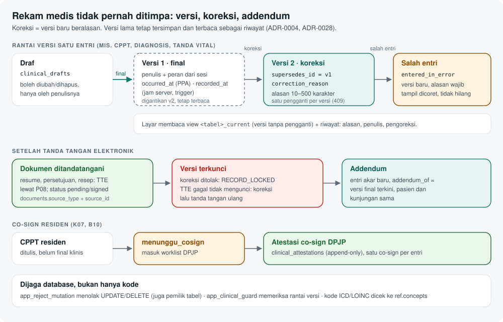

Posisi layar-layar ini dalam perjalanan pasien rawat jalan:

Konsep dasarnya ada di [Cara sistem bekerja](./01-cara-kerja-sistem.md#rekam-medis-dan-jejak-audit). Cara mode
presentasi dan simulasi pasien dibawakan ada di [Simulasi dan operasional](./18-simulasi-dan-operasional.md).

Sepuluh layar bagan RME memakai pola bersama di `apps/web/src/components/rme/` dan `apps/web/src/lib/rme.ts`:

- **`RmeChartHeader`** (`chart-header.tsx`): remah "Klinis / Rekam medis / <judul>", judul "<judul> · <nama pasien>",
  pemilih **Pasien** (`patient-picker.tsx`, dikelompokkan Rawat inap, Rawat jalan, Kamar bersalin), banner pasien
  wajib (nama, umur, RM, alergi, penjamin, DPJP), chip konteks kunjungan (setting, lokasi, hari rawat, tanggal mulai),
  dan navigasi bagan Ringkasan, CPPT & serah terima, Asesmen, Diagnosis, Konsultasi, Edukasi, Asuhan keperawatan, dan
  Kelengkapan RM. Navigasi hanya memuat layar yang terbuka untuk posisi (`chartLinks`) dan membawa `?pasien=`.
- **Pasien dari URL**: `rmeChartFor` (`apps/web/src/lib/server/data/klinis/rme.ts`) membaca `?pasien=<encounterId>`.
  Kosong = pasien bawaan Ny. Endang Wijaya (Bangsal Melati M-203, pulang hari ini); id tak dikenal = 404. Fixture ada di
  `apps/web/src/lib/demo/fixtures/rme-*.ts`; pasien rawat inap diambil dari fixture Rawat inap, pasien skenario
  Simulasi tidak ikut.
- **`Feedback` dan `ReasonField`** (`feedback.tsx`): umpan balik berjam yang berakhiran "(simulasi, tidak disimpan)",
  dan isian alasan wajib dengan hitungan "Wajib minimal 10 karakter · N karakter lagi." (`hasReason`, minimal 10).
- **Aturan murni** per layar di `apps/web/src/lib/rme-<layar>.ts` dengan tes `rme-<layar>.test.ts`.
- **Keadaan hanya di browser**: tidak ada Server Action, sehingga gerbang hanya ditegakkan di klien. Memuat ulang
  halaman mengembalikan keadaan awal, dan aksi di satu layar (mis. co-sign di worklist) tidak terlihat di layar lain.

## Ringkasan layar

| Layar                      | Rute                         | Peran (mode presentasi)                              | Komponen      | Status                                           |
| -------------------------- | ---------------------------- | ---------------------------------------------------- | ------------- | ------------------------------------------------ |
| Pemeriksaan poli           | `/klinis/poli`               | dokter, dokter residen, perawat, bidan               | K01, K02      | 🟨 demo; API worklist, CPPT, diagnosis ada       |
| Order dan resep (CPOE)     | `/klinis/order`              | dokter, dokter residen                               | K09           | 🟨 demo; API CPOE + CDS ada (3.4)                |
| IGD                        | `/klinis/igd`                | dokter, dokter residen, perawat, petugas pendaftaran | K03           | 🟨 demo; API triase + papan IGD ada (3.3)        |
| Tempat tidur               | `/klinis/tempat-tidur`       | perawat, petugas pendaftaran, manajemen              | K05           | 🟨 demo; API ADT + papan bed ada (3.3)           |
| Rawat inap                 | `/klinis/rawat-inap`         | dokter, dokter residen, perawat, bidan               | K04, K07, K12 | 🟨 demo; API CPPT + eMAR ada (3.5); W4 belum     |
| Resume medis               | `/klinis/resume`             | dokter, dokter residen                               | K13           | 🟨 demo; API belum (3.6)                         |
| Persetujuan tindakan       | `/tablet/persetujuan`        | dokter, perawat                                      | K11           | 🟨 demo; API belum (3.7, modul kerangka)         |
| Worklist klinis            | `/klinis/worklist`           | dokter, dokter residen, perawat, bidan               | K01           | 🟨 demo; API worklist ada (3.2b)                 |
| CPPT & serah terima        | `/klinis/cppt`               | dokter, dokter residen, perawat, bidan, apoteker     | K07           | 🟨 demo; API CPPT ada (3.2b)                     |
| Asesmen & skrining         | `/klinis/asesmen`            | dokter, dokter residen, perawat, bidan               | K06           | 🟨 demo; API asesmen + formulir ada              |
| Diagnosis & problem list   | `/klinis/diagnosis`          | dokter, dokter residen, perawat, bidan               | K08           | 🟨 demo; API diagnosis ada (3.2a)                |
| Konsultasi & rawat bersama | `/klinis/konsultasi`         | dokter, dokter residen                               | K10           | 🟨 demo; API belum (3.8, modul kerangka)         |
| Edukasi pasien             | `/klinis/edukasi`            | dokter, dokter residen, perawat, bidan               | K11           | 🟨 demo; API belum (3.7)                         |
| Asuhan keperawatan         | `/klinis/asuhan-keperawatan` | perawat, bidan                                       | K12           | 🟨 demo; API eMAR + askep ada (3.5); layar belum |
| Ringkasan pasien           | `/klinis/ringkasan`          | dokter, dokter residen, perawat, bidan               | K14           | 🟨 demo; API ringkasan ada (3.2a)                |
| Paket layanan khusus       | `/klinis/paket-layanan`      | dokter, perawat, bidan                               | K15           | 🟨 demo; API belum (3.8, modul kerangka)         |
| Kelengkapan rekam medis    | `/klinis/kelengkapan`        | dokter, dokter residen, petugas rekam medis          | K13           | 🟨 demo; API belum (3.6, 3.8)                    |

Legenda: 🟨 berjalan di mode presentasi, belum tersambung ke API · ✅ tersambung · ⬜ belum dibangun.

Tujuh layar inti di atas adalah layar hibrida (`requireScreen`): mode presentasi memakai jalur `demo-*.tsx` yang
dibekukan, mode api memeriksa `ScreenDef.permission` lalu menampilkan "Akses ditolak" atau "Belum tersambung".
Server Action mode presentasi (`actions-demo.ts`) memeriksa ulang posisi, kontrak zod, dan gerbang keselamatan,
tetapi tidak menyimpan apa pun. Umpan baliknya berakhiran "(simulasi, tidak disimpan)".

Sepuluh layar bagan RME memakai `requireDemoScreen`: di mode api rutenya 404 dan menunya redup. Di mode presentasi
posisi di luar `demoRoles` melihat "Layar ini untuk posisi lain". Bagian **Rencana backend** di tiap layar menyebut
izin rencana (`plannedPermission` di `screens.ts`) dan modul API yang menunggu disambung.

## Pemeriksaan poli

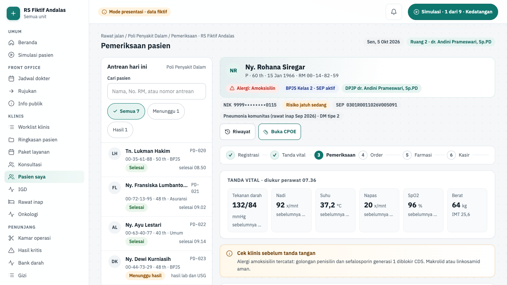

| Hal      | Isi                                                                                                                                                                                                  |
| -------- | ---------------------------------------------------------------------------------------------------------------------------------------------------------------------------------------------------- |
| Rute     | `/klinis/poli` (`?pasien=<id>` = kunjungan yang dibuka)                                                                                                                                              |
| Pemakai  | dokter, dokter residen, perawat, bidan                                                                                                                                                               |
| Komponen | K01 worklist klinis, K02 rawat jalan                                                                                                                                                                 |
| Status   | demo (mode presentasi); API worklist, CPPT, diagnosis, tanda vital, dan ringkasan pasien ada, layar belum disambung (W1)                                                                             |
| Mockup   | `design/mockups/Main.dc.html`                                                                                                                                                                        |
| Kode web | `apps/web/src/app/(staf)/klinis/poli/` · `apps/web/src/components/klinis/poli-*.tsx`, `soap-*.tsx`, `vitals-card.tsx` · `apps/web/src/lib/server/data/klinis/poli.ts` · `apps/web/src/lib/klinis.ts` |
| Kode API | `apps/api/src/modules/worklist/` · `cppt/` · `diagnosis/` · `nursing/` (tanda vital) · `summary/` · `assessment/` · `drafts/`                                                                        |

**Tujuan.** Satu layar kerja dokter dan perawat poli: antrean hari ini, banner pasien dengan alergi, tanda vital,
CPPT dalam format SOAP dengan diagnosis ICD-10, dan rencana tindak lanjut.

**Alur.**

1. Buka **Pemeriksaan poli**. Kolom kiri "Antrean hari ini" memuat 7 pasien Poli Penyakit Dalam. Cari dengan nama,
   No. RM, atau nomor antrean, atau saring dengan chip **Semua**, **Menunggu**, dan **Hasil**.
2. Dokter menekan **Panggil berikutnya · PD-026** (nomor mengikuti pasien menunggu berikutnya). Pasien dipanggil
   jadi "Diperiksa"; pasien yang sedang diperiksa sebelumnya jadi "Dijeda". Posisi lain melihat catatan
   "Pemanggilan pasien dilakukan dokter pemeriksa."
3. Klik nama pasien, misalnya Ny. Rohana Siregar. Banner pasien tampil dengan nama, umur, RM, NIK tersamar, penjamin,
   dan "Alergi: Amoksisilin".
4. Kartu tanda vital menulis "TANDA VITAL · diukur perawat 07.36". Nilai di luar batas diberi teks **Tinggi** atau
   **Rendah**, bukan hanya warna.
5. Perawat atau bidan menekan **Ukur ulang tanda vital**, mengisi tekanan darah, nadi, suhu, dan SpO2, lalu
   **Simpan tanda vital**.
6. Dokter mengisi **S · Subjektif** dan **O · Objektif**, lalu **+ Tambah diagnosis** dan memilih kode di
   **Pilih kode ICD-10** (mis. E11.9 Diabetes melitus tipe 2 tanpa komplikasi). Diagnosis pertama jadi diagnosis
   utama.
7. Bagian **P · Rencana** memuat baris LAB, RAD, OBAT, TINDAKAN, dan KONTROL. Dokter membuka CPOE lewat
   **Order penunjang**, **Tulis resep (CPOE)**, atau **Buka CPOE** di banner.
8. Tekan **Simpan draf** bila belum selesai, atau **Tanda tangani dan selesai**. Status berubah menjadi
   "Kunjungan selesai · ditandatangani <jam>" beserta ringkasan diagnosis utama, order, dan tindak lanjut, serta
   tautan **Lanjut ke kasir**.
9. Dokter residen melihat tombol **Simpan dan minta co-sign DPJP**. Catatannya berstatus "Menunggu co-sign DPJP"
   dan kunjungan belum selesai.

**Gerbang keselamatan dan aturan bisnis.**

- **Tanda tangani dan selesai** nonaktif sampai ada minimal satu diagnosis. Alasannya tertulis: "Isi minimal satu
  diagnosis (A · Asesmen ICD-10) agar kunjungan bisa diselesaikan." Server menolak hal yang sama.
- Kode ICD-10 hanya dari daftar contoh di `ICD10_OPTIONS` (`lib/klinis.ts`); kode lain ditolak server.
- CPPT dokter hanya untuk dokter dan dokter residen. Perawat dan bidan melihat "CPPT dokter hanya bisa diubah posisi
  dokter" dan tidak melihat tautan CPOE.
- Tanda vital hanya diisi perawat atau bidan. Format tekanan darah wajib `sistolik/diastolik`; isian lain ditolak
  dengan "Isi dengan format sistolik/diastolik, mis. 120/80."
- Tekanan darah ≥ 140/90 ditandai Tinggi, sistolik < 90 ditandai Rendah.
- CPPT dokter residen tidak final sebelum co-sign DPJP.
- Kunjungan yang diminta (`?pasien=`) tetapi tidak ada di antrean hari ini menghasilkan 404, agar tidak membuka
  rekam pasien lain secara diam-diam.
- Pasien skenario Simulasi (Tn. Suryo Adi Nugroho) hanya maju lewat tugas skenario. S/O mengikuti naskah, diagnosis
  dibatasi ke kode skenario, dan Server Action menolak penyimpanan langsung.

**Mode api.** Izin layar `clinical.write`. Peran yang memegangnya melihat "Belum tersambung" sampai potongan W1;
peran lain melihat "Akses ditolak". TTE CPPT di API tetap memakai izin `clinical.sign`.

## Order dan resep (CPOE)

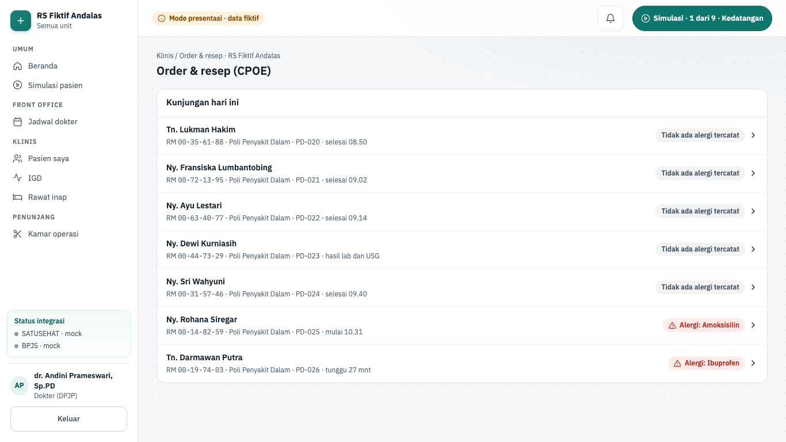

| Hal      | Isi                                                                                                                                                                      |
| -------- | ------------------------------------------------------------------------------------------------------------------------------------------------------------------------ |
| Rute     | `/klinis/order` (pilih kunjungan) · `/klinis/order/<encounterId>` (CPOE satu kunjungan)                                                                                  |
| Pemakai  | dokter, dokter residen                                                                                                                                                   |
| Komponen | K09 CPOE dan order set                                                                                                                                                   |
| Status   | demo (mode presentasi); API katalog, order set, pratinjau CDS, kirim, dan batal ada (3.4), layar belum disambung (W2)                                                    |
| Mockup   | `design/mockups/CPOE.dc.html`                                                                                                                                            |
| Kode web | `apps/web/src/app/(staf)/klinis/order/` · `apps/web/src/components/klinis/cpoe-*.tsx` · `apps/web/src/lib/klinis-cds.ts` · `apps/web/src/lib/server/data/klinis/cpoe.ts` |
| Kode API | `apps/api/src/modules/orders/` · `apps/api/src/modules/cds/` · mesin aturan `packages/shared/src/clinical/cds.ts`                                                        |

**Tujuan.** Dokter menulis order lab, radiologi, obat, tindakan, dan tindak lanjut dari katalog atau order set.
CDS memeriksa setiap item terhadap alergi, obat rutin, riwayat, interaksi, dan fungsi ginjal sebelum order
dikirim dengan TTE.

**Alur.**

1. Buka **Order & resep (CPOE)**. Pilih kunjungan di "Kunjungan hari ini". Pasien skenario yang sedang dibawakan
   tampil teratas dengan chip "Langkah Simulasi aktif".

   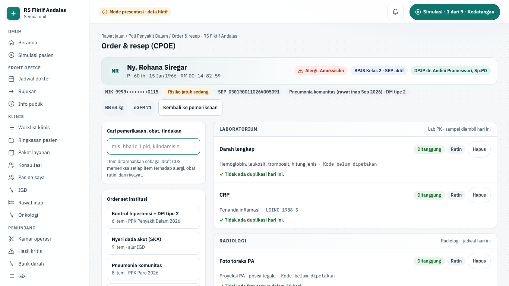

2. Kepala layar memuat banner pasien, BB, dan eGFR. eGFR < 45 ditandai "rendah".
3. Cari item di **Cari pemeriksaan, obat, tindakan**, atau terapkan order set institusi (mis. "Kontrol hipertensi +
   DM tipe 2", "Nyeri dada akut (SKA)", "Pneumonia komunitas", "Pra-operasi elektif dewasa"). Item masuk sebagai
   draf, dikelompokkan LABORATORIUM, RADIOLOGI, OBAT, TINDAKAN, dan TINDAK LANJUT.
4. Setiap baris menunjukkan hasil CDS. Contoh Ny. Rohana: tambah "Amoksisilin 500 mg kapsul" memunculkan gerbang
   merah "CDS memblokir Amoksisilin 500 mg kapsul" karena pasien alergi amoksisilin.

   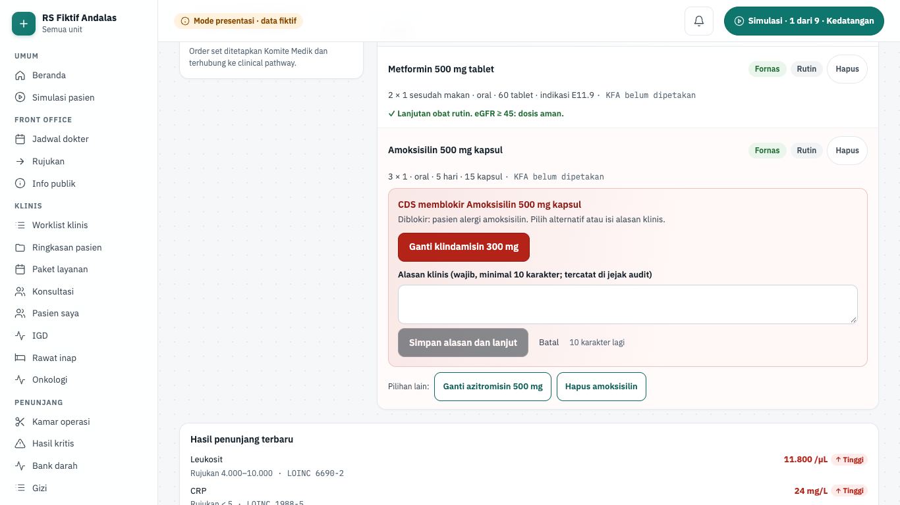

5. Selesaikan blok dengan salah satu cara: ganti ke alternatif aman (mis. Tn. Darmawan Putra, alergi ibuprofen:
   **Ganti parasetamol 500 mg** untuk asam mefenamat), hapus item, atau **Override dengan alasan** lalu
   **Simpan alasan dan lanjut**.
6. Periksa kolom kanan: "Pemeriksaan sebelum kirim", hasil penunjang terbaru, dan "Estimasi biaya pasien".
7. Tekan **Kirim N order (TTE)**. Layar menulis "N order terkirim pukul <jam>".

**Gerbang keselamatan dan aturan bisnis.**

- Temuan CDS tingkat blok menahan tombol kirim. Alasannya tertulis, mis. "Belum bisa dikirim: 1 order diblokir CDS
  (amoksisilin). Ganti alternatif, hapus, atau override dengan alasan."
- Override wajib alasan klinis minimal 10 karakter (`CPOE_OVERRIDE_MIN_REASON`). Override tercatat di baris order:
  "Override alergi oleh <dokter> · alasan: …".
- Server Action `sendOrdersAction` menghitung ulang CDS di server. Order yang masih diblokir ditolak dengan kode
  `CDS_BLOCKED`, bukan hanya tombol yang dimatikan. API 3.4 melakukan hal yang sama (422 `CDS_BLOCKED`, penolakan
  dicatat di `cds_alerts` dan audit `denied`).
- Urutan temuan CDS: blok, lalu peringatan alergi, alergi silang, riwayat, interaksi, dosis ginjal, perubahan dosis,
  dan biaya di luar paket penjamin.
- Estimasi biaya dihitung `bigint` rupiah. Pasien umum membayar seluruh tarif; pasien BPJS atau asuransi hanya item di
  luar paket. Bila ada item di luar paket, layar meminta persetujuan biaya pasien.
- Hanya dokter dan dokter residen. Perawat yang membuka CPOE melihat "Layar ini untuk posisi lain".
- Kunjungan pasien skenario (Tn. Suryo, Tn. Hartono Wibisono) mengikuti langkah Simulasi: katalog dan order set
  nonaktif dengan catatan "Pasien simulasi: order mengikuti langkah skenario.", dan kirim hanya lewat
  **Kirim resep (TTE)** setelah rencana terapi, gerbang CDS skenario, dan PRB selesai.
- Kunjungan tak dikenal menghasilkan 404.

**Mode api.** Izin layar `order.write`. Sampai potongan W2 halaman menampilkan "Belum tersambung". Di API, resep
penulis tanpa `clinical.sign` (residen) berstatus `needs_review` untuk DPJP.

## IGD

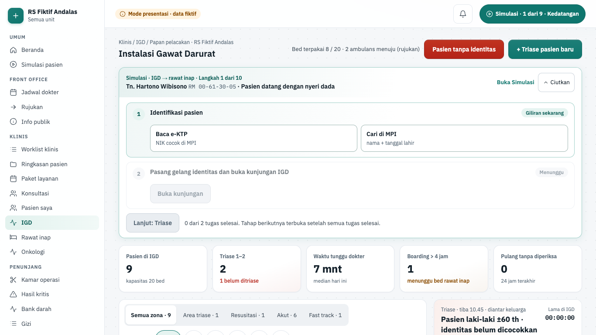

| Hal      | Isi                                                                                                                                                                         |
| -------- | --------------------------------------------------------------------------------------------------------------------------------------------------------------------------- |
| Rute     | `/klinis/igd` (`?pilih=<encounterId>` = pasien di panel triase)                                                                                                             |
| Pemakai  | dokter, dokter residen, perawat, petugas pendaftaran                                                                                                                        |
| Komponen | K03 IGD dan triase                                                                                                                                                          |
| Status   | demo (mode presentasi); API triase, papan IGD + SSE, status alur, dan SEP IGD ada (3.3), layar belum disambung (W3)                                                         |
| Mockup   | `design/mockups/IGD.dc.html`                                                                                                                                                |
| Kode web | `apps/web/src/app/(staf)/klinis/igd/` · `apps/web/src/components/rawat-inap/triage-*.tsx` · `apps/web/src/lib/rawat-inap.ts` · `apps/web/src/lib/server/data/klinis/igd.ts` |
| Kode API | `apps/api/src/modules/triage/` · `apps/api/src/modules/encounter/` (SEP IGD) · mesin triase `packages/shared/src/clinical/triage.ts`                                        |

**Tujuan.** Papan pelacakan pasien IGD dengan lama tinggal, zona, dan status alur, plus panel triase lima level (skala
ATS) dengan saran sistem dari tanda vital.

**Alur.**

1. Buka **IGD**. Kepala layar menunjukkan kapasitas bed dan ambulans menuju (SISRUTE). Region "Ringkasan IGD" memuat
   Triase 1–2, Waktu tunggu dokter, Boarding > 4 jam, dan Pulang tanpa diperiksa.
2. Saring papan dengan **Semua level** atau level tertentu (mis. **Level 4 · Semi-urgen**) dan dengan tab zona (Area
   triase, Resusitasi, Akut, Fast track; panah kiri/kanan berpindah tab).
3. Klik pasien, mis. Ny. Lestiani Hapsari. Panel "Triase pasien" menampilkan waktu tiba, penghitung "Lama di IGD",
   keluhan utama, dan ubin tanda vital bertulisan Tinggi atau Rendah.

   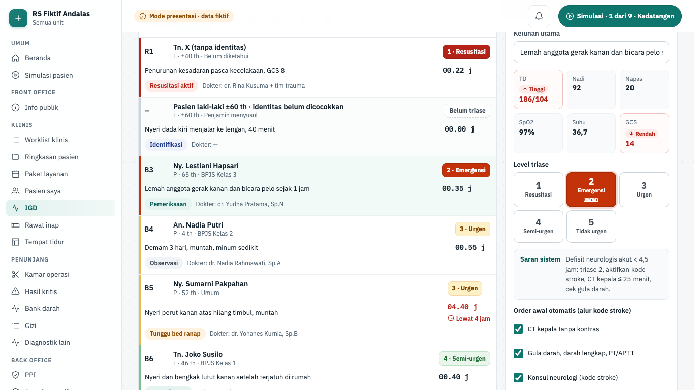

4. Pilih level di "Level triase". Saran sistem diberi tanda "(saran sistem)". Kotak "Saran sistem" berwarna sesuai
   level terpilih (1–2 merah, 3 kuning, 4 hijau, 5 biru) dan teksnya menyesuaikan level, misalnya "Urgen: zona akut,
   dokter ≤ 30 menit, ulang tanda vital tiap 30 menit."
5. Bila level lebih rendah dari saran, isian "Alasan memilih level lebih rendah dari saran (triase 2)" muncul di
   bawah kotak saran dengan keterangan "Wajib diisi (minimal 10 karakter) sebelum triase bisa disimpan." Setelah
   cukup, keterangannya berubah "Alasan tercatat di jejak audit triase." Kembali ke level saran cukup dengan
   memilih level itu lagi.
6. Centang order awal yang perlu, lalu tekan **Simpan triase N dan tempatkan di bed X** (tanpa bagian bed bila
   pasien belum punya bed). Tombol berwarna level terpilih dan abu selama nonaktif. Papan langsung menulis level
   baru, mis. "3 · Urgen".
7. Dari panel, **Minta bed** membuka Tempat tidur dan **Rawat inap** membuka daftar rawat inap.
8. **Pasien tanpa identitas** dan **+ Triase pasien baru** menambah pasien ke area triase (hanya di layar ini).
9. Skenario IGD → rawat inap: pasien anonim "Pasien laki-laki ±60 th · identitas belum dicocokkan" diidentifikasi
   dulu (**Pasang gelang dan buka kunjungan IGD**), lalu **Simpan tanda vital**, triase, dan
   **Tempatkan di bed resusitasi 2 dan pasang monitor**.

**Gerbang keselamatan dan aturan bisnis.**

- Turun dari saran sistem wajib alasan klinis minimal 10 karakter (`SAFETY_REASON_MIN`). Tanpa alasan, tombol simpan
  nonaktif dan server menolak dengan "Level di bawah saran sistem wajib disertai alasan klinis (minimal 10 karakter)."
  Override tercatat di jejak audit dan ditinjau komite mutu.
- Batas protokol: level di bawah batas pasien ditolak, mis. nyeri dada wajib minimal urgen sampai sindrom koroner
  disingkirkan.
- Saran dan batas protokol dibaca server dari data IGD, bukan dari klien.
- Triase hanya oleh perawat, dokter, atau dokter residen. Petugas pendaftaran membuka papan untuk identifikasi dan
  admisi, dan melihat alasan tertulis "Triase oleh perawat/dokter".
- Pasien skenario: triase terkunci sampai identitas dicocokkan dan gelang terpasang, lalu sampai tanda vital dicatat.
- Lama tinggal ≥ 4 jam ditulis "Lewat 4 jam"; triase 1–2 yang menunggu dokter > 10 menit ditulis "Dokter lewat 10
  menit". Batas 4 jam dari pengaturan `bed.boarding_alert_hours`.

**Mode api.** Izin layar `clinical.read`, agar petugas pendaftaran ikut membuka papan. Aksi klinis diperiksa API
dengan izin sendiri (triase `triage.write`). Sampai potongan W3 halaman menampilkan "Belum tersambung".

## Tempat tidur

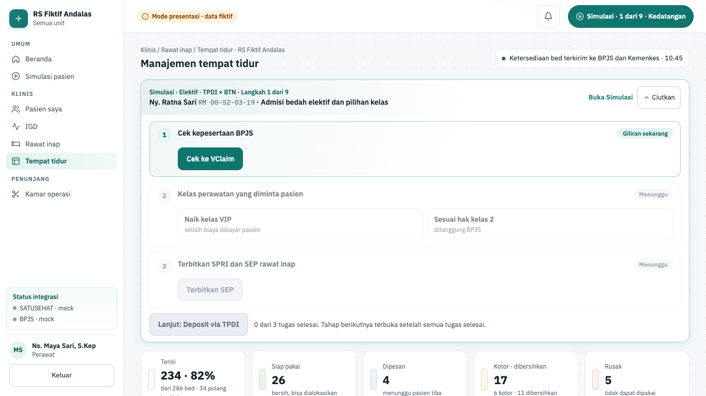

| Hal      | Isi                                                                                                                                                                |
| -------- | ------------------------------------------------------------------------------------------------------------------------------------------------------------------ |
| Rute     | `/klinis/tempat-tidur` (`?bangsal=<kode>` atau `?bangsal=semua`)                                                                                                   |
| Pemakai  | perawat, petugas pendaftaran, manajemen                                                                                                                            |
| Komponen | K05 bed management                                                                                                                                                 |
| Status   | demo (mode presentasi); API papan bed + SSE, status manual, permintaan dan alokasi bed, admisi, transfer, Aplicare ada (3.3), layar belum disambung (W3)           |
| Mockup   | `design/mockups/BedManagement.dc.html`                                                                                                                             |
| Kode web | `apps/web/src/app/(staf)/klinis/tempat-tidur/` · `apps/web/src/lib/rawat-inap.ts` (`BED_STATUS_META`, `filterBeds`) · `apps/web/src/lib/server/data/klinis/bed.ts` |
| Kode API | `apps/api/src/modules/adt/` (`bed-board.service.ts`, `bed-ops.service.ts`, `aplicare-sync.service.ts`, `adt.service.ts`)                                           |

**Tujuan.** Peta bed per bangsal dengan status bertulisan, alokasi bed ke permintaan dari IGD atau admisi elektif,
dan perputaran status bed (pulang, kotor, dibersihkan, siap).

**Alur.**

1. Buka **Tempat tidur**. Kepala layar menulis "Aplicare & SIRANAP diperbarui <jam>" dan memuat tab tampilan
   **Peta bed** / **Daftar**.
2. Region "Ringkasan status bed" memuat Total bed (keterangan: bed rusak), Terisi (keterangan: bed dipesan), Siap
   pakai, Dibersihkan (kotor + sedang dibersihkan), dan Rencana pulang hari ini.
3. Saring dengan **Bangsal**, **Kelas**, dan **Status**. Layar menulis jumlah yang tampil, mis. "1 dari 286 bed
   ditampilkan".
4. Pilih bed berstatus Siap di peta. Kartu "Bed terpilih" menampilkan rincian dan satu aksi status berikutnya.
5. Di "Permintaan bed", tekan **Alokasikan Ny. Maria ke bed M-xxx**. Layar menulis "… dialokasikan ke M-xxx ·
   dipesan …". Chip kandidat bed (**Tampilkan bed … di peta**) memilih bed itu di peta.
6. Ubah status bed lewat kartu bed terpilih: **Pasien tiba · tandai terisi**, **Pasien sudah pulang**,
   **Tandai dibersihkan**, **Selesai dibersihkan · siap pakai**, atau **Perbaikan selesai · siap pakai**.
7. Pasien skenario punya "Tugas admisi": **Cek kepesertaan BPJS**, **Terbitkan SPRI dan SEP rawat inap**,
   **Tanda tangani persetujuan**, dan **Transfer dan serah terima SBAR**.

**Gerbang keselamatan dan aturan bisnis.**

- Status selalu bertulisan (Siap, Terisi, Pulang hari ini, Dipesan, Kotor, Dibersihkan, Rusak), bukan hanya warna.
- Alokasi hanya ke bed berstatus Siap. Tanpa bed terpilih tombol menulis "(pilih bed Siap dulu)". Bed yang disiapkan
  untuk pasien skenario tidak bisa dipakai permintaan lain.
- Permintaan dari IGD yang menunggu ≥ 4 jam ditulis "Lewat 4 jam". Bangsal ≥ 90% terisi ditulis "Hampir penuh".
- Chip kandidat bed berukuran sentuh minimal 44 px.
- Di API, status manual memakai `baseVersion` (beda versi → 409 `BED_VERSION_CONFLICT`), alokasi ke bed tidak siap →
  409 `BED_NOT_AVAILABLE`, dan hunian ganda dicegah constraint EXCLUDE.
- Setiap perubahan status bed rawat inap ber-kelas memicu outbox Aplicare (`bpjs.aplicare.update`).

**Mode api.** Izin layar `bed.read` (manajemen hanya membaca). Sampai potongan W3 halaman menampilkan "Belum
tersambung". Detail API ada di
[Cara kode bekerja](./02-cara-kerja-kode.md#adt-papan-bed-triase-igd-gelang-aplicare-k03-k04-k05-fase-3-potongan-3-3).

## Rawat inap

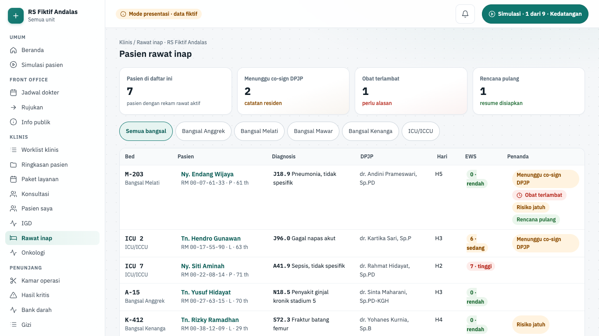

| Hal      | Isi                                                                                                                                                                                                     |
| -------- | ------------------------------------------------------------------------------------------------------------------------------------------------------------------------------------------------------- |
| Rute     | `/klinis/rawat-inap` (daftar) · `/klinis/rawat-inap/<encounterId>?tab=ringkasan\|cppt\|obs\|askep\|hasil`                                                                                               |
| Pemakai  | dokter, dokter residen, perawat, bidan                                                                                                                                                                  |
| Komponen | K04 rawat inap, K07 CPPT dan serah terima, K12 asuhan keperawatan dan eMAR                                                                                                                              |
| Status   | demo (mode presentasi); API CPPT + co-sign + serah terima (3.2b), tanda vital + EWS (3.2a), gelang (3.3), eMAR + askep (3.5) ada; layar belum disambung (W4)                                            |
| Mockup   | `design/mockups/Ranap.dc.html`                                                                                                                                                                          |
| Kode web | `apps/web/src/app/(staf)/klinis/rawat-inap/` (`cppt-panel.tsx`, `emar-gate.tsx`, `emar-dose.tsx`, `emar-panel.tsx`) · `apps/web/src/lib/rawat-inap.ts` · `apps/web/src/lib/server/data/klinis/ranap.ts` |
| Kode API | `apps/api/src/modules/cppt/` · `nursing/` (tanda vital + EWS) · `adt/` (gelang) · mesin `packages/shared/src/clinical/{emar,ews}.ts`                                                                    |

**Tujuan.** Rekam rawat inap per pasien dalam lima tab: Ringkasan, CPPT & eMAR, Observasi & EWS, Asuhan keperawatan,
dan Hasil. Pemberian obat terkunci sampai gelang pasien terpindai.

**Alur.**

1. Buka **Rawat inap**. Daftar memuat bed, pasien, diagnosis, DPJP, hari rawat, EWS, dan penanda (mis. "Menunggu
   co-sign DPJP"). Saring dengan "Filter bangsal", lalu klik pasien, mis. Ny. Endang Wijaya.
2. Judul menjadi "Rawat inap · Bangsal Melati M-203". Banner pasien memuat "Alergi: Amoksisilin". Di bawahnya baris
   "Tautan cepat pasien" selalu terlihat: **Order & resep (CPOE)**, **Persetujuan tindakan**, **Resume medis**, dan
   **Perencanaan pulang** (pasien tanpa draf resume atau dokumen persetujuan sendiri diarahkan ke daftar layarnya).

   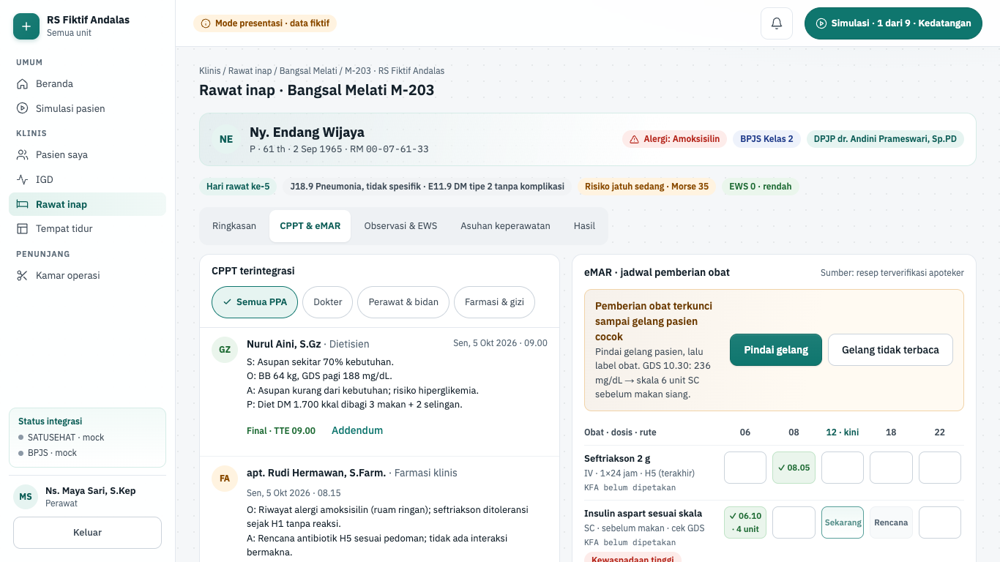

3. Di tab **CPPT & eMAR**, grid eMAR terkunci dengan pesan "Pemberian obat terkunci sampai gelang pasien cocok" dan
   dua baris status "○ Pasien · gelang belum dipindai" dan "○ Obat · pemberian nonaktif sampai gelang cocok".
   Tekan **Pindai gelang**. Status menjadi "✓ Pasien benar · gelang terpindai … · RM …". Di bawah kartu eMAR ada
   ubin EWS terakhir (dengan interval ulang) dan GDS terakhir dengan nilai sebelumnya bila pasien punya hasil gula
   darah. Balans cairan 24 jam belum ditampilkan karena belum ada di data rekam rawat inap.

   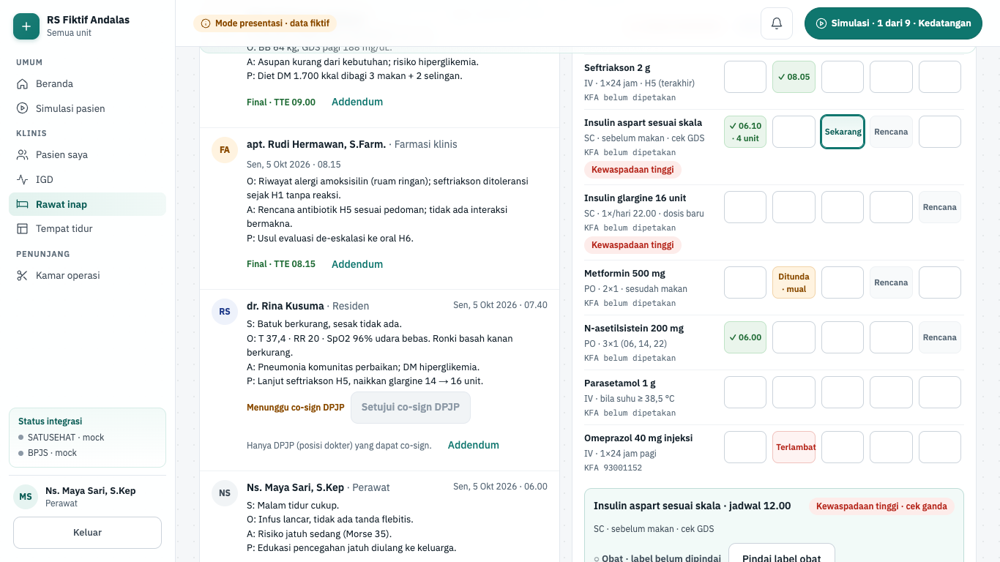

4. Pilih satu slot dosis (mis. "Insulin aspart sesuai skala jam 12.00"). Tekan **Pindai label obat**, lalu
   **Catat pemberian**. Obat kewaspadaan tinggi minta nama perawat kedua di "Cek ganda: nama perawat kedua".
5. Dosis terlambat (mis. Omeprazol 40 mg injeksi jam 08.00) memakai **Catat pemberian terlambat** dengan
   "Alasan keterlambatan".
6. Di "CPPT terintegrasi", saring per profesi, lalu **+ Tulis CPPT (SOAP)** dan **Simpan dan tanda tangani**.
7. Untuk catatan sendiri tekan **Koreksi CPPT …**, ubah isi, isi "Alasan koreksi", lalu
   **Simpan koreksi (versi baru)**. Untuk catatan PPA lain tekan **Addendum atas CPPT …** lalu **Simpan addendum**.
8. DPJP (posisi dokter) menekan **Setujui co-sign DPJP** pada catatan residen yang "Menunggu co-sign DPJP".
9. Tab **Observasi & EWS** ("Observasi tanda vital · <tanggal>") menampilkan tabel tanda vital dengan skor EWS dan
   tindak lanjut "Observasi berikutnya HH.MM" (rendah tiap 4 jam, sedang tiap 1 jam, tinggi pantau kontinu). Tab
   **Asuhan keperawatan** ("Intervensi keperawatan · shift pagi") memuat bilah kemajuan berlabel "n/m intervensi".
   Tab **Hasil** memuat hasil penunjang terbaru.
10. Pasien skenario (Tn. Hartono, Ny. Ratna Sari) punya region "Perjalanan rawat (simulasi)" dengan tombol
    **Lompat ke hari 1 pagi** dan seterusnya, yang terbuka setelah semua dosis jadwal pertama tercatat.

**Gerbang keselamatan dan aturan bisnis.**

- eMAR terkunci sampai gelang cocok dengan RM pasien kunjungan. Gelang yang salah ditolak: "Gelang tidak cocok
  dengan pasien kunjungan ini; pindai ulang gelang yang benar."
- Gelang tak terbaca membuka gerbang "Gelang tidak terbaca: identitas belum terverifikasi" dengan pilihan
  **Pindai ulang gelang** atau **Verifikasi manual dua identitas**. Override wajib alasan minimal 10 karakter,
  tercatat, dan ditinjau komite keselamatan pasien.
- Setiap dosis diperiksa ulang di server: slot harus bisa dicatat, label obat harus cocok dengan obat slot, dosis
  terlambat wajib alasan minimal 10 karakter.
- Obat kewaspadaan tinggi wajib cek ganda oleh petugas lain: "Cek ganda harus oleh petugas lain, bukan pemberi
  obat."
- Pemberian obat hanya oleh perawat, bidan, atau dokter.
- CPPT: S dan A wajib ("S wajib diisi."). Koreksi hanya oleh penulisnya, wajib alasan minimal 10 karakter, dan
  disimpan sebagai versi baru. Versi lama tetap tampil dengan label "Versi lama · digantikan koreksi (tetap
  tersimpan)". Catatan PPA lain hanya bisa diberi addendum; catatan aslinya tidak berubah.
- Co-sign hanya oleh DPJP (posisi dokter) atas entri residen yang memang menunggu co-sign.
- EWS dewasa: 0–4 rendah, 5–6 sedang (atau satu parameter bernilai 3), ≥ 7 tinggi.
- Fakta dosis (terlambat, kewaspadaan tinggi) dibaca dari rekam server, bukan dari klien.

**Mode api.** Izin layar `clinical.write`. Sampai potongan W4 halaman daftar dan detail menampilkan "Belum
tersambung" (rute detail mode api memberi 200, bukan 404). Endpoint eMAR sudah ada (potongan 3.5, lihat [Asuhan keperawatan](#asuhan-keperawatan)).

## Resume medis

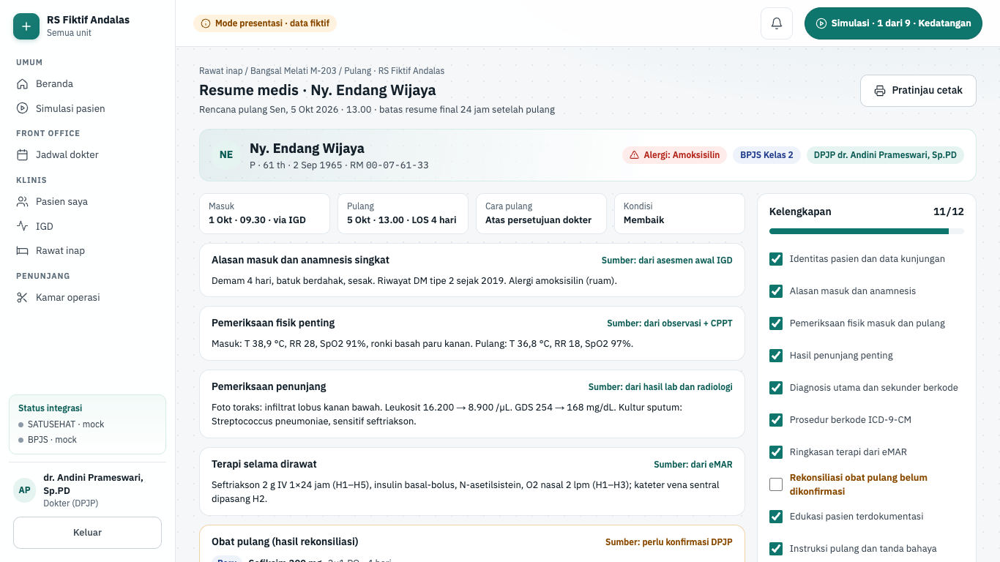

| Hal      | Isi                                                                                                                                                 |
| -------- | --------------------------------------------------------------------------------------------------------------------------------------------------- |
| Rute     | `/klinis/resume` (daftar) · `/klinis/resume/<encounterId>`                                                                                          |
| Pemakai  | dokter, dokter residen                                                                                                                              |
| Komponen | K13 resume dan dokumen pulang                                                                                                                       |
| Status   | demo (mode presentasi); API ✓ (potongan 3.6, ADR-0093); layar mode api W5b                                                                          |
| Mockup   | `design/mockups/Resume.dc.html`                                                                                                                     |
| Kode web | `apps/web/src/app/(staf)/klinis/resume/` · `apps/web/src/lib/rawat-inap.ts` (`resumeSignBlocker`) · `apps/web/src/lib/server/data/klinis/resume.ts` |
| Kode API | `apps/api/src/modules/discharge/` · kontrak `packages/shared/src/schemas/discharge.ts` · aturan `packages/shared/src/clinical/resume.ts`            |

**Tujuan.** Resume medis pulang yang menarik isi dari rekam medis (asesmen, CPPT, observasi, hasil, eMAR, laporan
operasi) tanpa input ulang, dengan 12 butir kelengkapan sebelum TTE DPJP.

**Alur.**

1. Buka **Resume medis**. Bila langkah resume skenario sedang aktif, layar langsung membuka resume pasien skenario.
   Selain itu tampil daftar resume yang sedang disiapkan.
2. Buka resume, mis. "Resume medis · Ny. Endang Wijaya". Setiap bagian diberi label sumber, mis. "dari CPPT",
   "dari eMAR", "dari hasil lab dan radiologi".
3. Periksa obat pulang. Bagian rekonsiliasi menulis "perlu konfirmasi DPJP" sampai dokter menekan
   **Konfirmasi DPJP**; labelnya menjadi "dikonfirmasi DPJP · HH.MM" dan daftar obat pulang dikunci untuk resep
   pulang. **Batalkan konfirmasi** tersedia selama resume belum final. Kepala layar memuat rencana pulang, batas
   resume final 24 jam, dan **Pratinjau PDF** (dialog cetak browser).
4. Panel "Kelengkapan dan tanda tangan" menunjukkan jumlah butir, mis. 12/12, dan daftar centang.
5. Tekan **Tanda tangani resume (TTE)**. Status menjadi "Resume final · TTE" dan semua centang terkunci.
6. Pasien skenario memakai **Himpun resume** dan pilihan rekonsiliasi skenario; TTE-nya mengikuti giliran Simulasi.

**Gerbang keselamatan dan aturan bisnis.**

- TTE terkunci sampai 12 butir lengkap. Alasannya tertulis: "TTE terkunci: lengkapi N butir lagi (…)". Kedua belas
  butir: identitas, anamnesis, pemeriksaan fisik masuk dan pulang, hasil penunjang penting, diagnosis berkode,
  prosedur ICD-9-CM, ringkasan terapi dari eMAR, rekonsiliasi obat pulang, edukasi, instruksi pulang, jadwal kontrol,
  serta kondisi dan cara pulang.
- Rekonsiliasi obat pulang wajib dikonfirmasi DPJP; server menolak TTE tanpa konfirmasi.
- TTE hanya oleh DPJP (posisi dokter). Dokter residen bisa menyiapkan resume tetapi melihat "Resume disiapkan; TTE
  hanya oleh DPJP (posisi dokter)."
- Setelah final, perubahan hanya lewat addendum berversi.
- Server memeriksa ulang: resume dikenal, sudah disiapkan, belum final, bukan milik pasien skenario, dan 12 butir
  lengkap.

**Mode api (potongan 3.6, ADR-0093).** Izin layar `clinical.write`; konfirmasi rekonsiliasi, TTE, dan addendum
`clinical.sign` (DPJP utama, rawat bersama, atau dokter kunjungan).

| Endpoint                                                                     | Fungsi                                                                                                             |
| ---------------------------------------------------------------------------- | ------------------------------------------------------------------------------------------------------------------ |
| `GET /api/v1/encounters/:id/discharge-summary`                               | Resume: final (beku) bila ada, selain itu draf Anda/pratinjau dari sumber terkini, 12 butir, ref sumber per bagian |
| `POST /api/v1/discharge/summaries` `{encounterId}`                           | Himpun draf dari sumber (usulan obat pulang = order obat aktif)                                                    |
| `PUT /api/v1/discharge/summaries/:encounterId/draft`                         | Isian DPJP: catatan per bagian, edukasi, instruksi, tindak lanjut, kondisi, cara pulang, obat pulang               |
| `POST /api/v1/discharge/summaries/:encounterId/reconciliation` `{confirmed}` | Konfirmasi DPJP atas daftar obat saat ini (mengubah daftar membatalkannya)                                         |
| `POST /api/v1/discharge/summaries/:encounterId/finalize` `{revision}`        | Butir wajib diperiksa server (422 `RESUME_INCOMPLETE`) → versi + PDF + TTE → terkunci                              |
| `POST /api/v1/discharge/summaries/:id/addenda` `{text}`                      | Addendum ber-TTE atas resume final                                                                                 |
| `POST /api/v1/encounters/:id/death-certificate`                              | Surat keterangan kematian (jam + sebab ICD-10) ber-TTE dokter (keputusan K-1)                                      |
| `POST /api/v1/encounters/:id/close` `{disposition}`                          | Tutup kunjungan lewat `DischargeGate` (rawat jalan: tiket poli selesai → task 5)                                   |

Isi bagian sumber tidak bisa ditimpa; DPJP menambah "Catatan DPJP". Resume rawat jalan memakai 8 butir ringkas
(tanpa rekonsiliasi dan edukasi). Versi ber-TTE tidak bisa dikoreksi (409 `RECORD_LOCKED`); perubahan lewat addendum.

**Gerbang tutup kunjungan (`DischargeGate`).** Rawat inap: resume final ber-TTE dengan cara pulang yang sama. Rawat
jalan: resume RJ final. Meninggal: hanya dokter ber-`clinical.sign` yang berelasi dengan pasien (DPJP, rawat bersama,
dokter jaga yang punya akses, termasuk akses darurat) dan surat keterangan kematian ber-TTE; petugas admisi ditolak 403.
Rujuk: surat rujukan keluar F07. Syarat yang kurang dikembalikan sebagai 409 `DISCHARGE_BLOCKED` berisi alasan.

## Persetujuan tindakan

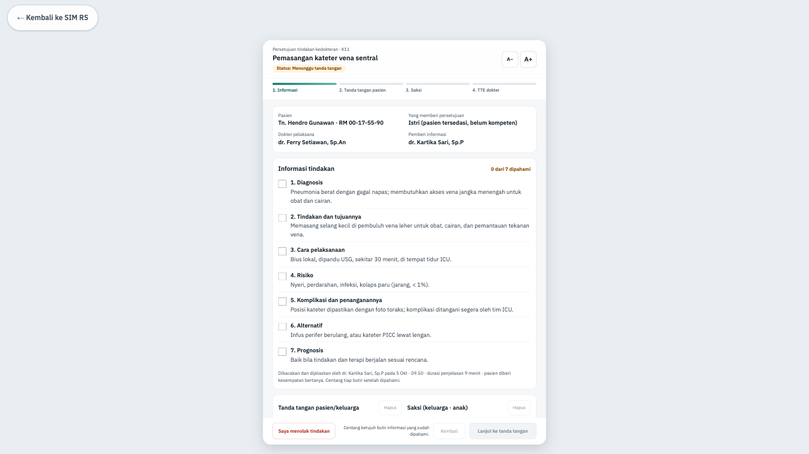

| Hal      | Isi                                                                                                                                                            |
| -------- | -------------------------------------------------------------------------------------------------------------------------------------------------------------- |
| Rute     | `/tablet/persetujuan` (dokumen di tablet ini) · `/tablet/persetujuan/<consentId>` (layar penuh, kerangka `perangkat`)                                          |
| Pemakai  | dokter, perawat                                                                                                                                                |
| Komponen | K11 persetujuan dan edukasi                                                                                                                                    |
| Status   | demo (mode presentasi); API belum (potongan 3.7; modul `consent` masih kerangka), layar belum disambung (W5a)                                                  |
| Mockup   | `design/mockups/Consent.dc.html`                                                                                                                               |
| Kode web | `apps/web/src/app/(perangkat)/tablet/persetujuan/` · `apps/web/src/components/rawat-inap/signature-pad.tsx` · `apps/web/src/lib/server/data/klinis/consent.ts` |
| Kode API | `apps/api/src/modules/consent/` (kerangka)                                                                                                                     |

**Tujuan.** Pasien atau keluarga membaca informasi tindakan di tablet, menyatakan paham per butir, lalu
menandatangani bersama saksi. Dokter pelaksana menutup dengan TTE. Pasien juga bisa menolak tindakan dengan alasan.

**Alur.**

1. Buka **Persetujuan tindakan**. Bila ada dokumen skenario yang sedang gilirannya, tablet langsung membukanya.
   Selain itu tampil "Dokumen di tablet ini".
2. Langkah **Informasi**: centang ketujuh butir "Saya memahami: …". Ukuran teks bisa diperbesar atau diperkecil.
3. Tekan **Lanjut ke tanda tangan**. Pasien atau keluarga menandatangani di bantalan kartu kiri, atau mengisi "Atau
   ketik nama lengkap sebagai tanda tangan" lalu **Pakai nama ketik**. **Ulangi** menghapus tanda tangan selama
   langkahnya aktif. Keterangan di bawah bantalan menulis nama, cara, jam, dan "lokasi tablet: …".
4. Tekan **Lanjut ke saksi**. Saksi keluarga menandatangani di kartu kanan ("Nama dan hubungan: …"), lalu centang
   "Saksi kedua (petugas): … hadir dan menyaksikan penandatanganan".
5. Tekan **Lanjut ke TTE dokter**. Kotak "TTE dokter pelaksana" menyebut sertifikat elektronik tersertifikasi
   (BSrE/PSrE). Dokter menekan **Tanda tangani (TTE)**. Status menjadi "Dokumen final · TTE".
6. Untuk menolak, tekan **Saya menolak tindakan**, tulis alasan dengan kata-kata pasien, lalu **Catat penolakan**.
   Status menjadi "Ditolak pasien" dan dokumen terkunci.

**Gerbang keselamatan dan aturan bisnis.**

- **Lanjut ke tanda tangan** nonaktif sampai ketujuh butir dicentang. Server memeriksa himpunan butir yang persis
  sama.
- Tanda tangan pasien atau keluarga dan saksi harus atas nama yang tercantum di dokumen.
- Saksi kedua dari petugas wajib hadir sebelum TTE.
- TTE hanya oleh dokter pelaksana (posisi dokter). Perawat bisa mendampingi dan mencatat penolakan, tetapi tidak
  bisa TTE.
- Penolakan wajib alasan minimal 10 karakter; tanpa alasan muncul "Alasan penolakan wajib diisi". Rancangannya,
  DPJP diberi notifikasi (mode presentasi tidak mengirim notifikasi nyata).
- Dokumen final atau ditolak terkunci: penolakan dan tanda tangan ulang ditolak; perubahan hanya lewat addendum.
- Dokumen milik skenario (Tn. Hartono, Ny. Ratna Sari) hanya bisa diproses pada giliran tugasnya. Di luar giliran,
  tablet hanya bisa dibaca dengan status "Menunggu giliran persetujuan di Simulasi." Persetujuan operasi Ny. Ratna
  final bersama SEP rawat inap pada langkah Admisi elektif.

**Mode api.** Izin layar `consent.write`, dibuka dengan sesi staf di tablet (tanpa prinsipal perangkat). TTE di API
kelak memakai `consent.sign`. Sampai potongan 3.7 dan W5a halaman menampilkan "Belum tersambung".

## Worklist klinis

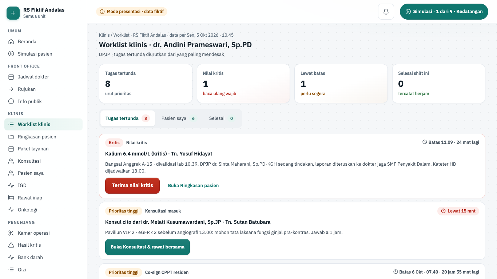

| Hal      | Isi                                                                                                                                                                                                        |
| -------- | ---------------------------------------------------------------------------------------------------------------------------------------------------------------------------------------------------------- |
| Rute     | `/klinis/worklist`                                                                                                                                                                                         |
| Pemakai  | dokter, dokter residen, perawat, bidan                                                                                                                                                                     |
| Komponen | K01 worklist klinis                                                                                                                                                                                        |
| Status   | demo (mode presentasi); API `worklist` sudah ada (fase 3 potongan 3.2b), layar belum disambung                                                                                                             |
| Mockup   | tidak ada (gaya mengikuti ubin KPI dan kartu Klinis Bersih, `docs/08-desain-ui.md`)                                                                                                                        |
| Kode web | `apps/web/src/app/(staf)/klinis/worklist/` · data `apps/web/src/lib/demo/fixtures/rme-worklist.ts` · aturan `apps/web/src/lib/rme-worklist.ts` · komponen `apps/web/src/components/rme/worklist-board.tsx` |
| Kode API | `apps/api/src/modules/worklist/` (`GET /api/v1/worklist`)                                                                                                                                                  |

**Tujuan.** Satu daftar kerja per posisi klinis: pasien yang menjadi tanggung jawabnya dan tugas tertunda (nilai
kritis, co-sign, verifikasi CPPT, tinjau order residen, hasil baru, konsul, obat, reasesmen, serah terima), diurutkan
dari yang paling mendesak.

**Alur.**

1. Buka **Worklist klinis**. Judul "Worklist klinis · <nama>" dengan posisi di bawahnya (DPJP, Dokter residen (PPDS),
   Perawat penanggung jawab, atau Bidan penanggung jawab). Data per Sen, 5 Okt 2026 · 10.45.
2. Ubin ringkasan memuat Tugas tertunda, Nilai kritis ("baca ulang wajib"), Lewat batas, dan Selesai shift ini.
3. Tab **Tugas tertunda** terbuka lebih dulu. Setiap kartu memuat chip prioritas (Kritis, Prioritas tinggi, Rutin),
   jenis tugas, dan tenggat bertulisan, mis. "Batas 11.09 · 24 mnt lagi" atau "Lewat 15 mnt".
4. Nilai kritis (DPJP: "Kalium 6,4 mmol/L (kritis) · Tn. Yusuf Hidayat"; perawat: "Telepon lab: kalium 6,4 mmol/L
   (kritis) · …"): tekan **Terima nilai kritis**, isi "Nilai dibaca ulang (mmol/L)", pilih "Tindak lanjut" (Lapor ke
   DPJP dengan SBAR, Tata laksana sesuai protokol hiperkalemia, atau Ulang pemeriksaan dan pantau EKG), lalu
   **Simpan penerimaan**. Hasilnya "Diterima dan dibaca ulang: 6,4 mmol/L · tindak lanjut: … · <jam> · <nama>".
5. DPJP menyelesaikan tugas langsung di kartu: **Co-sign sekarang** ("CPPT residen 07.40 · Ny. Endang Wijaya"),
   **Verifikasi** (CPPT farmasi 08.15 dan CPPT perawat 22.25), **Setujui order** (order residen insulin glargine), dan
   **Tandai sudah dibaca** (gula darah sewaktu 236 mg/dL).
6. Tugas yang diselesaikan di layar lain punya tautan **Buka <nama layar>**, mis. **Buka Konsultasi & rawat bersama**
   untuk konsul cito dr. Melati Kusumawardani, Sp.JP.
7. Tab **Selesai** menulis "✓ <catatan> · <jam> · <nama>". Tab **Pasien saya** memuat pasien dengan status bertulisan
   (Menunggu, Diperiksa, Menunggu hasil, Dirawat, Pulang hari ini, Konsul, Pra-operasi, Nifas) dan jumlah tugasnya.
   Nama pasien menaut ke Ringkasan pasien.

**Gerbang keselamatan dan aturan bisnis.**

- Nilai kritis wajib dibaca ulang (komunikasi efektif). **Simpan penerimaan** nonaktif sampai nilai dan tindak lanjut
  terisi. Nilai yang berbeda ditolak: "Nilai tidak cocok dengan laporan lab. Konfirmasi ulang ke pelapor sebelum
  menerima." Pencocokan mengabaikan spasi dan menyamakan koma dengan titik desimal (`readBackMatches`).
- Co-sign, verifikasi, dan persetujuan order residen hanya oleh DPJP (posisi dokter). Posisi lain melihat "Hanya
  DPJP (posisi dokter) yang dapat menyelesaikan tugas ini." (`completionBlocker`).
- Residen melihat "CPPT Anda 07.40 menunggu co-sign DPJP" tanpa tombol, dengan alasan "Residen tidak dapat
  memfinalkan CPPT sendiri: menunggu co-sign dr. …". Tugas yang menunggu pihak lain selalu di urutan terakhir.
- Urutan kerja: kritis dulu, lalu yang lewat batas, lalu batas terdekat, lalu yang paling lama menunggu (`sortTasks`).
- Tenggat selalu bertulisan ("Lewat 45 mnt", "1 jam 15 mnt lagi", "Tanpa batas waktu"), bukan hanya warna.
- Penyelesaian hanya ada di state browser: memuat ulang halaman mengembalikan daftar awal, dan co-sign di worklist
  tidak mengubah status catatan di layar CPPT.

**Rencana backend.** Izin rencana `clinical.read` (sudah ada di katalog). `GET /api/v1/worklist` sudah ada (3.2b)
dengan tugas `cosign`, `verify`, `review_order`, `ews_high`, `tte_failed`, `resume_overdue`, dan `handover`. Jenis
tugas demo yang belum punya sumber API: nilai kritis dengan baca ulang (rencana modul `critical-results`, fase 4),
hasil baru, konsul (3.8), obat dan askep (3.5), reasesmen, dan edukasi. Co-sign dan verifikasi kelak memanggil
`POST /api/v1/cppt/entries/:id/cosign` dan `…/verify` (izin `clinical.cosign`). Layar belum punya `permission` di
`screens.ts`, jadi belum hibrida.

## CPPT & serah terima

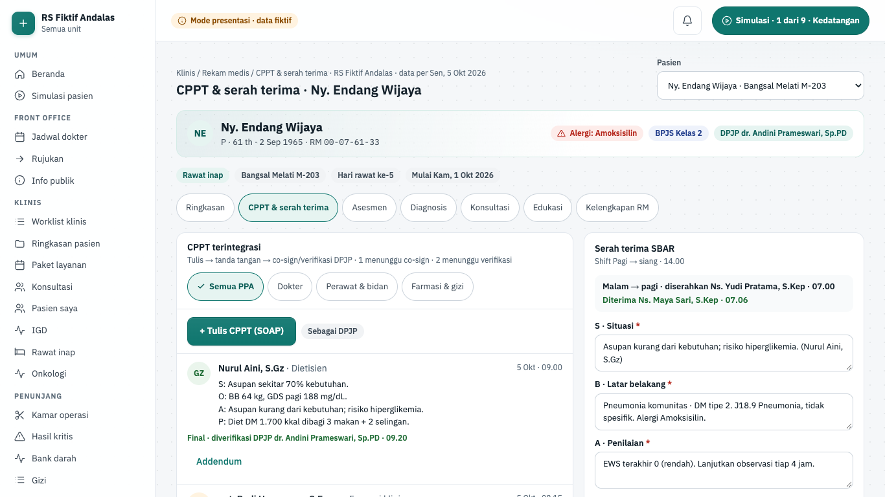

| Hal      | Isi                                                                                                                                                                                                                                                                        |
| -------- | -------------------------------------------------------------------------------------------------------------------------------------------------------------------------------------------------------------------------------------------------------------------------- |
| Rute     | `/klinis/cppt` (`?pasien=<encounterId>`)                                                                                                                                                                                                                                   |
| Pemakai  | dokter, dokter residen, perawat, bidan, apoteker                                                                                                                                                                                                                           |
| Komponen | K07 CPPT dan serah terima                                                                                                                                                                                                                                                  |
| Status   | demo (mode presentasi); API `cppt` sudah ada (fase 3 potongan 3.2b), layar belum disambung                                                                                                                                                                                 |
| Mockup   | `design/mockups/Ranap.dc.html`                                                                                                                                                                                                                                             |
| Kode web | `apps/web/src/app/(staf)/klinis/cppt/` · data `apps/web/src/lib/demo/fixtures/rme-cppt.ts` dan `rawat-inap.ts` · aturan `apps/web/src/lib/rme-cppt.ts`, `apps/web/src/lib/rawat-inap.ts` · komponen `apps/web/src/components/rme/cppt-workspace.tsx`, `handover-panel.tsx` |
| Kode API | `apps/api/src/modules/cppt/` (`POST /api/v1/cppt/entries`, `…/:id/cosign`, `…/:id/verify`, `…/:id/entered-in-error`, `POST /api/v1/cppt/handovers`, `GET /api/v1/encounters/:id/cppt`, `…/handovers`)                                                                      |

**Tujuan.** CPPT terintegrasi lintas PPA dalam format SOAP: tulis, tanda tangan, co-sign residen, verifikasi DPJP atas
catatan PPA lain, koreksi berversi, addendum, dan serah terima SBAR antarshift.

**Alur.**

1. Buka **CPPT & serah terima**. Pasien bawaan Ny. Endang Wijaya (Bangsal Melati M-203, hari rawat ke-5). Ganti
   pasien di **Pasien**.
2. Kolom "CPPT terintegrasi" menulis jumlah yang menunggu co-sign dan verifikasi. Saring dengan **Semua PPA**,
   **Dokter**, **Perawat & bidan**, atau **Farmasi & gizi**.
3. Tekan **+ Tulis CPPT (SOAP)**. Formulir "CPPT baru · <profesi>" memuat S · Subjektif, O · Objektif, A · Asesmen,
   dan P · Rencana. Singkatan terlarang muncul sebagai "Singkatan terlarang (peringatan, tidak memblokir):".
4. DPJP, perawat, bidan, dan apoteker menekan **Simpan dan tanda tangani (final)**. Dokter residen menekan
   **Simpan dan ajukan co-sign DPJP**; catatannya berstatus "Belum final · menunggu co-sign DPJP".

   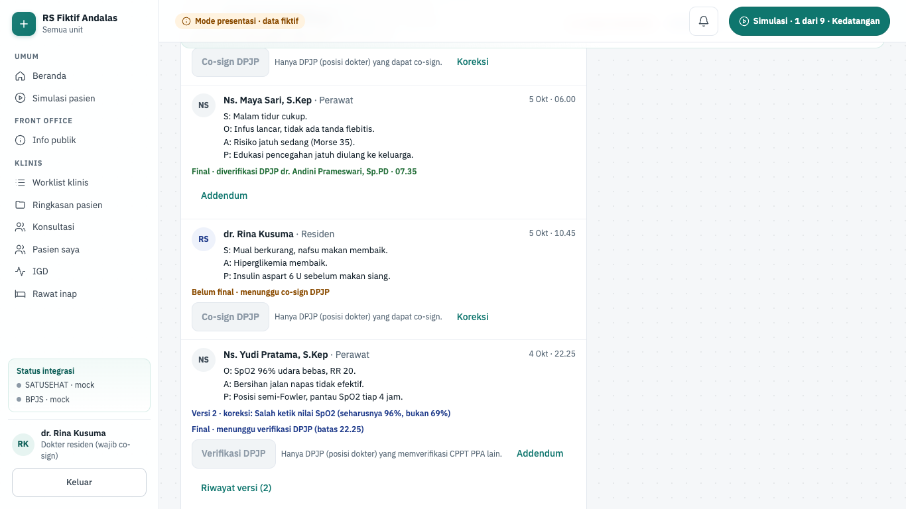

5. DPJP menekan **Co-sign DPJP** pada catatan residen. Status menjadi "Final · co-sign DPJP <nama> · <jam>".
6. Catatan perawat, bidan, farmasi, atau gizi berstatus "Final · menunggu verifikasi DPJP (batas 6 Okt · 08.15)".
   DPJP menekan **Verifikasi DPJP**; status menjadi "Final · diverifikasi DPJP <nama> · <jam>".
7. Untuk catatan sendiri tekan **Koreksi**, ubah isi, isi "Alasan koreksi", lalu **Simpan koreksi (versi baru)**.
   Untuk catatan PPA lain tekan **Addendum** lalu **Simpan addendum**. **Riwayat versi (N)** menampilkan rantai
   "Versi 1 · … · digantikan".
8. Panel "Serah terima SBAR" (rawat inap dan kamar bersalin) menampilkan serah terima terakhir, mis. "Malam → pagi ·
   diserahkan Ns. Yudi Pratama, S.Kep" dan "Diterima Ns. Maya Sari, S.Kep · 07.06". SBAR shift Pagi → siang · 14.00
   terisi dari CPPT terakhir, riwayat, diagnosis utama, alergi, EWS, dan rencana, dan bisa disunting.
9. Pilih "Penerima shift berikutnya", tekan **Serahkan shift**. Status "Menunggu konfirmasi <penerima>" berubah
   menjadi "Diterima <penerima> · <jam>" setelah **Konfirmasi penerimaan (simulasi penerima)**.
10. Kunjungan rawat jalan tidak memakai serah terima; panel diganti catatan bahwa kunjungan ditutup dengan resume
    rawat jalan.

**Gerbang keselamatan dan aturan bisnis.**

- S dan A wajib ("S wajib diisi."). Koreksi wajib alasan minimal 10 karakter ("Wajib minimal 10 karakter · N karakter
  lagi.").
- Catatan residen tidak final sebelum co-sign DPJP. Formulir residen selalu menulis "Residen tidak dapat memfinalkan
  catatannya sendiri."
- Co-sign hanya untuk catatan residen yang belum di-co-sign, hanya oleh DPJP (posisi dokter), dan bukan catatan
  sendiri ("Hanya DPJP (posisi dokter) yang dapat co-sign.", "Tidak bisa co-sign catatan sendiri.") (`cosignBlocker`).
- Verifikasi DPJP berlaku untuk CPPT PPA non-dokter dalam 24 jam (`VERIFY_WITHIN_HOURS`). Lewat batas ditulis "Final ·
  verifikasi DPJP lewat 24 jam". Catatan DPJP tidak perlu verifikasi; catatan residen memakai co-sign.
- Koreksi hanya oleh penulisnya (`canCorrectCppt`) dan menjadi versi baru. Versi lama tetap tersimpan dengan label
  "Versi lama · digantikan koreksi (tetap tersimpan)". Catatan PPA lain hanya bisa diberi addendum.
- Singkatan terlarang hanya peringatan (EP 9a), dari daftar contoh `SAMPLE_FORBIDDEN_ABBREVIATIONS`.
- Serah terima: keempat bagian SBAR wajib, penerima wajib dan bukan pemberi ("Pilih perawat penerima shift
  berikutnya.", "Penerima harus petugas shift berikutnya, bukan pemberi.").

**Rencana backend.** Izin rencana `cppt.write` belum ada di katalog; modul `cppt` yang sudah jadi memakai
`clinical.write`, `clinical.correct`, dan `clinical.cosign`. Matriks bawaan apoteker belum memegang `clinical.write`,
padahal apoteker ada di `demoRoles` dan di daftar penulis CPPT web (`CPPT_WRITER_ROLES`). Konfirmasi serah terima di
layar ini disimulasikan oleh pemberi; di API penerima mengonfirmasi dari sesinya sendiri.

## Asesmen & skrining

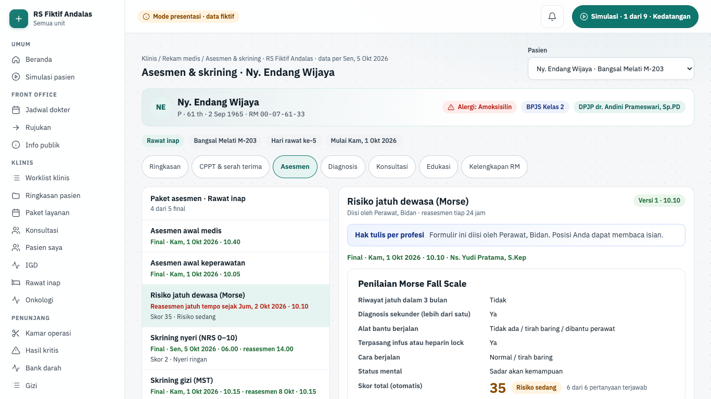

| Hal      | Isi                                                                                                                                                                                                                               |
| -------- | --------------------------------------------------------------------------------------------------------------------------------------------------------------------------------------------------------------------------------- |
| Rute     | `/klinis/asesmen` (`?pasien=<encounterId>`)                                                                                                                                                                                       |
| Pemakai  | dokter, dokter residen, perawat, bidan                                                                                                                                                                                            |
| Komponen | K06 asesmen dan skrining                                                                                                                                                                                                          |
| Status   | demo (mode presentasi); API `assessment` dan `forms` sudah ada (fase 3 potongan 3.2b, fase 1), layar belum disambung                                                                                                              |
| Mockup   | `design/mockups/Formulir.dc.html`                                                                                                                                                                                                 |
| Kode web | `apps/web/src/app/(staf)/klinis/asesmen/` · data `apps/web/src/lib/demo/fixtures/rme-asesmen.ts` · aturan `apps/web/src/lib/rme-asesmen.ts` · komponen `apps/web/src/components/rme/asesmen-workspace.tsx` (penyaji formulir P07) |
| Kode API | `apps/api/src/modules/assessment/` (`GET /api/v1/encounters/:id/assessments`) · `apps/api/src/modules/forms/` (`POST /api/v1/patients/:patientId/forms/:code/responses`, `POST /api/v1/form-responses/:id/corrections`)           |

**Tujuan.** Paket formulir asesmen per setting dengan skor otomatis, saran tindak lanjut, hak tulis per profesi, dan
isian final yang tidak bisa diubah (koreksi menjadi versi baru, reasesmen menjadi isian baru).

**Alur.**

1. Buka **Asesmen & skrining**. Kolom "Paket asesmen · Rawat inap" menulis kemajuan, mis. "4 dari 5 final". Paket
   rawat inap: Asesmen awal medis, Asesmen awal keperawatan, Risiko jatuh dewasa (Morse), Skrining nyeri (NRS 0–10),
   dan Skrining gizi (MST). Rawat jalan dan kamar bersalin memakai paket lebih kecil.
2. Setiap formulir menulis status: "Final · …", "Belum diisi · batas …", atau "Reasesmen jatuh tempo sejak …", beserta
   skor terakhir (mis. "Skor 35 · Risiko sedang").
3. Pilih formulir. Panel kanan menulis "Diisi oleh … · reasesmen tiap N jam" dan menampilkan isian final.
4. Perawat menekan **Isi reasesmen** (atau **Isi sekarang** bila belum pernah diisi), mengisi semua butir, dan melihat
   kotak "Tindak lanjut:" yang dihitung dari skor.
5. Tekan **Simpan final**. Umpan balik "Final · <jam> · Risiko jatuh dewasa (Morse) · skor 85 Risiko tinggi" dan paket
   menjadi "5 dari 5 final".
6. Untuk koreksi tekan **Koreksi isian**, ubah jawaban, periksa "Perubahan dari versi 1 (N)", isi "Alasan koreksi",
   lalu **Simpan koreksi (versi 2)**. Isian lama tetap ada di "Riwayat versi".

**Gerbang keselamatan dan aturan bisnis.**

- Hak tulis per profesi (ADR-0019): asesmen awal medis oleh dokter dan residen; asesmen awal keperawatan, Morse, dan
  MST oleh perawat dan bidan; NRS oleh keempatnya. Posisi lain melihat "Formulir ini diisi oleh … Posisi Anda dapat
  membaca isian." dan tombol isi nonaktif.
- Isian wajib harus lengkap: "N isian belum lengkap atau belum valid; periksa tanda merah di formulir."
- Asesmen awal wajib ≤ 24 jam sejak kunjungan dimulai (`INITIAL_WITHIN_HOURS`). Lewat batas ditulis "Belum diisi ·
  lewat batas …".
- Interval reasesmen: Morse 24 jam, NRS 8 jam, MST 168 jam (7 hari).
- Koreksi wajib berisi perubahan ("Tidak ada perubahan untuk dikoreksi.") dan alasan minimal 10 karakter. Versi lama
  tidak diubah (`newResponse`).
- Tindak lanjut skor adalah saran, bukan keputusan otomatis (`scoreFollowUp`): Morse ≥ 45 risiko tinggi (gelang
  kuning, bundle pencegahan jatuh, reasesmen tiap shift, masuk asuhan keperawatan), 25–44 sedang, < 25 rendah; NRS ≥ 7
  nyeri berat (lapor DPJP, reasesmen 30 menit), 4–6 sedang (reasesmen 1 jam); MST ≥ 2 rujuk dietisien.
- Morse memakai definisi bersama `MORSE_FALL_SCALE` (`packages/shared/src/forms.ts`). Formulir lain adalah contoh
  komite rekam medis tanpa kode terminologi.

**Rencana backend.** Izin rencana `forms.response.write` (sudah ada di katalog; koreksi memakai
`forms.response.correct`). Pembacaan per kunjungan dan penyimpanan isian sudah ada di API; layar tinggal disambung.
Kelengkapan paket per setting (`GET /api/v1/assessment/encounters/:id/completeness`) direncanakan di potongan 3.8.

## Diagnosis & problem list

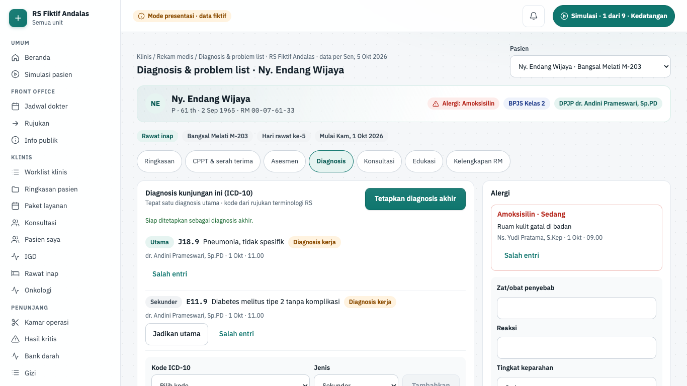

| Hal      | Isi                                                                                                                                                                                                                                            |
| -------- | ---------------------------------------------------------------------------------------------------------------------------------------------------------------------------------------------------------------------------------------------- |
| Rute     | `/klinis/diagnosis` (`?pasien=<encounterId>`)                                                                                                                                                                                                  |
| Pemakai  | dokter, dokter residen, perawat, bidan                                                                                                                                                                                                         |
| Komponen | K08 diagnosis dan problem list                                                                                                                                                                                                                 |
| Status   | demo (mode presentasi); API `diagnosis` sudah ada (fase 3 potongan 3.2a), layar belum disambung                                                                                                                                                |
| Mockup   | tidak ada (gaya mengikuti bagian A · Asesmen di `design/mockups/Main.dc.html`)                                                                                                                                                                 |
| Kode web | `apps/web/src/app/(staf)/klinis/diagnosis/` · data `apps/web/src/lib/demo/fixtures/rme-diagnosis.ts` · aturan `apps/web/src/lib/rme-diagnosis.ts` · komponen `apps/web/src/components/rme/diagnosis-workspace.tsx`                             |
| Kode API | `apps/api/src/modules/diagnosis/` (`GET /api/v1/encounters/:id/conditions`, `…/procedures`, `POST /api/v1/diagnosis/conditions`, `…/procedures`, `…/allergies`, `…/:id/entered-in-error`, `GET /api/v1/diagnosis/problem-list`, `…/allergies`) |

**Tujuan.** Diagnosis kunjungan berkode ICD-10 dengan tepat satu diagnosis utama, prosedur ICD-9-CM, daftar masalah
lintas kunjungan, dan alergi atau NKDA. Setiap perubahan adalah versi baru yang menunjuk versi lama.

**Alur.**

1. Buka **Diagnosis & problem list**. Kolom "Diagnosis kunjungan ini (ICD-10)" untuk Ny. Endang memuat J18.9
   Pneumonia, tidak spesifik (Utama) dan E11.9 Diabetes melitus tipe 2 tanpa komplikasi (Sekunder), keduanya
   "Diagnosis kerja".
2. Di bawahnya pilih "Kode ICD-10" dan "Jenis" (Utama, Sekunder, Komplikasi), lalu **Tambahkan**. Contoh: E87.5
   Hiperkalemia sebagai sekunder.
3. **Jadikan utama** (label aksesibel "Jadikan E11.9 diagnosis utama") menurunkan utama lama menjadi sekunder dan
   menaikkan yang dipilih. Keduanya menjadi versi 2.
4. **Salah entri** membuka "Alasan salah entri"; **Tandai salah entri** mencoret entri dengan "Salah entri · <alasan>".
5. **Masukkan ke problem list** menambah diagnosis yang belum ada di daftar masalah aktif.
6. **Tetapkan diagnosis akhir** mengubah semua diagnosis kerja menjadi diagnosis akhir.
7. Kartu "Prosedur (ICD-9-CM)": pilih "Kode ICD-9-CM", lalu **Tambahkan prosedur**.
8. Kartu "Problem list": saring **Aktif** atau **Teratasi**. **Tandai teratasi** meminta "Tanggal teratasi" dan
   "Catatan", lalu **Simpan**.
9. Kartu "Alergi": isi "Zat/obat penyebab", "Reaksi", dan "Tingkat keparahan", lalu **Catat alergi**. Alergi keliru
   ditandai **Salah entri**. **Verifikasi NKDA** mencatat "Tidak ada alergi yang diketahui (NKDA)".

**Gerbang keselamatan dan aturan bisnis.**

- Tepat satu diagnosis utama. Utama kedua ditolak: "Diagnosis utama sudah ada (J18.9). Tambahkan sebagai sekunder,
  lalu pakai "Jadikan utama" untuk menggantinya." Kode ganda ditolak (`addDxBlocker`).
- Diagnosis akhir butuh tepat satu utama ("Belum ada diagnosis utama. Tetapkan tepat satu diagnosis utama."). Setelah
  ditetapkan tombol menulis "Diagnosis akhir sudah ditetapkan." (`finalizeBlocker`).
- Salah entri diagnosis dan alergi wajib alasan minimal 10 karakter. Entri tetap tampil dicoret, tidak dihapus.
- Kode hanya dari `RME_ICD10` dan `RME_ICD9` di fixture, yang diambil dari rujukan seed `SEED_REF_SAMPLES` dan
  dijaga `rme-diagnosis.test.ts`.
- Diagnosis, prosedur, dan problem list hanya oleh dokter dan residen ("Diagnosis ditetapkan dokter (DPJP/residen).").
  Alergi juga boleh dicatat perawat dan bidan.
- NKDA hanya bila tidak ada alergi aktif: "Masih ada N alergi aktif; batalkan sebagai salah entri dulu bila memang
  keliru." Zat dan reaksi wajib; zat ganda ditolak. Masalah teratasi wajib bertanggal.

**Rencana backend.** Izin rencana `diagnosis.write` belum ada di katalog; modul `diagnosis` yang sudah jadi memakai
`clinical.read`, `clinical.write`, dan `clinical.correct`. API sudah menegakkan satu diagnosis utama final per
kunjungan dan NKDA eksklusif. Pemetaan aksi **Jadikan utama**, **Tetapkan diagnosis akhir**, dan **Tandai teratasi**
ke endpoint versi baru perlu dipastikan saat penyambungan.

## Konsultasi & rawat bersama

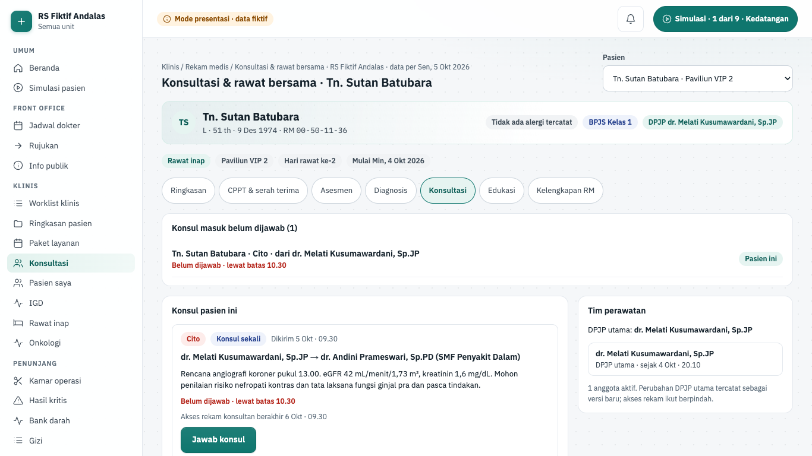

| Hal      | Isi                                                                                                                                                                                                        |
| -------- | ---------------------------------------------------------------------------------------------------------------------------------------------------------------------------------------------------------- |
| Rute     | `/klinis/konsultasi` (`?pasien=<encounterId>`; bawaan Tn. Sutan Batubara)                                                                                                                                  |
| Pemakai  | dokter, dokter residen                                                                                                                                                                                     |
| Komponen | K10 konsultasi dan rawat bersama                                                                                                                                                                           |
| Status   | demo (mode presentasi); backend fase 3 potongan 3.8 belum dibangun                                                                                                                                         |
| Mockup   | tidak ada (gaya mengikuti kartu Klinis Bersih, `docs/08-desain-ui.md`)                                                                                                                                     |
| Kode web | `apps/web/src/app/(staf)/klinis/konsultasi/` · data `apps/web/src/lib/demo/fixtures/rme-konsul.ts` · aturan `apps/web/src/lib/rme-konsul.ts` · komponen `apps/web/src/components/rme/konsul-workspace.tsx` |
| Kode API | `apps/api/src/modules/consult/` (kerangka; isi di potongan 3.8)                                                                                                                                            |

**Tujuan.** Permintaan konsul antar-DPJP dengan batas jawab per urgensi, jawaban terstruktur, penetapan rawat bersama
atau alih rawat, dan tim perawatan yang berubah sebagai versi baru.

**Alur.**

1. Buka **Konsultasi & rawat bersama**. Kartu "Konsul masuk belum dijawab (N)" memuat, mis., "Tn. Sutan Batubara ·
   Cito · dari dr. Melati Kusumawardani, Sp.JP" dengan status "Belum dijawab · lewat batas 10.30". Konsul pasien lain
   punya tautan **Buka konsul**.
2. Kartu "Konsul pasien ini" memuat chip urgensi dan jenis, jam kirim, "dr. Melati Kusumawardani, Sp.JP → dr. Andini
   Prameswari, Sp.PD (SMF Penyakit Dalam)", pertanyaan klinis, dan "Akses rekam konsultan berakhir 6 Okt · 09.30".
3. Tekan **Jawab konsul**. Isi "Temuan pemeriksaan", "Kesimpulan / diagnosis konsultan", "Rekomendasi tata laksana",
   dan "Tindak lanjut": Konsul selesai, kembali ke DPJP; Rawat bersama (konsultan ikut merawat); atau Alih rawat
   (konsultan menjadi DPJP utama).
4. Tekan **Tanda tangani jawaban**. Umpan balik "Konsul dijawab · <jam> · Rawat bersama …" dan kartu menulis
   "Dijawab <nama> · <jam>".
5. Kartu "Tim perawatan" menulis DPJP utama dan anggota aktif. Rawat bersama menambah "DPJP rawat bersama · sejak …";
   alih rawat menutup DPJP utama lama dan menetapkan konsultan.
6. Formulir "Kirim konsul baru": pilih "Dokter konsultan", "Jenis", dan "Urgensi" (Cito (≤ 1 jam) atau Biasa (≤ 24
   jam)), tulis "Pertanyaan klinis", lalu **Kirim konsul**. Umpan balik "Konsul terkirim ke … · <jam> · jawab sebelum
   …".

**Gerbang keselamatan dan aturan bisnis.**

- Batas jawab cito 1 jam dan biasa 24 jam (`URGENCY_HOURS`). Lewat batas ditulis "Belum dijawab · lewat batas …".
- Jawaban hanya oleh posisi dokter. Residen melihat **Jawab konsul** nonaktif dengan "Jawaban konsul ditandatangani
  dokter konsultan (posisi dokter)." Kesimpulan dan rekomendasi wajib ("Isi kesimpulan/diagnosis konsultan.").
- Kirim konsul hanya oleh dokter atau residen, ke konsultan yang bukan diri sendiri, dengan pertanyaan minimal 20
  karakter ("Tulis pertanyaan klinis yang jelas (minimal 20 karakter).") (`sendBlocker`).
- Akses rekam konsultan berbatas waktu: konsul sekali 24 jam sejak dijawab (atau sejak dikirim bila belum dijawab);
  rawat bersama dan alih rawat selama pasien dirawat (`consultantAccessUntil`).
- Tim perawatan tidak dihapus: anggota lama ditutup dengan tanggal berakhir, alih rawat dicatat "Alih rawat ke …
  (konsul <jam>)" (`applyFollowUp`).

**Rencana backend.** Izin rencana `consult.write` belum ada di katalog. Modul API `consult` masih kerangka; isinya
(permintaan + jawaban terstruktur, ganti DPJP utama sebagai versi baru dengan relasi akses ikut berpindah) dijadwalkan
di potongan 3.8 (`docs/rencana/fase-3-klinis-rme.md`). Akses berbatas waktu konsultan perlu dipetakan ke relasi ABAC.

## Edukasi pasien

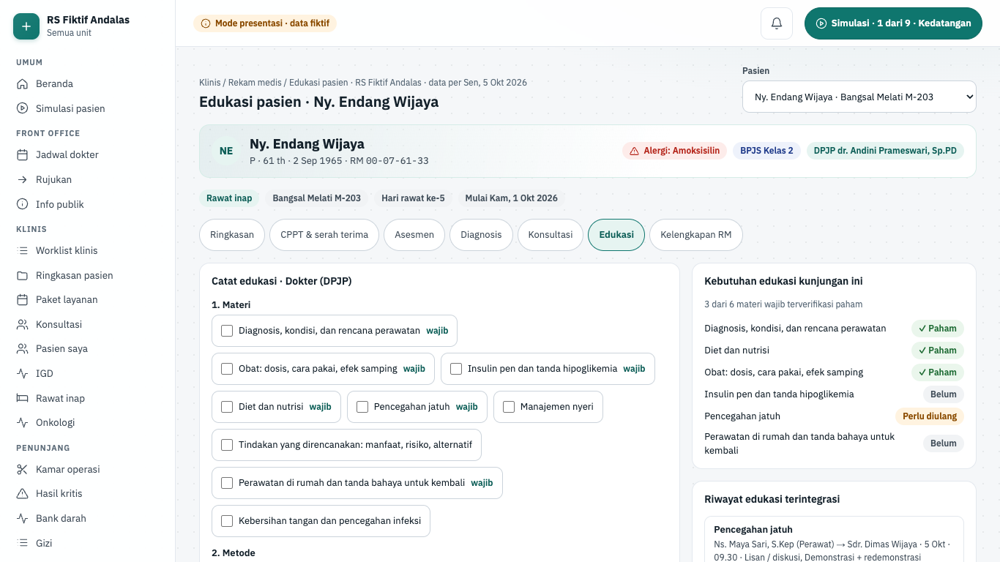

| Hal      | Isi                                                                                                                                                                                                        |
| -------- | ---------------------------------------------------------------------------------------------------------------------------------------------------------------------------------------------------------- |
| Rute     | `/klinis/edukasi` (`?pasien=<encounterId>`)                                                                                                                                                                |
| Pemakai  | dokter, dokter residen, perawat, bidan                                                                                                                                                                     |
| Komponen | K11 persetujuan dan edukasi                                                                                                                                                                                |
| Status   | demo (mode presentasi); backend fase 3 potongan 3.7 belum dibangun                                                                                                                                         |
| Mockup   | `design/mockups/Consent.dc.html`                                                                                                                                                                           |
| Kode web | `apps/web/src/app/(staf)/klinis/edukasi/` · data `apps/web/src/lib/demo/fixtures/rme-edukasi.ts` · aturan `apps/web/src/lib/rme-edukasi.ts` · komponen `apps/web/src/components/rme/edukasi-workspace.tsx` |
| Kode API | belum ada (rencana lewat formulir P07 `apps/api/src/modules/forms/` dan modul `consent` yang masih kerangka, docs/01-arsitektur.md §2)                                                                     |

**Tujuan.** Edukasi pasien dan keluarga terintegrasi lintas PPA dengan verifikasi pemahaman (teach-back), tanda
tangan penerima, dan atestasi edukator. Edukasi tindakan menjadi syarat persetujuan tindakan di tablet.

**Alur.**

1. Buka **Edukasi pasien**. Formulir "Catat edukasi · <profesi>" terdiri dari lima bagian.
2. **1. Materi**: pilih materi; materi wajib kunjungan ini diberi tanda "wajib".
3. **2. Metode**: Lisan / diskusi, Demonstrasi + redemonstrasi, Leaflet, atau Video.
4. **3. Sasaran** (Pasien, Keluarga / pendamping, Pasien dan keluarga) dan "Nama penerima". Untuk keluarga Ny. Endang
   nama terisi Sdr. Dimas Wijaya.
5. **4. Verifikasi pemahaman (teach-back)**: Paham (mampu menjelaskan ulang), Perlu diulang, atau Belum paham. Paham
   meminta "Ucapan ulang penerima"; selain itu meminta "Jadwal edukasi ulang hari ini".
6. **5. Tanda tangan penerima (ketik nama penerima)**, lalu centang "Saya, <nama>, memberikan edukasi ini dan
   memverifikasi pemahaman penerima."
7. Tekan **Simpan edukasi (final)**. Umpan balik "Edukasi final · <jam> · N materi terverifikasi paham", atau "Edukasi
   tercatat · … · edukasi ulang dijadwalkan …".
8. Kartu "Kebutuhan edukasi kunjungan ini" menulis kemajuan, mis. "3 dari 6 materi wajib terverifikasi paham", dengan
   status per materi ✓ Paham, Perlu diulang, atau Belum. Kartu "Riwayat edukasi terintegrasi" memuat catatan semua
   PPA.
9. Pasien dengan materi tindakan (mis. Ny. Anisa Rahmadani sebelum SC) mendapat status "Persetujuan tindakan belum
   siap: …" yang berubah menjadi "Persetujuan tindakan siap: …" beserta tautan **Buka persetujuan di tablet**.

**Gerbang keselamatan dan aturan bisnis.**

- Simpan ditolak dengan pesan berurutan (`eduBlocker`): minimal satu materi, metode, nama penerima, hasil verifikasi
  pemahaman, ucapan ulang minimal 10 karakter bila paham, jadwal ulang bila belum paham, tanda tangan sama dengan nama
  penerima ("Tanda tangan penerima: ketik nama yang sama dengan nama penerima."), dan atestasi ("Centang atestasi
  edukator.").
- Materi wajib per kunjungan: bawaan rawat jalan penyakit dan obat; rawat inap penyakit, obat, dan perawatan di rumah;
  beberapa kunjungan punya daftar sendiri (`requiredTopics`). Status materi memakai catatan terbaru per materi.
- Persetujuan tindakan siap hanya setelah materi "Tindakan yang direncanakan: manfaat, risiko, alternatif"
  terverifikasi paham (`consentReady`).
- Edukator: dokter, residen, perawat, dan bidan. Catatan final tidak bisa diubah.

**Rencana backend.** Izin rencana `education.write` belum ada di katalog. Rencana fase 3 potongan 3.7 menyimpan
edukasi lewat formulir P07 bersama tablet persetujuan (modul `consent`, izin `consent.write` dan `consent.sign`).
Syarat "edukasi tindakan paham sebelum persetujuan" baru ada di layar ini; tablet persetujuan belum memeriksanya.

## Asuhan keperawatan

API K12 (potongan 3.5): `GET /api/v1/nursing/emar/:encounterId?date=YYYY-MM-DD` membaca papan dosis WIB. `POST /nursing/wristband-scans` mencatat hasil pindai; kode salah tetap disimpan dan diaudit sebelum 422. `POST /nursing/administrations` memerlukan pindaian aktif milik pemberi obat dan label UUID baris order lokal. Obat high-alert memerlukan `doubleCheckId` dari `POST /nursing/double-checks` oleh sesi perawat/bidan kedua atas isi dosis yang sama. ID petugas yang dikirim sendiri belum memenuhi cek ganda. Dosis telat/ditunda/ditolak wajib alasan; jadwal ganda dan stat ganda ditolak. Dosis PRN berikutnya perlu pindaian baru. Detail: [ADR-0077](../adr/0077-emar-cek-ganda-terikat-dosis.md).

Diagnosis master lokal: `GET /nursing/diagnoses`. Asuhan: `POST /nursing/care-plans`, `GET /nursing/care-plans/:encounterId`; koreksi membuat versi baru oleh penulis, tidak menimpa catatan. Balans cairan: `POST /nursing/fluid-balances`, `GET /nursing/fluid-balances/:encounterId?date=YYYY-MM-DD`; total hanya menjumlahkan versi observasi terkini. Semua rute memakai awalan `/api/v1`, izin klinis/pemberian, isolasi tenant, dan ABAC pasien. Layar di bawah tetap menggambarkan mode presentasi sampai W4 disambungkan.

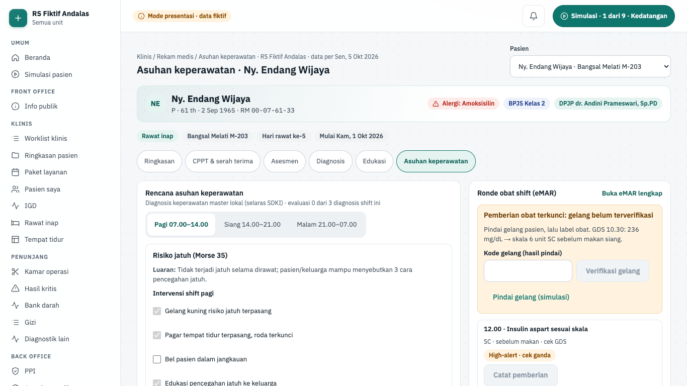

| Hal      | Isi                                                                                                                                                                                                                                 |
| -------- | ----------------------------------------------------------------------------------------------------------------------------------------------------------------------------------------------------------------------------------- |
| Rute     | `/klinis/asuhan-keperawatan` (`?pasien=<encounterId>`, pasien rawat inap)                                                                                                                                                           |
| Pemakai  | perawat, bidan                                                                                                                                                                                                                      |
| Komponen | K12 asuhan keperawatan dan eMAR                                                                                                                                                                                                     |
| Status   | demo (mode presentasi); API fase 3 potongan 3.5 (eMAR + askep) tersedia; layar masih demo, sambungan API mengikuti W4; tanda vital + EWS tersedia                                                                                   |
| Mockup   | `design/mockups/Ranap.dc.html`                                                                                                                                                                                                      |
| Kode web | `apps/web/src/app/(staf)/klinis/asuhan-keperawatan/` · data `apps/web/src/lib/demo/fixtures/rme-askep.ts` dan `rawat-inap.ts` · aturan `apps/web/src/lib/rme-askep.ts` · komponen `apps/web/src/components/rme/askep-workspace.tsx` |
| Kode API | `apps/api/src/modules/nursing/` (tanda vital + NEWS2, eMAR, cek ganda, askep, balans cairan; potongan 3.5, ADR-0077)                                                                                                                |

**Tujuan.** Rencana asuhan keperawatan per shift (diagnosis keperawatan, luaran, intervensi, evaluasi SOAP) dan ronde
obat shift dengan gerbang gelang eMAR.

**Alur.**

1. Buka **Asuhan keperawatan**. Kartu "Rencana asuhan keperawatan" menulis "Diagnosis keperawatan master lokal
   (selaras SDKI) · evaluasi 0 dari 3 diagnosis shift ini". Pilih shift: Pagi 07.00–14.00, Siang 14.00–21.00, atau
   Malam 21.00–07.00.
2. Setiap diagnosis (mis. "Risiko jatuh (Morse 35)") memuat Luaran dan "Intervensi shift pagi". Centang intervensi
   yang selesai; jamnya tercatat.
3. Isi evaluasi: S · Subjektif, O · Objektif, A · Hasil evaluasi (Masalah teratasi, Teratasi sebagian, Belum
   teratasi), dan P · Rencana lanjut. Tekan **Simpan evaluasi shift**; hasilnya "Evaluasi final · <jam> · <nama>".
4. **Tambah diagnosis keperawatan** dari master (Nyeri akut, Defisit pengetahuan, Risiko infeksi, Gangguan mobilitas
   fisik), lalu **Tambahkan**.
5. Kartu "Ronde obat shift (eMAR)" mulai terkunci: "Pemberian obat terkunci: gelang belum terverifikasi". Isi "Kode
   gelang (hasil pindai)" atau tekan **Pindai gelang (simulasi)**, lalu **Verifikasi gelang**.

   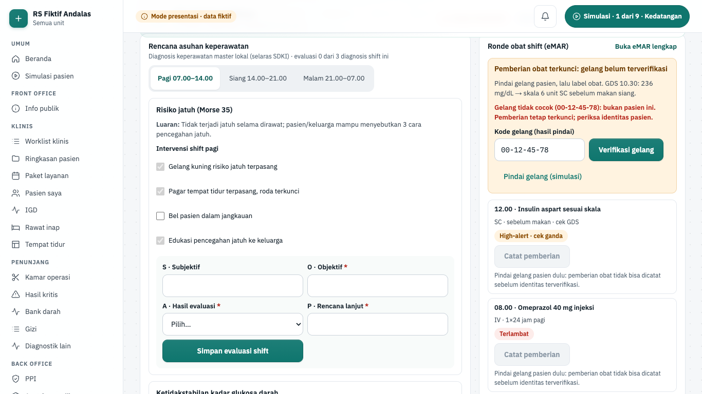

6. Gelang yang cocok menulis "✓ Pasien benar · gelang terpindai <jam> · RM 00-07-61-33".
7. Untuk setiap dosis jatuh tempo tekan **Catat pemberian**. Dosis terlambat (08.00 · Omeprazol 40 mg injeksi) meminta
   "Alasan keterlambatan". Obat high-alert (12.00 · Insulin aspart sesuai skala) meminta "Perawat pemeriksa kedua".
   Hasilnya "✓ Diberikan <jam> · … · terlambat: …" atau "… · cek ganda <nama>".
8. **Buka eMAR lengkap** membuka tab CPPT & eMAR di Rawat inap.

**Gerbang keselamatan dan aturan bisnis.**

- Pemberian obat terkunci sampai gelang cocok dengan RM pasien (hanya huruf dan angka yang dibandingkan). Pesan di
  setiap dosis: "Pindai gelang pasien dulu: pemberian obat tidak bisa dicatat sebelum identitas terverifikasi."
- Gelang salah ditolak: "Gelang tidak cocok (<kode>): bukan pasien ini. Pemberian tetap terkunci; periksa identitas
  pasien."
- Dosis terlambat wajib alasan minimal 10 karakter. Obat high-alert wajib cek ganda perawat kedua
  (`recordDoseBlocker`).
- Evaluasi shift wajib O, A, dan P ("Isi O (data objektif) evaluasi.", "Pilih hasil evaluasi (A).", "Isi P (rencana
  lanjut)."); S boleh kosong.
- Intervensi, evaluasi, dan pemberian obat hanya oleh perawat dan bidan.
- Diagnosis keperawatan memakai master lokal tanpa kode resmi (keputusan fase 3 no. 15). Pasien bukan rawat inap
  melihat penjelasan bahwa askep dan ronde obat berlaku untuk rawat inap.

**Backend.** API potongan 3.5 sudah ada (lihat awal bagian ini). Izin yang dipakai: `medication.administer` untuk
pindai gelang, cek ganda, dan pemberian; `clinical.write`/`clinical.read` untuk asuhan dan balans cairan. Izin rencana
`nursing.write` dari mode presentasi tidak dipakai API. Sambungan layar mengikuti W4.

## Ringkasan pasien

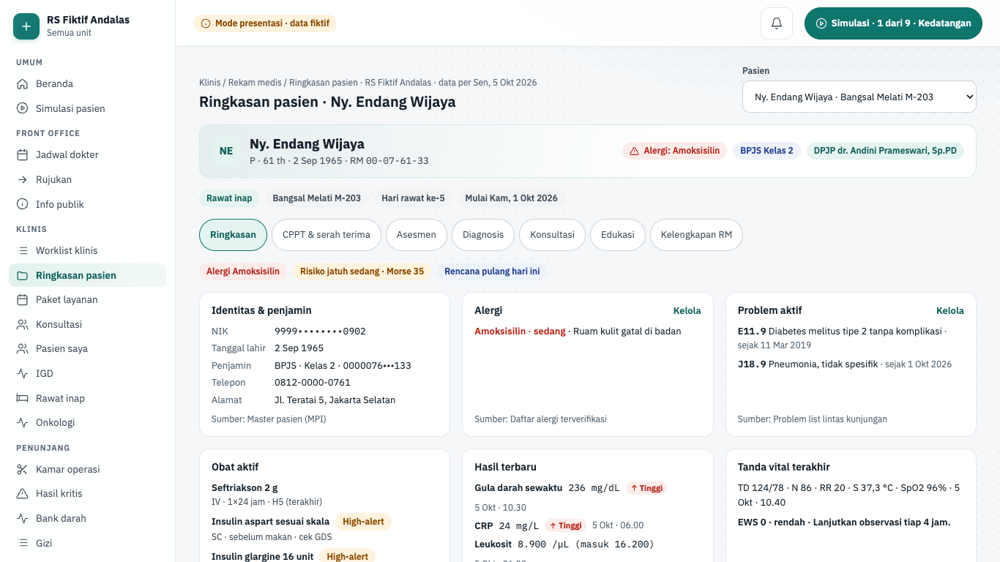

| Hal      | Isi                                                                                                                                                                   |
| -------- | --------------------------------------------------------------------------------------------------------------------------------------------------------------------- |
| Rute     | `/klinis/ringkasan` (`?pasien=<encounterId>`)                                                                                                                         |
| Pemakai  | dokter, dokter residen, perawat, bidan                                                                                                                                |
| Komponen | K14 ringkasan pasien                                                                                                                                                  |
| Status   | demo (mode presentasi); API `summary` sudah ada (fase 3 potongan 3.2a), layar belum disambung                                                                         |
| Mockup   | tidak ada (gaya mengikuti kartu Klinis Bersih, `docs/08-desain-ui.md`)                                                                                                |
| Kode web | `apps/web/src/app/(staf)/klinis/ringkasan/` · data `apps/web/src/lib/demo/fixtures/rme-ringkasan.ts`, `rme-diagnosis.ts` · aturan `apps/web/src/lib/rme-ringkasan.ts` |
| Kode API | `apps/api/src/modules/summary/` (`GET /api/v1/summary/patients/:id`, `GET /api/v1/encounters/:id/context`)                                                            |

**Tujuan.** Satu halaman baca untuk mengenal pasien dengan cepat: identitas, flag risiko, alergi, problem aktif, obat
aktif, hasil terbaru, tanda vital, kunjungan terakhir, dan rencana. Setiap blok menyebut sumbernya.

**Alur.**

1. Buka **Ringkasan pasien** dari menu, dari chip **Ringkasan** di navigasi bagan, atau dari tab **Pasien saya** di
   Worklist klinis (klik nama pasien).
2. Baris "Flag risiko" memuat chip bertulisan: alergi, nilai kritis (mis. "Nilai kritis: Kalium 6,4 mmol/L"), EWS bila
   bukan rendah, risiko tercatat (mis. "Risiko jatuh sedang · Morse 35"), Isolasi, dan "Rencana pulang hari ini".
   Tanpa flag tertulis "Tidak ada flag risiko aktif".
3. Baca kartu Identitas & penjamin (NIK tersamar), Alergi (atau "Tidak ada alergi yang diketahui (NKDA)"), Problem
   aktif, Obat aktif (chip High-alert), Hasil terbaru, Tanda vital terakhir (dengan EWS), Kunjungan terakhir, dan
   Rencana. Setiap kartu ditutup "Sumber: …".
4. Pindah ke layar asal lewat **Kelola** (Diagnosis & problem list), **Ronde obat** (Asuhan keperawatan), atau
   **CPPT**.

**Gerbang keselamatan dan aturan bisnis.**

- Layar hanya baca; perubahan dilakukan di layar asal.
- Hasil terbaru: satu baris per pemeriksaan (nilai terakhir), nilai kritis selalu paling atas, maksimal 6 baris
  (`latestResults`). Contoh Tn. Yusuf Hidayat: Kalium kritis di baris pertama.
- Flag risiko selalu bertulisan, bukan hanya warna (`riskFlags`). Tingkat EWS dari tanda vital terakhir (NEWS2).
- Tautan ke layar asal hanya tampil bila layar itu terbuka untuk posisi (mis. **Ronde obat** hanya untuk perawat dan
  bidan pada pasien rawat inap).
- Pasien rawat jalan: obat dari resep rawat jalan terakhir; tanda vital ditulis "Tanda vital rawat jalan tercatat di
  layar Pemeriksaan poli."

**Rencana backend.** Izin rencana `clinical.read` (sudah ada di katalog). Modul `summary` sudah jadi dan hanya
membaca modul lain; layar tinggal disambung. Flag nilai kritis menunggu sumber hasil kritis (fase 4).

## Paket layanan khusus

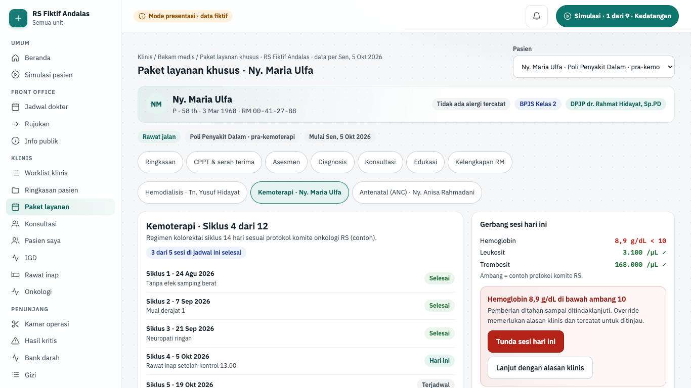

| Hal      | Isi                                                                                                                                                                                                        |
| -------- | ---------------------------------------------------------------------------------------------------------------------------------------------------------------------------------------------------------- |
| Rute     | `/klinis/paket-layanan` (`?pasien=<encounterId>`; bawaan kemoterapi Ny. Maria Ulfa)                                                                                                                        |
| Pemakai  | dokter, perawat, bidan                                                                                                                                                                                     |
| Komponen | K15 paket layanan khusus                                                                                                                                                                                   |
| Status   | demo (mode presentasi); backend fase 3 potongan 3.8 belum dibangun                                                                                                                                         |
| Mockup   | tidak ada (gaya mengikuti `SafetyGate` dan kartu Klinis Bersih, `docs/08-desain-ui.md`)                                                                                                                    |
| Kode web | `apps/web/src/app/(staf)/klinis/paket-layanan/` · data `apps/web/src/lib/demo/fixtures/rme-paket.ts` · aturan `apps/web/src/lib/rme-paket.ts` · komponen `apps/web/src/components/rme/paket-workspace.tsx` |
| Kode API | `apps/api/src/modules/care-packages/` (kerangka; isi di potongan 3.8)                                                                                                                                      |

**Tujuan.** Paket layanan berulang (hemodialisis, kemoterapi, antenatal) dengan jadwal sesi, daftar kelengkapan per
sesi yang diisi sesuai profesi, gerbang lab pra-tindakan, dan alur mulai sampai selesai sesi.

**Alur.**

1. Buka **Paket layanan khusus**. Navigasi "Paket aktif" memuat Hemodialisis · Tn. Yusuf Hidayat, Kemoterapi · Ny.
   Maria Ulfa, dan Antenatal (ANC) · Ny. Anisa Rahmadani.
2. Kartu paket menulis judul dan siklus ("Kemoterapi · Siklus 4 dari 12"), protokol, kemajuan ("3 dari 5 sesi di
   jadwal ini selesai"), dan "Jadwal sesi" dengan status Selesai, Hari ini, Berlangsung, Terjadwal, atau Ditunda.
3. Di daftar kelengkapan, tekan **Tandai selesai** pada butir yang menjadi hak profesi Anda (label aksesibel "Tandai
   selesai: <butir>"), mis. "Verifikasi ganda dosis (apoteker + perawat)".
4. Kartu "Gerbang sesi hari ini" menampilkan lab pra-tindakan: Hemoglobin 8,9 g/dL < 10, Leukosit 3.100 /µL ✓,
   Trombosit 168.000 /µL ✓, dengan catatan "Ambang = contoh protokol komite RS."
5. Gerbang "Hemoglobin 8,9 g/dL di bawah ambang 10" memberi dua pilihan: **Tunda sesi hari ini** (sesi menjadi
   Ditunda) atau **Lanjut dengan alasan klinis**, isi "Alasan klinis", lalu **Simpan alasan dan lanjut**. Gerbang
   menulis "Override tercatat · …".
6. Tekan **Mulai pemberian siklus** ("Kemoterapi dimulai · <jam>"), lalu **Selesaikan siklus hari ini**. Jadwal menulis
   "Selesai <jam> · <nama>" pada Siklus 4.
7. Hemodialisis memakai **Mulai sesi HD** dan **Selesaikan sesi HD**. ANC memakai **Tutup paket ANC (lanjut
   persalinan)** yang langsung menutup sesi.

**Gerbang keselamatan dan aturan bisnis.**

- Mulai sesi nonaktif sampai semua butir kelengkapan selesai ("Lengkapi dulu: …") lalu sampai gerbang lab lolos atau
  di-override ("Hasil lab di bawah ambang protokol: tunda sesi atau lanjut dengan alasan klinis.") (`startBlocker`).
- Override wajib alasan klinis minimal 10 karakter (`SafetyGate`) dan tercatat bersama nama dan jam.
- Butir kelengkapan punya hak isi per profesi. Butir di luar hak menulis "Diisi oleh …", mis. "Resep HD DPJP (durasi,
  target UF, antikoagulan)" hanya "Diisi oleh Dokter (DPJP)." (`markBlocker`).
- Ambang lab adalah contoh protokol RS di fixture, bukan pedoman klinis: kemoterapi Hb ≥ 10 g/dL, leukosit ≥ 3.000/µL,
  trombosit ≥ 100.000/µL.
- Butir hanya bisa ditandai bila paket punya sesi hari ini. Mulai dan selesai hanya mengubah sesi hari ini; sesi
  lain tidak berubah (`setTodayStatus`).

**Rencana backend.** Izin rencana `care-package.write` belum ada di katalog. Modul API `care-packages` masih kerangka;
potongan 3.8 merencanakan `GET /api/v1/care-packages?setting=` dan mekanisme paket formulir + kelengkapan
(keputusan fase 3 no. 18). Ambang gerbang lab perlu menjadi pengaturan protokol per RS, bukan konstanta.

## Kelengkapan rekam medis

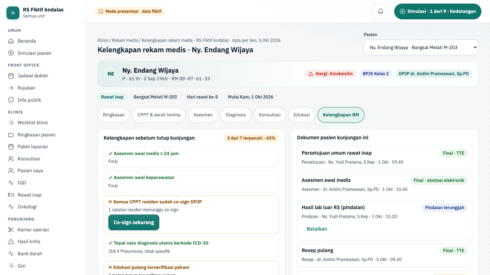

| Hal      | Isi                                                                                                                                                                                                                                                         |
| -------- | ----------------------------------------------------------------------------------------------------------------------------------------------------------------------------------------------------------------------------------------------------------- |
| Rute     | `/klinis/kelengkapan` (`?pasien=<encounterId>`)                                                                                                                                                                                                             |
| Pemakai  | dokter, dokter residen, petugas rekam medis                                                                                                                                                                                                                 |
| Komponen | K13 resume dan dokumen pulang                                                                                                                                                                                                                               |
| Status   | demo (mode presentasi); backend fase 3 potongan 3.6 dan 3.8 belum dibangun                                                                                                                                                                                  |
| Mockup   | `design/mockups/Resume.dc.html`                                                                                                                                                                                                                             |
| Kode web | `apps/web/src/app/(staf)/klinis/kelengkapan/` · data `apps/web/src/lib/demo/fixtures/rme-kelengkapan.ts` · aturan `apps/web/src/lib/rme-kelengkapan.ts` · komponen `apps/web/src/components/rme/kelengkapan-workspace.tsx`                                  |
| Kode API | kontrak `DischargeGate` + `BasicDischargeGate` sementara di `apps/api/src/modules/adt/discharge-gate.ts` (aturan lengkap 3.6; modul `discharge` masih kerangka); kelengkapan rencana 3.8; dokumen lewat `apps/api/src/modules/documents/` (P08, sudah jadi) |

**Tujuan.** Daftar periksa DPJP sebelum menutup kunjungan (gerbang tutup encounter, EP 5c) dan daftar dokumen pasien
per kunjungan dengan status TTE. Dokumen tidak pernah dihapus.

**Alur.**

1. Buka **Kelengkapan rekam medis**. Kartu "Kelengkapan sebelum tutup kunjungan" Ny. Endang menulis "3 dari 7
   terpenuhi · 43%". Butirnya ditandai ✓ atau ✕: Asesmen awal medis ≤ 24 jam, Asesmen awal keperawatan, Semua CPPT
   residen sudah co-sign DPJP, Tepat satu diagnosis utama berkode ICD-10, Edukasi pulang terverifikasi paham, Surat
   kontrol Poli Penyakit Dalam ber-TTE, dan Resume medis final ber-TTE.
2. Perbaiki butir di tempat: **Co-sign sekarang** dan **Kirim ulang TTE**. Butir lain punya tautan **Lengkapi di layar
   asal** (Asesmen, Diagnosis, Edukasi, Resume medis, atau CPPT).
3. Pilih "Disposisi": Pulang atas persetujuan DPJP, Dirujuk ke fasilitas lain, Pulang atas permintaan sendiri, atau
   Meninggal.
4. Tekan **Tutup kunjungan**. Selama ada butir terbuka, tombol nonaktif dan alasannya tertulis.

   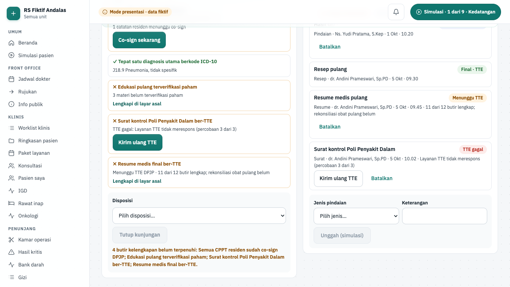

5. Bila semua butir terpenuhi (mis. rawat jalan Ny. Rohana Siregar, 100%), kunjungan ditutup: "Kunjungan ditutup ·
   <jam> · Pulang atas persetujuan DPJP. Rekam medis terkunci; perubahan berikutnya lewat addendum."
6. Kartu "Dokumen pasien kunjungan ini" memuat status Final · TTE, Final · atestasi elektronik, Menunggu TTE, TTE
   gagal, Draf, Pindaian terunggah, atau Dibatalkan. Dokumen belum final bisa **Batalkan**: isi "Alasan pembatalan",
   lalu **Batalkan dokumen**.
7. Unggah pindaian: pilih "Jenis pindaian" (Pindaian surat rujukan, Hasil pemeriksaan luar RS, Surat keterangan,
   Dokumen identitas penjamin), isi "Keterangan", lalu **Unggah (simulasi)**.

**Gerbang keselamatan dan aturan bisnis.**

- Tutup kunjungan hanya oleh DPJP (posisi dokter). Residen dan petugas rekam medis melihat "Kunjungan ditutup oleh
  DPJP (posisi dokter)." (`closeBlocker`).
- Semua butir wajib terpenuhi: "N butir kelengkapan belum terpenuhi: …". Disposisi wajib ("Pilih disposisi
  pasien."). Rujuk membutuhkan surat rujukan ber-TTE; meninggal membutuhkan surat keterangan kematian ber-TTE.
- Co-sign dan kirim ulang TTE dari layar ini hanya oleh DPJP; posisi lain melihat "Diselesaikan DPJP (posisi
  dokter)."
- Butir dihitung dari data layar RME lain (asesmen, CPPT, diagnosis, edukasi) agar konsisten; rawat inap menambah
  butir resume medis final ber-TTE.
- Pembatalan dokumen wajib alasan minimal 10 karakter dan dokumen tetap ada di daftar dengan status Dibatalkan.
  Dokumen final tidak bisa dibatalkan: "Dokumen final terkunci; koreksi lewat addendum." (`cancelBlocker`).
- Setelah ditutup, rekam medis kunjungan terkunci; perubahan hanya lewat addendum.

**Rencana backend.** Izin rencana `clinical.sign` (sudah ada di katalog), tetapi petugas rekam medis di `demoRoles`
tidak memegangnya dan juga tidak memegang `documents.write`. Potongan 3.6 membangun `DischargeGate` (rawat inap =
disposisi + resume final; meninggal = surat kematian; rujuk = surat rujukan). Untuk disposisi meninggal berlaku
keputusan K-1 (7 Okt 2026): hanya dokter yang berelasi dengan pasien, wajib jam kematian + sebab kematian ICD-10 +
surat keterangan kematian ber-TTE, admisi ditolak. Potongan 3.8 membangun
`GET /api/v1/assessment/encounters/:id/completeness` serta `components/klinis/patient-documents.tsx`. Daftar,
unggah, batal, dan TTE dokumen kelak memakai modul `documents` (`POST /api/v1/patients/:patientId/documents`,
`POST /api/v1/documents/:id/void`, `POST /api/v1/documents/:id/signatures`).

## Tes yang menjaga layar ini

E2E mode presentasi (Playwright, proyek `demo-desktop` dan `demo-tablet`):

- `apps/web/e2e/demo/klinis.spec.ts`: antrean poli, banner + alergi, TTV, tanda tangan butuh diagnosis, CDS
  amoksisilin diblokir sampai alasan ≥ 10 karakter, alternatif aman, kunjungan tak dikenal 404, perawat ditolak di
  CPOE, CPOE pasien skenario terkunci, status IGD dan bed bertulisan, CSP ber-nonce.
- `apps/web/e2e/demo/rawat-inap.spec.ts`: triase turun wajib alasan, alokasi bed, eMAR terkunci sampai gelang cocok,
  cek ganda, dosis terlambat, koreksi dan addendum CPPT, TTE resume 12 butir, persetujuan tablet dan penolakan.
- `apps/web/e2e/demo/fe2-klinis.spec.ts`: sepuluh layar bagan RME. Worklist (baca ulang nilai kritis, co-sign dari
  worklist, residen menunggu co-sign), CPPT (co-sign, verifikasi, riwayat versi, koreksi beralasan, serah terima SBAR
  wajib penerima), asesmen (reasesmen Morse dan hak tulis per profesi), diagnosis (satu utama, salah entri beralasan,
  NKDA), konsultasi (jawaban terstruktur, pertanyaan minimal 20 karakter), edukasi (teach-back, tanda tangan,
  persetujuan siap), askep (gerbang gelang, terlambat, cek ganda), ringkasan (nilai kritis di atas), paket (gerbang Hb
  dan override), dan kelengkapan (tutup kunjungan terkunci, hanya DPJP). Setiap tes juga memeriksa tidak ada gulir
  horizontal.
- `apps/web/e2e/demo/semua-layar.spec.ts`: jaring pengaman semua layar dan QA visual.
- `apps/web/e2e/smoke.spec.ts`: mode api menampilkan "Belum tersambung" atau "Akses ditolak" di layar klinis dan rute
  detailnya.

Unit:

- `apps/web/src/lib/klinis.test.ts`, `klinis-cds.test.ts`, `rawat-inap.test.ts`, `rawat-inap-gates.test.ts`,
  `rawat-inap-scenario.test.ts`, `screens.test.ts`, `apps/web/src/lib/demo/fixtures/fixtures.test.ts`.
- Bagan RME: `apps/web/src/lib/rme.test.ts`, `rme-worklist.test.ts`, `rme-cppt.test.ts`, `rme-asesmen.test.ts`,
  `rme-diagnosis.test.ts` (termasuk kode hanya dari rujukan seed), `rme-konsul.test.ts`, `rme-edukasi.test.ts`,
  `rme-askep.test.ts`, `rme-ringkasan.test.ts`, `rme-paket.test.ts`, `rme-kelengkapan.test.ts`.
- `packages/shared/src/clinical/clinical.test.ts` (CDS, EWS, triase, eMAR, resume).
- API: `apps/api/test/clinical-infra.test.ts`, `clinical-records.test.ts`, `clinical-notes.test.ts`,
  `orders.test.ts`, `adt-triage.test.ts`, `admission.test.ts`.

## Lihat juga

- [Fitur penunjang](./13-fitur-penunjang.md): lab, radiologi, farmasi, dan kamar operasi yang menerima order CPOE.
- [Fitur front office](./11-fitur-front-office.md): pendaftaran, SEP, dan antrean sebelum pasien sampai di poli.
- [Fitur keuangan](./14-fitur-keuangan.md): kasir dan klaim setelah kunjungan selesai.
- [Cara kode bekerja · CPOE + CDS](./02-cara-kerja-kode.md#cpoe-cds-resep-k09-fase-3-potongan-3-4) dan
  [CPPT, co-sign, worklist](./02-cara-kerja-kode.md#cppt-co-sign-verifikasi-dpjp-serah-terima-asesmen-worklist-fase-3-potongan-3-2b).
- [Siapa boleh apa](./01-cara-kerja-sistem.md#siapa-boleh-apa): RBAC, ABAC, dan break-the-glass.
- [Simulasi dan operasional](./18-simulasi-dan-operasional.md) dan [Peta kode](./19-peta-kode.md).
- [Peta alur semua fase](./20-peta-alur-semua-fase.md): posisi layar bagan RME dalam alur pasien lintas fase.
- [Fitur back office](./16-fitur-back-office.md): layar onkologi dan administrasi rekam medis yang memakai data klinis.
- Rencana: `docs/rencana/fase-3-klinis-rme.md`; status: `docs/PROGRESS.md`.
