# Fitur penunjang

Halaman ini menjelaskan sepuluh layar penunjang (lapisan S): laboratorium dengan nilai kritis, radiologi, farmasi,
kamar operasi dan anestesi, pusat hasil kritis, depo dan stok farmasi, bank darah, gizi, mikrobiologi dan patologi
anatomi, serta diagnostik lain. Layar-layar ini menerima order dari CPOE dan mengembalikan hasil, obat, atau laporan operasi ke rekam
medis pasien. Setiap layar punya gerbang keselamatan yang ditegakkan ulang di Server Action, bukan hanya di tombol.

> Status 7 Okt 2026: kesepuluh layar berjalan di mode presentasi dengan data fiktif (`pnpm dev:demo`) dan sejak
> potongan 4.0c berstatus hibrida: di mode api peran berizin melihat "Belum tersambung" sampai potongan 4.2–4.9 mengisi
> jalur API, peran lain "Akses ditolak". Kontrak bersama fase 4 (4.0a: izin, event, `SUPPORT_ERRORS`, skema API,
> aturan murni, parser HL7 ORU), skema DB + gerbang keselamatan di database (4.0b, ADR-0034–0037), dan mock analyzer
> LIS (4.1b) sudah ada. Modul API pertama: stok depo (4.6a, layar Depo mode api); modul lain menyusul. Sumber order tetap
> CPOE + CDS (3.4); hasil berkode masuk modul `results` (3.2a).

Posisi layar penunjang dalam perjalanan pasien rawat jalan (CPOE → lab dan farmasi → kasir):

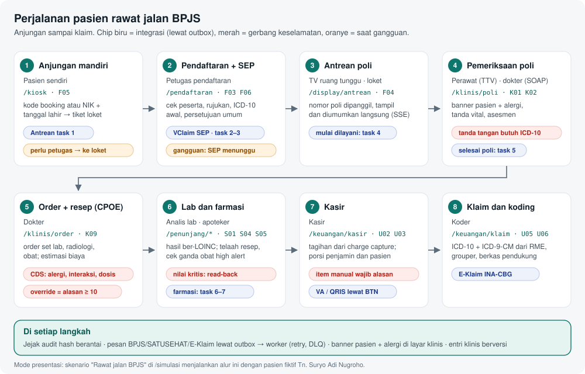

Order yang masuk ke layar-layar ini ditulis di [CPOE](./12-fitur-klinis.md#order-dan-resep-cpoe). Cara membawakan
skenario Simulasi ada di [Simulasi dan operasional](./18-simulasi-dan-operasional.md).

## Ringkasan layar

| Layar               | Rute                       | Peran (mode presentasi)                  | Komponen | Status                                   |
| ------------------- | -------------------------- | ---------------------------------------- | -------- | ---------------------------------------- |
| Laboratorium        | `/penunjang/lab`           | analis lab                               | S01, S09 | 🟨 demo; api: belum tersambung (4.2)     |
| Radiologi           | `/penunjang/radiologi`     | radiografer                              | S03      | 🟨 demo tanpa mockup; API belum (fase 4) |
| Farmasi             | `/penunjang/farmasi`       | apoteker                                 | S04, S05 | 🟨 demo; API belum (fase 4)              |
| Kamar operasi       | `/penunjang/kamar-operasi` | dokter, perawat                          | S06      | 🟨 demo; API belum (fase 4)              |
| Pusat hasil kritis  | `/penunjang/hasil-kritis`  | analis lab, radiografer, dokter, perawat | S09      | 🟨 demo tanpa mockup; API belum (fase 4) |
| Depo & stok farmasi | `/penunjang/depo`          | apoteker                                 | S05      | 🟨 demo tanpa mockup; API belum (fase 4) |
| Bank darah          | `/penunjang/bank-darah`    | analis lab, perawat, bidan, dokter       | S08      | 🟨 demo tanpa mockup; API belum (fase 4) |
| Gizi                | `/penunjang/gizi`          | perawat, dokter                          | S07      | 🟨 demo tanpa mockup; API belum (fase 4) |
| Mikrobiologi & PA   | `/penunjang/mikrobiologi`  | analis lab, dokter                       | S02      | 🟨 demo tanpa mockup; API belum (fase 4) |
| Diagnostik lain     | `/penunjang/diagnostik`    | dokter, perawat                          | S10      | 🟨 demo tanpa mockup; API belum (fase 4) |

Legenda: 🟨 berjalan di mode presentasi, belum tersambung ke API · ✅ tersambung · ⬜ belum dibangun.

Sejak fase 4 potongan 4.0c, kesepuluh layar penunjang **hibrida** dengan pola yang sama dengan layar klinis 3.0d:

- `page.tsx` memanggil `requireScreen(<id>)`. Mode presentasi merender `demo-<layar>.tsx` dengan Server Action
  `actions-demo.ts` (dibekukan, setiap action lewat `assertDemo`).
- Mode api membuka layar bagi peran yang memegang izin layarnya (katalog dan matriks bawaan 4.0a), lalu menampilkan
  "Belum tersambung" sampai potongan 4.2–4.9 mengisi jalur API. Peran tanpa izin melihat "Akses ditolak", dan menunya
  tidak tampil.
- Data per layar di `apps/web/src/lib/server/data/penunjang/<layar>.ts` (`lab`, `farmasi`, `radiologi`,
  `kamar-operasi`, `kritis`, `depo`, `bank-darah`, `gizi`, `mikro`, `diagnostik`) + `shared.ts`.

| Layar                           | Izin layar (mode api)  | Pelaksana di matriks bawaan                        |
| ------------------------------- | ---------------------- | -------------------------------------------------- |
| Laboratorium, Mikrobiologi & PA | `lab.worklist.read`    | analis lab                                         |
| Radiologi                       | `radiology.read`       | radiografer, dokter berpenugasan di unit Radiologi |
| Farmasi                         | `pharmacy.review.read` | apoteker                                           |
| Kamar operasi                   | `surgery.read`         | perawat unit OK, dokter berelasi                   |
| Pusat hasil kritis              | `critical_result.read` | analis lab, radiografer, dokter, perawat           |
| Depo & stok farmasi             | `stock.read`           | apoteker, manajemen                                |
| Bank darah                      | `blood_bank.read`      | analis lab                                         |
| Gizi                            | `nutrition.read`       | ahli gizi, perawat                                 |
| Diagnostik lain                 | `diagnostics.write`    | dokter berpenugasan di unit Diagnostik             |

Server Action mode presentasi mencari rekaman di server (klien hanya mengirim id), memeriksa gerbang, lalu menyimpan
ke toko demo. Atribut keselamatan seperti
nilai kritis, kontras, modalitas, peringatan CDS, dan obat high alert dibaca dari data server, bukan dari kiriman
klien.

## Laboratorium

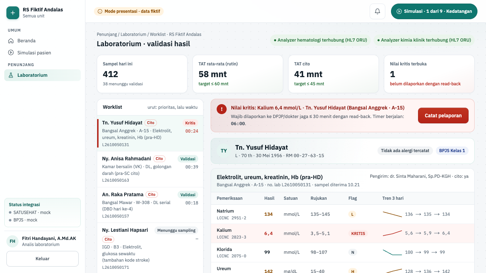

| Hal      | Isi                                                                                                                                                                          |
| -------- | ---------------------------------------------------------------------------------------------------------------------------------------------------------------------------- |
| Rute     | `/penunjang/lab` (`?pilih=<sampleId>` = sampel yang dibuka)                                                                                                                  |
| Pemakai  | analis lab                                                                                                                                                                   |
| Komponen | S01 laboratorium patologi klinik, S09 hasil kritis                                                                                                                           |
| Status   | demo + hibrida api "Belum tersambung" (4.0c); API lab belum (4.2–4.3); modul `results` fase 3 menerima observasi berkode                                                     |
| Mockup   | `design/mockups/Lab.dc.html`                                                                                                                                                 |
| Kode web | `apps/web/src/app/(staf)/penunjang/lab/` · `apps/web/src/components/penunjang/lab-*.tsx` · `apps/web/src/lib/penunjang.ts` · `apps/web/src/lib/server/data/penunjang/lab.ts` |
| Kode API | belum ada modul lab · `apps/api/src/modules/results/` (observasi dan laporan hasil, fase 3)                                                                                  |

**Tujuan.** Analis memantau worklist sampel, membaca hasil analyzer berkode LOINC dengan bendera dan delta check,
melaporkan nilai kritis dengan read-back dalam batas waktu, lalu memvalidasi hasil secara teknis dan klinis.

**Alur.**

1. Buka **Laboratorium**. Kepala layar menunjukkan analyzer "terhubung" atau "terputus". Region "Indikator
   laboratorium" memuat Sampel hari ini, TAT rata-rata (rutin), TAT cito, dan Nilai kritis terbuka.
2. "Worklist" diurutkan menurut prioritas, lalu waktu: nilai kritis terbuka, cito, rutin, lalu selesai atau
   inkubasi. Setiap sampel punya nomor (mis. L2610050142) dan status bertulisan.
3. Klik sampel, mis. Ny. Endang Wijaya. "Hasil pemeriksaan" menampilkan nilai, rentang rujukan, kode LOINC (mis.
   LOINC 2160-0 untuk kreatinin), tren, dan bendera **H**, **L**, **KRITIS**, atau **Δ** (delta check).
4. Banner "Nilai kritis terbuka · <pasien>" muncul dengan timer berjalan. Tekan **Catat pelaporan**, isi
   "Nama penerima laporan (DPJP / dokter jaga)", centang **Read-back**, lalu **Simpan pelaporan**.

   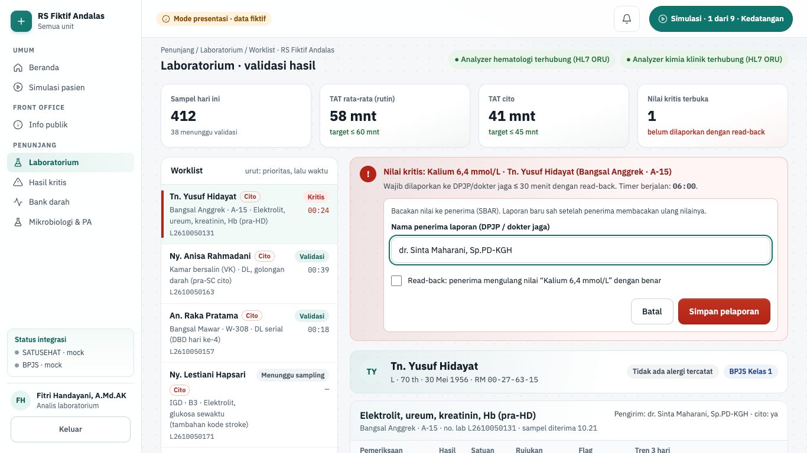

5. Banner berubah menjadi "Nilai kritis dilaporkan · <pasien>" dengan "read-back terkonfirmasi" dan waktu lapor
   dalam menit:detik, mis. "waktu lapor 06:12".
6. Tekan **Validasi teknis**. Setelah itu tekan **Validasi klinis (TTE Sp.PK)**. Tombol berubah menjadi
   **Tervalidasi**. Layar menyebut hasil dirilis ke CPPT, DPJP, dan SATUSEHAT (simulasi).
7. Bila sampel bermasalah, tekan **Minta ulang sampel** (atau **Batalkan sampel ulang**). Tombol ini selalu tampil;
   bila tidak berlaku ia nonaktif dengan alasan tertulis (hasil sudah dirilis, belum ada hasil, atau sampel pasien
   simulasi). Sampel tanpa hasil menulis "Hasil belum lengkap (status: …)" atau, bila sudah selesai, "Hasil sudah
   divalidasi klinis dan dirilis. Buka riwayat untuk melihat rincian."
8. Pasien skenario memakai tombol langkahnya: Tn. Suryo (rawat jalan) **Pindai tabung**, **Terima hasil (HL7 ORU)**,
   lalu **Validasi dan rilis**; Tn. Hartono (IGD) **Buka hasil**, lalu pelaporan kalium kritis.

**Gerbang keselamatan dan aturan bisnis.**

- Nilai kritis wajib dilaporkan ke DPJP atau dokter jaga dalam 30 menit (`limitMinutes` di fixture). Timer terus
  berjalan; lewat batas, layar menulis "Melewati batas 30 menit, segera laporkan dengan read-back."
- Pelaporan ditolak tanpa nama penerima minimal 5 karakter ("Nama penerima wajib diisi (minimal 5 karakter).") dan
  tanpa read-back ("Read-back wajib dikonfirmasi sebelum disimpan."). Laporan tanpa read-back tidak sah, jadi nilai
  kritis tetap terbuka.
- Validasi diblokir bila nilai kritis belum dilaporkan dengan read-back, parameter masih diproses analyzer, sampel
  menunggu sampel ulang, atau kultur masih inkubasi. Alasannya tertulis di layar.
- Urutan validasi tetap: teknis oleh analis, lalu klinis oleh dokter Sp.PK dengan TTE.
- Bendera: KRITIS bila melewati batas kritis, H/L bila di luar rentang rujukan. Nilai tepat di batas dianggap masih
  dalam rentang. Status tidak hanya lewat warna.
- Koreksi setelah rilis hanya lewat hasil revisi berversi.

**Mode api.** Layar hibrida (4.0c): peran berizin melihat "Belum tersambung" sampai potongan fase 4 layar ini tergabung.

## Radiologi

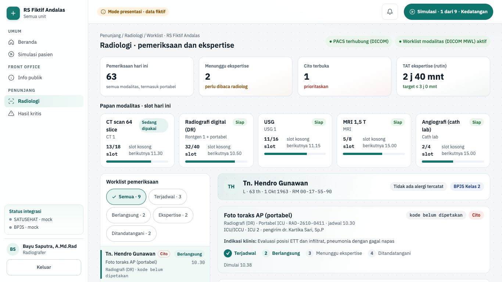

| Hal      | Isi                                                                                                                                                                                                |
| -------- | -------------------------------------------------------------------------------------------------------------------------------------------------------------------------------------------------- |
| Rute     | `/penunjang/radiologi` (`?pilih=<examId>`)                                                                                                                                                         |
| Pemakai  | radiografer                                                                                                                                                                                        |
| Komponen | S03 radiologi (RIS)                                                                                                                                                                                |
| Status   | demo (mode presentasi, tanpa mockup); API belum (fase 4 potongan 4.4)                                                                                                                              |
| Mockup   | tidak ada (dibangun tanpa mockup)                                                                                                                                                                  |
| Kode web | `apps/web/src/app/(staf)/penunjang/radiologi/` · `apps/web/src/components/penunjang/rad-*.tsx` · `apps/web/src/lib/penunjang-radiologi.ts` · `apps/web/src/lib/server/data/penunjang/radiologi.ts` |
| Kode API | belum ada                                                                                                                                                                                          |

**Tujuan.** Menjadwalkan dan menjalankan pemeriksaan per modalitas, mencatat dosis radiasi, lalu menulis ekspertise
dengan templat yang ditandatangani radiolog.

**Alur.**

1. Buka **Radiologi**. "Papan modalitas · slot hari ini" memuat tiap alat dan pemakaian slotnya (mis. CT scan 64
   slice, 13/18 slot). Region "Indikator radiologi" memuat Pemeriksaan hari ini, Cito terbuka, Menunggu ekspertise,
   dan TAT ekspertise (rutin).
2. "Worklist radiologi" menampilkan kode tindakan (mis. ICD-9-CM 87.03) atau "kode belum dipetakan". Saring dengan
   "Filter status". Alurnya: Terjadwal, Berlangsung, Ekspertise, Ditandatangani.
3. Pemeriksaan terjadwal (mis. Tn. Rizky Ramadhan): centang "Identitas dicek dengan 2 penanda", centang skrining
   kontras bila order berkontras, lalu **Mulai pemeriksaan**.
4. Pemeriksaan berlangsung (mis. CT Ny. Maria Ulfa): isi "CTDIvol (mGy)" dan "DLP (mGy·cm)", lalu
   **Selesai, kirim ke ekspertise**.
5. Di "Ekspertise", pilih templat dan tekan **Terapkan templat**, isi **Temuan** dan **Kesan**, lalu
   **Tandatangani (TTE)**. "Laporan radiologi" menampilkan nama radiolog penanda tangan.
6. Skenario IGD: foto toraks Tn. Hartono muncul di worklist dari order set IGD.

**Gerbang keselamatan dan aturan bisnis.**

- **Mulai pemeriksaan** nonaktif sampai identitas dicek dengan 2 penanda. Order berkontras juga wajib skrining
  (eGFR, riwayat alergi kontras, puasa).
- Pemeriksaan CT wajib dosis sebelum dikirim ke ekspertise: CTDIvol di atas 0 sampai 200 mGy, DLP di atas 0 sampai
  5.000 mGy·cm.
- TTE ekspertise butuh temuan minimal 20 karakter, kesan minimal 10 karakter, dan tidak ada isian templat kosong
  (`__`).
- Kebutuhan kontras dan modalitas dibaca dari order di server, bukan dari input layar.
- Di mode presentasi, posisi radiografer menjalankan TTE atas nama radiolog fiktif di data dummy. Pemisahan peran
  radiografer dan radiolog dibangun di fase 4.

**Mode api.** Layar hibrida (4.0c): peran berizin melihat "Belum tersambung" sampai potongan fase 4 layar ini tergabung.

## Farmasi

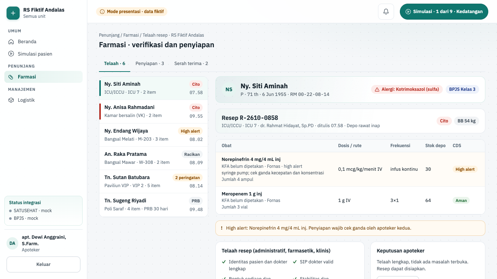

| Hal      | Isi                                                                                                                                                                                              |
| -------- | ------------------------------------------------------------------------------------------------------------------------------------------------------------------------------------------------ |
| Rute     | `/penunjang/farmasi`                                                                                                                                                                             |
| Pemakai  | apoteker                                                                                                                                                                                         |
| Komponen | S04 farmasi klinis, S05 dispensing dan depo                                                                                                                                                      |
| Status   | demo (mode presentasi); API belum (fase 4 potongan 4.5, 4.6a, 4.6b)                                                                                                                              |
| Mockup   | `design/mockups/Farmasi.dc.html`                                                                                                                                                                 |
| Kode web | `apps/web/src/app/(staf)/penunjang/farmasi/` · `apps/web/src/components/penunjang/farmasi-*.tsx` · `apps/web/src/lib/penunjang-farmasi.ts` · `apps/web/src/lib/server/data/penunjang/farmasi.ts` |
| Kode API | belum ada modul farmasi · sumber resep: `apps/api/src/modules/orders/` (3.4)                                                                                                                     |

**Tujuan.** Apoteker menelaah resep (administratif, farmasetik, klinis), menindaklanjuti peringatan CDS, menyiapkan
obat dengan cek ganda untuk obat high alert, lalu menyerahkan obat dan mengurangi stok depo.

**Alur.**

1. Buka **Farmasi**. Tab antrean di kanan kepala layar (**Telaah · n**, **Penyiapan · n**, **Serah terima · n**);
   **Telaah · n** aktif. Pilih resep di "Antrean telaah", mis. Tn. Sutan Batubara.
2. "Item resep" menampilkan obat dengan kode KFA dan status formularium (mis. "KFA 93000387 · Fornas" untuk
   Klopidogrel 75 mg tab). Daftar telaah memuat identitas, SIP dokter, sediaan, stabilitas, interaksi, dosis ginjal,
   duplikasi, dan kontraindikasi.

   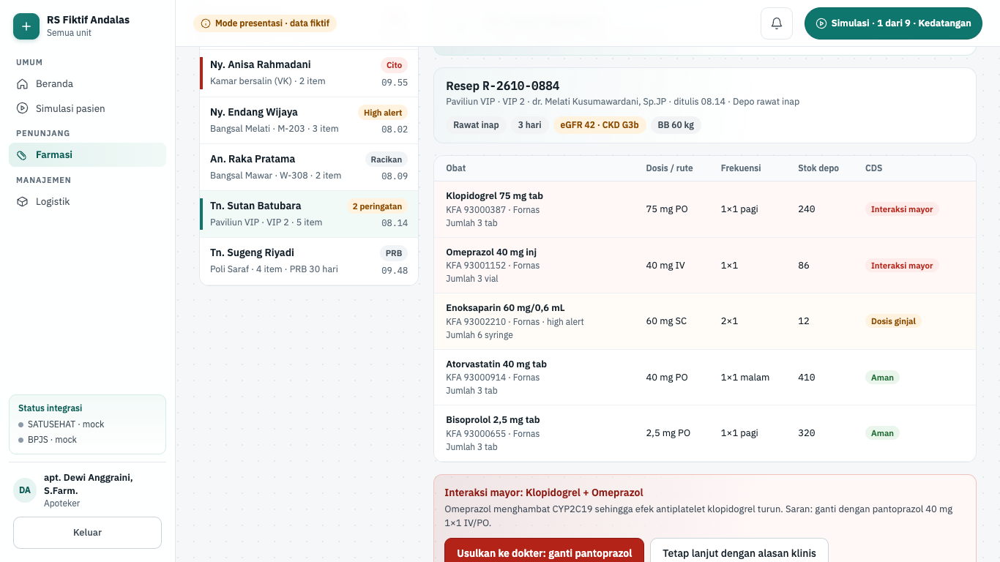

3. Tindak lanjuti setiap peringatan CDS: **Usulkan ke dokter: ganti pantoprazol** lalu **Simulasi: dokter setuju**,
   atau **Dosis sudah sesuai eGFR**, atau **Tetap lanjut dengan alasan klinis**.
4. Tekan **Setujui dan siapkan**. Resep masuk antrean penyiapan. Pilihan lain: **Tahan resep**, **Lepas tahanan**,
   dan **Siapkan sebagian**.
5. Di tab **Penyiapan**, centang setiap obat setelah diambil, dihitung, dan diberi etiket. Untuk obat high alert,
   pilih "Apoteker kedua", centang konfirmasi hitung ulang, lalu **Konfirmasi cek ganda**. Tekan
   **Selesai disiapkan**.
6. Di tab **Serah terima**, centang empat butir serah terima, pilih penerima (**Pasien sendiri**, **Keluarga**, atau
   **Perawat ruangan** untuk rawat inap), lalu **Serahkan obat**. Layar menulis pengurangan stok depo, mis.
   "Asetosal 80 mg tab 700 → 670 tab".
7. Skenario rawat jalan: resep Tn. Suryo ditelaah, disiapkan, dan diserahkan dari layar ini.

**Gerbang keselamatan dan aturan bisnis.**

- **Setujui dan siapkan** nonaktif selama ada peringatan CDS yang menahan telaah: "Tindak lanjuti N peringatan CDS
  lebih dulu (ikuti saran atau lanjut dengan alasan)." Resep yang ditahan harus dilepas dulu.
- Override peringatan CDS wajib alasan klinis minimal 10 karakter. Server memeriksa bahwa peringatan itu milik resep
  yang sama dan memang menahan telaah.
- Obat high alert wajib cek ganda oleh apoteker kedua yang bertugas hari ini dan bukan apoteker yang menyiapkan:
  "Cek ganda harus oleh apoteker lain, bukan apoteker yang menyiapkan."
- **Selesai disiapkan** dan **Serahkan obat** nonaktif sampai semua centang lengkap ("Lengkapi N centang lagi.").
- Serah terima mencakup identitas dengan 2 penanda, pencocokan obat dengan resep dan etiket, edukasi, dan tanda
  tangan penerima.
- Stok di bawah minimum ditandai "di bawah minimum".

**Mode api.** Layar hibrida (4.0c): peran berizin melihat "Belum tersambung" sampai potongan fase 4 layar ini tergabung.

## Kamar operasi

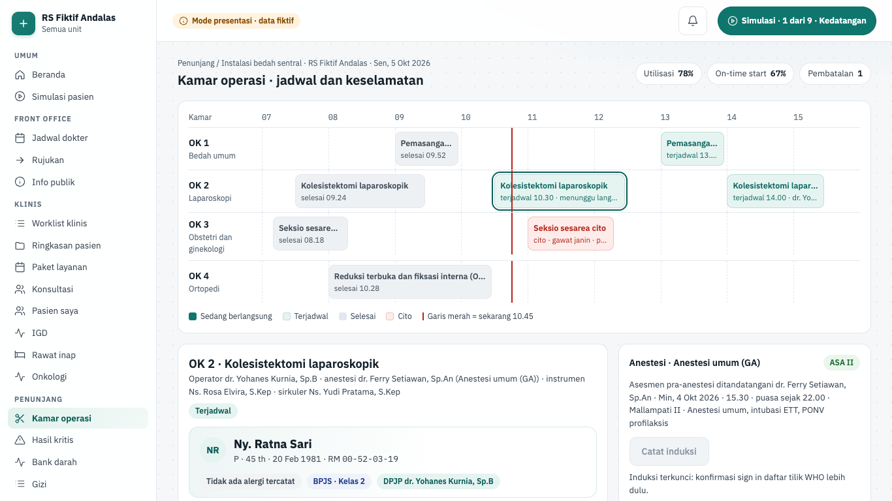

| Hal      | Isi                                                                                                                                                                                                                                                                                   |
| -------- | ------------------------------------------------------------------------------------------------------------------------------------------------------------------------------------------------------------------------------------------------------------------------------------- |
| Rute     | `/penunjang/kamar-operasi` (`?pilih=<caseId>`, mis. `ok3-1`)                                                                                                                                                                                                                          |
| Pemakai  | dokter, perawat                                                                                                                                                                                                                                                                       |
| Komponen | S06 kamar operasi dan anestesi                                                                                                                                                                                                                                                        |
| Status   | demo (mode presentasi); API belum (fase 4 potongan 4.7)                                                                                                                                                                                                                               |
| Mockup   | `design/mockups/OK.dc.html`                                                                                                                                                                                                                                                           |
| Kode web | `apps/web/src/app/(staf)/penunjang/kamar-operasi/` · `apps/web/src/components/penunjang/ok-*.tsx` · `apps/web/src/lib/penunjang-ok.ts` · data `apps/web/src/lib/server/data/penunjang/kamar-operasi.ts` (`getOrSchedule`) · fixture `apps/web/src/lib/demo/fixtures/kamar-operasi.ts` |
| Kode API | belum ada                                                                                                                                                                                                                                                                             |

**Tujuan.** Jadwal kamar operasi hari ini dan daftar tilik keselamatan bedah WHO (Sign in, Time out, Sign out) yang
terkunci berurutan, dengan hitung kasa dan instrumen sebelum operasi ditutup.

**Alur.**

1. Buka **Kamar operasi**. "Jadwal kamar" berbentuk Gantt per kamar. Kasus terpilih bawaan adalah Ny. Ratna Sari,
   "OK 2 · Kolesistektomi laparoskopik" dengan "ICD-9-CM 51.23 · Kolesistektomi laparoskopik".
2. Region "Daftar tilik keselamatan" memuat tiga fase; kanan judul kasus menulis fase berjalan ("Fase: Sign in").
   Centang butir **Sign in** (sebelum induksi), lalu **Konfirmasi sign in**. Konfirmasi tercatat dengan nama dan
   jam beserta akibatnya, mis. "· induksi dapat dimulai" atau "· insisi dapat dicatat".
3. Centang butir **Time out** (sebelum insisi), lalu **Konfirmasi time out**. Tombol **Mulai insisi** baru aktif.

   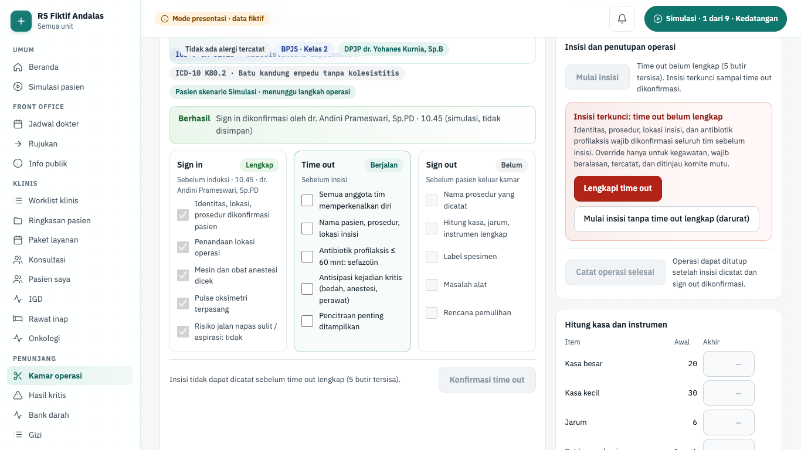

4. Tekan **Mulai insisi**. Layar menulis "✓ Insisi dicatat <jam>".
5. Isi hitung akhir di "Hitung kasa dan instrumen" (kolom awal dan akhir). Bila semua cocok, butir hitung di Sign out
   tercentang otomatis. Lengkapi **Sign out** (sebelum pasien keluar kamar) dan konfirmasi.
6. Tekan **Catat operasi selesai**, lalu **Pindahkan ke ruang pulih**.
7. Kasus lain dipilih dari Gantt, mis. Ny. Anisa Rahmadani "OK 3 · Seksio sesarea cito".

**Gerbang keselamatan dan aturan bisnis.**

- Fase hanya bisa dikonfirmasi berurutan dan bila semua butirnya lengkap. Sebelum sign in: "Sign in belum
  dikonfirmasi; induksi dan insisi terkunci."
- Insisi terkunci sampai time out dikonfirmasi: "Insisi terkunci: time out belum lengkap".
- Override darurat **Mulai insisi tanpa time out lengkap (darurat)** wajib alasan klinis minimal 15 karakter
  (`OVERRIDE_REASON_MIN`). Server menolak alasan yang lebih pendek.
- Server memeriksa bukti time out saat insisi: daftar tilik harus milik kasus itu, sign in dan time out lengkap dan
  terkonfirmasi, dan insisi belum tercatat. Selain itu ditolak.
- Sign out terkunci sampai insisi dicatat dan butuh hitung akhir kasa, jarum, dan instrumen yang sama dengan hitung
  awal. Bila tidak cocok, layar meminta hitung ulang.
- Operasi hanya bisa dicatat selesai setelah sign out dikonfirmasi.
- Kasus pasien skenario (Ny. Ratna Sari) menunggu langkah operasi di Simulasi; sebelum itu tertulis "Pasien skenario
  Simulasi · menunggu langkah operasi".
- Region "Anestesi" (`components/penunjang/ok-anestesi.tsx`, aturan `lib/penunjang-anestesi.ts`): **Catat induksi**
  terkunci sampai "Asesmen pra-anestesi" ditandatangani, lalu sampai sign in WHO dikonfirmasi. Teksnya "Induksi
  terkunci: asesmen pra-anestesi belum ditandatangani dokter anestesi." lalu "Induksi terkunci: konfirmasi sign in
  daftar tilik WHO lebih dulu." Tidak ada override.
- **Tandatangani asesmen (TTE dr. Ferry Setiawan, Sp.An)** nonaktif sampai kelas ASA, jam mulai puasa (kecuali
  "Operasi darurat (ASA E)"), jalan napas, rencana anestesi (minimal 5 karakter), dan persetujuan anestesi lengkap.
  Server Action `recordAnesthesiaAction` mengulang pemeriksaan ini. Contoh: SC cito Ny. Anisa (`?pilih=ok3-1`) menjadi
  "ASA IIE" setelah ditandatangani. Monitoring intraoperasi memberi peringatan bila SpO₂ di bawah 92%, sistolik di
  bawah 90 atau di atas 180 mmHg, nadi di bawah 50 atau di atas 120, atau EtCO₂ di luar 30–45.

**Mode api.** Layar hibrida (4.0c): peran berizin melihat "Belum tersambung" sampai potongan fase 4 layar ini tergabung.

## Pusat hasil kritis

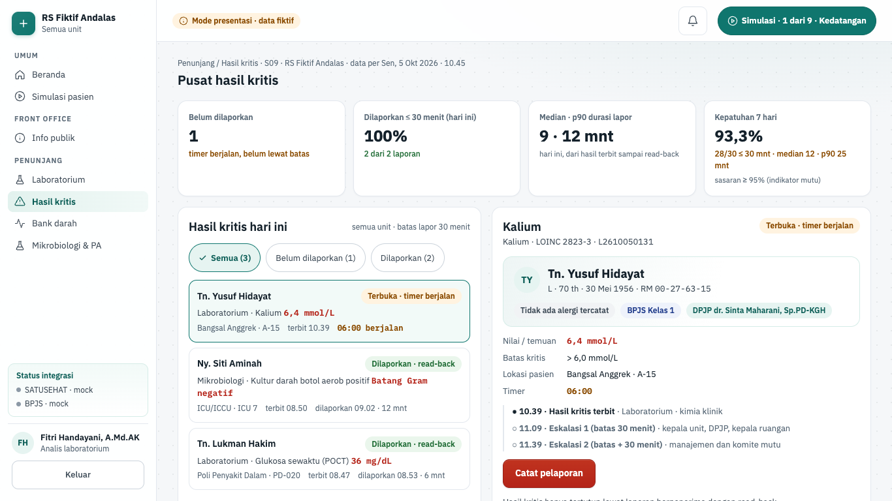

| Hal      | Isi                                                                                                                                                                                                                                           |
| -------- | --------------------------------------------------------------------------------------------------------------------------------------------------------------------------------------------------------------------------------------------- |
| Rute     | `/penunjang/hasil-kritis` (`?pilih=<id>`, mis. `kr-L2610050131`)                                                                                                                                                                              |
| Pemakai  | analis lab, radiografer, dokter, perawat                                                                                                                                                                                                      |
| Komponen | S09 hasil kritis                                                                                                                                                                                                                              |
| Status   | demo (mode presentasi); backend fase 4 potongan 4.3 belum dibangun                                                                                                                                                                            |
| Mockup   | tidak ada (gaya mengikuti banner nilai kritis di layar Laboratorium)                                                                                                                                                                          |
| Kode web | `apps/web/src/app/(staf)/penunjang/hasil-kritis/` · data `apps/web/src/lib/server/data/penunjang/kritis.ts` (`getCriticalCenter`) · aturan `apps/web/src/lib/penunjang-kritis.ts` · komponen `apps/web/src/components/penunjang/kritis-*.tsx` |
| Kode API | belum ada (rencana modul `critical-results`, docs/01-arsitektur.md §2)                                                                                                                                                                        |

**Tujuan.** Satu tempat untuk semua nilai kritis lintas unit (laboratorium, POCT, mikrobiologi, radiologi, diagnostik
lain). Petugas melihat timer batas lapor, mencatat pelaporan berpenerima dengan read-back, dan memantau kepatuhan
durasi lapor sebagai indikator mutu.

**Alur.**

1. Buka **Pusat hasil kritis**. Region "Kepatuhan hasil kritis" memuat empat kartu: Belum dilaporkan, Dilaporkan ≤ 30
   menit (hari ini), Median · p90 durasi lapor, dan Kepatuhan 7 hari (sasaran ≥ 95%).
2. "Hasil kritis hari ini" menggabungkan nilai kritis dari worklist Laboratorium yang sama dengan sumber lain, mis.
   kultur darah Ny. Siti Aminah (mikrobiologi) dan glukosa POCT Tn. Lukman Hakim. Saring dengan **Semua**,
   **Belum dilaporkan**, atau **Dilaporkan**. Yang belum dilaporkan dan paling lama menunggu ada di atas.
3. Setiap baris punya chip bertulisan "Terbuka · timer berjalan", "Lewat batas · eskalasi", atau "Dilaporkan ·
   read-back", lalu nilai, lokasi, jam terbit, dan timer mm:ss.
4. Pilih pasien, mis. Tn. Yusuf Hidayat: "Kalium · LOINC 2823-3" 6,4 mmol/L, batas kritis "> 6,0 mmol/L", Bangsal
   Anggrek A-15. "Detail hasil kritis" memuat nilai, batas, lokasi, timer, dan "Jenjang eskalasi" (terbit, Eskalasi 1
   pada batas 30 menit, Eskalasi 2 pada batas + 30 menit).
5. Tekan **Catat pelaporan**. Pilih penerima dari daftar (DPJP, dokter jaga, perawat penanggung jawab) atau
   **Penerima lain (di luar daftar jaga)** lalu isi "Nama penerima". Isi "Peran penerima", pilih "Saluran" (bawaan
   Telepon (direkam), atau Langsung (tatap muka)), centang **Read-back terkonfirmasi**, lalu **Simpan pelaporan**.

   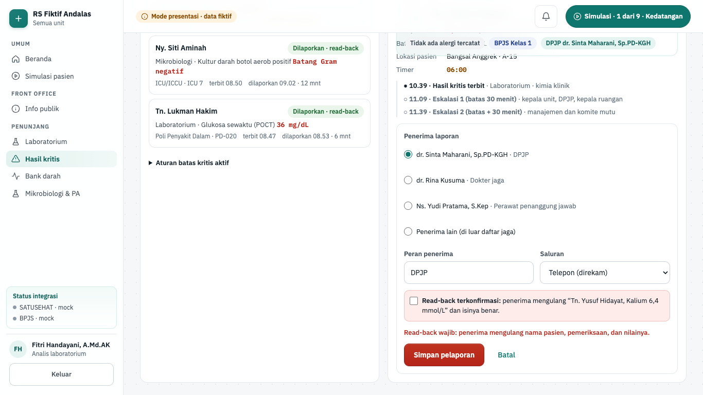

6. Layar menulis "Hasil kritis dilaporkan ke … read-back terkonfirmasi · <jam> (simulasi, tidak disimpan)". Chip
   berubah "Dilaporkan · read-back" dan jenjang eskalasi mencatat penerima, saluran, dan pelapor. Kartu Belum
   dilaporkan menjadi "semua sudah dilaporkan" bila tidak ada lagi yang terbuka.
7. Buka "Aturan batas kritis aktif" untuk melihat acuan, mis. "Kalium · LOINC 2823-3: < 2,5 atau > 6,0 mmol/L".
8. Nilai kritis pasien skenario Simulasi (mis. kalium Tn. Hartono di skenario IGD) tidak dilaporkan dari sini. Alert
   "Pasien skenario Simulasi" mengarahkan ke layar [Laboratorium](#laboratorium) agar alur Simulasi ikut maju.

**Gerbang keselamatan dan aturan bisnis.**

- Hasil kritis hanya tertutup lewat laporan berpenerima dengan read-back (`reportGate`). Tidak ada tombol penutupan
  lain.
- Galat per isian: nama penerima minimal 5 karakter ("Nama penerima wajib diisi (minimal 5 karakter)."), peran
  minimal 3 karakter, saluran wajib, dan read-back wajib ("Read-back wajib: penerima mengulang nama pasien,
  pemeriksaan, dan nilainya.").
- Hasil yang sudah dilaporkan ditolak ("Hasil kritis ini sudah dilaporkan dengan read-back."). Id yang tidak ada di
  daftar ditolak.
- Server Action `reportCriticalCenterAction` memeriksa posisi pemakai layar, mencari hasil kritis di server (klien
  hanya mengirim id dan isian), lalu menjalankan `reportGate` yang sama. Pasien skenario ditolak di server dengan
  pesan "Pasien skenario dilaporkan dari layar Laboratorium agar alur Simulasi ikut maju."
- Batas lapor 30 menit (`limitMinutes` di fixture). Eskalasi 1 pada batas: kepala unit pelapor, DPJP, dan kepala
  ruangan (in-app + WhatsApp tanpa data pasien). Eskalasi 2 pada batas + 30 menit: manajemen dan komite mutu, masuk
  tinjauan insiden. Di mode presentasi eskalasi hanya tampil sebagai teks; tidak ada notifikasi terkirim.
- Metrik dihitung murni: persen dilaporkan ≤ batas, median, dan p90 (nearest-rank) durasi lapor. Riwayat 7 hari
  berisi 30 durasi fiktif dengan dua laporan lewat 30 menit, jadi kartu Kepatuhan 7 hari di bawah sasaran 95%.
- Status tidak hanya lewat warna: chip bertulisan dan timer berbentuk teks.

**Rencana backend.** Izin rencana `critical_result.report`. Fase 4 potongan 4.3 membangun `/api/v1/critical-results`:
`POST :id/reports` dengan penerima, saluran, dan `readBackConfirmed: true` wajib (422
`CRITICAL_RECIPIENT_REQUIRED` / `CRITICAL_READBACK_REQUIRED`, ditegakkan juga oleh CHECK DB), durasi dari jam server,
job eskalasi P11 sekali per level, dan `GET metrics` untuk peninjau mutu. Di mode api layar hibrida (4.0c): peran berizin melihat "Belum tersambung" sampai potongan fase 4 layar ini tergabung.

## Depo & stok farmasi

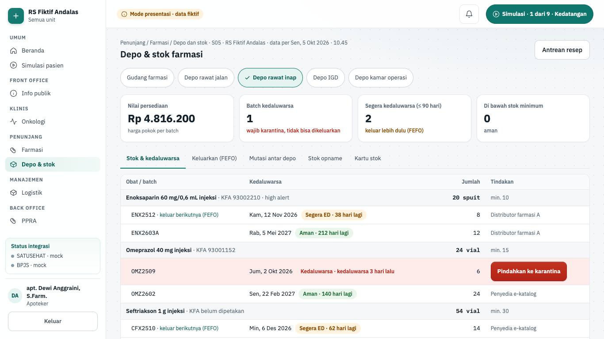

| Hal      | Isi                                                                                                                                                                                                                       |
| -------- | ------------------------------------------------------------------------------------------------------------------------------------------------------------------------------------------------------------------------- |
| Rute     | `/penunjang/depo`                                                                                                                                                                                                         |
| Pemakai  | apoteker                                                                                                                                                                                                                  |
| Komponen | S05 dispensing dan depo                                                                                                                                                                                                   |
| Status   | demo (mode presentasi) dan api (4.6a): saldo per batch + ED, penerimaan, mutasi dua langkah, penyesuaian, kartu stok; pengeluaran ke pasien menyusul 4.6b                                                                 |
| Mockup   | tidak ada (gaya mengikuti layar Farmasi dan Logistik)                                                                                                                                                                     |
| Kode web | `apps/web/src/app/(staf)/penunjang/depo/` · data `apps/web/src/lib/server/data/penunjang/depo.ts` (`getDepoData`) · aturan `apps/web/src/lib/penunjang-depo.ts` · komponen `apps/web/src/components/penunjang/depo-*.tsx` |
| Kode API | `apps/api/src/modules/stock/` (`/api/v1/stock`, ADR-0036) · kontrak `packages/shared/src/schemas/stock.ts` + `penunjang-api.ts`                                                                                           |

**Tujuan.** Apoteker mengelola saldo obat per depo dan per batch: mengeluarkan obat dengan urutan FEFO (first expired,
first out), memindahkan stok antar depo dua langkah, mengarantina batch kedaluwarsa, dan menutup stok opname.

**Alur.**

1. Buka **Depo & stok farmasi**. "Pilih depo" berisi Gudang farmasi, Depo rawat jalan, Depo rawat inap (bawaan), Depo
   IGD, dan Depo kamar operasi. Ringkasan depo memuat Nilai persediaan (harga pokok per batch), Batch kedaluwarsa,
   Segera kedaluwarsa (≤ 90 hari), dan Di bawah stok minimum.
2. Tab **Stok & kedaluwarsa** menampilkan saldo per obat dan batch dengan tanggal kedaluwarsa. Batch Omeprazol
   OMZ2509 di depo rawat inap bertanda "Kedaluwarsa"; tekan **Pindahkan ke karantina**.
3. Tab **Keluarkan (FEFO)**. Di "Permintaan menunggu disiapkan", pilih mis. Seftriakson untuk UDD siang Ny. Endang
   Wijaya (10 vial), lalu **Siapkan**. Form "Pengeluaran stok" menulis "Rencana FEFO (batch ED terdekat keluar dulu)",
   mis. "CFX2510 · 10 vial". Tekan **Keluarkan**.
4. Untuk memakai batch lain, centang **Pilih batch lain (override FEFO, wajib alasan)**, pilih "Batch pilihan", dan isi
   "Alasan override (minimal 10 karakter, tercatat di kartu stok)". Batch kedaluwarsa tertulis "kedaluwarsa, tidak
   bisa dipilih".

   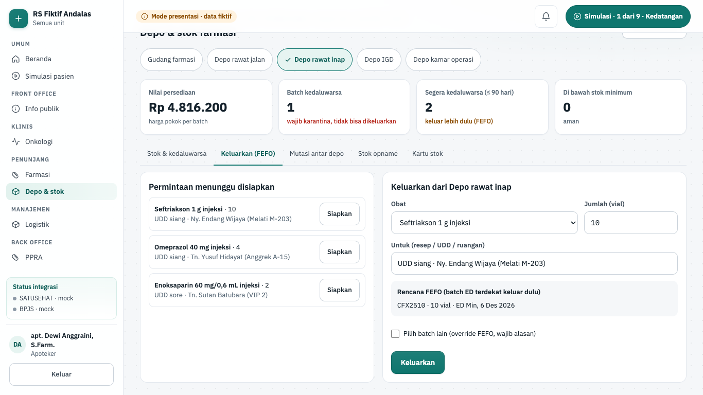

5. Tab **Mutasi antar depo**. "Langkah 1 · Kirim dari <depo>": pilih Depo tujuan, Obat, dan Jumlah, lalu
   **Kirim mutasi**. "Langkah 2 · Terima di depo tujuan": isi "Petugas penerima di <depo tujuan>", lalu
   **Konfirmasi terima**.
6. Tab **Stok opname**. Isi hitung fisik per batch (kosong = sama dengan sistem). Bila ada selisih, isi "Alasan selisih
   (wajib, minimal 10 karakter)" lalu tekan **Tutup opname (N selisih)**; tanpa selisih tombolnya
   **Tutup opname tanpa selisih**.
7. Tab **Kartu stok** menampilkan ledger: Saldo awal, Keluar ke pasien, Mutasi keluar, Mutasi masuk, Penyesuaian
   opname, dan Karantina kedaluwarsa, dengan rujukan, petugas, dan alasan.

**Gerbang keselamatan dan aturan bisnis.**

- FEFO otomatis: batch dengan ED terdekat yang belum kedaluwarsa keluar lebih dulu (`fefoPlan`). Memilih batch lain
  wajib alasan minimal 10 karakter ("Memilih batch selain urutan FEFO wajib alasan (minimal 10 karakter) dan tercatat
  di kartu stok."). Alasan tersimpan sebagai "Override FEFO: …" di kartu stok.
- Batch kedaluwarsa tidak pernah keluar ke pasien ("Batch kedaluwarsa tidak boleh dikeluarkan. Pindahkan ke
  karantina.") dan tidak dihitung sebagai stok yang boleh dipakai. Karantina hanya untuk batch kedaluwarsa.
- Jumlah harus bilangan bulat lebih dari 0. Saldo tidak pernah negatif; bila kurang, "Stok yang boleh dipakai di depo
  ini tidak cukup."
- Mutasi dua langkah: depo asal dan tujuan berbeda, penerima minimal 5 karakter dan bukan pengirim ("Penerima harus
  petugas lain, bukan pengirim mutasi.").
- Selisih opname wajib alasan minimal 10 karakter.
- Setiap perubahan saldo menjadi baris ledger; saldo selalu sama dengan jumlah ledger (`ledgerBalance`, dijaga tes).
  Nilai persediaan dihitung dalam rupiah `bigint` (jumlah × harga pokok batch).
- Server Action `recordDepoAction` memeriksa depo, obat, dan batch terhadap master, menolak batch kedaluwarsa,
  override tanpa alasan, opname berselisih tanpa alasan, dan penerima yang sama dengan pengirim. Saldo di layar adalah
  keadaan lokal sesi; server belum memeriksa kecukupan saldo.
- Kode KFA hanya dari seed; Seftriakson 1 g tertulis "KFA belum dipetakan".

**Mode api (4.6a).** Izin layar `stock.read`; tulisan memakai `stock.receive`, `stock.transfer`, dan `stock.adjust`
(apoteker, lingkup unit penugasan). Kode web `api-depo.tsx`, `actions.ts`, `components/penunjang/depo-api-*.tsx`,
logika murni `lib/depo-api.ts`.

1. "Pilih depo" hanya berisi depo/gudang di unit penugasan (apoteker FARMASI: Gudang farmasi, Depo farmasi rawat jalan,
   Depo farmasi rawat inap). Ringkasan: Batch tersedia, Batch kedaluwarsa, Segera kedaluwarsa (pengaturan
   `stock.expiry_warning_days`), dan Mutasi masuk menunggu.
2. **Stok & kedaluwarsa**: saldo per batch urut ED terdekat dengan status bertulisan (Kedaluwarsa, Segera kedaluwarsa,
   Aman).
3. **Penerimaan barang**: pemasok, nomor faktur, lalu per baris obat (cari minimal 2 huruf), nomor batch, tanggal
   kedaluwarsa, jumlah, dan harga pokok per satuan. Batch yang sudah kedaluwarsa ditahan ("… sudah kedaluwarsa dan
   tidak boleh diterima") dan ditolak API (`BATCH_EXPIRED`). Hasilnya nomor `TRM-YYMM-NNNN` beserta harga per baris
   dan harga pokok batch rata-rata tertimbang. Satu faktur pemasok hanya bisa diterima sekali.
4. **Mutasi antar depo**: pilih Depo tujuan, Obat, dan Jumlah; layar menulis "Batch FEFO: …" (batch layak ED terdekat
   dulu, batch kedaluwarsa tidak pernah ditawarkan), lalu **Kirim mutasi** (`MUT-YYMM-NNNN`). Petugas berlingkup atas
   depo tujuan menekan **Terima MUT-…**; selama dalam perjalanan stok tidak tercatat di kedua depo.
   Mutasi yang tersangkut dibatalkan petugas depo asal lewat **Batalkan MUT-…** (alasan minimal 10 karakter); stok
   kembali ke depo asal. Depo yang masih punya mutasi dalam perjalanan tidak bisa dinonaktifkan.
5. **Penyesuaian**: pilih batch, isi selisih (negatif = berkurang) dan alasan minimal 10 karakter. Batch kedaluwarsa
   hanya bisa dikurangi (hapus buku).
6. **Kartu stok**: ledger terbaru dulu dengan jenis, nomor dokumen, alasan, dan petugas.

Saldo hanya berubah lewat ledger dan trigger database; saldo kurang ditolak `STOCK_INSUFFICIENT`. Pengeluaran ke pasien
(FEFO dispensing, retur) menyusul potongan 4.6b; stok opname penuh di fase 8.

## Bank darah

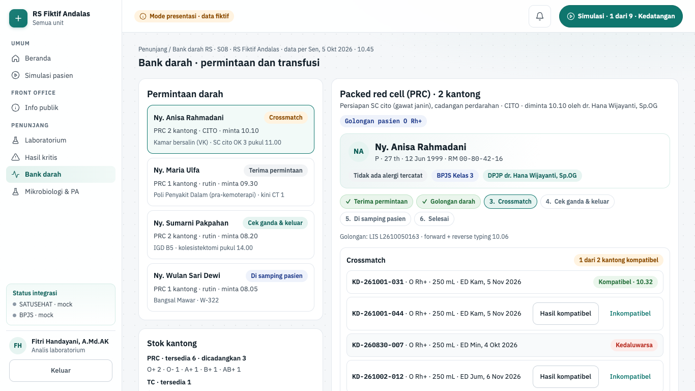

| Hal      | Isi                                                                                                                                                                                                                                                |
| -------- | -------------------------------------------------------------------------------------------------------------------------------------------------------------------------------------------------------------------------------------------------- |
| Rute     | `/penunjang/bank-darah`                                                                                                                                                                                                                            |
| Pemakai  | analis lab, perawat, bidan, dokter                                                                                                                                                                                                                 |
| Komponen | S08 bank darah                                                                                                                                                                                                                                     |
| Status   | demo (mode presentasi); backend fase 4 potongan 4.9 belum dibangun                                                                                                                                                                                 |
| Mockup   | tidak ada (gaya mengikuti layar Laboratorium)                                                                                                                                                                                                      |
| Kode web | `apps/web/src/app/(staf)/penunjang/bank-darah/` · data `apps/web/src/lib/server/data/penunjang/bank-darah.ts` (`getBloodBank`) · aturan `apps/web/src/lib/penunjang-bank-darah.ts` · komponen `apps/web/src/components/penunjang/bank-darah-*.tsx` |
| Kode API | belum ada (rencana modul `blood-bank`, docs/01-arsitektur.md §2)                                                                                                                                                                                   |

**Tujuan.** Mengikuti satu permintaan darah dari penerimaan sampel sampai transfusi selesai: golongan darah,
crossmatch, pengeluaran kantong dengan cek ganda dua petugas, pindai gelang dan kantong di samping pasien, lalu
pemantauan reaksi transfusi.

**Alur.**

1. Buka **Bank darah**. "Permintaan darah" memuat, antara lain, Ny. Anisa Rahmadani (PRC 2 kantong, persiapan SC cito
   pukul 11.00, golongan O+ dari LIS) dan Ny. Maria Ulfa (permintaan baru). "Stok kantong" merangkum PRC, TC, dan FFP
   per golongan dan menandai kantong kedaluwarsa untuk dimusnahkan.
2. Detail permintaan menampilkan "Tahap permintaan darah": Terima permintaan, Golongan darah, Crossmatch, Cek ganda &
   keluar, Di samping pasien, Selesai.
3. Permintaan baru: cocokkan label sampel dengan formulir, tekan **Terima permintaan & sampel**, isi golongan ABO dan
   "Rhesus", lalu **Simpan golongan**.
4. Region "Crossmatch" mendaftar kantong kandidat. Kantong yang tidak layak menulis alasannya, mis. KD-260830-007
   "Kedaluwarsa". Untuk kantong layak, tekan **Hasil kompatibel** atau **Inkompatibel**. Ringkasan menjadi "2 dari 2
   kantong kompatibel".
5. Form "Cek ganda pengeluaran kantong": pilih "Kantong (sudah crossmatch kompatibel)", centang lima "Butir cek ganda
   (dibacakan bersama)", isi "Petugas 2 (penerima dari ruangan)" (Petugas 1 = pemakai), lalu **Keluarkan kantong**.

   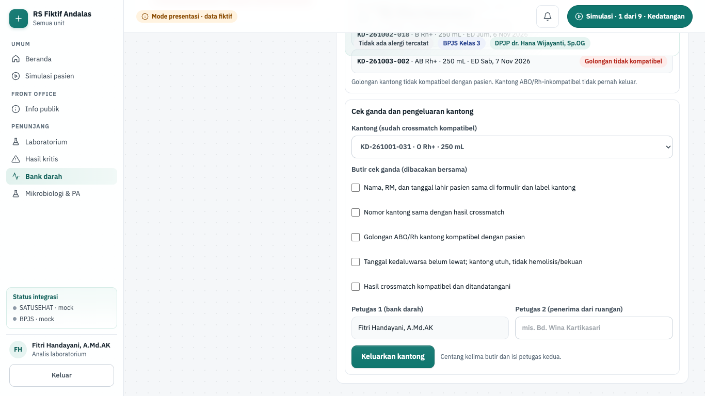

6. "Verifikasi di samping pasien": isi "Pindai gelang pasien (No. RM)" dan "Pindai label kantong" (tombol **Pindai**
   mengisi hasil pindai simulasi), isi TTV sebelum mulai, lalu **Cocokkan dan mulai transfusi**. Bila barcode tidak
   terbaca, centang "Barcode tidak terbaca: verifikasi manual dua petugas (alasan tercatat)".
7. "Pemantauan transfusi" berstatus "Berjalan" dengan jadwal TTV Sebelum mulai, 15 menit, 1 jam, dan Selesai. Di form
   "Catat TTV transfusi" isi tanda vital dan "Gejala (centang bila ada)", lalu **Catat TTV**. Tekan
   **Transfusi selesai** bila tuntas tanpa reaksi.

**Gerbang keselamatan dan aturan bisnis.**

- Kompatibilitas ABO/Rh (`compatible`): sel darah merah (PRC) mengikuti antigen donor dan pasien Rh-negatif hanya
  menerima sel Rh-negatif; plasma dan trombosit mengikuti antibodi donor (AB = donor plasma universal). Kantong
  inkompatibel atau kedaluwarsa tidak pernah keluar, tanpa override.
- Crossmatch butuh golongan pasien, komponen sesuai permintaan, dan kantong yang belum dipegang pasien lain.
- Pengeluaran butuh crossmatch kompatibel, dua petugas berbeda dengan nama masing-masing minimal 5 karakter ("Cek
  ganda wajib dua petugas …", "Petugas pemeriksa kedua harus orang lain."), dan kelima butir dicentang ("Semua butir
  cek ganda wajib dicentang.").
- Di samping pasien, gelang yang tidak cocok dengan RM memblokir tanpa override: "Gelang pasien tidak cocok dengan
  permintaan. Hentikan: jangan pasang kantong." Kantong yang bukan kantong keluaran untuk pasien itu juga ditolak.
  Verifikasi manual hanya bila barcode tidak terbaca, dengan alasan minimal 10 karakter dan petugas kedua.
- Reaksi transfusi (`reactionCheck`): gejala apa pun, suhu naik ≥ 1 °C dari awal, atau sistolik turun ≥ 30 mmHg.
  Layar menulis "Dugaan reaksi transfusi", menghentikan transfusi ("Dihentikan · reaksi"), dan meminta jalur infus
  dipertahankan dengan NaCl 0,9% serta DPJP dan bank darah dilapori.
- Server Action `recordBloodAction` mencari permintaan dan kantong di fixture. Golongan dari fixture menang atas kiriman
  klien. Server menegakkan komponen, kedaluwarsa, kompatibilitas, dua petugas, kelima butir, dan gelang. Crossmatch dan
  pengeluaran yang terjadi di sesi ini adalah keadaan lokal, jadi server belum memeriksanya.

**Rencana backend.** Izin rencana `blood.write`. Fase 4 potongan 4.9 membangun modul `blood-bank` (stok kantong,
crossmatch, pengeluaran, reaksi transfusi, event `blood.unit_issued`). Rencana memakai nama izin `blood_bank` untuk
analis lab dan menetapkan bank darah tanpa layar (keputusan fase 4 #1), jadi layar demo ini mendahului rencana.
Keputusan #22 (darah darurat golongan O tanpa crossmatch dengan alasan dokter) belum ada di demo. Di mode api layar hibrida (4.0c): peran berizin melihat "Belum tersambung" sampai potongan fase 4 layar ini tergabung.

## Gizi

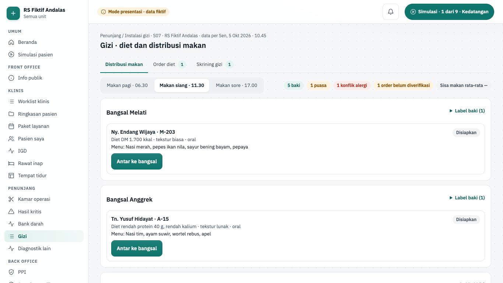

| Hal      | Isi                                                                                                                                                                                                                                |
| -------- | ---------------------------------------------------------------------------------------------------------------------------------------------------------------------------------------------------------------------------------- |
| Rute     | `/penunjang/gizi`                                                                                                                                                                                                                  |
| Pemakai  | perawat, dokter (peran `nutrisionis` belum ada di katalog peran)                                                                                                                                                                   |
| Komponen | S07 gizi                                                                                                                                                                                                                           |
| Status   | demo (mode presentasi); backend fase 4 potongan 4.9 belum dibangun                                                                                                                                                                 |
| Mockup   | tidak ada (gaya mengikuti layar penunjang lain)                                                                                                                                                                                    |
| Kode web | `apps/web/src/app/(staf)/penunjang/gizi/` · data `apps/web/src/lib/server/data/penunjang/gizi.ts` (`getNutrition`) · aturan `apps/web/src/lib/penunjang-gizi.ts` · komponen `apps/web/src/components/penunjang/gizi-workspace.tsx` |
| Kode API | belum ada (rencana modul `nutrition`, docs/01-arsitektur.md §2)                                                                                                                                                                    |

**Tujuan.** Instalasi gizi memverifikasi order diet dari DPJP, melakukan skrining gizi, lalu mendistribusikan makan
per bangsal dan jam makan dengan label baki, tanpa mengantar makanan beralergen atau makanan untuk pasien puasa.

**Alur.**

1. Buka **Gizi**. Tab **Distribusi makan** aktif dengan "Jam makan" Makan siang · 11.30 (pilihan lain Makan pagi ·
   06.30 dan Makan sore · 17.00). Chip merangkum jumlah baki, puasa, konflik alergi, order belum diverifikasi, dan
   sisa makan rata-rata.
2. Setiap bangsal punya kartu "Distribusi <bangsal>" (Melati, Anggrek, Mawar, Paviliun VIP, ICU/ICCU) dan daftar
   "Label baki" berisi nama, RM, bed, diet, tekstur, menu, dan alergi.
3. Baki Ny. Wulan Sari Dewi (Bangsal Mawar) menulis "Menu makan siang mengandung alergen: udang". Tekan
   **Ganti menu pengganti (…)**, atau **Tetap antar dengan alasan**. Baki berstatus "Diantar <jam>" dengan chip "menu
   pengganti".
4. Baki Tn. Sutan Batubara (Paviliun VIP) berstatus "Puasa · Persiapan angiografi koroner pukul 13.00"; tombol
   **Antar ke bangsal** nonaktif.
5. Baki An. Raka Pratama nonaktif karena order belum diverifikasi. **Buka order diet** membuka tab **Order diet**, tetapi
   **Verifikasi order** masih nonaktif karena pasien belum diskrining. Di tab **Skrining gizi**, isi "Penurunan berat
   badan tanpa disengaja (6 bulan)", centang "Asupan makan berkurang karena nafsu makan turun (1)" bila ada, lalu
   **Simpan skrining**.
6. Di tab **Order diet**, tekan **Verifikasi order** pada An. Raka. Kembali ke **Distribusi makan**; tombol
   **Antar ke bangsal** kini aktif.
7. Setelah diantar, pilih "Sisa makanan" (0–100%) lalu **Konfirmasi diterima pasien**.

**Gerbang keselamatan dan aturan bisnis.**

- Order diet yang belum diverifikasi tidak boleh diantar ("Order diet belum diverifikasi ahli gizi; makanan belum
  boleh disiapkan untuk diantar."). **Verifikasi order** nonaktif sampai pasien diskrining ("Skrining gizi dulu (tab
  Skrining gizi).").
- Pasien puasa tidak pernah diantar makanan, tanpa override ("Pasien sedang puasa. Makanan tidak diantar sampai puasa
  dicabut DPJP.").
- Menu yang mengandung alergen pasien (pencocokan bahan, tidak peka huruf besar) ditahan. Pilihannya: ganti menu
  pengganti, atau **Tetap antar dengan alasan** minimal 10 karakter yang tercatat ("Override alergi tercatat: …").
- Skrining memakai Malnutrition Screening Tool (MST): skor penurunan berat badan 0–4 ditambah 1 bila nafsu makan turun.
  Skor ≥ 2 = berisiko malnutrisi, asuhan gizi oleh ahli gizi ≤ 24 jam.
- Server Action `recordGiziAction` mencari order di fixture dan menjalankan `deliveryGate` yang sama. Status verifikasi
  dan skrining yang dibuat di sesi ini dikirim klien sebagai tanda boolean, karena belum ada penyimpanan.

**Rencana backend.** Izin rencana `nutrition.write`. Fase 4 potongan 4.9 membangun modul `nutrition` (order diet,
daftar makan per ruang × jam makan, label, sisa makanan; asuhan gizi lewat formulir P07). Komentar `screens.ts`
mencatat peran `nutrisionis` (keputusan fase 4 #21) belum ada di katalog, jadi sementara layar dipakai perawat dan
dokter. Rencana fase 4 #1 menetapkan gizi tanpa layar (cetak HTML); layar demo ini mendahului rencana. Di mode api
layar hibrida (4.0c) menampilkan "Belum tersambung" bagi peran berizin.

## Mikrobiologi & PA

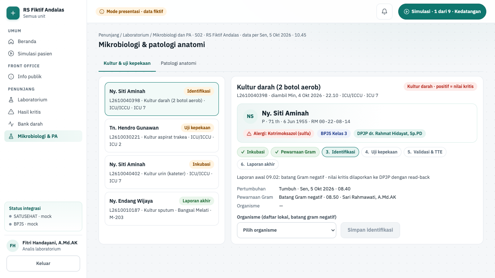

| Hal      | Isi                                                                                                                                                                                                                                         |
| -------- | ------------------------------------------------------------------------------------------------------------------------------------------------------------------------------------------------------------------------------------------- |
| Rute     | `/penunjang/mikrobiologi`                                                                                                                                                                                                                   |
| Pemakai  | analis lab, dokter                                                                                                                                                                                                                          |
| Komponen | S02 mikrobiologi dan patologi anatomi                                                                                                                                                                                                       |
| Status   | demo (mode presentasi); backend fase 4 potongan 4.8 belum dibangun                                                                                                                                                                          |
| Mockup   | tidak ada (gaya mengikuti layar Laboratorium)                                                                                                                                                                                               |
| Kode web | `apps/web/src/app/(staf)/penunjang/mikrobiologi/` · data `apps/web/src/lib/server/data/penunjang/mikro.ts` (`getMicroPa`) · aturan `apps/web/src/lib/penunjang-mikro.ts` · komponen `apps/web/src/components/penunjang/mikro-workspace.tsx` |
| Kode API | belum ada (rencana modul `micro-pa`, docs/01-arsitektur.md §2)                                                                                                                                                                              |

**Tujuan.** Menjalankan kultur bertahap sampai uji kepekaan antibiotik dan laporan akhir ber-TTE, serta laporan
patologi anatomi yang terkunci setelah ditandatangani. Kultur darah positif diteruskan sebagai nilai kritis.

**Alur.**

1. Buka **Mikrobiologi & PA**. Tab **Kultur & uji kepekaan** aktif. Kultur pertama, kultur darah Ny. Siti Aminah
   (L2610040398, ICU 7), sudah tumbuh batang Gram negatif dan menunggu identifikasi.
2. "Tahap kultur": Inkubasi, Pewarnaan Gram, Identifikasi, Uji kepekaan, Validasi & TTE, Laporan akhir. Kultur yang
   masih inkubasi memakai **Catat tumbuh**; tahap Gram memakai "Hasil pewarnaan Gram" dan **Simpan dan kirim laporan
   awal**.
3. Pilih "Organisme (daftar lokal, batang gram negatif)", mis. Escherichia coli, lalu **Simpan identifikasi**.
4. Form "Uji kepekaan antibiotik" mendaftar panel sesuai Gram (mis. Ampisilin sampai Kotrimoksazol). Antibiotik yang
   termasuk alergi pasien ditandai "alergi pasien". Isi S/I/R tiap baris, lalu **Simpan uji kepekaan**.
5. Tekan **Validasi & TTE (dr. Maya Lestari, Sp.PK)**. Layar menulis "✓ Laporan akhir ditandatangani …".
6. Tab **Patologi anatomi**: pilih kasus di "Daftar patologi anatomi", mis. biopsi kolon Ny. Maria Ulfa. Isi
   "Makroskopik", "Mikroskopik", dan "Diagnosis (kesimpulan)", lalu **Tandatangani (TTE dr. Hendra Wiguna, Sp.PA)**.
   Status menjadi "… terkunci" dan isian menjadi hanya-baca.
7. Koreksi setelah TTE lewat "Addendum (laporan asli tidak diubah)" dan **Tambah addendum**.

**Gerbang keselamatan dan aturan bisnis.**

- Tahap kultur berurutan dan tidak bisa dilompati (`applyCulture`): "Langkah ini belum bisa dilakukan; selesaikan
  tahap sebelumnya dulu."
- Organisme harus dari daftar lokal yang sesuai hasil Gram ("Organisme tidak sesuai dengan hasil pewarnaan Gram.").
  Pemetaan SNOMED menyusul (keputusan fase 4 #20).
- Semua antibiotik di panel wajib diisi S/I/R sebelum disimpan ("Semua antibiotik di panel wajib diisi S/I/R sebelum
  disimpan.").
- Pewarnaan Gram pada kultur darah adalah nilai kritis. Layar menautkan ke [Pusat hasil kritis](#pusat-hasil-kritis)
  untuk pelaporan dengan read-back.
- TTE PA butuh ketiga isian minimal 10 karakter ("Isian wajib minimal 10 karakter."). Setelah TTE laporan terkunci;
  addendum hanya untuk laporan ber-TTE dan minimal 10 karakter. Isi lama tidak pernah diubah (rekam medis immutable).
- Server Action `recordMicroAction` menegakkan kosakata Gram, organisme per Gram, kelengkapan panel S/I/R, dan panjang
  isian PA. Urutan tahap di sesi ini dijaga layar; server belum memeriksanya.
- Di mode presentasi analis lab menjalankan TTE atas nama dokter Sp.PK dan Sp.PA fiktif. Pemisahan peran dibangun di
  fase 4.

**Rencana backend.** Izin rencana `lab.write`. Fase 4 potongan 4.8 membangun modul `micro-pa`: kultur bertahap, isolat,
S/I/R + MIC, PA dengan gambar (P08) + TTE, dan `GET micro/antibiogram` untuk PPRA. Rencana menaruh mikrobiologi sebagai
tab di layar Laboratorium (keputusan fase 4 #1); di demo ia layar sendiri. Di mode api layar hibrida (4.0c): peran berizin melihat "Belum tersambung" sampai potongan fase 4 layar ini tergabung.

## Diagnostik lain

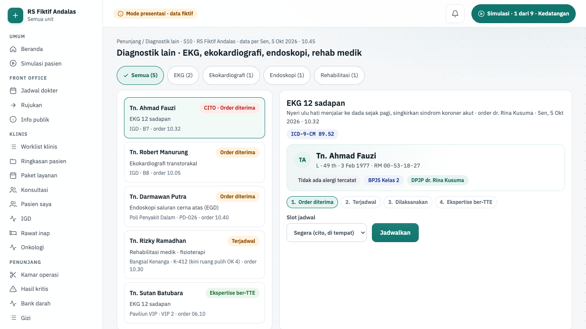

| Hal      | Isi                                                                                                                                                                                                                                                         |
| -------- | ----------------------------------------------------------------------------------------------------------------------------------------------------------------------------------------------------------------------------------------------------------- |
| Rute     | `/penunjang/diagnostik`                                                                                                                                                                                                                                     |
| Pemakai  | dokter, perawat                                                                                                                                                                                                                                             |
| Komponen | S10 penunjang diagnostik lain                                                                                                                                                                                                                               |
| Status   | demo (mode presentasi); backend fase 4 potongan 4.8 belum dibangun                                                                                                                                                                                          |
| Mockup   | tidak ada (gaya mengikuti layar Radiologi)                                                                                                                                                                                                                  |
| Kode web | `apps/web/src/app/(staf)/penunjang/diagnostik/` · data `apps/web/src/lib/server/data/penunjang/diagnostik.ts` (`getDiagOrders`) · aturan `apps/web/src/lib/penunjang-diagnostik.ts` · komponen `apps/web/src/components/penunjang/diagnostik-workspace.tsx` |
| Kode API | belum ada (rencana modul `diagnostics`, docs/01-arsitektur.md §2)                                                                                                                                                                                           |

**Tujuan.** Menjalankan pemeriksaan EKG, ekokardiografi, endoskopi, dan rehabilitasi medik dari order sampai
ekspertise terstruktur per templat yang ditandatangani dokter pembaca. Temuan kritis diteruskan ke jalur S09.

**Alur.**

1. Buka **Diagnostik lain**. Saring dengan "Saring jenis pemeriksaan". "Worklist diagnostik" menampilkan tahap tiap
   order: Order diterima, Terjadwal, Dilaksanakan, Ekspertise ber-TTE.
2. Pilih Tn. Ahmad Fauzi (IGD B7, EKG cito). "Detail pemeriksaan" menulis "EKG 12 sadapan" dan "ICD-9-CM 89.52".
   Ekokardiografi memakai ICD-9-CM 88.72; endoskopi dan rehab medik tertulis "ICD-9-CM belum dipetakan".
3. Di "Jadwalkan pemeriksaan" pilih "Slot jadwal" (mis. "Segera (cito, di tempat)"), lalu **Jadwalkan**.
4. Centang "Identitas pasien dicocokkan (nama + tanggal lahir / RM di gelang)", lalu
   **Mulai dan catat pelaksanaan**.
5. Isi form "Ekspertise EKG 12 sadapan": Irama, Laju jantung, Aksis, Segmen ST / gelombang T, dan Kesimpulan. Centang
   "Temuan kritis (mis. STEMI, aritmia mengancam) → laporkan dengan read-back" bila perlu.
6. Tekan **Simpan dan tandatangani (TTE dr. Bagus Santoso, Sp.JP)**. Layar menulis "Ekspertise ditandatangani dr.
   Bagus Santoso, Sp.JP …". Bila temuan kritis dicentang, layar menautkan ke Pusat hasil kritis.

**Gerbang keselamatan dan aturan bisnis.**

- Tahap berurutan (`applyDiag`): jadwal hanya dari tahap order, pelaksanaan hanya setelah terjadwal, TTE hanya setelah
  dilaksanakan.
- Slot harus dari daftar slot templat ("Pilih slot jadwal yang tersedia.").
- Pemeriksaan tidak bisa dimulai tanpa konfirmasi identitas ("Konfirmasi identitas pasien (dua pengenal) sebelum
  pemeriksaan dimulai.").
- Semua isian ekspertise templat wajib diisi sebelum TTE ("Semua isian ekspertise wajib diisi sebelum
  ditandatangani.").
- Kode ICD-9-CM hanya dari seed (89.52, 88.72); selebihnya "belum dipetakan".
- Server Action `recordDiagAction` mencari order di fixture dan menegakkan slot, identitas, dan kelengkapan isian.
- Di mode presentasi dokter dan perawat sama-sama bisa menekan TTE atas nama dokter pembaca fiktif. Temuan kritis yang
  dicentang belum muncul di Pusat hasil kritis karena keadaan antarlayar tidak disimpan.

**Rencana backend.** Izin rencana `diagnostic.write`. Fase 4 potongan 4.8 membangun modul `diagnostics`: order F3-1 +
isian formulir P07 (lima formulir diseed) + lampiran P08 + TTE, event `diagnostic.report_signed`. Rencana menampilkan
hasil S10 di panel hasil fase 3 (keputusan fase 4 #1), bukan layar sendiri. Di mode api layar hibrida (4.0c): peran berizin melihat "Belum tersambung" sampai potongan fase 4 layar ini tergabung.

## Tes yang menjaga layar ini

E2E mode presentasi (Playwright):

- `apps/web/e2e/demo/penunjang.spec.ts`: worklist dan hasil ber-LOINC, nilai kritis wajib penerima dan read-back,
  validasi berurutan, skenario IGD read-back, CDS menahan telaah farmasi, cek ganda high alert, stok depo berkurang,
  skenario resep Tn. Suryo, dosis CT wajib, ekspertise ber-TTE, tablet 768 px tanpa scroll horizontal.
- `apps/web/e2e/demo/btn.spec.ts` (blok "kamar operasi"): insisi terkunci sampai time out lengkap, override wajib
  beralasan.
- `apps/web/e2e/demo/fe3-penunjang-integrasi.spec.ts` (blok S09, S05, S08, S07, S02, S10, S06): hasil kritis tidak
  tertutup tanpa penerima dan read-back, FEFO dan override beralasan, karantina batch kedaluwarsa, crossmatch → cek
  ganda dua petugas → pindai gelang → reaksi menghentikan transfusi, alergi makanan dan puasa menahan baki, kultur
  sampai TTE dan PA terkunci dengan addendum, EKG cito ber-TTE, induksi terkunci sampai asesmen pra-anestesi ber-TTE,
  dan depo tanpa scroll horizontal di tablet 768 px.
- `apps/web/e2e/demo/semua-layar.spec.ts`: jaring pengaman semua layar dan QA visual.

Unit:

- `apps/web/src/lib/penunjang.test.ts`, `penunjang-farmasi.test.ts`, `penunjang-radiologi.test.ts`,
  `penunjang-skenario.test.ts` (gerbang server per aksi dan skenario).
- `apps/web/src/lib/penunjang-ok.test.ts` (gerbang time out, hitung kasa).
- `apps/web/src/lib/penunjang-kritis.test.ts`, `penunjang-depo.test.ts`, `penunjang-bank-darah.test.ts`,
  `penunjang-gizi.test.ts`, `penunjang-mikro.test.ts`, `penunjang-diagnostik.test.ts`, `penunjang-anestesi.test.ts`
  (gerbang murni layar penunjang lanjutan).
- `apps/web/src/lib/demo/fixtures/fixtures.test.ts`.

## Lihat juga

- [Fitur klinis (RME)](./12-fitur-klinis.md): CPOE yang mengirim order, rawat inap dan eMAR yang menerima obat.
- [Fitur keuangan](./14-fitur-keuangan.md): tarif penunjang masuk tagihan lewat charge capture.
- [Fitur integrasi](./15-fitur-integrasi.md#perangkat-medis): device gateway HL7 yang memasukkan hasil analyzer
  sebagai draf, dan [SATUSEHAT](./15-fitur-integrasi.md#satusehat) yang mengirim hasil ke luar.
- [Fitur back office](./16-fitur-back-office.md): Logistik memasok gudang farmasi yang dipakai layar Depo.
- [Peta alur semua fase](./20-peta-alur-semua-fase.md).
- [Rekam medis dan jejak audit](./01-cara-kerja-sistem.md#rekam-medis-dan-jejak-audit).
- [Membuat layar web dari mockup](./03-tutorial.md#5-membuat-layar-web-dari-mockup).
- [Simulasi dan operasional](./18-simulasi-dan-operasional.md) dan [Peta kode](./19-peta-kode.md).
- Rencana: `docs/rencana/fase-4-penunjang.md`; status: `docs/PROGRESS.md`.
