# Fitur keuangan

Halaman ini menjelaskan tiga belas layar keuangan. Lima layar utama: Kasir, Klaim & koding, Akuntansi, Pembayaran digital TPDI × BTN, dan Pembiayaan BTN. Delapan layar keuangan lanjutan: Tarif & paket, Charge capture, Penjaminan & piutang, Workbench koder, Jasa pelayanan, Kas & bank, Hutang usaha, dan Costing & case-mix. Isinya ditulis untuk orang yang perlu tahu apa yang terjadi di layar, aturan apa yang menjaga uang, dan di mana kodenya. Uang selalu `bigint` rupiah, setiap mutasi uang menghasilkan jurnal berpasangan, dan dana pasien tidak pernah transit di TPDI.

> Status 6 Okt 2026: ketiga belas layar hanya berjalan di **mode presentasi** (data dummy fiktif, ADR-0023, `pnpm dev:demo`). Backend fase 5 (keuangan), fase 6 (TPDI × BTN), dan fase 9 (costing) belum dibangun. Di lima layar utama setiap aksi divalidasi Server Action lalu dibuang. Delapan layar lanjutan tidak punya Server Action: aksi hanya mengubah keadaan di peramban dan hilang saat halaman dimuat ulang. Pesan umpan balik umumnya berakhiran "(simulasi, tidak disimpan)". Di luar mode presentasi rute ini menjawab 404, dan jalur data api masih `notImplemented`.

Layar keuangan ada di ujung perjalanan pasien. Tindakan klinis menjadi baris tagihan (charge capture), kasir menyelesaikan tagihan, koder mengirim klaim, lalu akuntansi menerima jurnalnya.

## Ringkasan layar

| Layar                | Rute                       | Peran (mode presentasi) | Komponen      | Status        |
| -------------------- | -------------------------- | ----------------------- | ------------- | ------------- |
| Kasir                | `/keuangan/kasir`          | Kasir                   | U02, U03      | demo · fase 5 |
| Klaim & koding       | `/keuangan/klaim`          | Koder klinis            | U05, U06      | demo · fase 5 |
| Akuntansi            | `/keuangan/akuntansi`      | Akuntan                 | U04, U07, U09 | demo · fase 5 |
| Pembayaran digital   | `/keuangan/pembayaran`     | Kasir, Akuntan          | I05, U09      | demo · fase 6 |
| Pembiayaan BTN       | `/keuangan/pembiayaan`     | Akuntan, Manajemen      | U04           | demo · fase 6 |
| Tarif & paket        | `/keuangan/tarif`          | Akuntan, Manajemen      | U01           | demo · fase 5 |
| Charge capture       | `/keuangan/charge-capture` | Kasir, Akuntan          | U02           | demo · fase 5 |
| Penjaminan & piutang | `/keuangan/piutang`        | Akuntan, Manajemen      | U04           | demo · fase 5 |
| Workbench koder      | `/keuangan/koding`         | Koder klinis            | U06           | demo · fase 5 |
| Jasa pelayanan       | `/keuangan/jasa-pelayanan` | Akuntan, Manajemen      | U08           | demo · fase 5 |
| Kas & bank           | `/keuangan/kas-bank`       | Kasir, Akuntan          | U09           | demo · fase 5 |
| Hutang usaha         | `/keuangan/hutang`         | Akuntan, Manajemen      | U10           | demo · fase 5 |
| Costing & case-mix   | `/keuangan/costing`        | Manajemen, Akuntan      | I10           | demo · fase 9 |

Posisi lain yang membuka rute ini melihat pesan "Layar ini untuk posisi lain" dengan tautan **Ganti posisi**. Sumber kebenaran tabel ini adalah registri `SCREENS` di `apps/web/src/lib/screens.ts`.

Semua layar mengambil data hanya lewat satu pintu per domain: `apps/web/src/lib/server/data/keuangan.ts` (Kasir, Klaim, Akuntansi) dan `apps/web/src/lib/server/data/btn.ts` (Pembayaran, Pembiayaan). Data dummy divalidasi skema zod yang sama dengan kontrak API kelak (`packages/shared/src/schemas/keuangan.ts`, `btn.ts`). Pasien skenario Simulasi (Tn. Suryo, Tn. Hartono, Ny. Ratna) diproyeksikan dari mesin skenario; lihat [Simulasi dan operasional](./18-simulasi-dan-operasional.md).

Delapan layar lanjutan punya satu pintu data sendiri: `apps/web/src/lib/server/data/keuangan-lanjut.ts` (`getTariffBoard`, `getChargeCaptureBoard`, `getReceivablesBoard`, `getCodingBoard`, `getFeeSharingBoard`, `getCashBankBoard`, `getPayablesBoard`, `getCostingBoard`). Fixture-nya ada di `apps/web/src/lib/demo/fixtures/{tarif,charge-capture,piutang,koding,jaspel,kas-bank,hutang,costing}.ts`. Kedelapan layar ini tidak punya mockup.

## Pola bersama: jurnal berpasangan

Setiap mutasi uang di delapan layar lanjutan tampil sebagai jurnal berpasangan lewat satu komponen bersama, `JurnalPasangan` (`apps/web/src/components/keuangan/jurnal-pasangan.tsx`). Aturannya ada di `apps/web/src/lib/keuangan-jurnal.ts`, fungsi murni yang dipakai server dan klien.

- Uang selalu `bigint` rupiah. Tidak ada float: persen dihitung dengan bigint (`persen`), dan pembagian memakai sisa terbesar (`bagiSisaTerbesar`) sehingga Σ bagian = total tepat.
- Satu baris hanya debit atau hanya kredit. Jurnal sah bila Σ debit = Σ kredit dan tidak nol (`jurnalSeimbang`). Baris bernilai nol dibuang (`jurnal`).
- Komponen menulis status dalam teks, bukan hanya warna: "✓ Seimbang (debit = kredit)" atau "✗ Tidak seimbang". Total ada di atribut `data-total-debit` dan `data-total-credit`; E2E membandingkan keduanya di setiap jurnal yang tampil.
- Keterangan posting tertulis di kepala jurnal, mis. "draf · diposting setelah disetujui" atau "terposting".
- Pesan umpan balik meringkas jurnal dalam satu baris (`ringkasJurnal`), mis. "Dr 1-1120 Rp 9.850.000 · Dr 6-1200 Rp 150.000 · Cr 1-1210 Rp 10.000.000".
- Agustus dan September 2026 adalah periode tertutup (`PERIODE_TERTUTUP`). Mutasi bertanggal periode itu tampil "Terkunci: periode … ditutup"; koreksi masuk periode berjalan.
- Layar Pembayaran digital juga memakai komponen ini untuk jurnal refund (`refundJournal`: Dr 2-1210 Uang muka pasien / Cr 1-1120 Bank BTN operasional).

Kode akun yang dipakai layar lanjutan berikut ini fiktif dan hanya ada di kode web. Bagan akun belum ada di seed `packages/db`.

| Kode     | Nama akun                                    | Didefinisikan di                       | Dipakai layar                           |
| -------- | -------------------------------------------- | -------------------------------------- | --------------------------------------- |
| `1-1110` | Kas kasir (laci loket)                       | `AKUN_LANJUT`                          | Kas & bank                              |
| `1-1120` | Bank BTN ••••4417 — operasional              | `AKUN_LANJUT` (juga `AKUN`)            | Piutang, Kas & bank, Pembayaran digital |
| `1-1140` | Bank mitra ••••7730 — penggajian dan pemasok | `AKUN_LANJUT`                          | Jasa pelayanan, Hutang usaha            |
| `1-1210` | Piutang settlement EDC                       | `AKUN_LANJUT`                          | Kas & bank                              |
| `1-1320` | Piutang BPJS — RI                            | `keuangan-piutang.ts` (salinan `AKUN`) | Piutang (pembagian penjamin)            |
| `1-1330` | Piutang pasien                               | `AKUN_LANJUT` (juga `AKUN`)            | Piutang                                 |
| `1-1340` | Piutang asuransi swasta                      | `AKUN_LANJUT`                          | Piutang, Kas & bank                     |
| `1-1350` | Piutang perusahaan kerja sama                | `AKUN_LANJUT`                          | Piutang                                 |
| `1-1410` | Persediaan obat dan BHP                      | `AKUN_LANJUT` (juga `AKUN`)            | Hutang usaha                            |
| `2-1110` | Utang usaha — pemasok                        | `AKUN_LANJUT` (juga `AKUN`)            | Hutang usaha                            |
| `2-1120` | Utang penerimaan belum difakturkan           | `AKUN_LANJUT`                          | Hutang usaha                            |
| `2-1210` | Uang muka pasien                             | `keuangan-jurnal.ts` (juga `AKUN`)     | Pembayaran digital (refund)             |
| `2-1290` | Titipan dana belum teridentifikasi           | `keuangan-kasbank.ts`                  | Kas & bank                              |
| `2-1410` | Utang jasa pelayanan                         | `AKUN_LANJUT`                          | Jasa pelayanan                          |
| `2-1420` | Utang PPh 21 jasa pelayanan                  | `AKUN_LANJUT`                          | Jasa pelayanan                          |
| `4-1200` | Pendapatan RI — JKN                          | `keuangan-piutang.ts` (salinan `AKUN`) | Piutang (pembagian penjamin)            |
| `4-1300` | Pendapatan layanan — non-JKN                 | `keuangan-piutang.ts`                  | Piutang (pembagian penjamin)            |
| `4-1900` | Selisih tarif INA-CBG (pengurang pendapatan) | `keuangan-piutang.ts` (salinan `AKUN`) | Piutang (pembagian penjamin)            |
| `4-1950` | Potongan dan penyesuaian tagihan             | `AKUN_LANJUT`                          | Piutang (penyesuaian)                   |
| `4-3100` | Pendapatan lain-lain (selisih lebih kas)     | `AKUN_LANJUT`                          | Kas & bank                              |
| `5-1100` | Beban jasa pelayanan                         | `AKUN_LANJUT`                          | Jasa pelayanan                          |
| `6-1200` | Beban administrasi bank (MDR EDC)            | `AKUN_LANJUT`                          | Kas & bank                              |
| `6-1210` | Beban administrasi rekening bank             | `demo/fixtures/kas-bank.ts`            | Kas & bank                              |
| `6-1300` | Beban selisih kurang kas                     | `AKUN_LANJUT`                          | Kas & bank                              |
| `6-3100` | Beban penurunan nilai piutang                | `AKUN_LANJUT` (juga `AKUN`)            | Piutang (hapus buku)                    |

`AKUN_LANJUT` ada di `apps/web/src/lib/keuangan-jurnal.ts`; `AKUN` adalah bagan akun layar Akuntansi di `apps/web/src/lib/demo/fixtures/keuangan.ts`.

## Kasir

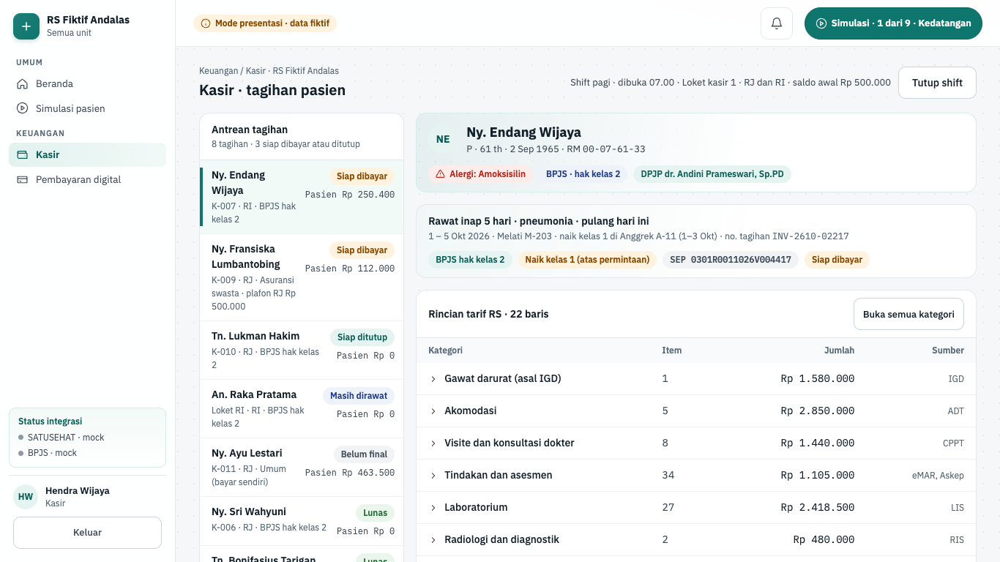

| Hal      | Isi                                                                                                                                                           |
| -------- | ------------------------------------------------------------------------------------------------------------------------------------------------------------- |
| Rute     | `/keuangan/kasir` (`?pilih=<id tagihan>`)                                                                                                                     |
| Pemakai  | kasir                                                                                                                                                         |
| Komponen | U02 charge capture, U03 billing dan kasir                                                                                                                     |
| Status   | demo (mode presentasi); backend fase 5 belum dibangun                                                                                                         |
| Mockup   | `design/mockups/Kasir.dc.html`                                                                                                                                |
| Kode web | `apps/web/src/app/(staf)/keuangan/kasir/` · `apps/web/src/components/keuangan/` · `apps/web/src/lib/keuangan.ts` · `apps/web/src/lib/server/data/keuangan.ts` |
| Kode API | belum ada (rencana modul `charge-capture`, `billing`, `guarantor`, `cash-bank`; `docs/01-arsitektur.md` §2)                                                   |

**Tujuan.** Kasir menyelesaikan tagihan pasien yang sudah pulang. Baris tagihan datang dari charge capture (order, eMAR, lab, radiologi, OK, ADT) lengkap dengan sumbernya, jadi kasir tidak mengetik ulang item.

**Alur.**

1. Buka **Keuangan › Kasir**. Kolom kiri "Antrean tagihan" berisi nomor loket (`K-…`), penjamin, porsi pasien, dan status teks: Masih dirawat, Belum final, Siap dibayar, Siap ditutup, atau Lunas.
2. Pilih tagihan. Kanan atas tampil banner pasien (nama, umur, RM, alergi, penjamin, DPJP) dan kartu kunjungan dengan chip penjamin, naik kelas, SEP, dan status.
3. Periksa "Rincian tagihan". Baris dikelompokkan per kategori (kolom Kategori, Item, Tarif RS, Sumber). Tekan **Buka semua kategori** untuk melihat semua baris. Baris paling bawah: **Total tarif RS**.
4. Bila ada layanan yang belum tertangkap otomatis, tekan **Tambah item manual**. Isi Nama item, Kategori, Kuantitas, Harga satuan (Rp), dan "Alasan item manual (wajib, minimal 15 karakter)", lalu **Ajukan item manual**. Baris baru berlabel "Manual" dan menampilkan alasannya.
5. Baca kartu "Pembagian penjamin": tarif RS, tarif INA-CBG hak kelas (dan kelas tujuan bila naik kelas 1/2), porsi penjamin, tanggungan pasien, dan sisa bayar.
6. Tekan **Finalkan tagihan**. Tombol ini aktif hanya bila pasien sudah pulang. Setelah final, tagihan terkunci.
7. Di panel "Pembayaran", pilih metode lalu penuhi syaratnya (tabel di bawah). Tombol **Selesaikan dan cetak kuitansi** aktif setelah syarat metode terpenuhi.
8. Hasilnya kotak "Lunas" dengan nomor kuitansi `KW-…`, jam, dan catatan bahwa jurnal bank terbentuk (pasien BPJS: klaim diteruskan ke casemix). Langkah lanjut seperti mockup: **Lanjut ke klaim BPJS** (pasien BPJS), **Lihat jurnal**, **Pembayaran digital**; lalu **Cetak kuitansi** atau **Tagihan berikutnya**. Layar posisi lain menawarkan "Ganti posisi".
9. Bila pasien tidak membayar apa pun (mis. JKN sesuai hak kelas), tekan **Tutup kunjungan (pasien bayar Rp 0)**.
10. Di akhir shift, tekan **Tutup shift** di kepala layar, lalu **Ya, tutup shift**. Rekap kas dikirim ke akuntansi (simulasi).

| Metode                        | Syarat sebelum selesai                                                                                                     |
| ----------------------------- | -------------------------------------------------------------------------------------------------------------------------- |
| QRIS (via TPDI, acquirer BTN) | QR dinamis berlaku 10 menit. Menunggu webhook TPDI; di demo tekan **Simulasikan pembayaran diterima**                      |
| Virtual Account BTN           | VA berlaku 24 jam. Menunggu webhook TPDI; di demo tekan **Simulasikan pembayaran VA**                                      |
| Debit / kredit                | Centang "Struk EDC approved diterima"                                                                                      |
| Tunai                         | Uang diterima ≥ sisa tagihan; kembalian dihitung otomatis                                                                  |
| Transfer bank                 | Nomor referensi minimal 6 karakter dan sudah dicocokkan dengan mutasi BTN                                                  |
| Cicilan BTN                   | Pilih tenor 3, 6, atau 12 bulan, **Ajukan pembiayaan ke BTN**, lalu empat langkah simulasi sampai dana cair ke rekening RS |

Contoh data dummy: Ny. Endang Wijaya, `INV-2610-02217`, rawat inap pneumonia 5 hari. Total tarif RS Rp 17.217.500. BPJS hak kelas 2 menanggung tarif INA-CBG. Pasien naik kelas 1 atas permintaan, jadi menanggung selisih Rp 1.250.400 (tarif kelas 1 Rp 7.863.200 − kelas 2 Rp 6.612.800, tarif simulasi). Deposit VA Rp 1.000.000 sudah masuk, jadi sisa bayar Rp 250.400. Bayar QRIS menghasilkan kuitansi `KW-2610-02217`.

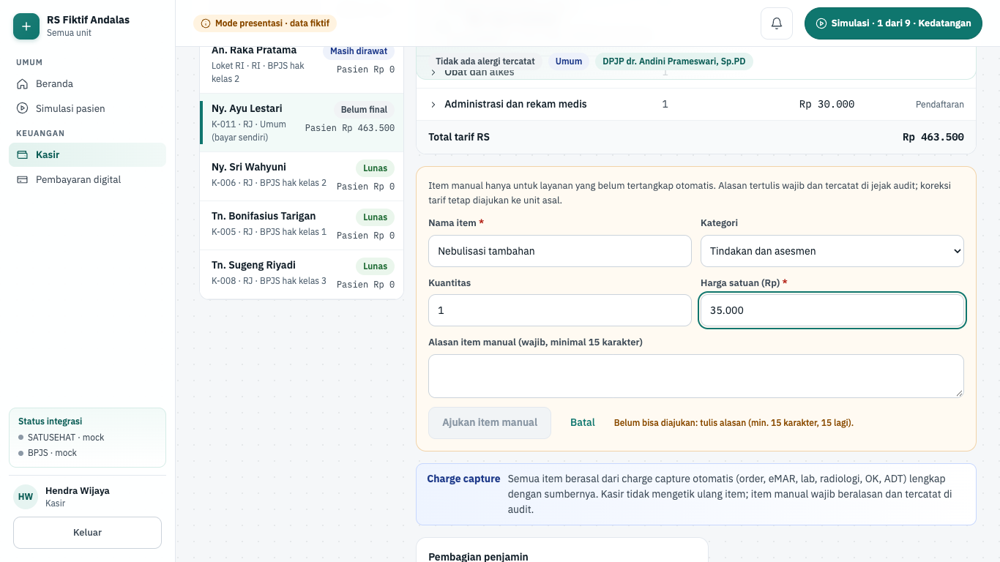

**Gerbang keselamatan dan aturan bisnis.**

- Total tagihan = jumlah baris (bigint). Baris = kuantitas × harga satuan. E2E menjumlahkan atribut `data-line-amount` dan membandingkannya dengan `data-total-amount`.
- Item manual wajib: nama ≥ 3 huruf, kuantitas bilangan bulat 1–99 ("2.5" ditolak, bukan dipotong), harga Rp 1 sampai Rp 100.000.000, dan alasan ≥ 15 karakter. Aturan yang sama (`manualLineProblems`) dipakai tombol dan Server Action. Alasan tercatat di jejak audit (versi produksi).
- Item manual dan finalisasi hanya untuk tagihan berjalan. Tagihan final terkunci; koreksi lewat unit asal. Tagihan lunas tidak bisa diubah.
- Finalisasi dan pembayaran menunggu pasien pulang.
- Server tidak memercayai nominal dari klien. `kasirAction` membaca ulang tagihan, menghitung sisa dari baris + item manual (`invoiceSettlement`), dan menolak nominal yang beda ("Nominal tidak sesuai sisa tagihan").
- Pembagian penjamin dihitung, bukan diketik. BPJS membayar tarif INA-CBG; pasien hanya menanggung selisih naik kelas. Asuransi membayar sampai plafon; ekses ditagihkan ke pasien. Umum membayar seluruhnya. Tarif RS = porsi penjamin + porsi pasien + selisih yang ditanggung RS.
- Tagihan pasien skenario hanya maju lewat tugas skenario, bukan aksi lokal kasir.
- Jurnal otomatis tertulis di panel: Kas/Bank BTN ••••4417 (D) · uang muka/piutang pasien (K). Piutang BPJS tetap terbuka sampai klaim dibayar.
- Dana QRIS, VA, dan EDC masuk langsung ke rekening operasional RS di BTN, bukan ke TPDI.

**Rencana backend.** Izin terencana `billing.write`. Fase 5 membangun charge capture dari event domain (`modules/charge-capture/consumers/`, potongan 5.4), penjaminan (5.6), serta kasir + shift (5.7). Kanal VA/QRIS/EDC terintegrasi dan cicilan masuk di fase 6 (`docs/rencana/fase-5-keuangan.md`, `fase-6-pembayaran-tpdi-btn.md`).

## Klaim & koding

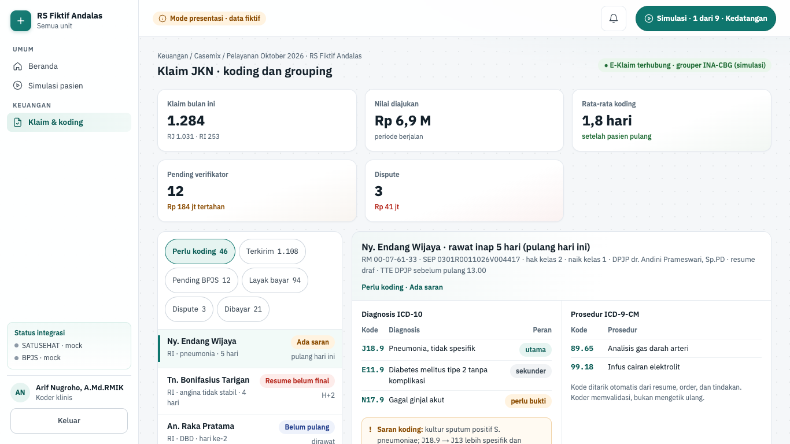

| Hal      | Isi                                                                                                                               |
| -------- | --------------------------------------------------------------------------------------------------------------------------------- |
| Rute     | `/keuangan/klaim` (`?status=<status>&pilih=<id klaim>`)                                                                           |
| Pemakai  | koder                                                                                                                             |
| Komponen | U05 klaim BPJS dan INA-CBG, U06 koding klinis                                                                                     |
| Status   | demo (mode presentasi); backend fase 5 belum dibangun                                                                             |
| Mockup   | `design/mockups/Klaim.dc.html`                                                                                                    |
| Kode web | `apps/web/src/app/(staf)/keuangan/klaim/` · `apps/web/src/components/keuangan/claim-*.tsx` · `apps/web/src/lib/keuangan-klaim.ts` |
| Kode API | belum ada (rencana modul `claims`, `coding`; konektor E-Klaim di worker)                                                          |

**Tujuan.** Koder memeriksa kode diagnosis dan prosedur, menjalankan grouper INA-CBG, melengkapi berkas, lalu mengirim klaim ke E-Klaim. Koder juga menanggapi klaim pending dan dispute dari verifikator BPJS.

**Alur.**

1. Buka **Keuangan › Klaim & koding**. Wilayah "Indikator klaim" berisi Klaim bulan ini (1.284), Nilai diajukan, Rata-rata koding, Pending verifikator, dan Dispute.
2. Saring daftar per status: Perlu koding, Terkirim, Pending BPJS, Layak bayar, Dispute, Dibayar.
3. Pilih berkas. Kepala berkas memuat pasien, SEP, kelas, DPJP, dan status resume.
4. Periksa tabel "Diagnosis ICD-10" (peran utama, sekunder, perlu bukti, sementara) dan "Prosedur ICD-9-CM".
5. Bila ada catatan "Saran koding", pilih tombol terima kode saran (mis. **Terima J13**) atau **Kirim query ke DPJP**. Status di kepala berkas dan chip di daftar ikut berubah: Menunggu jawaban DPJP (chip "Menunggu DPJP") → Siap grouping · J13 (chip "Saran diterima") → Siap final · J-4-15-III → Terkirim ke E-Klaim (chip "Terkirim"; pending: "Tanggapan terkirim"; dispute: "Banding diajukan"). Tindakan ini bertahan saat koder membuka berkas lain lalu kembali (simulasi, selama layar terbuka).
6. Baca "Hasil grouper INA-CBG (simulasi)": kode CBG, tarif kelas, perbandingan tarif RS vs INA-CBG, dan special CMG.
7. Di "Kelengkapan berkas", centang berkas yang sudah ada.
8. Kirim dengan tombol sesuai status: **Final dan kirim E-Klaim** (perlu koding), **Kirim tanggapan ke verifikator** (pending), atau **Ajukan penyelesaian dispute** (dispute). Hasilnya "Terkirim ke E-Klaim HH.MM", berkas terkunci, dan tautan **Lihat jurnal piutang di Akuntansi** (kepala layar juga punya tautan **Jurnal piutang BPJS**).

Contoh data dummy: klaim Ny. Endang berisi J18.9 (utama), E11.9 (sekunder), N17.9 (perlu bukti), prosedur 89.65 dan 99.18. Grouper awal J-4-15-II kelas 2 Rp 6.612.800 (estimasi). Berkas 6/7 lengkap; yang kurang "Bukti klinis N17.9 di CPPT". Saran koding: kultur sputum mendukung J13. Setelah **Terima J13** dan bukti N17.9 dicentang, grouper naik ke J-4-15-III Rp 9.104.300 (naik Rp 2.491.500). Kode CBG di data dummy web bergaya INA-CBG dengan tarif berlabel simulasi; mock E-Klaim di `apps/mock` memakai kode `SIM-*`.

**Gerbang keselamatan dan aturan bisnis.**

- Tombol kirim nonaktif (`aria-disabled`, tetap bisa difokus) sampai semua berkas lengkap. Alasannya tertulis dan dibacakan, mis. "Belum bisa dikirim: lengkapi 1 berkas (…)".
- Grouping ditahan bila pasien masih dirawat, resume medis belum final ber-TTE, atau kode utama tidak sesuai bukti klinis.
- Skenario IGD (Tn. Hartono): sistem menandai I20.0 (angina) yang tidak cocok dengan troponin dan EKG. Pilihannya ikuti saran "Kembali ke I21.4", atau "Kirim query ke DPJP (klaim ditahan)" dengan alasan tertulis (minimal 10 karakter di server).
- Kode hanya dari daftar contoh seed (`ICD10_NAME`, `ICD9_NAME` di fixture). Kode di luar daftar membuat fixture gagal dibangun.
- Tarif RS vs INA-CBG dibandingkan dengan bigint (`claimRatio`), termasuk persen dan selisih.
- Setelah terkirim, berkas dikunci untuk verifikasi BPJS dan jurnal piutang BPJS terbentuk di Akuntansi.

**Rencana backend.** Izin terencana `claim.write`. Fase 5 membangun koding + grouping (potongan 5.5), klaim final → kirim → status → dibayar (5.10), konektor E-Klaim lewat outbox (5.1b), dan mock E-Klaim lengkap (5.1c).

## Akuntansi

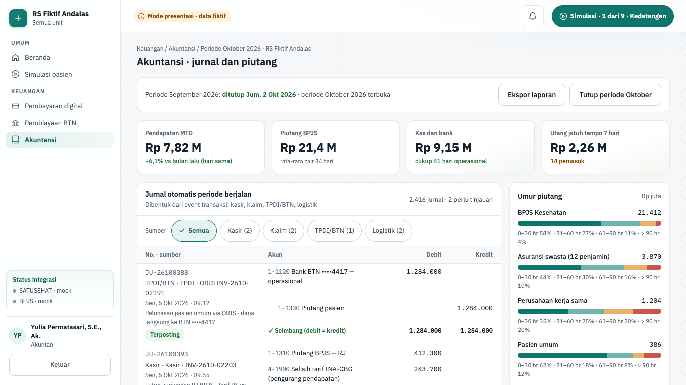

| Hal      | Isi                                                                                                                                                                                                            |
| -------- | -------------------------------------------------------------------------------------------------------------------------------------------------------------------------------------------------------------- |
| Rute     | `/keuangan/akuntansi`                                                                                                                                                                                          |
| Pemakai  | akuntan                                                                                                                                                                                                        |
| Komponen | U04 penjaminan dan piutang, U07 akuntansi, U09 kas dan bank                                                                                                                                                    |
| Status   | demo (mode presentasi); backend fase 5 belum dibangun                                                                                                                                                          |
| Mockup   | `design/mockups/Akuntansi.dc.html`                                                                                                                                                                             |
| Kode web | `apps/web/src/app/(staf)/keuangan/akuntansi/` · `apps/web/src/components/keuangan/{accounting-workspace,journal-table,period-close,bank-recon-card,aging-card}.tsx` · `apps/web/src/lib/keuangan-akuntansi.ts` |
| Kode API | belum ada (rencana modul `accounting`, `cash-bank`)                                                                                                                                                            |

**Tujuan.** Akuntan memantau jurnal otomatis dari kasir, klaim, TPDI/BTN, dan logistik. Akuntan memetakan akun yang belum lengkap, memadankan mutasi bank, lalu menutup periode.

**Alur.**

1. Buka **Keuangan › Akuntansi**. Wilayah "Indikator keuangan": Pendapatan MTD, Piutang BPJS, Kas dan bank, Utang jatuh tempo 7 hari.
2. Baca "Jurnal otomatis periode berjalan". Tiap jurnal menampilkan baris debit/kredit dan totalnya. Saring lewat tombol Sumber: Semua, Kasir, Klaim, TPDI/BTN, Logistik.
3. Status jurnal tertulis: Terposting, Menunggu rekonsiliasi, Menunggu penyetuju kedua, atau Perlu pemetaan akun.
4. Jurnal `JU-26100417` (penurunan nilai piutang klaim dispute) belum punya akun lawan. Tekan **Petakan akun** (atau **Batal** untuk menutupnya lagi), lalu pilih akun di "Akun lawan (kredit)", mis. `1-1390` Cadangan kerugian penurunan nilai — piutang BPJS. Pesannya: "siap diposting setelah disetujui penyetuju kedua".
5. Di samping, baca "Umur piutang" (Rp juta) dan "Rekonsiliasi bank otomatis". Rekening BTN penampungan klaim ••••9021 punya 2 transfer BPJS yang belum dipadankan; tekan **Padankan 2 transfer ke batch klaim**. Tautan **Rekonsiliasi 3 arah TPDI × BTN** membuka Pembayaran digital.
6. Tekan **Tutup periode Oktober**. Dialog "Tutup periode Oktober 2026?" menampilkan syarat sebagai daftar teks. Tekan **Ya, tutup dan kunci periode** bila semua syarat terpenuhi, atau **Batal**. Selama syarat belum terpenuhi tombol itu tetap bisa difokus dan alasannya dibacakan.
7. Setelah ditutup, banner menyatakan periode ditutup dan jurnal dikunci. **Ekspor laporan** mengekspor jurnal dan neraca saldo (simulasi).

**Gerbang keselamatan dan aturan bisnis.**

- Setiap jurnal seimbang: total debit = total kredit, satu sisi per baris. E2E membandingkan `data-total-debit` dan `data-total-credit`; tes unit memeriksanya di setiap langkah tiga skenario.
- Jurnal tanpa akun lawan tidak bisa diposting. Pemetaan butuh penyetuju kedua (pembuat ≠ penyetuju).
- Tutup periode hanya bila semua jurnal terpetakan dan rekonsiliasi bank tanpa selisih. Server memeriksa syarat terhadap papan versi server (`periodCloseCheck`); klien hanya mengirim id jurnal dan rekening, bukan hitungan.
- Jurnal terposting tidak bisa diedit, hanya dibalik. Periode tertutup dikunci; membuka ulang butuh direktur keuangan.
- Porsi umur piutang dihitung dengan bigint dan selalu berjumlah 100%.

**Rencana backend.** Izin terencana `accounting.write`. Fase 5 membangun inti buku besar dengan satu aturan posting per sumber di `modules/accounting/posting-rules/<sumber>.ts` (potongan 5.3), pencocok mutasi bank di `modules/cash-bank/matchers/` (5.8), serta laporan dan tutup periode (5.11).

## Pembayaran digital TPDI × BTN

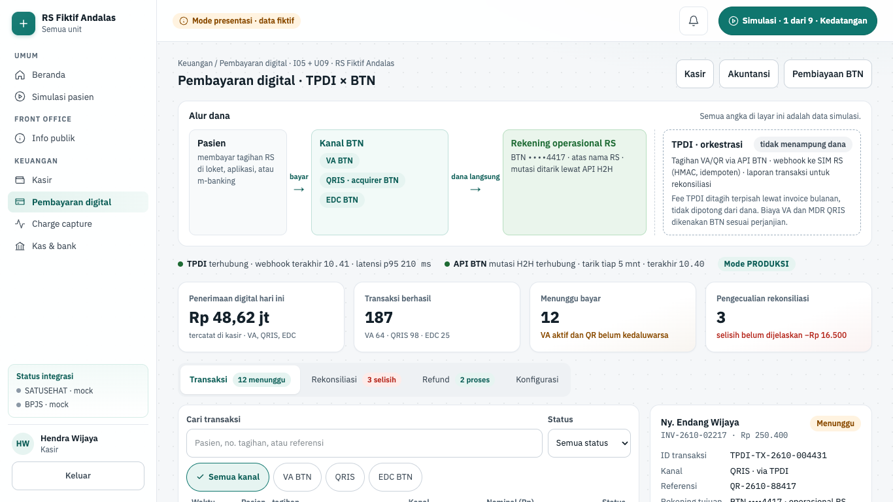

| Hal      | Isi                                                                                                                                                 |
| -------- | --------------------------------------------------------------------------------------------------------------------------------------------------- |
| Rute     | `/keuangan/pembayaran`                                                                                                                              |
| Pemakai  | kasir, akuntan                                                                                                                                      |
| Komponen | I05 konektor layanan pendukung (bank, TPDI), U09 kas dan bank                                                                                       |
| Status   | demo (mode presentasi); backend fase 6 belum dibangun                                                                                               |
| Mockup   | `design/mockups/PembayaranBTN.dc.html`                                                                                                              |
| Kode web | `apps/web/src/app/(staf)/keuangan/pembayaran/` · `apps/web/src/components/btn/` · `apps/web/src/lib/btn.ts` · `apps/web/src/lib/server/data/btn.ts` |
| Kode API | belum ada (rencana modul `webhooks`, `payments`, `reconciliation`)                                                                                  |

**Tujuan.** Layar ini memantau pembayaran VA, QRIS, dan EDC lewat TPDI × BTN, merekonsiliasi tiga sumber, mengelola refund, dan mengatur kanal. Layar ini juga menunjukkan bahwa TPDI tidak menampung dana (ADR-0005).

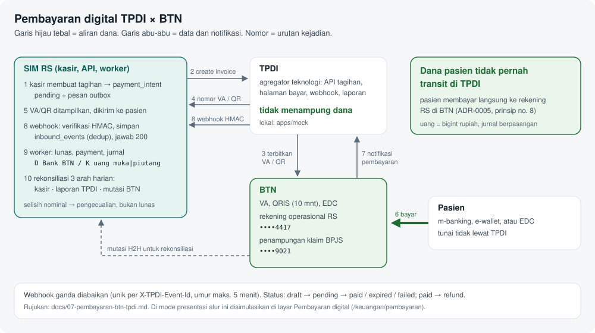

**Alur.**

1. Buka **Keuangan › Pembayaran digital**. Bagian "Alur dana" menunjukkan Pasien → Kanal BTN (VA BTN, QRIS · acquirer BTN, EDC BTN) → Rekening operasional RS BTN ••••4417. Kotak "TPDI · orkestrasi" berlabel "tidak menampung dana".
2. Baris status menampilkan koneksi TPDI (webhook terakhir, latensi p95), API BTN mutasi H2H, dan mode SANDBOX atau PRODUKSI.
3. Wilayah "Indikator pembayaran": Penerimaan digital hari ini, Transaksi berhasil, Menunggu bayar, Pengecualian rekonsiliasi.
4. Tab **Transaksi**: pilih baris di "Daftar transaksi". "Detail transaksi" menampilkan jejak status, webhook TPDI yang diterima, dan payload ringkas.
5. Untuk VA/QRIS yang menunggu, tekan **Simulasikan pembayaran (webhook TPDI)**. Hasilnya "Webhook TPDI diterima, tagihan lunas" dan tanda "✓ HMAC valid". Contoh: Ny. Endang `INV-2610-02217 · Rp 250.400`.
6. Contoh callback ganda: transaksi Tn. Sutan Batubara menampilkan event kedua sebagai "duplikat · diabaikan" dan "Dikreditkan sekali per event id: Rp 5.000.000".
7. Tab **Rekonsiliasi** (lencana "3 selisih"): tabel "Rekonsiliasi 3 arah · hari ini" membandingkan Kasir SIM RS, Laporan TPDI, dan Mutasi BTN. **Jalankan rekonsiliasi** menarik ulang data. Untuk tiap pengecualian, pilih tindakan, isi "Catatan penyelesaian (wajib)", lalu **Terapkan**. Baris berubah menjadi "Ditangani".
8. Tab **Refund**: lima tahap Diajukan → Supervisor kasir → Manajer keuangan → Transfer BTN → Dana kembali. Tombolnya **Ajukan refund**, **Setujui sebagai supervisor kasir**, **Setujui sebagai manajer keuangan**, dan **Simulasikan dana diterima pasien**.
9. Tab **Konfigurasi**: merchant dan rekening tujuan, kanal aktif, masa berlaku VA (12/24/48 jam) dan QRIS (5/10/15 menit), mode koneksi TPDI (Sandbox/Produksi), serta webhook TPDI → SIM RS (HMAC-SHA256, timestamp ditolak bila selisih > 5 menit). **Rotasi secret** meminta konfirmasi **Ya, rotasi sekarang**. Simpan dengan **Simpan konfigurasi**.

Contoh tindakan pengecualian dari data dummy: "Tandai lunas di kasir (TPDI + BTN cocok)", "Minta TPDI kirim ulang webhook", "Catat Rp 14.000 sebagai beban MDR QRIS", dan "Catat sebagai titipan tak teridentifikasi".

**Gerbang keselamatan dan aturan bisnis.**

- Dana tidak transit di TPDI. Rekening tujuan semua transaksi adalah rekening operasional RS di BTN; tes fixture memeriksanya. Fee TPDI ditagih terpisah, tidak dipotong dari dana.
- Webhook idempoten: hanya event `payment.paid` dengan tanda tangan sah yang dikreditkan, dan satu event id hanya dihitung sekali (`creditedAmount`).
- Pelunasan simulasi hanya untuk VA/QRIS yang masih menunggu dan bukan pasien skenario. Server memeriksa ulang (`canSimulatePay`).
- Pengecualian rekonsiliasi wajib tindakan dan catatan minimal 10 karakter. Selisih nominal tidak menjadi lunas otomatis.
- Refund: nominal tidak boleh melebihi kelebihan deposit atau nominal transaksi asal, alasan wajib, keterangan minimal 15 karakter. Dua penyetuju berbeda tingkat. Tahap tidak boleh mundur dari tahap di server.
- Konfigurasi menolak bila semua kanal dimatikan ("Minimal satu kanal pembayaran harus aktif").
- Nominal disimpan tak bertanda (bigint); hanya penyesuaian rekonsiliasi yang boleh negatif.

**Rencana backend.** Izin terencana `payment.write`. Fase 6 membangun penerima webhook di `modules/webhooks` (`POST /api/v1/webhooks/tpdi/:tenantCode`, raw body, verifikasi HMAC, simpan `inbound_events`, jawab 2xx), payment intent di `modules/payments`, dan rekonsiliasi 3 arah di `modules/reconciliation`. Fungsi verifikasi tanda tangan sudah ada: `verifyTpdiWebhook` di `packages/shared/src/integrations/tpdi-signature.ts`.

## Pembiayaan BTN

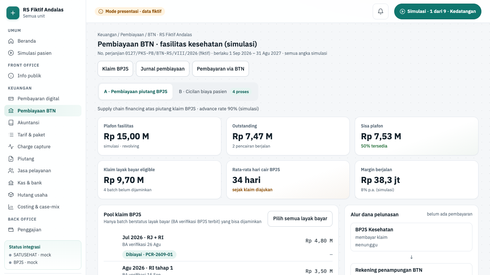

| Hal      | Isi                                                                                                                                             |
| -------- | ----------------------------------------------------------------------------------------------------------------------------------------------- |
| Rute     | `/keuangan/pembiayaan` (`?tab=cicilan` membuka tab B)                                                                                           |
| Pemakai  | akuntan, manajemen                                                                                                                              |
| Komponen | U04 penjaminan dan piutang                                                                                                                      |
| Status   | demo (mode presentasi); backend fase 6 belum dibangun                                                                                           |
| Mockup   | `design/mockups/PembiayaanBTN.dc.html`                                                                                                          |
| Kode web | `apps/web/src/app/(staf)/keuangan/pembiayaan/` · `apps/web/src/components/btn/{piutang-*,cicilan-*}.tsx` · `apps/web/src/lib/btn-pembiayaan.ts` |
| Kode API | belum ada (rencana modul `financing`)                                                                                                           |

**Tujuan.** RS mencairkan dana lebih awal atas piutang klaim BPJS yang layak bayar (supply chain financing), dan memantau cicilan biaya pasien yang diputuskan BTN. Pembiayaan adalah produk BTN; SIM RS hanya meneruskan data dan status.

**Alur.**

1. Buka **Keuangan › Pembiayaan BTN**. Judul "Pembiayaan BTN · fasilitas kesehatan (simulasi)" dengan nomor perjanjian fiktif.
2. Tab **A · Pembiayaan piutang BPJS**. Wilayah "Indikator fasilitas": Plafon fasilitas (Rp 15,00 M), Outstanding, Sisa plafon, Klaim layak bayar eligible, Rata-rata hari cair BPJS, Margin berjalan.
3. Di "Pool klaim BPJS", centang batch layak bayar (atau **Pilih semua layak bayar**), lalu **Ajukan pencairan**. Lanjutkan **Simulasi: BTN menyetujui** dan **Simulasi: BTN mencairkan dana**. Dana masuk rekening operasional.
4. Panel "Alur dana pelunasan": BPJS membayar ke rekening penampungan ••••9021, pokok + margin didebit otomatis ke BTN, sisanya diteruskan ke operasional ••••4417. Tekan **BPJS membayar klaim** untuk menyimulasikan.
5. Tab **B · Cicilan biaya pasien**. Pilih pengajuan di "Daftar pengajuan cicilan". "Detail pengajuan" menampilkan nilai pembiayaan, estimasi angsuran, dan timeline.
6. Majukan tahap: **Simulasi: teruskan ke verifikasi BTN**, **Simulasi: BTN menyetujui**, **Simulasi: pasien tanda tangan akad (TTE)**, **Simulasi: BTN mencairkan dana**. Contoh: Ny. Wulan Sari Dewi berakhir "✓ BTN mencairkan Rp 14.200.000".
7. Untuk menolak, tekan **Tolak**, isi "Alasan penolakan dari BTN (wajib)", lalu **Konfirmasi tolak**.

**Gerbang keselamatan dan aturan bisnis.**

- Advance = nilai klaim × 90%, dibulatkan ke bawah. Pokok tidak boleh melebihi advance maupun sisa plafon.
- Hanya batch layak bayar yang belum dijaminkan yang bisa diajukan. Server memeriksa ulang batch dan pokok (`drawdownRequestError`).
- Margin 8% per tahun dihitung harian sejak cair, dibulatkan ke Rp 100.
- Pelunasan otomatis: dana BPJS − (pokok + margin) = sisa ke operasional. Contoh skenario elektif Ny. Ratna: klaim Rp 7.140.000, cair Rp 6.426.000, pelunasan Rp 6.455.600, sisa Rp 684.400.
- Cicilan pasien: alur Diajukan → Verifikasi BTN → Disetujui → Akad TTE → Dicairkan. Tahap tidak boleh mundur. Penolakan hanya sebelum BTN memutuskan (Diajukan atau Verifikasi) dan wajib alasan minimal 10 karakter.
- Estimasi angsuran memakai margin flat 11% per tahun, sama dengan pilihan Cicilan BTN di Kasir (dijaga tes).
- RS menerima pelunasan penuh; angsuran dibayar pasien ke BTN.

**Rencana backend.** Izin terencana `financing.write`. Fase 6 membangun `modules/financing`: pool piutang dan pencairan dibatasi plafon dan advance rate, pelunasan otomatis saat BPJS membayar dengan jurnal, serta mesin status cicilan. Pesan ke BTN dikirim lewat outbox.

## Tarif & paket

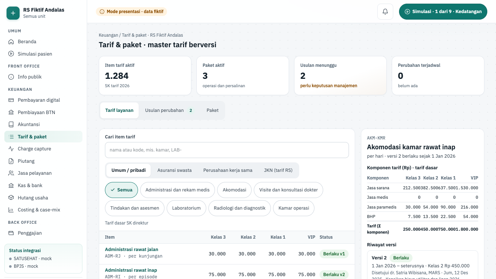

| Hal      | Isi                                                                                                                                                                                                                                                         |
| -------- | ----------------------------------------------------------------------------------------------------------------------------------------------------------------------------------------------------------------------------------------------------------- |
| Rute     | `/keuangan/tarif`                                                                                                                                                                                                                                           |
| Pemakai  | akuntan, manajemen                                                                                                                                                                                                                                          |
| Komponen | U01 tarif dan paket                                                                                                                                                                                                                                         |
| Status   | demo (mode presentasi); backend fase 5 belum dibangun                                                                                                                                                                                                       |
| Mockup   | tidak ada (gaya mengikuti layar Akuntansi)                                                                                                                                                                                                                  |
| Kode web | `apps/web/src/app/(staf)/keuangan/tarif/` · data `apps/web/src/lib/server/data/keuangan-lanjut.ts` (`getTariffBoard`) · aturan `apps/web/src/lib/keuangan-tarif.ts` · komponen `apps/web/src/components/keuangan/tarif-{workspace,detail,usulan,paket}.tsx` |
| Kode API | belum ada (rencana modul `tariff`, `docs/01-arsitektur.md` §2)                                                                                                                                                                                              |

**Tujuan.** Pengelola tarif memelihara master tarif berkomponen per kelas dan penjamin. Setiap perubahan harga menjadi versi baru dengan tanggal berlaku, lewat usulan yang disetujui orang lain. Paket dan aturan selisih naik kelas ada di tab tersendiri.

**Alur.**

1. Buka **Keuangan › Tarif & paket**. Wilayah "Indikator tarif": Item tarif aktif (1.284, SK tarif 2026), Paket aktif, Usulan menunggu, dan Perubahan terjadwal.
2. Tab **Tarif layanan**. Di "Daftar tarif", isi "Cari item tarif" (nama atau kode), saring kategori, dan pilih Penjamin: Umum / pribadi, Asuransi swasta, Perusahaan kerja sama, atau JKN (tarif RS). Harga Kelas 3, Kelas 2, Kelas 1, dan VIP dihitung ulang untuk penjamin itu. Kolom Status berisi "Berlaku vN", "Ada usulan", atau "Terjadwal …" dengan tanggalnya.
3. Pilih item, mis. Pemasangan kateter urin. "Rincian tarif" menampilkan komponen (Jasa sarana, Jasa medis, Jasa paramedis, BHP) per kelas, baris "Tarif (Σ komponen)", dan "Riwayat versi" (Berlaku, Terjadwal, Berakhir).
4. Tekan **Buat usulan perubahan**. Isi harga tiap kelas (Rp), "Berlaku mulai", dan "Alasan perubahan (wajib)". Petunjuk di bawah tiap harga menulis perubahannya ("▲ …%", "▼ …%", atau "tetap"). Tekan **Ajukan usulan**. Pesannya: "Usulan UT-2610-008 diajukan · …".
5. Tab **Usulan perubahan** (lencana jumlah yang menunggu). Tiap usulan menampilkan tabel Kelas, Berlaku, Usulan, Perubahan, dan status Menunggu persetujuan, Disetujui · terjadwal, atau Ditolak.
6. Posisi manajemen menekan **Setujui usulan**. Contoh: UT-2610-007 USG abdomen menjadi "USG abdomen versi baru terjadwal berlaku 1 Nov 2026; versi berlaku ditutup sehari sebelumnya".
7. Untuk menolak, tekan **Tolak…**, isi "Alasan penolakan (wajib, dibaca pembuat usulan)", lalu **Tolak usulan**. Contoh: UT-2610-006 Nebulisasi.
8. Tab **Paket**. Pilih paket di "Daftar paket" dan kelas di "Kelas paket". "Isi paket" membandingkan "Jumlah bila ditagih per item", "Harga paket", dan "Pasien hemat". Contoh: Paket kolesistektomi laparoskopik `PKT-OK-051` kelas VIP Rp 18.200.000. Di sampingnya ada "Aturan selisih naik kelas JKN" berversi (angka simulasi), dipakai Kasir dan Piutang.

**Gerbang keselamatan dan aturan bisnis.**

- Usulan ditahan (`usulanProblems`) bila ada harga kelas nol, harga tidak berjenjang (Kelas 3 ≤ Kelas 2 ≤ Kelas 1 ≤ VIP), berlaku mulai hari ini atau lampau (tarif tidak retroaktif), sudah ada versi terjadwal, harga sama dengan versi berlaku, atau alasan kurang dari 15 karakter. Pesan "Belum bisa diajukan: …" tertulis di samping tombol.
- Satu usulan aktif per item. Item yang sudah punya versi terjadwal tidak bisa diusulkan lagi sampai versi itu berlaku.
- Kenaikan lebih dari 20% memunculkan catatan "lampirkan analisis biaya untuk penyetuju". Ini peringatan, bukan penolakan.
- Persetujuan (`approvalProblem`) hanya oleh posisi manajemen, pembuat ≠ penyetuju, usulan masih diajukan, dan tanggal berlaku belum lewat. Akuntan melihat tombol nonaktif dengan alasan "Persetujuan tarif oleh posisi manajemen (direktur/manajer keuangan)."
- Penolakan wajib alasan minimal 15 karakter.
- Versi yang disetujui menutup versi lama sehari sebelum tanggal berlaku (`applyApproved`). Tagihan yang sudah final tidak berubah.
- Σ komponen = harga tepat (sisa terbesar, bigint). Tarif penjamin = tarif dasar × (10.000 + bp) / 10.000, dibulatkan ke Rp 100 terdekat: asuransi +10%, perusahaan −5%.
- Tes menjaga keselarasan: tarif Kelas 2 sama dengan baris tagihan Kasir, dan setiap paket lebih murah dari jumlah item satuannya di semua kelas.

**Rencana backend.** Izin terencana `tariff.write`, belum ada di `PERMISSION_CATALOG`. Fase 5 potongan 5.2 membangun `/api/v1/tariffs`: draf dengan Σ komponen = total, `approve` (pemohon ≠ penyetuju, versi lama ditutup), paket, `class-upgrade-rules` berversi, `billable-items`, dan impor CSV lewat CLI `db:import-tariff`. Rencana menulis `valid_from ≥ hari ini`, sedangkan layar demo menolak tanggal hari ini; keduanya perlu diselaraskan.

## Charge capture

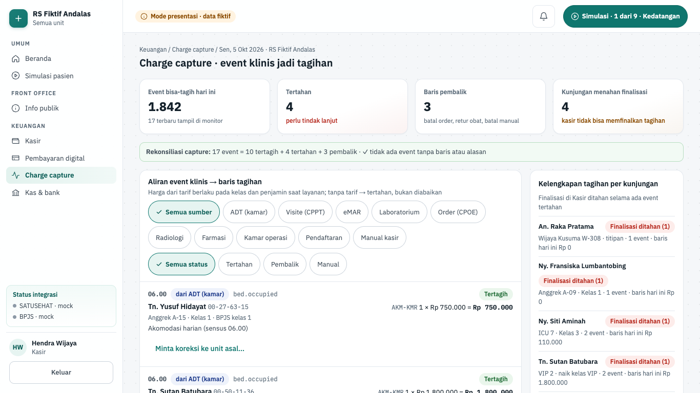

| Hal      | Isi                                                                                                                                                                                                                                                                   |
| -------- | --------------------------------------------------------------------------------------------------------------------------------------------------------------------------------------------------------------------------------------------------------------------- |
| Rute     | `/keuangan/charge-capture`                                                                                                                                                                                                                                            |
| Pemakai  | kasir, akuntan                                                                                                                                                                                                                                                        |
| Komponen | U02 charge capture                                                                                                                                                                                                                                                    |
| Status   | demo (mode presentasi); backend fase 5 belum dibangun                                                                                                                                                                                                                 |
| Mockup   | tidak ada (gaya mengikuti layar keuangan bermockup; komponen `@simrs/ui`)                                                                                                                                                                                             |
| Kode web | `apps/web/src/app/(staf)/keuangan/charge-capture/` · data `apps/web/src/lib/server/data/keuangan-lanjut.ts` (`getChargeCaptureBoard`) · aturan `apps/web/src/lib/keuangan-charge.ts` · komponen `apps/web/src/components/keuangan/{charge-workspace,alasan-form}.tsx` |
| Kode API | belum ada (rencana modul `charge-capture`, konsumen di `modules/charge-capture/consumers/`)                                                                                                                                                                           |

**Tujuan.** Kasir dan akuntan memantau bagaimana event klinis menjadi baris tagihan bersumber. Event yang tidak bisa diberi harga tidak hilang diam-diam: event itu tertahan dengan alasan sampai ditangani.

**Alur.**

1. Buka **Keuangan › Charge capture**. Wilayah "Indikator charge capture": Event bisa-tagih hari ini (1.842), Tertahan, Baris pembalik, dan Kunjungan menahan finalisasi.
2. Baca baris "Rekonsiliasi capture". Keadaan awal: "17 event = 10 tertagih + 4 tertahan + 3 pembalik · ✓ tidak ada event tanpa baris atau alasan".
3. Di "Aliran event klinis", saring per sumber (mis. ADT (kamar), Visite (CPPT), Laboratorium, Manual kasir) dan per status (Semua status, Tertahan, Pembalik, Manual). Tiap event menampilkan jam, sumber, nama event domain (mis. `lab.specimen_received`), pasien, dan baris "kuantitas × harga = jumlah".
4. Tangani event tertahan menurut jenisnya:
   - Tarif tidak ada, tetapi tarif sudah disetujui: tekan **Coba ulang capture**. Contoh: "Visite dokter subspesialis VIP Rp 400.000 masuk tagihan Tn. Sutan Batubara".
   - Tarif tidak ada dan belum disetujui (prokalsitonin): tombol coba ulang nonaktif. Tekan **Minta tarif ke pengelola tarif** atau tautan **Buka Tarif & paket**.
   - Kelas belum ditetapkan (An. Raka Pratama, titipan bangsal penuh): tekan **Minta admisi menetapkan kelas**, lalu **Simulasikan admisi menetapkan kelas**, lalu **Coba ulang capture**.
   - Penjamin berubah (Ny. Fransiska, Umum → Asuransi swasta): tabel menunjukkan baris terbuka sebelum dan sesudah. Tekan **Reprice baris terbuka**; selisih bersih Rp 105.000 masuk tagihan.
5. Untuk baris klinis yang tertagih, tekan **Minta koreksi ke unit asal…**, isi "Alasan koreksi untuk … (wajib)" (nama sumber), lalu **Kirim permintaan koreksi**. Baris tetap ada sampai unit asal membaliknya.
6. Untuk baris manual kasir (saringan **Manual**), tekan **Batalkan baris manual…**, isi "Alasan pembatalan baris manual (wajib)", lalu **Batalkan baris**. Contoh: Sewa kursi roda; baris pembalik −Rp 25.000 ditambahkan.
7. Panel kanan "Kelengkapan tagihan per kunjungan" menandai tiap pasien "Finalisasi ditahan (n)" atau "Lengkap". Kotak "Aturan koreksi" merangkum siapa mengoreksi apa.

**Gerbang keselamatan dan aturan bisnis.**

- Setiap event menjadi baris bersumber atau pengecualian beralasan (`captureReconciliation`). Jumlah event tanpa baris dan tanpa alasan harus nol.
- Harga = tarif berlaku pada kelas dan penjamin saat layanan; tes membandingkannya dengan layar Tarif. Tanpa tarif, event tertahan, bukan diabaikan.
- Coba ulang hanya bila tarif sudah disetujui. Kelas rawat ditetapkan admisi di modul ADT, bukan di billing (`captureActions`).
- Penjamin berubah: setiap baris terbuka dibalik lalu dibuat ulang dengan tarif penjamin baru; tagihan menyimpan selisih bersihnya (`repriceNetLine`).
- Billing tidak menghapus baris klinis. Kasir hanya membatalkan baris manual, dengan alasan minimal 15 karakter (`KOREKSI_REASON_MIN`). Baris asal ditandai "Dibalik" dan baris pembalik bernilai negatif ditambahkan; jejaknya tetap.
- Jumlah baris = kuantitas × harga satuan, termasuk pembalik dan reprice (`lineConsistent`).
- Kunjungan dengan event tertahan menahan finalisasi. Di mode presentasi penahanan ini hanya tampil di sini; layar Kasir tidak membacanya.

**Rencana backend.** Izin terencana `billing.read`, padahal layar memuat aksi tulis (coba ulang, reprice, batal baris manual). Fase 5 potongan 5.4 membangun konsumen per event (`bed.occupied`, `visit.recorded`, `lab.specimen_received`, `pharmacy.returned`, `coverage.changed`, dan lainnya) dan API `/api/v1/billing`: `encounters/:id/charges`, `charges/:id/void` hanya untuk baris manual, serta `charge-exceptions` + `retry`. Tarif yang baru disetujui memicu coba ulang otomatis. Finalisasi kasir menolak `CHARGES_PENDING` (potongan 5.7).

## Penjaminan & piutang

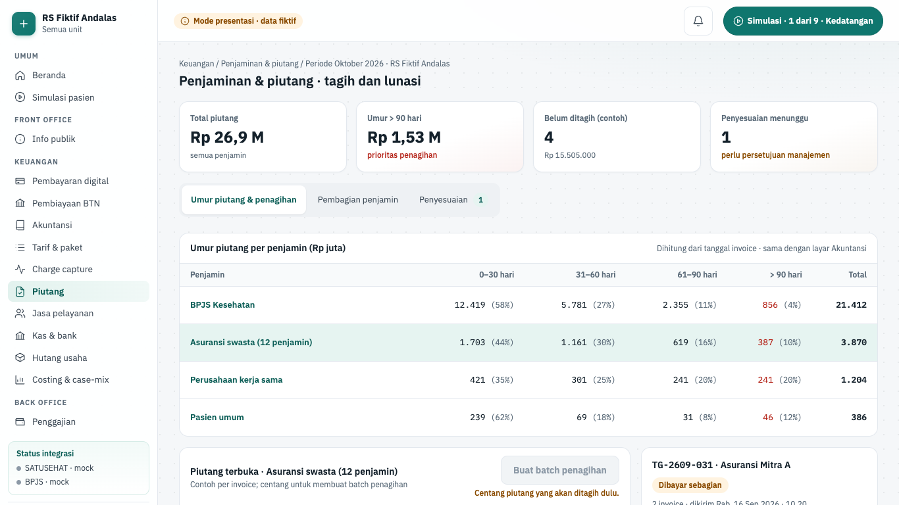

| Hal      | Isi                                                                                                                                                                                                                                                                                                       |
| -------- | --------------------------------------------------------------------------------------------------------------------------------------------------------------------------------------------------------------------------------------------------------------------------------------------------------- |
| Rute     | `/keuangan/piutang`                                                                                                                                                                                                                                                                                       |
| Pemakai  | akuntan, manajemen                                                                                                                                                                                                                                                                                        |
| Komponen | U04 penjaminan dan piutang                                                                                                                                                                                                                                                                                |
| Status   | demo (mode presentasi); backend fase 5 belum dibangun                                                                                                                                                                                                                                                     |
| Mockup   | tidak ada (gaya mengikuti layar keuangan bermockup; komponen `@simrs/ui`)                                                                                                                                                                                                                                 |
| Kode web | `apps/web/src/app/(staf)/keuangan/piutang/` · data `apps/web/src/lib/server/data/keuangan-lanjut.ts` (`getReceivablesBoard`) · aturan `apps/web/src/lib/keuangan-piutang.ts` · komponen `apps/web/src/components/keuangan/piutang-{workspace,penagihan,pembagian,penyesuaian}.tsx`, `jurnal-pasangan.tsx` |
| Kode API | belum ada (rencana modul `guarantor`, `docs/01-arsitektur.md` §2)                                                                                                                                                                                                                                         |

**Tujuan.** Akuntan menagih piutang asuransi dan perusahaan per batch, mencatat pelunasan dengan referensi bank, dan mengajukan penyesuaian. Tab pembagian penjamin menjelaskan asal porsi penjamin, pasien, dan RS.

**Alur.**

1. Buka **Keuangan › Penjaminan & piutang**. Indikator: Total piutang, Umur > 90 hari, Belum ditagih (contoh), dan Penyesuaian menunggu.
2. Tab **Umur piutang & penagihan**: tabel umur per penjamin (0–30, 31–60, 61–90, > 90 hari) dihitung dari tanggal invoice, sama dengan layar Akuntansi. Tautan **Buka Klaim & koding** dan **Pembiayaan BTN** mengarah ke piutang BPJS.
3. Di "Daftar piutang", centang invoice dari satu penjamin, mis. `INV-2610-02190` dan `INV-2610-02205` (Asuransi Mitra A). Tekan **Buat batch penagihan**. Hasilnya "Batch TG-2610-005 dibuat untuk Asuransi Mitra A (2 invoice)".
4. Di kartu batch (Ditagih, Dibayar, Sisa), tekan **Kirim tagihan ke penjamin**. Status berubah dari Draf ke Ditagih.
5. Tekan **Catat pelunasan…**. Isi "Nominal diterima (Rp)" dan "Referensi mutasi bank" (mis. `BTN-H2H-2610-90311`). Draf jurnal tampil. Tekan **Posting pelunasan**. Contoh Rp 8.630.000 menghasilkan "Dr 1-1120 … · Cr 1-1340 …" dan batch berstatus Lunas.
6. Batch lama `TG-2609-031` menampilkan pembayaran 28 Sep dengan "Terkunci: periode September 2026 ditutup; koreksi lewat penyesuaian".
7. Tab **Pembagian penjamin**. Pilih tagihan contoh: Ny. Endang Wijaya (BPJS, naik Kelas 1), Tn. Sutan Batubara (BPJS, naik VIP), Tn. Darmawan Putra (asuransi berplafon), atau Ny. Ayu Lestari (umum). Rincian memuat Total tarif RS, porsi penjamin, porsi pasien, porsi yang ditanggung RS, dasar perhitungan, dan jurnal pengakuan saat tagihan final. Ny. Endang membayar selisih naik kelas Rp 1.250.400.
8. Tab **Penyesuaian**. Isi formulir "Ajukan penyesuaian piutang": Piutang, Jenis penyesuaian (potongan kontrak atau hapus buku), Nominal (Rp), dan "Alasan (wajib, dibaca penyetuju dan auditor)". Tekan **Ajukan penyesuaian**. Hasilnya "Penyesuaian AJ-2610-004 diajukan".
9. Posisi manajemen menekan **Setujui dan posting** atau **Tolak**. Contoh: AJ-2610-003 hapus buku Rp 3.250.000 menghasilkan "Dr 6-3100 Rp 3.250.000 · Cr 1-1340 Rp 3.250.000".

**Gerbang keselamatan dan aturan bisnis.**

- Batch baru (`batchProblem`): minimal satu piutang, belum masuk batch lain, satu penjamin per batch ("Satu batch hanya untuk satu penjamin."), dan bukan piutang pasien umum (ditagih lewat Kasir).
- Pelunasan (`paymentProblem`): nominal lebih dari nol dan tidak melebihi sisa batch; lebih bayar dicatat sebagai titipan, bukan pelunasan. Referensi mutasi bank minimal 6 karakter. Pelunasan dialokasikan ke invoice tertua dulu (FIFO).
- Jurnal pelunasan: Dr 1-1120 Bank BTN operasional / Cr piutang penjamin (1-1340 asuransi, 1-1350 perusahaan).
- Pembayaran di periode tertutup terkunci (`paymentLocked`).
- Pembagian: total = penjamin + pasien + ditanggung RS, selalu; tes membandingkannya dengan Kasir. BPJS membayar INA-CBG hak kelas. Selisih naik ke Kelas 1 = CBG Kelas 1 − CBG hak; naik ke VIP = 75% CBG Kelas 1 (aturan berversi, angka simulasi). Asuransi membayar sampai plafon.
- Penyesuaian (`adjustmentProblems`): nominal 1 rupiah sampai sisa piutang, alasan minimal 20 karakter. Persetujuan hanya oleh posisi manajemen, pembuat ≠ penyetuju. Jurnal bertanggal periode berjalan: potongan Dr 4-1950, hapus buku Dr 6-3100, Cr piutang penjamin.
- Penolakan penyesuaian tidak meminta alasan, berbeda dengan penolakan usulan tarif.

**Rencana backend.** Izin terencana `receivable.write`. Fase 5 potongan 5.6 membangun `GuarantorSplitService.compute` dan API `/api/v1/receivables`: umur piutang per tanggal WIB, pelunasan manual bereferensi, batch penagihan asuransi/perusahaan (cetak HTML), dan hapus buku berpersetujuan dengan jurnal. Pembayaran penjamin swasta dari mutasi bank dicocokkan di potongan 5.8.

## Workbench koder

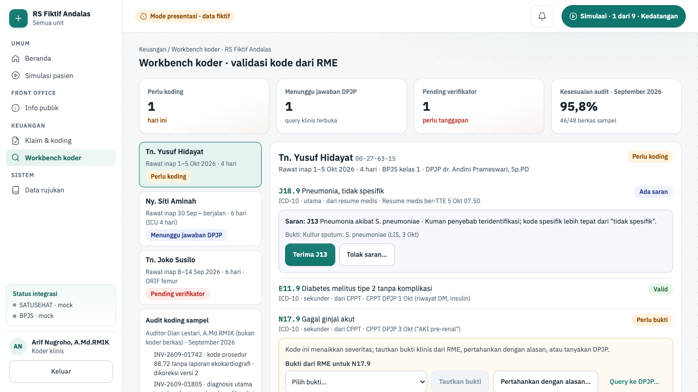

| Hal      | Isi                                                                                                                                                                                                                                                    |
| -------- | ------------------------------------------------------------------------------------------------------------------------------------------------------------------------------------------------------------------------------------------------------ |
| Rute     | `/keuangan/koding`                                                                                                                                                                                                                                     |
| Pemakai  | koder                                                                                                                                                                                                                                                  |
| Komponen | U06 koding klinis                                                                                                                                                                                                                                      |
| Status   | demo (mode presentasi); backend fase 5 belum dibangun                                                                                                                                                                                                  |
| Mockup   | tidak ada (melengkapi layar Klaim & koding; komponen `@simrs/ui`)                                                                                                                                                                                      |
| Kode web | `apps/web/src/app/(staf)/keuangan/koding/` · data `apps/web/src/lib/server/data/keuangan-lanjut.ts` (`getCodingBoard`) · aturan `apps/web/src/lib/keuangan-koding.ts` · komponen `apps/web/src/components/keuangan/{koding-workspace,alasan-form}.tsx` |
| Kode API | belum ada (rencana modul `coding`, `docs/01-arsitektur.md` §2)                                                                                                                                                                                         |

**Tujuan.** Koder memvalidasi kode diagnosis dan prosedur yang ditarik dari RME, menautkan bukti klinis, bertanya ke DPJP, dan membuat versi koding baru bila verifikator bertanya. Grouping dan kirim E-Klaim tetap di layar Klaim & koding.

**Alur.**

1. Buka **Keuangan › Workbench koder**. Indikator: Perlu koding, Menunggu jawaban DPJP, Pending verifikator, dan Kesesuaian audit · September 2026 (46/48 berkas sampel).
2. Pilih berkas di "Worklist koder": Tn. Yusuf Hidayat (Perlu koding), Ny. Siti Aminah (Menunggu jawaban DPJP), atau Tn. Joko Susilo (Pending verifikator).
3. Berkas Tn. Yusuf: tiap kode menampilkan sistem, peran, dan sumbernya (resume medis, CPPT, hasil lab). Kode J18.9 punya saran. Tekan **Terima J13** (bukti kultur sputum ikut tertaut) atau **Tolak saran…** dengan alasan.
4. Kode N17.9 berstatus Perlu bukti. Pilih bukti di "Bukti dari RME untuk N17.9", lalu **Tautkan bukti**. Hasilnya "✓ Bukti: Kreatinin serial …". Pilihan lain: **Pertahankan dengan alasan…** atau **Query ke DPJP…** ("Pertanyaan ke DPJP (wajib, tanpa mengarahkan jawaban)", **Kirim query ke DPJP**).
5. Tekan **Validasi dan teruskan ke grouping**. Pesannya: "Koding Tn. Yusuf Hidayat tervalidasi · … diteruskan ke grouper di Klaim & koding".
6. Berkas Ny. Siti Aminah menunggu jawaban query R57.2 (syok septik). Tekan **Kirim pengingat**, atau di demo **Simulasikan jawaban DPJP**. Jawaban tertaut sebagai addendum resume ("✓ Dijawab …"), dan tombol validasi aktif.
7. Berkas Tn. Joko Susilo sudah terkirim. Kotak "Pertanyaan verifikator" menyebut E87.5 tanpa bukti lab. Tekan **Hapus E87.5 di versi baru**, isi "Alasan versi koding baru (berkas sudah terkirim; wajib)", lalu **Simpan versi 2 dan siapkan tanggapan**.
8. Panel "Audit koding" menampilkan temuan audit sampel September.

**Gerbang keselamatan dan aturan bisnis.**

- Validasi berkas (`validateBerkas`) menahan tombol sampai: tepat satu diagnosis utama, semua saran diputuskan, setiap kode butuh-bukti tertaut ke bukti atau beralasan minimal 10 karakter, dan query DPJP terjawab. Pesan "Belum bisa diteruskan: …" menyebut kekurangannya.
- Kode hanya dari contoh seed (`ICD10_NAME`, `ICD9_NAME`), sama dengan layar Klaim. Kode di luar daftar membuat fixture gagal dimuat.
- Menolak saran wajib alasan minimal 10 karakter. Query ke DPJP wajib minimal 20 karakter.
- Koder tidak mengubah RME. Jawaban DPJP berupa addendum resume yang tertaut sebagai bukti kode yang dikonfirmasi (`applyAnswer`).
- Berkas yang sudah terkirim: setiap perubahan menjadi versi baru dengan alasan minimal 15 karakter (`versionProblem`), dan harus ada perubahan kode atau bukti. Kode yang dihapus tetap tampil "Dihapus di versi baru".
- Audit koding memakai sampel; auditor (petugas rekam medis) bukan koder.

**Rencana backend.** Izin terencana `claim.write`, sama dengan layar Klaim & koding. Fase 5 potongan 5.5 membangun di `/api/v1/claims`: worklist koder, `:id/coding` (tarik diagnosis dan prosedur dari RME, saran dari `coding_rules`, tautan bukti, versi beralasan), `:id/queries` yang mengirim notifikasi ke DPJP, dan `audits` (auditor ≠ koder). Tes rencana mencakup 403 untuk kasir.

## Jasa pelayanan

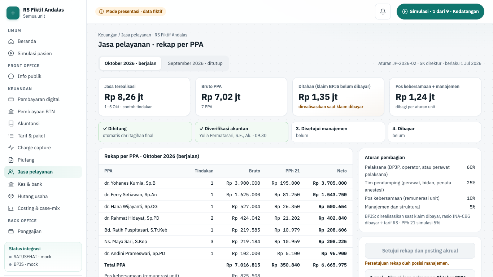

| Hal      | Isi                                                                                                                                                                                                                                                                    |
| -------- | ---------------------------------------------------------------------------------------------------------------------------------------------------------------------------------------------------------------------------------------------------------------------- |
| Rute     | `/keuangan/jasa-pelayanan`                                                                                                                                                                                                                                             |
| Pemakai  | akuntan, manajemen                                                                                                                                                                                                                                                     |
| Komponen | U08 jasa pelayanan                                                                                                                                                                                                                                                     |
| Status   | demo (mode presentasi); backend fase 5 belum dibangun                                                                                                                                                                                                                  |
| Mockup   | tidak ada (gaya mengikuti layar keuangan bermockup; komponen `@simrs/ui`)                                                                                                                                                                                              |
| Kode web | `apps/web/src/app/(staf)/keuangan/jasa-pelayanan/` · data `apps/web/src/lib/server/data/keuangan-lanjut.ts` (`getFeeSharingBoard`) · aturan `apps/web/src/lib/keuangan-jaspel.ts` · komponen `apps/web/src/components/keuangan/{jaspel-workspace,jurnal-pasangan}.tsx` |
| Kode API | belum ada (rencana modul `fee-sharing`, `docs/01-arsitektur.md` §2)                                                                                                                                                                                                    |

**Tujuan.** Akuntan dan manajemen merekap jasa medis dan paramedis per PPA dari komponen tarif setiap tindakan, menyetujui rekap, mengekspornya, lalu memposting pembayaran. Jasa dari klaim BPJS baru terealisasi setelah klaim dibayar.

**Alur.**

1. Buka **Keuangan › Jasa pelayanan**. Pilih "Periode jasa": Oktober 2026 · berjalan, atau September 2026 · ditutup. Di sampingnya tertulis aturan JP-2026-02 · SK direktur dan tanggal berlakunya.
2. Oktober: indikator Jasa terealisasi, Bruto PPA, Ditahan (klaim BPJS belum dibayar), dan Pos kebersamaan + manajemen.
3. Tabel "Rekap per PPA" berisi Tindakan, Bruto, PPh 21, dan Neto, lalu baris Total PPA dan pos kebersamaan serta manajemen. Buka "Rincian n tindakan sumber" untuk melihat tiap tindakan: Ditahan, terealisasi sebagian, atau terealisasi penuh.
4. Panel "Persetujuan dan jurnal" memuat aturan pembagian (pelaksana 60%, tim pendamping 25%, pos kebersamaan 10%, manajemen dan struktural 5%), tahapan Dihitung → Diverifikasi akuntan → Disetujui manajemen → Dibayar, tombol tahap berikutnya, dan dua jurnal.
5. Keadaan awal: rekap sudah diverifikasi akuntan pukul 09.30. Posisi manajemen menekan **Setujui rekap dan posting akrual**. Pesannya: "Rekap jasa Oktober disetujui manajemen · … · Dr 5-1100 …".
6. Setelah disetujui, tekan **Ekspor CSV**. "Pratinjau CSV" berisi kolom `PPA;Jumlah tindakan;Bruto;PPh 21;Neto`.
7. Posisi akuntan menekan **Posting pembayaran jasa**. Jurnal pembayaran terposting dan tahap menjadi Dibayar.
8. September: kotak "Periode ditutup" dengan Bruto Rp 1.420.000.000, PPh 21 Rp 71.000.000, Neto dibayar, dan 214 PPA. **Hitung ulang** nonaktif dengan tulisan "Terkunci: periode September 2026 ditutup."

**Gerbang keselamatan dan aturan bisnis.**

- Aturan pembagian berjumlah 100%. Σ alokasi per tindakan = jasa terealisasi tepat (sisa terbesar, bigint).
- BPJS: jasa terealisasi = jasa × (INA-CBG dibayar ÷ tarif RS), paling banyak jasa penuh. Klaim yang belum dibayar membuat jasa ditahan (nol).
- Tahapan (`stepProblem`): verifikasi oleh akuntan; persetujuan oleh manajemen yang bukan pemverifikasi; pembayaran oleh akuntan. Tahap tidak bisa dilompati. Alasan tombol nonaktif tertulis, mis. "Persetujuan rekap oleh posisi manajemen."
- Jurnal akrual saat disetujui: Dr 5-1100 Beban jasa pelayanan / Cr 2-1410 Utang jasa pelayanan, sebesar bruto pelaksana + tim. Jurnal bayar: Dr 2-1410 / Cr 1-1140 Bank mitra (neto) / Cr 2-1420 Utang PPh 21.
- PPh 21 flat 5% adalah angka simulasi, bukan aturan pajak.
- Ekspor CSV aman dari formula injection: sel berawalan `=`, `+`, `-`, `@`, tab, atau CR diberi apostrof (`csvCell`). Pesan ekspor menyebut "tercatat di jejak audit".
- Periode tertutup tidak dihitung ulang; koreksi masuk sebagai penyesuaian di periode berjalan.

**Rencana backend.** Izin terencana `fee_sharing.read`, padahal layar memuat aksi tulis (setujui, bayar). Fase 5 potongan 5.9: konsumen `invoice.finalized` mengalokasikan komponen jasa, BPJS direalisasikan saat `claim.status_changed: paid`, dan `GET /api/v1/fee-sharing/recap?period` + ekspor CSV. Keputusan #17 rencana fase 5 menyebut jasa pelayanan tanpa layar, akrual saat tutup periode, dan pembayaran ke dokter lewat penggajian B05. Layar demo ini berbeda (akrual saat disetujui, bayar lewat bank mitra), jadi perlu ADR atau penyelarasan.

## Kas & bank

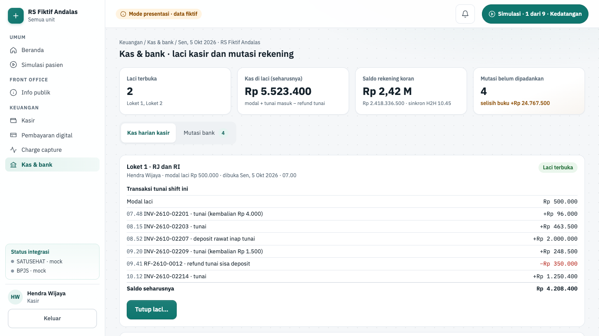

| Hal      | Isi                                                                                                                                                                                                                                                                          |
| -------- | ---------------------------------------------------------------------------------------------------------------------------------------------------------------------------------------------------------------------------------------------------------------------------- |
| Rute     | `/keuangan/kas-bank`                                                                                                                                                                                                                                                         |
| Pemakai  | kasir, akuntan                                                                                                                                                                                                                                                               |
| Komponen | U09 kas dan bank                                                                                                                                                                                                                                                             |
| Status   | demo (mode presentasi); backend fase 5 belum dibangun                                                                                                                                                                                                                        |
| Mockup   | tidak ada (gaya mengikuti layar keuangan bermockup; komponen `@simrs/ui`)                                                                                                                                                                                                    |
| Kode web | `apps/web/src/app/(staf)/keuangan/kas-bank/` · data `apps/web/src/lib/server/data/keuangan-lanjut.ts` (`getCashBankBoard`) · aturan `apps/web/src/lib/keuangan-kasbank.ts` · komponen `apps/web/src/components/keuangan/{kasbank-workspace,jurnal-pasangan,alasan-form}.tsx` |
| Kode API | belum ada (rencana modul `cash-bank`, pencocok di `modules/cash-bank/matchers/`)                                                                                                                                                                                             |

**Tujuan.** Kasir menutup laci dengan hitungan fisik dan setoran, dan akuntan memadankan mutasi rekening BTN operasional dengan dokumennya. Setiap langkah membentuk jurnal berpasangan.

**Alur.**

1. Buka **Keuangan › Kas & bank**. Indikator: Laci terbuka, Kas di laci (seharusnya), Saldo rekening koran (dengan jam sinkron H2H), dan Mutasi belum dipadankan.
2. Tab **Kas harian kasir**. Tiap kartu laci memuat loket, kasir, jam buka, modal, transaksi tunai (pembayaran neto setelah kembalian; refund bernilai negatif), dan "Saldo seharusnya". Contoh: Laci Loket 1 · RJ dan RI = Rp 4.208.400.
3. Tekan **Tutup laci…**. Isi jumlah lembar atau keping per pecahan (Rp 100.000 sampai Rp 100). Selisih tampil sebagai "Rp 0 · cocok", "kurang …", atau "lebih …".
4. Bila ada selisih, isi alasan selisih. Selisih di atas Rp 50.000 juga butuh centang "Supervisor kasir menyaksikan hitung ulang". Jurnal tutup laci tampil di formulir.
5. Tekan **Tutup laci dan buat setoran**. Contoh: fisik Rp 4.208.000 (kurang Rp 400) menghasilkan "setoran STR-2610-0413 Rp 3.708.000"; modal Rp 500.000 tetap di laci.
6. Laci yang tertutup (Loket 3) bisa dibuka lagi dengan **Buka laci dengan modal Rp 500.000**; pesannya menyebut modal dihitung dua orang.
7. Tab **Mutasi bank**. Tiap mutasi berstatus Cocok, Belum dipadankan, atau Pengecualian. Tombol **Padankan ke …** (nama dokumen) hanya muncul untuk kandidat yang nominalnya cocok, dengan usulan jurnal di bawahnya. Contoh settlement EDC Rp 9.850.000 ke Batch EDC RI-01 (MDR 1,5%): "Dr 1-1120 Rp 9.850.000 · Dr 6-1200 Rp 150.000 · Cr 1-1210 Rp 10.000.000".
8. Untuk dana masuk tanpa dokumen (TRF MASUK TANPA BERITA), tekan **Tandai pengecualian…**, isi "Catatan pengecualian (wajib)", lalu **Catat pengecualian**. Dana dicatat sebagai titipan 2-1290, bukan pendapatan.
9. Untuk padanan yang salah, tekan **Lepas padanan…**, isi "Alasan melepas padanan (wajib; jurnal balik dibentuk)", lalu **Lepas padanan**. Jurnal balik menukar debit dan kredit, mis. "jurnal balik Dr 1-1210 …".

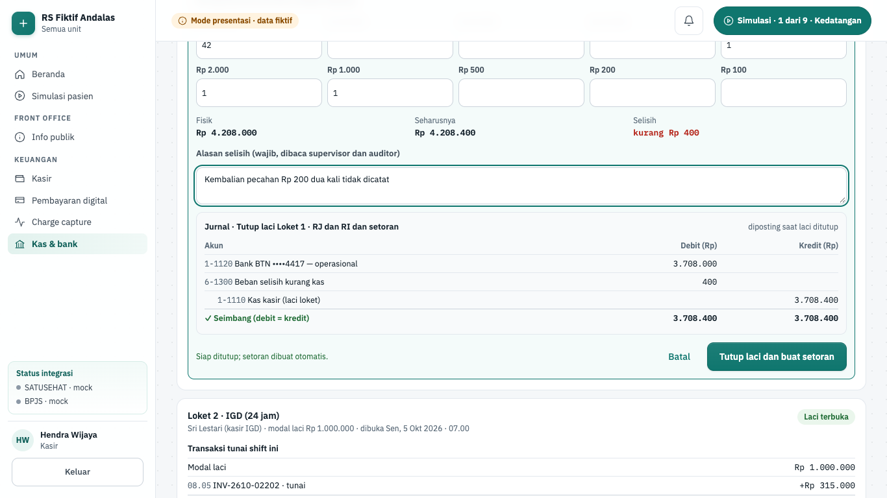

**Gerbang keselamatan dan aturan bisnis.**

- Saldo seharusnya = modal + Σ transaksi tunai (`expectedCash`). Hitungan fisik dari jumlah lembar per pecahan berupa bilangan bulat; nilai negatif diabaikan.
- Tutup laci (`closeProblems`): hitungan fisik wajib; selisih bukan nol wajib alasan minimal 15 karakter; selisih di atas Rp 50.000 wajib disaksikan supervisor.
- Jurnal tutup laci: setoran = fisik − modal. Kurang: Dr 1-1120 + Dr 6-1300 / Cr 1-1110. Lebih: Dr 1-1120 / Cr 1-1110 + Cr 4-3100.
- Kandidat padanan cocok bila nominal mutasi = nilai dokumen − MDR (EDC) atau = nilai dokumen; biaya bank dicocokkan sebagai mutasi keluar (`candidateFits`).
- Jurnal padanan: dana masuk Dr Bank (+ Dr MDR) / Cr akun lawan; biaya bank Dr 6-1210 / Cr 1-1120.
- Catatan pengecualian dan alasan lepas padanan minimal 10 karakter (`PENGECUALIAN_NOTE_MIN`).
- Mutasi periode tertutup terkunci. "BUNGA JASA GIRO SEP 2026" tampil "Terkunci: periode September 2026 ditutup; koreksi lewat jurnal di periode berjalan."
- Saldo buku = saldo rekening koran − mutasi yang belum dipadankan (`reconSummary`).
- Tes menjaga keselarasan: transfer Asuransi Mitra A Rp 14.800.000 sama dengan sisa batch TG-2609-031 di layar Piutang. Modal Laci Loket 1 diambil dari shift Kasir (Rp 500.000).

**Rencana backend.** Izin terencana `cashbank.write`. Fase 5 potongan 5.7 membangun shift kasir (buka, tutup dengan selisih wajib alasan, setoran). Potongan 5.8 membangun `/api/v1/bank`: impor mutasi CSV (pola ADR-0020) atau dari mock H2H, registri pencocok di `modules/cash-bank/matchers/` (setoran kas, settlement EDC + MDR, transfer penjamin), padanan manual dan pengecualian bercatatan, serta jurnal saat cocok. Rencana 5.8 menulis "Web: API saja"; layar ini dibangun lebih dulu untuk mode presentasi. Tutup laci di sini tumpang tindih dengan **Tutup shift** di Kasir.

## Hutang usaha

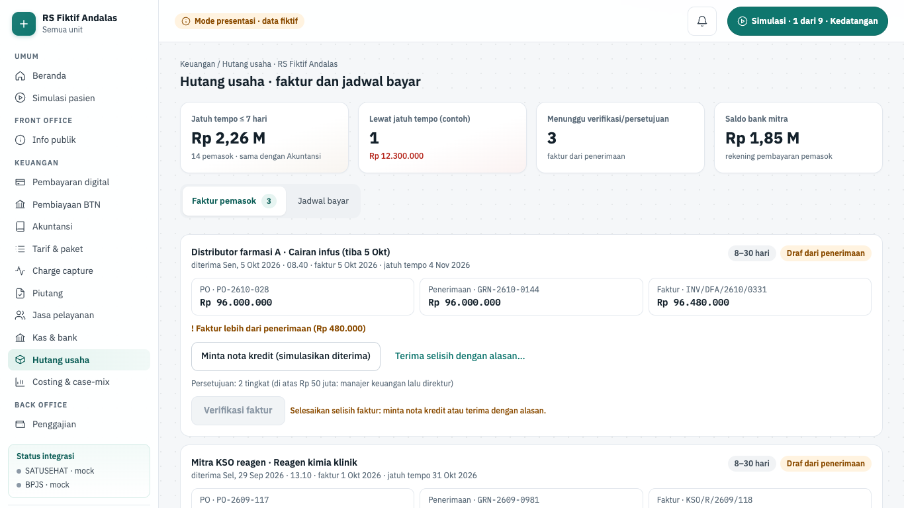

| Hal      | Isi                                                                                                                                                                                                                                                                      |
| -------- | ------------------------------------------------------------------------------------------------------------------------------------------------------------------------------------------------------------------------------------------------------------------------ |
| Rute     | `/keuangan/hutang`                                                                                                                                                                                                                                                       |
| Pemakai  | akuntan, manajemen                                                                                                                                                                                                                                                       |
| Komponen | U10 hutang usaha                                                                                                                                                                                                                                                         |
| Status   | demo (mode presentasi); backend fase 5 belum dibangun                                                                                                                                                                                                                    |
| Mockup   | tidak ada (gaya mengikuti layar keuangan bermockup; komponen `@simrs/ui`)                                                                                                                                                                                                |
| Kode web | `apps/web/src/app/(staf)/keuangan/hutang/` · data `apps/web/src/lib/server/data/keuangan-lanjut.ts` (`getPayablesBoard`) · aturan `apps/web/src/lib/keuangan-hutang.ts` · komponen `apps/web/src/components/keuangan/{hutang-workspace,jurnal-pasangan,alasan-form}.tsx` |
| Kode API | belum ada (rencana modul `payables`, `docs/01-arsitektur.md` §2)                                                                                                                                                                                                         |

**Tujuan.** Akuntan memverifikasi faktur pemasok terhadap PO dan penerimaan barang, manajemen menyetujuinya berjenjang menurut nilai, lalu akuntan menjadwalkan dan memposting pembayaran.

**Alur.**

1. Buka **Keuangan › Hutang usaha**. Indikator: Jatuh tempo ≤ 7 hari (sama dengan Akuntansi), Lewat jatuh tempo (contoh), Menunggu verifikasi/persetujuan, dan Saldo bank mitra.
2. Tab **Faktur pemasok**. Tiap faktur memuat pemasok, jatuh tempo, status, dan pencocokan tiga arah PO ↔ Penerimaan ↔ Faktur.
3. Faktur `INV/DFA/2610/0331` (Distributor farmasi A) lebih Rp 480.000 dari penerimaan, jadi **Verifikasi faktur** nonaktif. Pilih **Minta nota kredit (simulasikan diterima)** agar faktur disesuaikan ke nilai penerimaan, atau **Terima selisih dengan alasan…** ("Alasan menerima selisih harga (wajib)", **Terima selisih**).
4. Setelah "✓ PO, penerimaan, dan faktur cocok", akuntan menekan **Verifikasi faktur**. Faktur menunggu persetujuan dan draf jurnal tampil.
5. Posisi manajemen menekan **Setujui tingkat 1**. Faktur di atas Rp 50 juta butuh **Setujui tingkat 2** oleh orang lain. Contoh `EK/2609/55120` (Penyedia e-katalog, Rp 184.000.000): "disetujui tingkat 2 · Dr 2-1120 Rp 184.000.000 · Cr 2-1110 Rp 184.000.000".
6. Tab **Jadwal bayar**. Centang faktur disetujui di "Faktur siap dibayar" (mis. `INV/DAB/2609/2210` dan `INV/DFA/2609/0288`), lalu **Buat batch pembayaran**.
7. Panel "Batch pembayaran" menampilkan jurnal Dr 2-1110 / Cr 1-1140. Akuntan menekan **Posting pembayaran**: "BYR-2610-003 dibayar … · Dr 2-1110 Rp 61.050.000 …".

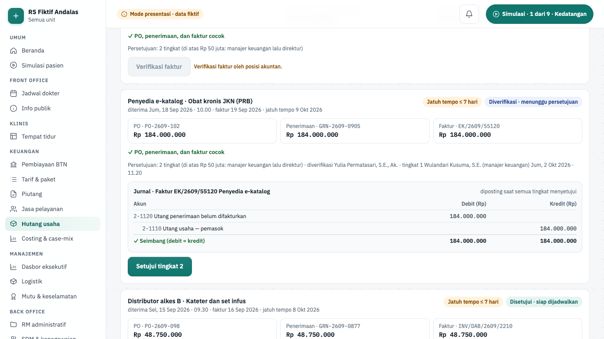

**Gerbang keselamatan dan aturan bisnis.**

- Pencocokan tiga arah (`threeWay`): faktur harus sama dengan nilai penerimaan, dan penerimaan tidak melebihi PO.
- Verifikasi (`verifyProblem`) hanya oleh posisi akuntan, untuk faktur draf, bila cocok tiga arah atau selisihnya diterima dengan alasan minimal 15 karakter. Penerimaan yang melebihi PO diselesaikan dengan logistik dulu.
- Persetujuan (`approveProblem`) hanya oleh posisi manajemen, dan pemverifikasi tidak boleh menyetujui. Faktur di atas Rp 50.000.000 butuh dua tingkat oleh orang berbeda (manajer keuangan, lalu direktur).
- Jurnal saat semua tingkat setuju: Dr 2-1120 Utang penerimaan belum difakturkan (nilai penerimaan), ± 1-1410 Persediaan untuk selisih harga yang diterima, Cr 2-1110 Utang usaha (nilai faktur).
- Jadwal bayar (`scheduleProblem`): hanya faktur disetujui, total batch tidak melebihi saldo bank mitra, dan hanya satu batch terbuka.
- Posting pembayaran hanya oleh posisi akuntan ("Pembayaran diposting posisi akuntan (transfer H2H bank mitra).").
- Faktur yang dibayar di periode tertutup terkunci; koreksi lewat nota debit di periode berjalan.
- Tes menjaga keselarasan: nilai PO cairan infus dan reagen sama dengan layar Logistik.

**Rencana backend.** Izin terencana `payable.write`. Fase 5 potongan 5.8 membangun `/api/v1/payables`: tagihan pemasok draf dari konsumen `stock.received` atau input manual, persetujuan maker-checker, jatuh tempo (KPI 7 hari), dan bayar dengan jurnal. Rencana menulis "Web: API saja"; layar ini dibangun lebih dulu untuk mode presentasi.

## Costing & case-mix

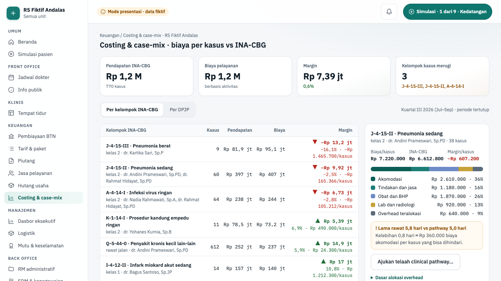

| Hal      | Isi                                                                                                                                                                                                                                                        |
| -------- | ---------------------------------------------------------------------------------------------------------------------------------------------------------------------------------------------------------------------------------------------------------- |
| Rute     | `/keuangan/costing`                                                                                                                                                                                                                                        |
| Pemakai  | manajemen, akuntan                                                                                                                                                                                                                                         |
| Komponen | I10 costing dan case-mix                                                                                                                                                                                                                                   |
| Status   | demo (mode presentasi); backend fase 9 belum dibangun; modul lanjutan RS tersier yang bisa dinonaktifkan per RS                                                                                                                                            |
| Mockup   | tidak ada (gaya mengikuti layar keuangan bermockup; komponen `@simrs/ui`)                                                                                                                                                                                  |
| Kode web | `apps/web/src/app/(staf)/keuangan/costing/` · data `apps/web/src/lib/server/data/keuangan-lanjut.ts` (`getCostingBoard`) · aturan `apps/web/src/lib/keuangan-costing.ts` · komponen `apps/web/src/components/keuangan/{costing-workspace,alasan-form}.tsx` |
| Kode API | belum ada (rencana modul `costing` di lapisan integrasi dan data, `docs/01-arsitektur.md` §2)                                                                                                                                                              |

**Tujuan.** Manajemen dan akuntan membandingkan biaya per kasus berbasis aktivitas dengan tarif INA-CBG, melihat margin per kelompok kasus dan per DPJP, lalu mengirim telaah clinical pathway ke komite medik bila lama rawat melebihi pathway.

**Alur.**

1. Buka **Keuangan › Costing & case-mix**. Periode: Kuartal III 2026 (Jul–Sep) · periode tertutup. Indikator: Pendapatan INA-CBG, Biaya pelayanan, Margin, dan Kelompok kasus merugi.
2. Pilih "Kelompokkan margin": **Per kelompok INA-CBG** atau **Per DPJP**. Tabel "Margin kasus" (Kasus, Pendapatan, Biaya, Margin) diurut dari margin terburuk.
3. Pilih baris. "Komposisi biaya kasus" menampilkan lima komponen (Akomodasi, Tindakan dan jasa, Obat dan BHP, Lab dan radiologi, Overhead teralokasi) dengan nominal dan persen, serta margin per kasus. Contoh J-4-15-II pneumonia sedang (dr. Andini Prameswari, Sp.PD): margin −Rp 607.200 per kasus.
4. Baca kotak varians: "Lama rawat 5,8 hari vs pathway 5,0 hari" dan perkiraan biaya akomodasi per kasus yang bisa dihindari. Bila sesuai, tertulis "✓ Lama rawat … sesuai clinical pathway".
5. Tekan **Ajukan telaah clinical pathway…**, isi "Catatan telaah untuk komite medik (wajib)", lalu **Kirim ke komite medik**. Hasilnya chip "Telaah dikirim ke komite medik HH.MM".
6. Buka "Dasar alokasi overhead" untuk membaca driver alokasi biaya tidak langsung.

**Gerbang keselamatan dan aturan bisnis.**

- Biaya per kasus = Σ lima komponen (bigint). Margin kelompok = Σ (tarif × kasus) − Σ (biaya × kasus).
- Margin per kelompok INA-CBG dan per DPJP berjumlah sama dengan total (dijaga tes). Persen komponen dibulatkan dengan sisa terbesar sehingga selalu 100%.
- Lama rawat disimpan dalam persepuluh hari (bilangan bulat, tanpa float). Biaya yang bisa dihindari = biaya akomodasi per hari × kelebihan hari (`losVariance`).
- Tarif INA-CBG sama dengan tarif simulasi bersama Kasir dan Klaim (`CBG`). Biaya fiktif dan ilustratif.
- Telaah wajib catatan minimal 20 karakter (`TELAAH_REASON_MIN`). Layar tidak mengubah clinical pathway; keputusan tetap di komite medik.

**Rencana backend.** Izin terencana `costing.read`; telaah ke komite medik adalah aksi tulis yang belum punya izin. Registri menaruh layar ini di fase 9. Komponen I10 bergantung pada U02, U07, dan I11 (`docs/02-katalog-komponen.md`). Rencana fase 9 mencatat margin penjamin non-JKN di dasbor baru terisi setelah I10 aktif.

## Tes yang menjaga layar ini

| Tes                                                     | Yang dijaga                                                                                                                                                                                                                                                                                                                                                                                                                                                                                                                                                     |
| ------------------------------------------------------- | --------------------------------------------------------------------------------------------------------------------------------------------------------------------------------------------------------------------------------------------------------------------------------------------------------------------------------------------------------------------------------------------------------------------------------------------------------------------------------------------------------------------------------------------------------------- |
| `apps/web/e2e/demo/keuangan.spec.ts`                    | Kasir: total = jumlah baris, bayar QRIS sampai kuitansi, item manual ditahan tanpa alasan, posisi lain ditolak. Klaim: tabel kode, grouper, saran J13, kirim. Akuntansi: jurnal seimbang, dialog tutup periode menahan sampai syarat terpenuhi                                                                                                                                                                                                                                                                                                                  |
| `apps/web/e2e/demo/btn.spec.ts`                         | Pembayaran: pelunasan simulasi + HMAC, callback ganda diabaikan, pengecualian wajib catatan. Pembiayaan: pencairan piutang, lima tahap cicilan, penolakan beralasan                                                                                                                                                                                                                                                                                                                                                                                             |
| `apps/web/src/lib/keuangan.test.ts`                     | Total = baris, pembagian penjamin, gerbang item manual, gerbang Server Action kasir, kuantitas bulat, kode klaim hanya dari seed                                                                                                                                                                                                                                                                                                                                                                                                                                |
| `apps/web/src/lib/keuangan-klaim.test.ts`               | Klaim lolos kontrak, J13 + bukti N17.9 → J-4-15-III, grouping ditahan, gerbang kirim                                                                                                                                                                                                                                                                                                                                                                                                                                                                            |
| `apps/web/src/lib/keuangan-akuntansi.test.ts`           | Jurnal seimbang, umur piutang 100%, syarat tutup periode diperiksa terhadap papan server                                                                                                                                                                                                                                                                                                                                                                                                                                                                        |
| `apps/web/src/lib/keuangan-skenario.test.ts`            | Proyeksi tiga skenario ke tiga papan: tagihan = charge capture, jurnal seimbang di setiap langkah                                                                                                                                                                                                                                                                                                                                                                                                                                                               |
| `apps/web/src/lib/btn.test.ts`                          | Dana ke rekening RS, idempotensi webhook, rekonsiliasi 3 arah, refund berjenjang                                                                                                                                                                                                                                                                                                                                                                                                                                                                                |
| `apps/web/src/lib/btn-pembiayaan.test.ts`               | Aritmetika advance/margin/pelunasan (bigint), pemeriksaan server pencairan, alur cicilan                                                                                                                                                                                                                                                                                                                                                                                                                                                                        |
| `apps/web/src/lib/btn-skenario.test.ts`                 | Deposit dan pembiayaan Ny. Ratna, webhook ganda tidak dobel, angka "hari ini"                                                                                                                                                                                                                                                                                                                                                                                                                                                                                   |
| `packages/shared/src/integrations/integrations.test.ts` | Tanda tangan HMAC TPDI dan batas umur timestamp                                                                                                                                                                                                                                                                                                                                                                                                                                                                                                                 |
| `apps/web/e2e/demo/fe4-keuangan.spec.ts`                | Tarif: retroaktif ditolak, pembuat tidak menyetujui sendiri, persetujuan manajemen, paket lebih murah. Charge capture: coba ulang, reprice, batal manual beralasan. Piutang: batch satu penjamin, pelunasan bereferensi, penyesuaian dua posisi. Koder: saran, bukti, query DPJP, versi 2. Jasa pelayanan: gerbang tahap, akrual, CSV, September terkunci. Kas & bank: selisih beralasan, padanan EDC, pengecualian, lepas padanan. Hutang: tiga arah, tingkat 2, batch bayar. Costing: margin, per DPJP, telaah. Semua jurnal seimbang, tanpa gulir horizontal |
| `apps/web/src/lib/keuangan-jurnal.test.ts`              | Jurnal seimbang, baris nol dibuang, jurnal refund, sisa terbesar, periode tertutup, persen tanpa float                                                                                                                                                                                                                                                                                                                                                                                                                                                          |
| `apps/web/src/lib/keuangan-tarif.test.ts`               | Komposisi 100%, satu versi berlaku, tarif Kelas 2 = Kasir, paket lebih murah, gerbang usulan dan persetujuan, versi lama ditutup                                                                                                                                                                                                                                                                                                                                                                                                                                |
| `apps/web/src/lib/keuangan-charge.test.ts`              | Jumlah = kuantitas × harga, harga = tarif berlaku, rekonsiliasi capture, penahanan finalisasi, coba ulang, batal manual dengan pembalik                                                                                                                                                                                                                                                                                                                                                                                                                         |
| `apps/web/src/lib/keuangan-piutang.test.ts`             | Identitas pembagian = Kasir, selisih naik kelas, plafon asuransi, gerbang batch dan pelunasan, FIFO, kunci periode, penyesuaian                                                                                                                                                                                                                                                                                                                                                                                                                                 |
| `apps/web/src/lib/keuangan-koding.test.ts`              | Kode hanya dari seed, satu diagnosis utama, bukti atau alasan, jawaban DPJP sebagai addendum, versi beralasan                                                                                                                                                                                                                                                                                                                                                                                                                                                   |
| `apps/web/src/lib/keuangan-jaspel.test.ts`              | Aturan 100%, Σ alokasi = terealisasi, rasio BPJS, jurnal akrual dan bayar seimbang, tahapan, CSV anti formula injection                                                                                                                                                                                                                                                                                                                                                                                                                                         |
| `apps/web/src/lib/keuangan-kasbank.test.ts`             | Saldo seharusnya, hitungan pecahan, selisih + supervisor, jurnal tutup laci, padanan/pengecualian/balik, transfer = sisa batch Piutang, kunci periode                                                                                                                                                                                                                                                                                                                                                                                                           |
| `apps/web/src/lib/keuangan-hutang.test.ts`              | PO = Logistik, tiga arah, persetujuan berjenjang, jurnal seimbang, jadwal bayar, kunci periode                                                                                                                                                                                                                                                                                                                                                                                                                                                                  |
| `apps/web/src/lib/keuangan-costing.test.ts`             | Tarif CBG = Kasir/Klaim, margin per kelompok = total, porsi 100%, varians lama rawat                                                                                                                                                                                                                                                                                                                                                                                                                                                                            |

## Lihat juga

- [Cara sistem bekerja: integrasi lewat outbox](./01-cara-kerja-sistem.md#integrasi-lewat-outbox)
- [Cara kode bekerja: mode presentasi dan data dummy](./02-cara-kerja-kode.md#mode-presentasi-dan-data-dummy-adr-0023)
- [Fitur integrasi](./15-fitur-integrasi.md)
- [Fitur klinis](./12-fitur-klinis.md) dan [Fitur penunjang](./13-fitur-penunjang.md), sumber charge capture
- [Fitur back office](./16-fitur-back-office.md), sumber PO dan penerimaan barang untuk Hutang usaha
- [Simulasi dan operasional](./18-simulasi-dan-operasional.md)
- [Peta kode](./19-peta-kode.md)
- [Peta alur semua fase](./20-peta-alur-semua-fase.md)
- Dokumen desain: `docs/07-pembayaran-btn-tpdi.md`, `docs/adr/0005-tpdi-non-custodial-btn.md`, `docs/rencana/fase-5-keuangan.md`, `docs/rencana/fase-6-pembayaran-tpdi-btn.md`, `docs/rencana/fase-9-kanal-dasbor-mobile.md`
