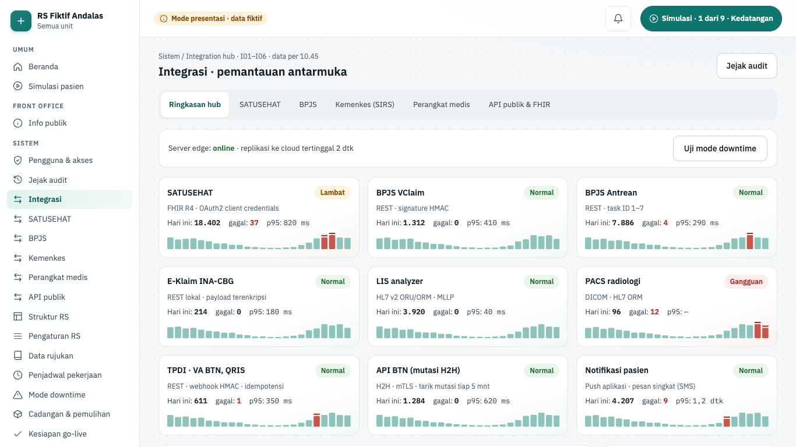
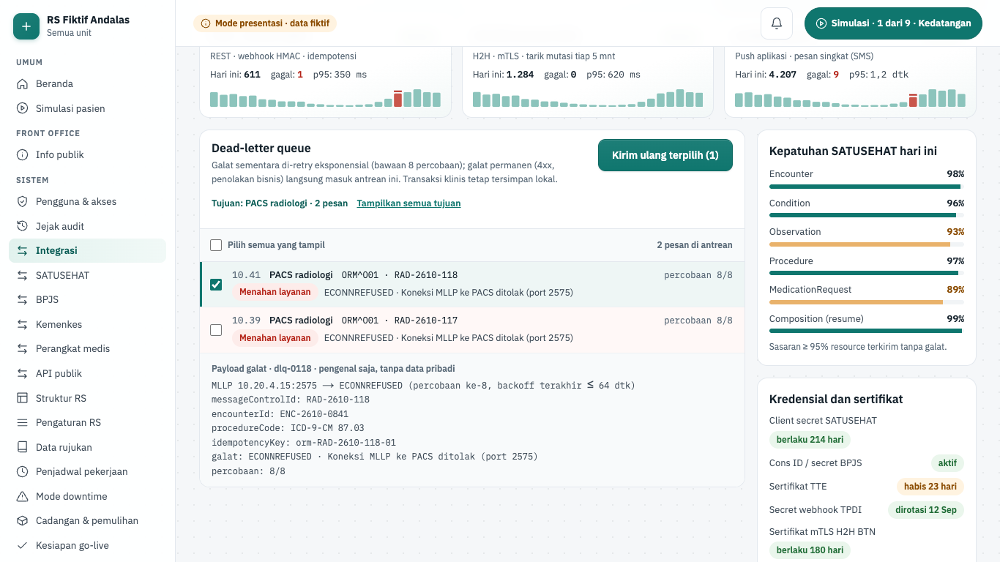
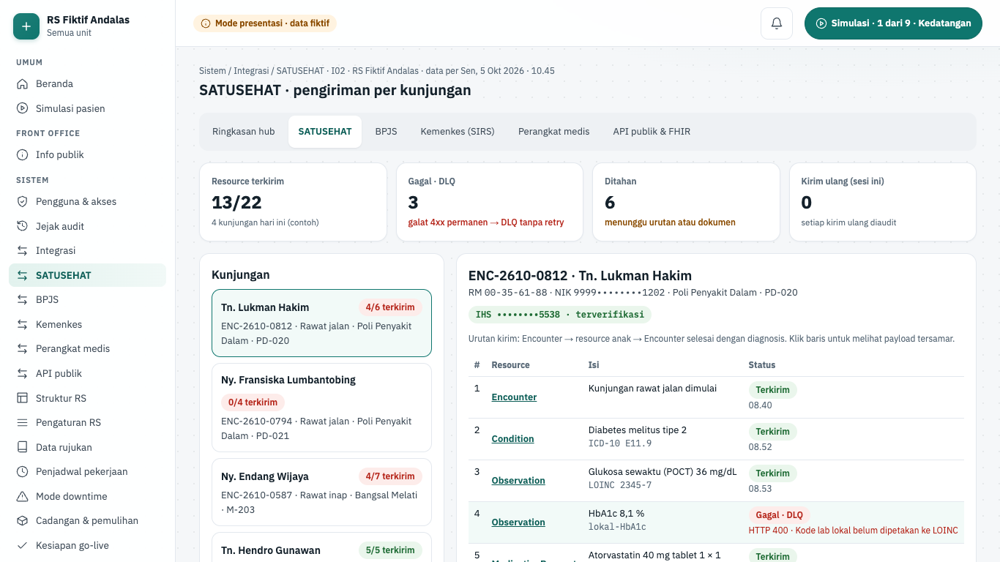
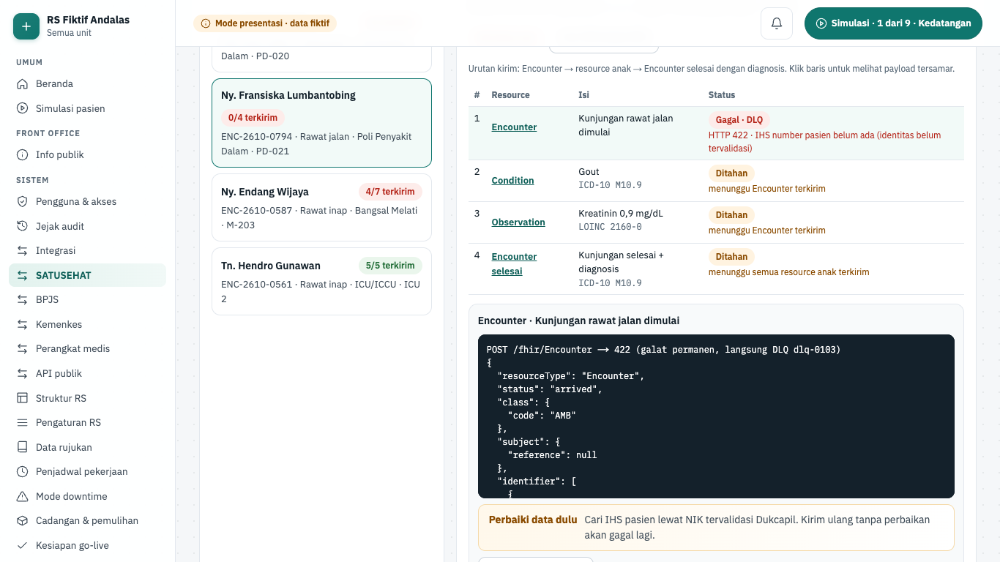
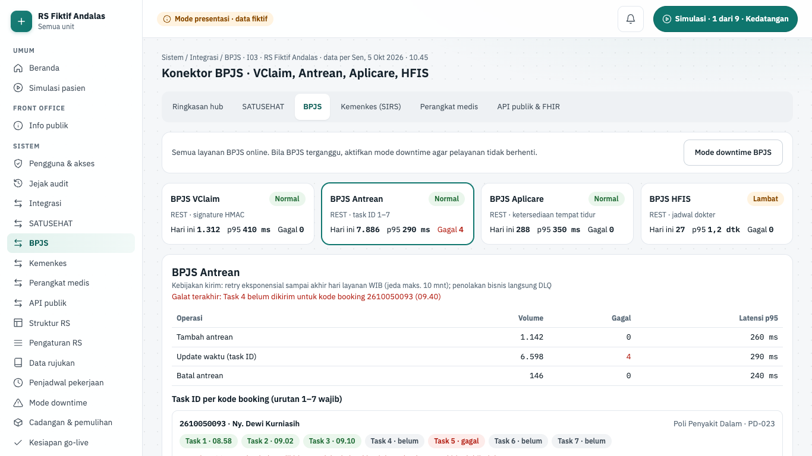
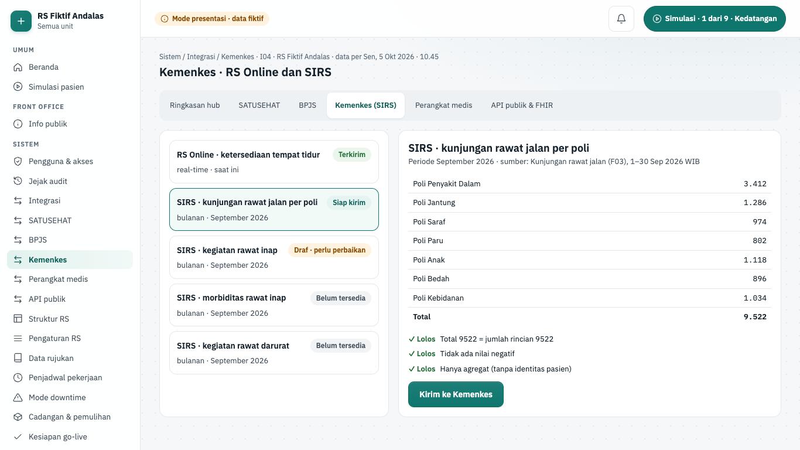
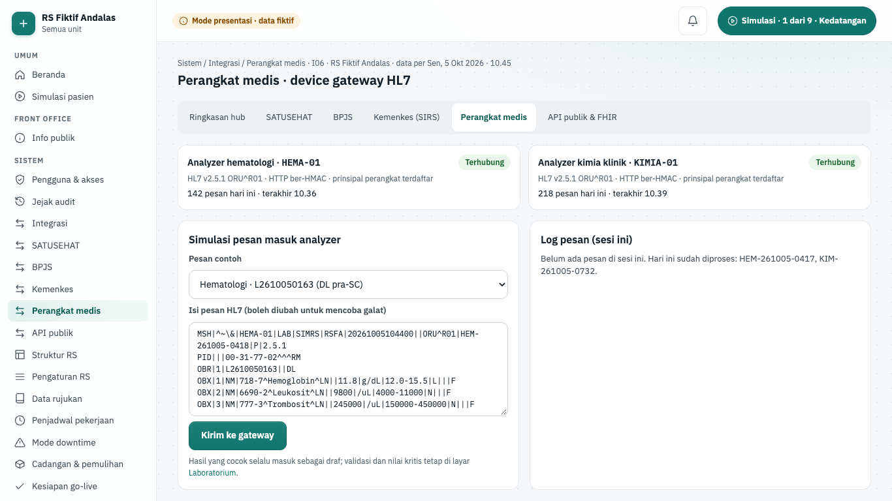
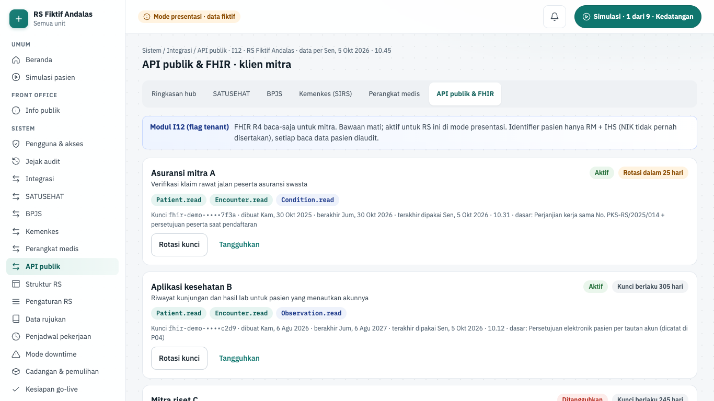

# Fitur integrasi

Halaman ini menjelaskan layar Integrasi (integration hub) dan konsep di belakangnya: outbox, retry, dead-letter queue (DLQ), webhook masuk, dan mock sistem luar. Tujuannya agar pembaca fitur paham kenapa pelayanan tetap jalan saat BPJS atau SATUSEHAT gangguan, dan di mana kode tiap bagian. Detail teknis lengkap ada di halaman cara kerja; halaman ini meringkas dan menautkannya.

> Status 6 Okt 2026: layar `/sistem/integrasi` dan lima layar konektor (SATUSEHAT, BPJS, Kemenkes, perangkat medis, API publik & FHIR) hanya berjalan di **mode presentasi** (data dummy fiktif, ADR-0023). Layar konektor ditambahkan agen FE3 tanpa mockup. Integration hub penuh (fase 7) belum dibangun. Yang sudah nyata: outbox + worker dengan retry dan DLQ, konektor BPJS (VClaim, Antrean, HFIS, Aplicare), Dukcapil, TTE, notifikasi, verifikasi HMAC TPDI, dan mock semua sistem luar. Konektor E-Klaim, SATUSEHAT, TPDI, dan BTN belum ada.

## Ringkasan layar

| Layar                       | Rute                           | Peran (mode presentasi) | Komponen | Status        |
| --------------------------- | ------------------------------ | ----------------------- | -------- | ------------- |
| Integrasi (integration hub) | `/sistem/integrasi`            | Admin SIM RS            | I01–I06  | demo · fase 7 |
| SATUSEHAT                   | `/sistem/integrasi/satusehat`  | Admin SIM RS            | I02      | demo · fase 7 |
| Konektor BPJS               | `/sistem/integrasi/bpjs`       | Admin SIM RS            | I03      | demo · fase 7 |
| Kemenkes (SIRS)             | `/sistem/integrasi/kemenkes`   | Admin SIM RS            | I04      | demo · fase 7 |
| Perangkat medis             | `/sistem/integrasi/perangkat`  | Admin SIM RS            | I06      | demo · fase 7 |
| API publik & FHIR           | `/sistem/integrasi/api-publik` | Admin SIM RS            | I12      | demo · fase 7 |

Posisi lain melihat "Layar ini untuk posisi lain" dengan tautan **Ganti posisi**. Sumber kebenaran: registri `SCREENS` di `apps/web/src/lib/screens.ts`.

Keenam layar berbagi sub-menu `IntegrasiSubnav` (`apps/web/src/components/integrasi/integrasi-subnav.tsx`): navigasi "Sub-menu integrasi" berisi **Ringkasan hub**, **SATUSEHAT**, **BPJS**, **Kemenkes (SIRS)**, **Perangkat medis**, dan **API publik & FHIR**. Tautan layar aktif diberi `aria-current="page"`. Setiap halaman memanggil `<IntegrasiSubnav current="…" />` dengan rutenya sendiri; daftar tautan ada di konstanta `INTEGRASI_LINKS`, jadi layar konektor baru cukup menambah satu baris di sana. Server Action layar konektor memakai pola yang sama dengan hub: `manajemenSession(<id layar>)` memeriksa gerbang demo, sesi lengkap, dan posisi pemakai layar, lalu rekaman dicari di fixture (klien hanya mengirim id). Tidak ada yang dikirim ke sistem luar atau disimpan.

## Integration hub

| Hal      | Isi                                                                                                                                                                                  |
| -------- | ------------------------------------------------------------------------------------------------------------------------------------------------------------------------------------ |
| Rute     | `/sistem/integrasi`                                                                                                                                                                  |
| Pemakai  | admin_tenant                                                                                                                                                                         |
| Komponen | I01 integration hub, I02 SATUSEHAT, I03 BPJS, I04 Kemenkes lain, I05 layanan pendukung, I06 device gateway                                                                           |
| Status   | demo (mode presentasi); backend fase 7 belum dibangun                                                                                                                                |
| Mockup   | `design/mockups/Integrasi.dc.html`                                                                                                                                                   |
| Kode web | `apps/web/src/app/(staf)/sistem/integrasi/` · `apps/web/src/components/manajemen/interface-card.tsx` · `apps/web/src/lib/manajemen.ts` · `apps/web/src/lib/server/data/manajemen.ts` |
| Kode API | belum ada (rencana `modules/integration-hub`, `satusehat`, `bpjs-ws`, `device-gateway`; `docs/rencana/fase-7-integration-hub-satusehat.md`)                                          |

**Tujuan.** Admin SIM RS memantau semua antarmuka ke sistem luar dalam satu layar: status, volume, kegagalan, dan latensi. Admin juga mengirim ulang pesan gagal dan menguji perilaku server edge saat koneksi putus.

**Alur.**

1. Buka **Sistem › Integrasi**. Judul "Integrasi · pemantauan antarmuka" dengan tautan **Jejak audit**.
2. Baris "Server edge" menunjukkan status online dan keterlambatan replikasi ke cloud.
3. Wilayah "Status antarmuka" berisi sembilan kartu: SATUSEHAT, BPJS VClaim, BPJS Antrean, E-Klaim INA-CBG, LIS analyzer, PACS radiologi, TPDI · VA BTN, QRIS, API BTN (mutasi H2H), dan Notifikasi pasien. Tiap kartu memuat protokol, status teks (Normal, Lambat, Gangguan, Antre lokal), volume hari ini, jumlah gagal, latensi p95, dan grafik batang 24 jam dengan jam galat ditandai.
4. Volume kartu ikut bertambah oleh pesan keluar skenario Simulasi ("+N dari skenario Simulasi").
5. Klik kartu untuk menyaring dead-letter queue ke tujuan itu, mis. "Tujuan: PACS radiologi · 2 pesan". Klik lagi atau **Tampilkan semua tujuan** untuk melepas saringan.
6. Di "Dead-letter queue", centang pesan (atau "Pilih semua yang tampil"), lalu **Kirim ulang terpilih (N)**.
7. Konfirmasi "Kirim ulang N pesan ke …?" muncul. Tekan **Ya, kirim ulang** atau **Batal**. Pesan yang terkirim keluar dari antrean dan jumlah gagal di kartu berkurang.
8. Pilih baris pesan untuk membaca "Payload galat · pengenal saja, tanpa data pribadi".
9. Tekan **Uji mode downtime**. Kartu eksternal berubah "Antre lokal" dan penghitung "Transaksi tersimpan lokal selama uji" naik tiap 2 detik. Tekan **Pulihkan**; pesan "Koneksi pulih pukul … disinkronkan ulang berurutan tanpa duplikasi" muncul.
10. Panel kanan: "Kepatuhan SATUSEHAT hari ini" per resource (sasaran ≥ 95%), "Kredensial dan sertifikat" (mis. sertifikat TTE habis 23 hari ditandai), dan "Backup (aturan 3-2-1)".

**Gerbang keselamatan dan aturan bisnis.**

- **Kirim ulang terpilih** nonaktif sampai minimal satu pesan dicentang ("Centang minimal satu pesan untuk dikirim ulang.").
- Kirim ulang selalu lewat konfirmasi. Selama uji downtime kirim ulang ditahan: konfirmasi yang terbuka ditutup dan alasannya tertulis.
- Pesan dikirim ulang dengan kunci idempotensi yang sama, jadi tujuan tidak menerima data ganda. Versi produksi mencatat tindakan ini di log audit.
- Payload DLQ hanya berisi pengenal teknis (mis. id pesan, kunci idempotensi, kode galat), tanpa nama, NIK, atau isi klinis. Tes menolak fixture yang melanggar.
- Server Action `resendDeadLettersAction` memeriksa gerbang demo, sesi lengkap, posisi pemakai layar, dan id pesan yang dikenal. Id tak dikenal ditolak dengan "Muat ulang halaman".
- Status tidak hanya lewat warna: chip bertulisan, dan persen kepatuhan diberi teks "memenuhi sasaran" atau "di bawah sasaran" untuk pembaca layar.
- Angka di layar adalah data dummy. Teks DLQ menyebut "gagal setelah 5× retry" (nilai fixture). Worker nyata memakai 8 percobaan bawaan, dan operasi BPJS SEP/task ID dicoba sampai akhir hari layanan.

**Rencana backend.** Izin terencana `integration.read`. Fase 7 membangun lajur kirim per tujuan (tanpa head-of-line blocking), circuit breaker, status/volume/latensi/DLQ per tujuan, kirim ulang dan abaikan yang diaudit, kredensial per RS terenkripsi dengan rotasi, dan kepatuhan SATUSEHAT per resource. Layar disambungkan ke API; jalur demo tetap hidup.

## SATUSEHAT

| Hal      | Isi                                                                                                                                                                                                                                                         |
| -------- | ----------------------------------------------------------------------------------------------------------------------------------------------------------------------------------------------------------------------------------------------------------- |
| Rute     | `/sistem/integrasi/satusehat`                                                                                                                                                                                                                               |
| Pemakai  | admin_tenant                                                                                                                                                                                                                                                |
| Komponen | I02 konektor SATUSEHAT                                                                                                                                                                                                                                      |
| Status   | demo (mode presentasi); backend fase 7 belum dibangun                                                                                                                                                                                                       |
| Mockup   | tidak ada (gaya mengikuti `design/mockups/Integrasi.dc.html`)                                                                                                                                                                                               |
| Kode web | `apps/web/src/app/(staf)/sistem/integrasi/satusehat/` · data `apps/web/src/lib/server/data/integrasi-lanjut.ts` (`getSatusehatVisits`) · aturan `apps/web/src/lib/integrasi-satusehat.ts` · komponen `apps/web/src/components/integrasi/satusehat-view.tsx` |
| Kode API | belum ada (rencana modul `satusehat`, docs/01-arsitektur.md §2)                                                                                                                                                                                             |

**Tujuan.** Admin SIM RS melihat pengiriman resource FHIR R4 per kunjungan, memahami kenapa sebuah resource gagal atau ditahan, memperbaiki datanya, lalu mengirim ulang dengan konfirmasi dan jejak audit.

**Alur.**

1. Buka **Sistem › Integrasi**, lalu **SATUSEHAT** di "Sub-menu integrasi". Judul "SATUSEHAT · pengiriman per kunjungan". "Ringkasan SATUSEHAT" memuat Resource terkirim, Gagal · DLQ, Ditahan, dan Kirim ulang (sesi ini).
2. Region "Kunjungan" mendaftar empat kunjungan contoh dengan ringkasan terkirim/total: Tn. Lukman Hakim (ENC-2610-0812, rawat jalan), Ny. Fransiska Lumbantobing (ENC-2610-0794, rawat jalan), Ny. Endang Wijaya (ENC-2610-0587, rawat inap), dan Tn. Hendro Gunawan (ENC-2610-0561, rawat inap ICU).
3. "Detail kunjungan SATUSEHAT" berisi tabel resource berurutan (Encounter, Condition, Observation, Procedure, MedicationRequest, Composition, Encounter selesai) dengan kode baku dari fixture (mis. ICD-10 E11.9, LOINC 2345-7) dan status Terkirim, Antre kirim, Ditahan, atau Gagal · DLQ.
4. Pilih Ny. Fransiska. Encounter gagal 422 karena IHS pasien belum ada ("IHS belum ada"). Condition dan Observation tertulis "menunggu Encounter terkirim"; Encounter selesai "menunggu semua resource anak terkirim".

   

5. Region "Payload Encounter" menampilkan JSON tersamar (`"nik": "•••"`). **Kirim ulang** nonaktif dengan teks "Tersedia setelah data diperbaiki." Tekan **Cari IHS lewat NIK**; pasien menjadi terverifikasi.
6. Tekan **Kirim ulang**. Grup "Konfirmasi kirim ulang" menanyakan pengiriman dengan kunci idempotensi yang sama. Tekan **Ya, kirim ulang** (atau **Batal**). Layar menulis "Encounter ENC-2610-0794 dikirim ulang … → 201 Created · kunci idempotensi sama · tercatat di jejak audit (simulasi, tidak disimpan)".
7. Resource yang menunggu ikut dilepas berurutan; kunjungan menjadi "4/4 terkirim". "Jejak audit (sesi ini)" mencatat "Kirim ulang … · dilepas berurutan: …".
8. Kasus lain: Observation Tn. Lukman gagal 400 karena kode lokal; tekan **Petakan lokal-HbA1c → LOINC 4548-4**, lalu kirim ulang. MedicationRequest racikan Ny. Endang tertulis "Belum bisa dikirim ulang" karena menunggu farmasi memetakan bahan racikan ke KFA, dan Composition-nya ditahan "menunggu TTE resume medis oleh DPJP".
9. "Kepatuhan per resource (kunjungan contoh)" merangkum persen terkirim per jenis resource.

**Gerbang keselamatan dan aturan bisnis.**

- Urutan kirim dijaga (`effectiveStatus`): resource anak ditahan selama Encounter belum terkirim; Encounter selesai ditahan sampai semua anak terkirim. Resource dengan alasan tahan sendiri (mis. resume belum TTE) tetap ditahan.
- Galat 4xx bersifat permanen: langsung DLQ tanpa retry. Kirim ulang hanya setelah data diperbaiki (`resendGate`): "Perbaiki data dulu: …. Kirim ulang tanpa perbaikan akan gagal lagi." Perbaikan yang bergantung unit lain ditolak dengan alasannya.
- Kirim ulang wajib konfirmasi; Server Action `satusehatAction` menolak permintaan tanpa `confirmed: true`. Lookup IHS ditolak bila pasien sudah punya IHS terverifikasi. Pemetaan kode hanya untuk galat kode lab.
- Payload ditampilkan tersamar (`maskPayload`): kunci identitas (NIK, nama, tanggal lahir, telepon, alamat) menjadi "•••" dan referensi `Patient/…` atau `Practitioner/…` disisakan 4 karakter terakhir.
- Server mencari kunjungan dan resource di fixture. Status perbaikan di sesi ini dikirim klien sebagai tanda boolean karena belum ada penyimpanan.

**Rencana backend.** Izin rencana `integration.manage` (hub memakai `integration.read`; kirim ulang DLQ di API direncanakan `integration.dlq.resend`). Fase 7 potongan 7.3a–7.3b membangun modul `satusehat`: identitas pasien dan praktisi (IHS lewat NIK tervalidasi), resource dari event domain lewat outbox, pesan `held` dilepas berurutan, dan kepatuhan per resource. Pemetaan FHIR di `packages/fhir` (7.0b).

## Konektor BPJS

| Hal      | Isi                                                                                                                                                                                                                                        |
| -------- | ------------------------------------------------------------------------------------------------------------------------------------------------------------------------------------------------------------------------------------------ |
| Rute     | `/sistem/integrasi/bpjs`                                                                                                                                                                                                                   |
| Pemakai  | admin_tenant                                                                                                                                                                                                                               |
| Komponen | I03 konektor BPJS                                                                                                                                                                                                                          |
| Status   | demo (mode presentasi); backend fase 7 belum dibangun                                                                                                                                                                                      |
| Mockup   | tidak ada (gaya mengikuti `design/mockups/Integrasi.dc.html`)                                                                                                                                                                              |
| Kode web | `apps/web/src/app/(staf)/sistem/integrasi/bpjs/` · data `apps/web/src/lib/server/data/integrasi-lanjut.ts` (`getBpjsConnector`) · aturan `apps/web/src/lib/integrasi-bpjs.ts` · komponen `apps/web/src/components/integrasi/bpjs-view.tsx` |
| Kode API | operasi outbox BPJS sudah ada di worker (lihat [Sistem luar yang terhubung](#sistem-luar-yang-terhubung)); layar dan modul `bpjs` belum ada (docs/01-arsitektur.md §2)                                                                     |

**Tujuan.** Memisahkan empat layanan BPJS (VClaim, Antrean, Aplicare, HFIS) dalam kartu sendiri, mengirim ulang task ID antrean dengan urutan yang benar, menyamakan ketersediaan kamar dan jadwal dokter, serta menjalankan mode downtime saat BPJS terganggu.

**Alur.**

1. Buka **BPJS** di "Sub-menu integrasi". Judul "Konektor BPJS · VClaim, Antrean, Aplicare, HFIS". Region "Mode downtime BPJS" di atas menulis "Semua layanan BPJS online …".
2. "Layanan BPJS" berisi kartu BPJS VClaim, BPJS Antrean, BPJS Aplicare, dan BPJS HFIS dengan status bertulisan (Normal, Lambat, Gangguan), volume, gagal, dan p95. Klik kartu untuk membuka detailnya; bawaan BPJS Antrean.
3. "Detail <layanan>" memuat tabel Operasi, Volume, Gagal, dan p95, galat terakhir, dan kebijakan retry: "retry eksponensial sampai akhir hari layanan WIB (jeda maks. 10 mnt); penolakan bisnis langsung DLQ".
4. Antrean: tiap kode booking punya task ID 1–7. Booking 2610050093 (Ny. Dewi Kurniasih) menulis "task 4 harus terkirim lebih dulu". Tekan **Kirim ulang berurutan**, lalu **Ya, kirim berurutan**. Layar menulis "Task 4 lalu 5 booking 2610050093 dikirim berurutan → diterima BPJS, tercatat di jejak audit …".
5. Aplicare: tabel Kelas, Kapasitas, Tersedia (SIM RS), dan Di Aplicare. Tekan **Sinkronkan sekarang (N kelas beda)**; bila sama tombolnya "Sudah sinkron".
6. HFIS: jadwal tiap dokter "SIM RS … · HFIS …". Bila beda, tekan **Kirim jadwal ke HFIS**; bila sama chip "Sama".
7. Mode downtime: tekan **Mode downtime BPJS**, isi "Alasan mode downtime (wajib, minimal 10 karakter; tercatat atas nama <pemakai>)", lalu **Aktifkan mode downtime**. Region menulis "Mode downtime BPJS aktif sejak …" dan kartu berubah "Antre lokal".
8. Selama downtime, catat transaksi tertunda dengan **Catat pendaftaran BPJS (SEP ditunda)** atau **Catat task ID tertunda**. Tekan **Pulihkan & sinkronkan**: "Mode downtime diakhiri · N transaksi tertunda disinkronkan berurutan tanpa duplikasi", diikuti urutan sinkronnya.

**Gerbang keselamatan dan aturan bisnis.**

- Task ID n hanya boleh dikirim bila task 1 sampai n−1 sudah terkirim (`taskOrderGate`). Kirim ulang berurutan mengirim task yang tertinggal mulai dari yang terkecil sampai task gagal ikut terkirim (`resendInOrder`). Booking tanpa task gagal ditolak.
- Kirim ulang task wajib konfirmasi; Server Action `bpjsAction` menolak tanpa `confirmed: true` dan mencari booking serta dokter HFIS di fixture.
- Status kartu dihitung dari angka (`serviceStatus`): gagal ≥ 5% = Gangguan; p95 ≥ 1 detik atau gagal ≥ 1% = Lambat. Contoh: HFIS dengan p95 1.240 ms tampil Lambat.
- Mode downtime wajib alasan minimal 10 karakter dan tercatat di jejak audit (`downtimeGate`). Selama downtime, kirim ulang task, sinkron Aplicare, dan kirim jadwal HFIS nonaktif.
- Saat pulih, transaksi tertunda disinkronkan menurut waktu kejadian, lalu jenis: SEP sebelum task ID, task ID sebelum Aplicare (`syncOrder`).

**Rencana backend.** Izin rencana `integration.manage`. Fase 7 potongan 7.4 melengkapi BPJS (I03): kartu per layanan dari data hub, WS Mobile JKN yang dipanggil BPJS di modul `bpjs-ws`, dan pengaturan jeda/lanjut konektor dengan alasan wajib yang diaudit (`integration.manage`). Kebijakan retry nyata ada di worker: SEP dan task ID dicoba sampai akhir hari layanan WIB.

## Kemenkes (SIRS)

| Hal      | Isi                                                                                                                                                                                                                                                      |
| -------- | -------------------------------------------------------------------------------------------------------------------------------------------------------------------------------------------------------------------------------------------------------- |
| Rute     | `/sistem/integrasi/kemenkes`                                                                                                                                                                                                                             |
| Pemakai  | admin_tenant                                                                                                                                                                                                                                             |
| Komponen | I04 konektor Kemenkes lain                                                                                                                                                                                                                               |
| Status   | demo (mode presentasi); backend fase 7 belum dibangun                                                                                                                                                                                                    |
| Mockup   | tidak ada (gaya mengikuti `design/mockups/Integrasi.dc.html`)                                                                                                                                                                                            |
| Kode web | `apps/web/src/app/(staf)/sistem/integrasi/kemenkes/` · data `apps/web/src/lib/server/data/integrasi-lanjut.ts` (`getKemenkesReports`) · aturan `apps/web/src/lib/integrasi-kemenkes.ts` · komponen `apps/web/src/components/integrasi/kemenkes-view.tsx` |
| Kode API | belum ada (rencana modul `kemenkes`, docs/01-arsitektur.md §2)                                                                                                                                                                                           |

**Tujuan.** Menyusun, memvalidasi, dan mengirim laporan agregat ke Kemenkes (RS Online real-time dan SIRS bulanan), dengan tanda terima per periode dan tanpa data identitas pasien.

**Alur.**

1. Buka **Kemenkes (SIRS)** di "Sub-menu integrasi". Judul "Kemenkes · RS Online dan SIRS". "Daftar laporan" memuat RS Online · ketersediaan tempat tidur (terkirim), SIRS · kunjungan rawat jalan per poli (September 2026, siap, terpilih bawaan), SIRS · kegiatan rawat inap (draf), SIRS · morbiditas rawat inap, dan SIRS · kegiatan rawat darurat (belum tersedia).
2. "Detail laporan" menampilkan isi agregat dengan baris Total, lalu "Validasi bentuk": total sama dengan jumlah rincian, tidak ada nilai negatif, hanya agregat, ditambah pemeriksaan khusus laporan.
3. Pilih "SIRS · kegiatan rawat inap". Pemeriksaan "Cara keluar tercatat untuk semua pasien pulang" gagal ("3 pasien pulang belum tercatat cara keluarnya · lengkapi dari rekam medis"); **Kirim ke Kemenkes** nonaktif.
4. Tekan **Lengkapi dari rekam medis**. Validasi lolos dan **Kirim ke Kemenkes** aktif.
5. Tekan **Kirim ke Kemenkes**. Grup "Konfirmasi kirim laporan" muncul; tekan **Ya, kirim** (atau **Batal**). Laporan menulis "✓ Terkirim <jam> · tanda terima SIRS-2610-…".

**Gerbang keselamatan dan aturan bisnis.**

- Kirim diblokir (`sendGate`) bila laporan belum punya sumber data ("Laporan ini belum tersedia: sumber datanya belum dibangun."), periode sudah terkirim ("Periode ini sudah terkirim (idempoten per periode). Koreksi lewat pengiriman ulang dari hub."), atau validasi bentuk belum lolos.
- Laporan hanya berisi agregat; tidak ada identitas pasien.
- Kirim wajib konfirmasi; Server Action `kemenkesAction` menolak tanpa `confirmed: true`, mencari laporan di fixture, menerapkan perbaikan yang dikirim klien, lalu menjalankan `sendGate` yang sama.
- Perbaikan data dikerjakan unit sumber (rekam medis). Di mode presentasi tombol **Lengkapi dari rekam medis** hanya mensimulasikannya.

**Rencana backend.** Izin rencana `integration.manage`. Fase 7 potongan 7.5 membangun konektor `kemenkes`: RS Online bed (pola sama dengan Aplicare), registri laporan SIRS RL di `packages/shared`, generator bulanan P11 untuk satu-dua laporan, tabel `kemenkes_report_submissions`, dan outbox `kemenkes.sirs.submit` yang dikirim ulang dari hub. SISRUTE, SITB, dan surveilans menjadi utang.

## Perangkat medis

| Hal      | Isi                                                                                                                                                                                                                                                       |
| -------- | --------------------------------------------------------------------------------------------------------------------------------------------------------------------------------------------------------------------------------------------------------- |
| Rute     | `/sistem/integrasi/perangkat`                                                                                                                                                                                                                             |
| Pemakai  | admin_tenant                                                                                                                                                                                                                                              |
| Komponen | I06 device gateway                                                                                                                                                                                                                                        |
| Status   | demo (mode presentasi); backend fase 7 belum dibangun                                                                                                                                                                                                     |
| Mockup   | tidak ada (gaya mengikuti `design/mockups/Integrasi.dc.html`)                                                                                                                                                                                             |
| Kode web | `apps/web/src/app/(staf)/sistem/integrasi/perangkat/` · data `apps/web/src/lib/server/data/integrasi-lanjut.ts` (`getDeviceGateway`) · aturan `apps/web/src/lib/integrasi-perangkat.ts` · komponen `apps/web/src/components/integrasi/perangkat-view.tsx` |
| Kode API | belum ada (rencana modul `device-gateway`, docs/01-arsitektur.md §2)                                                                                                                                                                                      |

**Tujuan.** Mensimulasikan pesan hasil HL7 v2 ORU^R01 dari analyzer laboratorium: diterima gateway, identitas disamarkan, dicocokkan dengan nomor lab, lalu masuk sebagai hasil draf yang masih harus divalidasi analis.

**Alur.**

1. Buka **Perangkat medis** di "Sub-menu integrasi". Judul "Perangkat medis · device gateway HL7". "Perangkat terdaftar" memuat Analyzer hematologi dan Analyzer kimia klinik ("HL7 v2.5.1 ORU^R01 · HTTP ber-HMAC") dengan status Terhubung atau Terputus dan jumlah pesan hari ini.
2. Di form "Simulasi pesan masuk", pilih "Pesan contoh": Hematologi · L2610050163 (DL pra-SC), Kimia · L2610050142 (kreatinin, kalium), Kimia · L2610050171 (sampel belum diterima), atau Hematologi · L2610059999 (nomor lab tidak dikenal). "Isi pesan HL7 (boleh diubah untuk mencoba galat)" terisi otomatis.
3. Tekan **Kirim ke gateway**. "Log pesan (sesi ini)" mencatat ACK dan hasilnya, mis. "ACK AA · N hasil masuk ke L2610050163 (<pasien>) sebagai draf · menunggu validasi analis", beserta isi pesan dengan baris `PID|||•••`.
4. Pilih nomor lab tidak dikenal lalu kirim: log menulis ACK AE. Kirim pesan yang sama dua kali: ACK ulang "Duplikat …" tanpa memproses ulang.
5. Validasi dan nilai kritis tetap dikerjakan di layar [Laboratorium](./13-fitur-penunjang.md#laboratorium).

**Gerbang keselamatan dan aturan bisnis.**

- Pesan rusak atau bukan ORU^R01 ditolak dengan ACK AR (`parseOru`): MSH tidak ada, jenis pesan salah, MSH-10 (control ID) kosong, OBR-2 (nomor lab) kosong, atau tanpa OBX.
- Control ID yang sudah diproses dijawab ACK AA "duplikat" tanpa memproses ulang (idempoten).
- ACK AE bila nomor lab tidak dikenal, spesimen belum diterima laboratorium, atau kode LOINC belum dipetakan ke katalog lab.
- Hasil yang cocok selalu masuk sebagai draf; tidak ada autoverifikasi (keputusan fase 4 #5).
- Segmen PID diganti `PID|||•••` sebelum ditampilkan (`redactPid`); identitas pasien tidak disimpan di log gateway.
- Server Action `processHl7Action` menerima teks maksimal 64 KB, mencocokkan dengan worklist Laboratorium hari demo, dan memakai daftar LOINC katalog lab.

**Rencana backend.** Izin rencana `integration.manage`. Fase 7 potongan 7.7 membangun modul `device-gateway` (flag modul `I06`, bawaan mati): ingest ber-HMAC dengan idempotensi MSH-10, PID diredaksi sebelum disimpan, dan worker memetakan OBX ke hasil draf. Fase 4 potongan 4.1a menyiapkan endpoint `POST /api/v1/devices/lis/hl7` dengan batas 256 KB.

## API publik & FHIR

| Hal      | Isi                                                                                                                                                                                                                                                       |
| -------- | --------------------------------------------------------------------------------------------------------------------------------------------------------------------------------------------------------------------------------------------------------- |
| Rute     | `/sistem/integrasi/api-publik`                                                                                                                                                                                                                            |
| Pemakai  | admin_tenant                                                                                                                                                                                                                                              |
| Komponen | I12 API publik dan FHIR server                                                                                                                                                                                                                            |
| Status   | demo (mode presentasi); backend fase 7 belum dibangun                                                                                                                                                                                                     |
| Mockup   | tidak ada (gaya mengikuti `design/mockups/Integrasi.dc.html`)                                                                                                                                                                                             |
| Kode web | `apps/web/src/app/(staf)/sistem/integrasi/api-publik/` · data `apps/web/src/lib/server/data/integrasi-lanjut.ts` (`getApiClients`) · aturan `apps/web/src/lib/integrasi-api-publik.ts` · komponen `apps/web/src/components/integrasi/api-publik-view.tsx` |
| Kode API | belum ada (rencana modul `fhir-server`, docs/01-arsitektur.md §2)                                                                                                                                                                                         |

**Tujuan.** Mengelola klien mitra (asuransi, aplikasi kesehatan, riset) yang membaca data lewat FHIR R4 baca-saja: cakupan resource, kunci API berbatas umur dengan rotasi, penangguhan beralasan, dan log akses.

**Alur.**

1. Buka **API publik & FHIR** di "Sub-menu integrasi". Judul "API publik & FHIR · klien mitra". Alert "Modul I12 (flag tenant)" menjelaskan bahwa modul bawaan mati, identifier pasien hanya RM + IHS (NIK tidak pernah disertakan), dan setiap baca data pasien diaudit.
2. "Klien terdaftar" memuat kartu Asuransi mitra A, Aplikasi kesehatan B, dan Mitra riset C (ditangguhkan). Tiap kartu menulis tujuan, cakupan, status kunci ("Kunci berlaku N hari", "Rotasi dalam N hari", atau "Kunci kedaluwarsa"), dan pemakaian terakhir.
3. Rotasi: tekan **Rotasi kunci**, lalu **Ya, rotasi kunci** di konfirmasi. Kartu menulis "Kunci berlaku 365 hari".
4. Penangguhan: tekan **Tangguhkan**, isi "Alasan penangguhan (wajib)", lalu **Tangguhkan**. Klien yang ditangguhkan bisa **Aktifkan kembali**.
5. "Daftarkan klien baru": isi "Nama klien", "Tujuan pemakaian", centang cakupan (Patient.read, Encounter.read, Condition.read, Observation.read, AllergyIntolerance.read), isi "Dasar persetujuan pasien / perjanjian kerja sama (wajib untuk data klinis)" bila perlu, lalu **Daftarkan klien**. Kartu klien baru muncul.
6. "Log akses terbaru" menampilkan permintaan seperti `GET /fhir/r4/Encounter?patient=…` dengan status HTTP dan catatan.

**Gerbang keselamatan dan aturan bisnis.**

- Pendaftaran (`registerGate`): nama minimal 3 karakter, tujuan minimal 10 karakter, minimal satu cakupan. Cakupan klinis (Condition.read, Observation.read, AllergyIntolerance.read) wajib dasar persetujuan pasien atau perjanjian kerja sama minimal 10 karakter.
- Rotasi kunci wajib konfirmasi; Server Action `apiClientAction` menolak tanpa `confirmed: true`. Kunci lama dicabut seketika dan kunci baru berlaku 365 hari.
- Status kunci (`keyState`): kedaluwarsa bila lewat tanggal, perlu rotasi bila ≤ 30 hari lagi.
- Penangguhan wajib alasan minimal 10 karakter (`suspendGate`).
- Identifier pasien di API hanya RM + IHS; NIK tidak pernah disertakan. Log akses menyingkat id pasien (`patient=…`).
- Server menjalankan gerbang yang sama untuk pendaftaran. Klien yang didaftarkan di sesi ini tidak ada di fixture; aksi lanjutannya hanya divalidasi bentuknya.

**Rencana backend.** Izin rencana `integration.manage`. Fase 7 potongan 7.8 membangun modul `fhir-server` (flag modul `I12`, bawaan mati): FHIR R4 baca-saja dengan lingkup relasi, audit per baca, dan isolasi tenant; flag mati = 404, tanpa izin = 403.

## Konsep integrasi

Semua sistem luar diperlakukan sama: bisa lambat, bisa mati, bisa mengirim dua kali. Tiga pola menjaga pelayanan tetap jalan.

### Outbox, retry, dan DLQ

Modul domain tidak pernah memanggil API luar di dalam transaksi database. Ia menulis pesan ke tabel `outbox_messages` di transaksi yang sama dengan perubahan datanya, lewat `enqueueOutbox` di `packages/db/src/outbox.ts`. Penulisan idempoten per (tenant, tujuan, kunci idempotensi).

Worker (`apps/worker/src/outbox/outbox.dispatcher.ts`) mengklaim pesan tiap ±2 detik, mengirim di luar transaksi, lalu mencatat hasilnya.

| Status       | Arti                                                                                                                  |
| ------------ | --------------------------------------------------------------------------------------------------------------------- |
| `pending`    | Menunggu dikirim                                                                                                      |
| `processing` | Sedang diklaim worker (lease 60 detik)                                                                                |
| `sent`       | Tujuan menjawab 2xx                                                                                                   |
| `failed`     | Gagal sementara (5xx, 408, 425, 429, jaringan); dijadwalkan ulang dengan backoff eksponensial + jitter, maks. 5 menit |
| `dead`       | DLQ: percobaan habis (bawaan 8) atau galat permanen (4xx lain)                                                        |
| `held`       | Ditahan (staging SATUSEHAT sejak fase 3, dilepas berurutan di fase 7)                                                 |

Operasi boleh membawa kebijakan retry sendiri. SEP dan task ID BPJS dicoba sampai 00.00 WIB berikutnya, lalu DLQ dan tombol kirim ulang di layar domain. Payload outbox tidak boleh memuat data pribadi. Penjelasan lengkap: [Integrasi lewat outbox](./01-cara-kerja-sistem.md#integrasi-lewat-outbox) dan [Worker](./02-cara-kerja-kode.md#worker).

### Webhook masuk bertanda tangan HMAC

Arah sebaliknya (TPDI dan BTN mengabari SIM RS) memakai pola ini:

1. Verifikasi tanda tangan. Untuk TPDI: header `X-TPDI-Signature` = hex(HMAC-SHA256(timestamp + "." + body, secret)). Timestamp yang selisihnya lebih dari 5 menit ditolak (anti-replay).
2. Simpan event mentah di `inbound_events`, unik per (tenant, sumber, kunci idempotensi).
3. Jawab 2xx secepatnya.
4. Proses di worker secara async. Event yang sama hanya dihitung sekali.

Yang sudah ada: fungsi `verifyTpdiWebhook` (perbandingan waktu-konstan) di `packages/shared/src/integrations/tpdi-signature.ts` beserta tesnya, dan tabel `inbound_events` di `packages/db/prisma/schema/platform.prisma`. Penerima webhook belum dibangun; rencana fase 6 menaruhnya di `apps/api/src/modules/webhooks/` (`POST /api/v1/webhooks/tpdi/:tenantCode` dan `/btn/:tenantCode`). Event TPDI di kontrak: `payment.paid`, `payment.expired`, `payment.failed`, `refund.completed`. Perilakunya bisa dilihat di layar [Pembayaran digital](./14-fitur-keuangan.md#pembayaran-digital-tpdi-btn): callback ganda tampil "duplikat · diabaikan".

### Mock dan panel kendali

Semua sistem luar ditiru `apps/mock` di `http://localhost:4100` (ADR-0006). Mock meniru kontrak aslinya, termasuk tanda tangan BPJS, enkripsi respons, dan webhook HMAC TPDI. Lokal, semua base URL integrasi mengarah ke `http://localhost:4100/<sistem>`; untuk BPJS, env kredensial yang kosong di luar produksi otomatis bernilai mock. Tidak ada panggilan ke layanan nyata dari lokal.

Panel kendali di `http://localhost:4100/`:

- Skenario per sistem: normal, lambat, gagal, acak, timeout. Mode timeout memproses permintaan lalu menahan jawabannya (meniru SEP yang terbit tetapi RS tidak tahu).
- Pemicu TPDI: bayar, kirim ulang webhook (callback ganda), atau kedaluwarsakan tagihan (`POST /_panel/api/tpdi/invoices/:id/(pay|resend|expire)`).
- Saklar enkripsi BPJS dan reset data. State disimpan di memori dan hilang saat restart.

Detail berkas mock: [Mock](./02-cara-kerja-kode.md#mock).

### Sistem luar yang terhubung

| Sistem              | Dipakai untuk                                                  | Mock                                | Kode saat ini                                                                                                                                                                        |
| ------------------- | -------------------------------------------------------------- | ----------------------------------- | ------------------------------------------------------------------------------------------------------------------------------------------------------------------------------------ |
| BPJS VClaim         | Kepesertaan, rujukan, SEP, SPRI, surat kontrol, rujukan keluar | `/bpjs/vclaim`                      | Operasi outbox `bpjs.vclaim.sep.insert`, `.sep.update`, `.sep.delete`, `bpjs.vclaim.spri.insert`, `bpjs.vclaim.rujukan.insert`, `.rujukan.delete`; lookup sinkron lewat `BpjsClient` |
| BPJS Antrean + HFIS | Antrean online, task ID 1–7, jadwal dokter                     | `/bpjs/antrean`                     | `bpjs.antrean.add`, `bpjs.antrean.updatewaktu`, `bpjs.antrean.batal`, `bpjs.hfis.pull`, `bpjs.hfis.update`                                                                           |
| BPJS Aplicare       | Ketersediaan tempat tidur                                      | `/bpjs/aplicare`                    | `bpjs.aplicare.update`                                                                                                                                                               |
| E-Klaim INA-CBG     | Grouper dan kirim klaim                                        | `/eklaim/ws.php` (kode CBG `SIM-*`) | Belum ada konektor (fase 5)                                                                                                                                                          |
| SATUSEHAT           | Kirim resource FHIR R4                                         | `/satusehat`                        | Pesan disimpan `held` (`apps/api/src/infra/clinical/staging.ts`); konektor fase 7                                                                                                    |
| Dukcapil            | Verifikasi NIK                                                 | `/dukcapil`                         | `dukcapil.nik.verify`                                                                                                                                                                |
| TTE                 | Tanda tangan elektronik dokumen                                | `/tte`                              | `tte.sign`                                                                                                                                                                           |
| TPDI                | Tagihan VA/QRIS, webhook, laporan, refund                      | `/tpdi/v1`                          | Verifikasi HMAC ada; konektor dan penerima webhook fase 6                                                                                                                            |
| BTN                 | Mutasi rekening H2H, pembiayaan                                | `/btn/v1`                           | Fase 6                                                                                                                                                                               |
| WhatsApp / email    | Notifikasi pasien dan staf                                     | `/whatsapp/send`, `/email/send`     | `notify.whatsapp`, `notify.email`                                                                                                                                                    |

Nama operasi di atas diambil dari `apps/worker/src/outbox/`. Kontrak kawat ada di `packages/shared/src/integrations/`; ringkasan kontrak di `docs/06-integrasi.md` dan `docs/07-pembayaran-btn-tpdi.md`.

## Tes yang menjaga layar ini

| Tes                                                                                                                                                                   | Yang dijaga                                                                                                                                                                                                                                                                                                                                              |
| --------------------------------------------------------------------------------------------------------------------------------------------------------------------- | -------------------------------------------------------------------------------------------------------------------------------------------------------------------------------------------------------------------------------------------------------------------------------------------------------------------------------------------------------- |
| `apps/web/e2e/demo/manajemen.spec.ts` (integration hub)                                                                                                               | Sembilan kartu, saring DLQ per tujuan, kirim ulang terkonfirmasi, uji downtime dan pulih, tanpa scroll horizontal                                                                                                                                                                                                                                        |
| `apps/web/src/lib/manajemen.test.ts`                                                                                                                                  | Fixture lolos kontrak, payload DLQ tanpa nama/NIK, jejak skenario menambah volume kartu                                                                                                                                                                                                                                                                  |
| `apps/web/src/lib/manajemen-aksi.test.ts`                                                                                                                             | Kirim ulang DLQ hanya untuk posisi layar Integrasi; tanpa sesi lengkap diarahkan ke halaman masuk                                                                                                                                                                                                                                                        |
| `apps/worker/test/outbox.test.ts`, `dispatcher-policy.test.ts`                                                                                                        | Dispatcher, `defer`, `onDead` atomik dengan DLQ, kebijakan retry per operasi                                                                                                                                                                                                                                                                             |
| `apps/worker/test/retry-policy.test.ts`, `classify.test.ts`                                                                                                           | Batas hari layanan WIB, klasifikasi kode HTTP (coba ulang vs permanen)                                                                                                                                                                                                                                                                                   |
| `apps/mock/src/mock.test.ts`, `apps/mock/src/panel/scenario.test.ts`                                                                                                  | Kontrak mock dan skenario panel per sistem                                                                                                                                                                                                                                                                                                               |
| `packages/shared/src/integrations/integrations.test.ts`                                                                                                               | Tanda tangan HMAC TPDI dan batas umur timestamp                                                                                                                                                                                                                                                                                                          |
| `apps/web/e2e/demo/fe3-penunjang-integrasi.spec.ts` (blok I02, I03, I04/I06/I12)                                                                                      | Sub-menu integrasi aktif; anak SATUSEHAT ditahan sampai Encounter terkirim, lookup IHS, kirim ulang berkonfirmasi dan diaudit; task ID BPJS dikirim berurutan; mode downtime wajib alasan lalu sinkron; laporan SIRS tertahan validasi; ACK AA/AE gateway dengan PID tersamar; cakupan klinis API wajib dasar persetujuan dan rotasi kunci berkonfirmasi |
| `apps/web/src/lib/integrasi-satusehat.test.ts`, `integrasi-bpjs.test.ts`, `integrasi-kemenkes.test.ts`, `integrasi-perangkat.test.ts`, `integrasi-api-publik.test.ts` | Aturan murni konektor: urutan dan samaran SATUSEHAT, urutan task ID dan status kartu BPJS, gerbang kirim SIRS, parser ORU^R01 dan ACK, gerbang pendaftaran klien dan status kunci                                                                                                                                                                        |

## Lihat juga

- [Cara sistem bekerja: integrasi lewat outbox](./01-cara-kerja-sistem.md#integrasi-lewat-outbox)
- [Cara kode bekerja: worker](./02-cara-kerja-kode.md#worker) dan [mock](./02-cara-kerja-kode.md#mock)
- [Tutorial: mengirim pesan outbox contoh](./03-tutorial.md#3-mengirim-pesan-outbox-contoh)
- [Fitur keuangan](./14-fitur-keuangan.md), untuk webhook TPDI dan rekonsiliasi
- [Fitur front office](./11-fitur-front-office.md), untuk SEP dan task ID BPJS
- [Fitur penunjang](./13-fitur-penunjang.md#laboratorium), untuk hasil analyzer yang divalidasi analis dan nilai kritis
- [Peta alur semua fase](./20-peta-alur-semua-fase.md)
- [Simulasi dan operasional](./18-simulasi-dan-operasional.md)
- [Peta kode](./19-peta-kode.md)
- Dokumen desain: `docs/06-integrasi.md`, `docs/adr/0003-outbox-integrasi.md`, `docs/adr/0006-mock-first.md`; rencana `docs/rencana/fase-7-integration-hub-satusehat.md`
