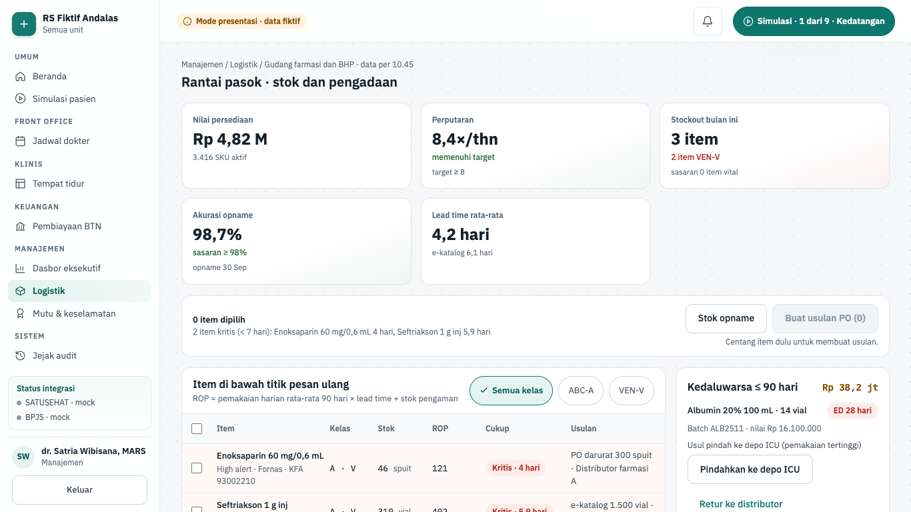
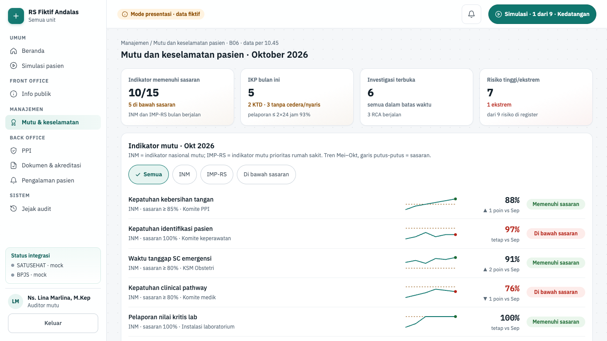
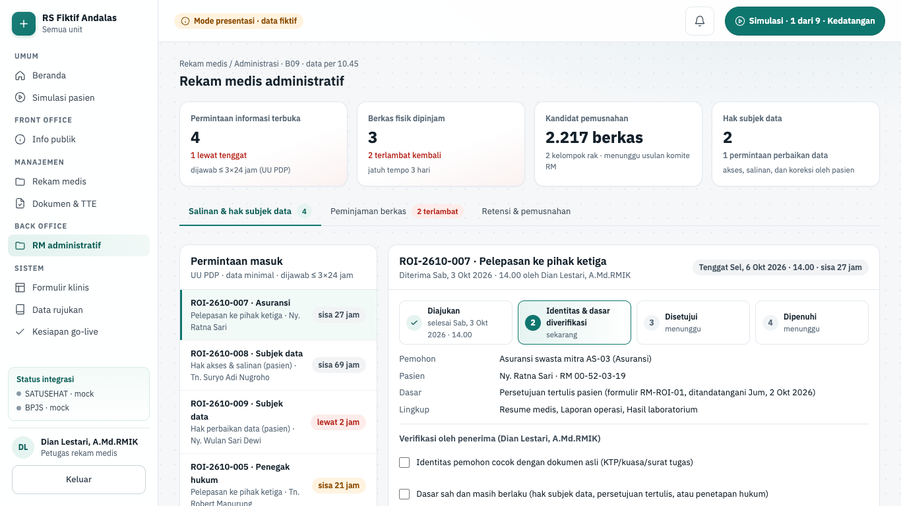
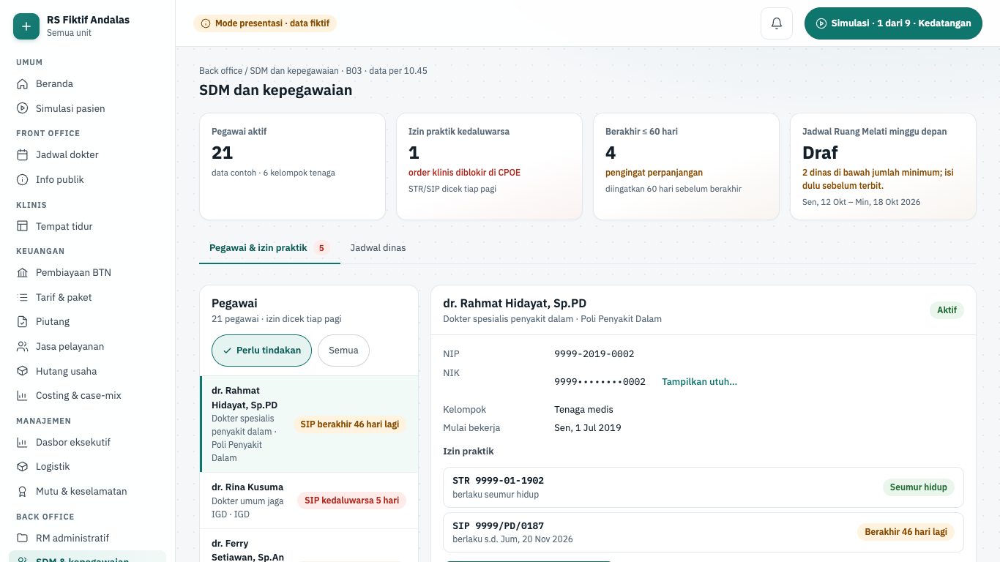
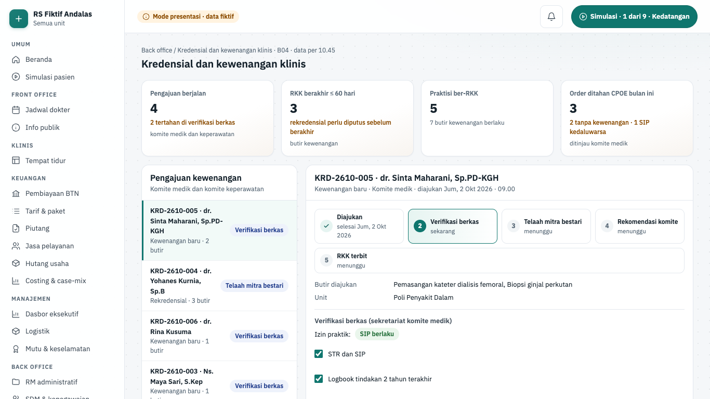
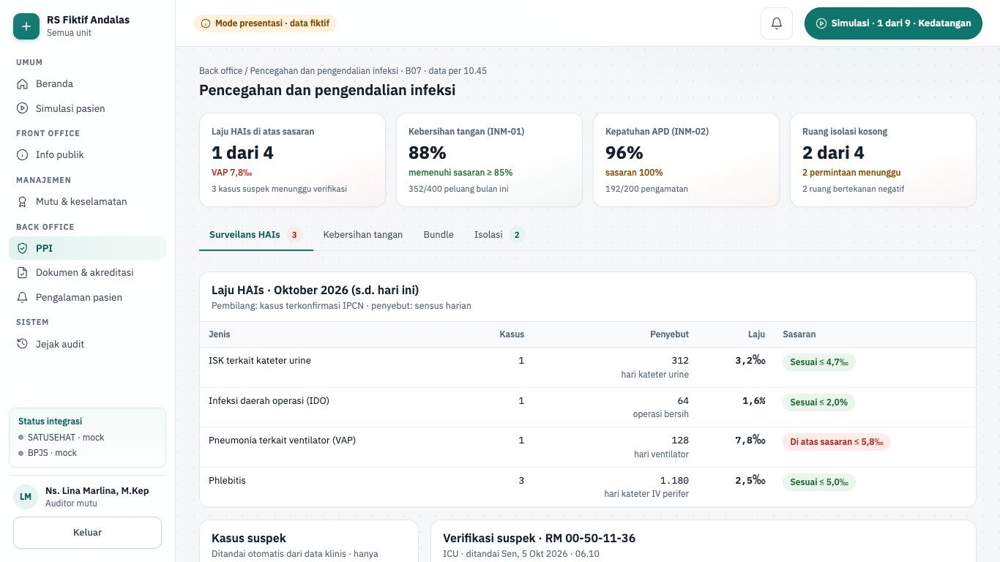
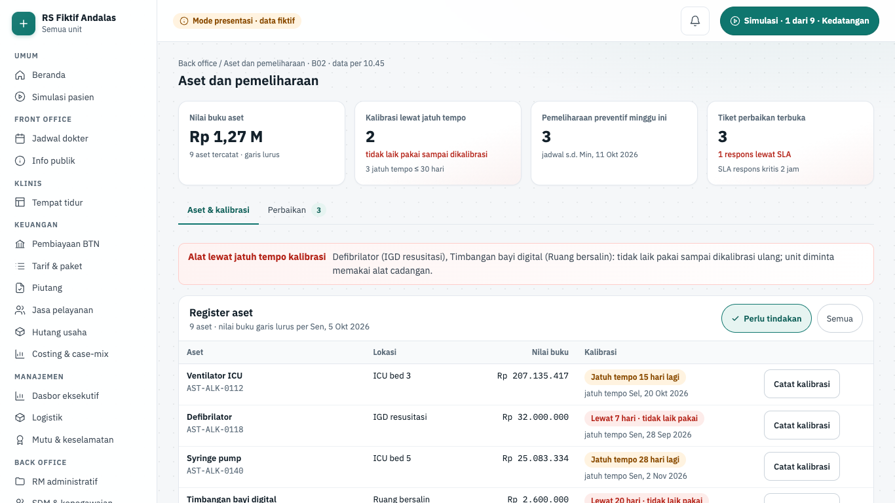
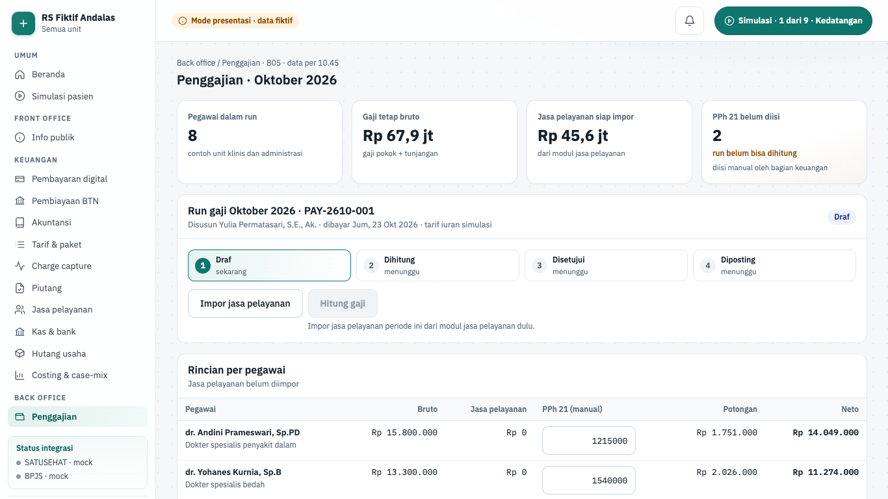
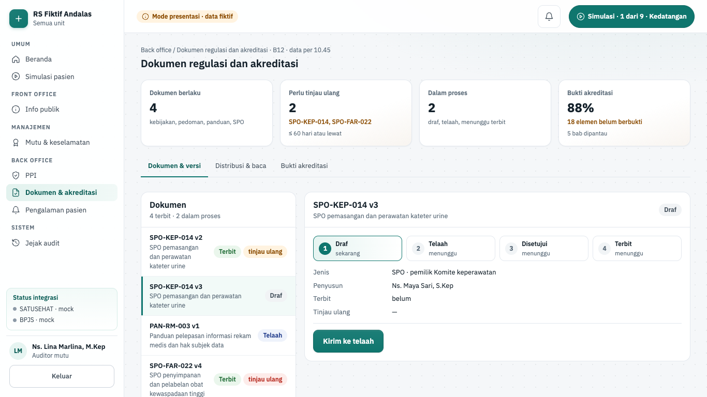
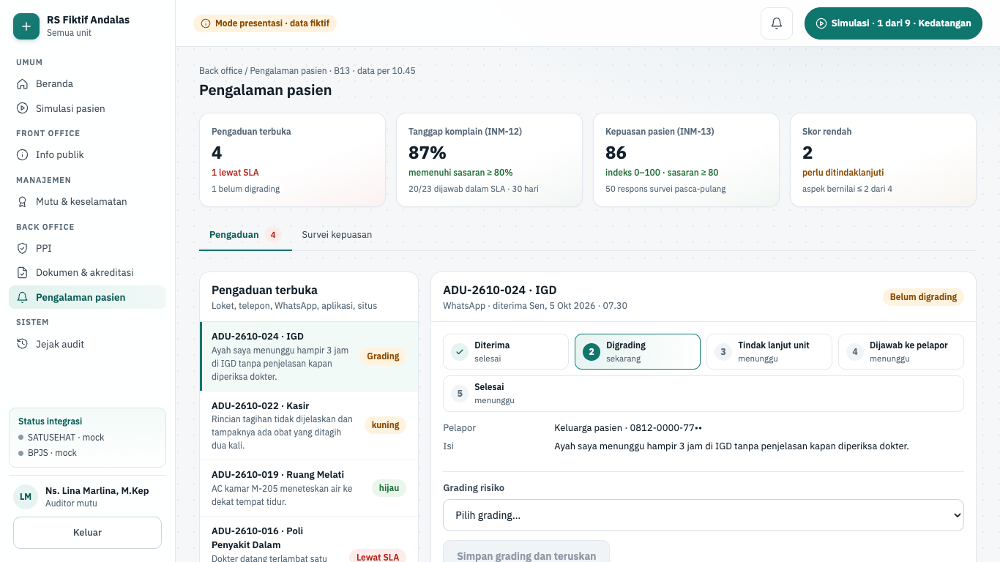

# Fitur back office

Halaman ini menjelaskan tiga belas layar back office: Logistik, Mutu & keselamatan, dan sebelas layar fase 8 yang dibangun agen FE5 (RM administratif, SDM, kredensial, PPI, aset, penggajian, PPRA, dokumen, pengalaman pasien, pendidikan klinik, onkologi). Semuanya dipakai untuk mengelola RS, bukan untuk pelayanan langsung ke pasien, kecuali Onkologi yang menyiapkan order kemoterapi. Isinya: apa yang tampil, aturan yang menjaganya, dan di mana kodenya.

Sebelas layar FE5 memakai pola yang sama:

- `page.tsx` (server) memanggil `requireDemoScreen('<id>')`, membaca data dari satu pintu `apps/web/src/lib/server/data/backoffice.ts`, lalu menampilkan empat KPI.
- Papan klien di `apps/web/src/components/<domain>/` memegang keadaan layar. Semua aksi lokal di peramban; tidak ada Server Action. Muat ulang halaman mengembalikan keadaan awal.
- Aturan bisnis berupa fungsi murni di `apps/web/src/lib/<domain>.ts`, dengan tes `*.test.ts` di sebelahnya.
- Perangkat kecil bersama di `apps/web/src/components/backoffice/kit.tsx`: `Panel` (kartu berjudul), `FlashLine` (umpan balik `role="status"`), `StageTrack` (jejak tahap), `ReasonButton` (tombol nonaktif dengan alasan tertulis di dekatnya, docs/08 §5.2), `ConfirmBox` (`role="alertdialog"` dengan alasan wajib minimal N huruf), `KeyValues`, `TableWrap`, `PickRow`, `SelectField`, `TextField`, `CheckField`, dan `PageHead`.

> Status 6 Okt 2026: ketiga belas layar hanya berjalan di **mode presentasi** (data dummy fiktif, ADR-0023). Backend fase 8 (back office) belum dibangun. Logistik masih memakai Server Action yang memvalidasi lalu membuang aksi dengan pesan "(simulasi, tidak disimpan)"; layar FE5 menyimpan aksi di keadaan peramban saja. Di luar mode presentasi rute ini menjawab 404.

## Ringkasan layar

| Layar                   | Rute                        | Peran (mode presentasi)                         | Komponen | Status        |
| ----------------------- | --------------------------- | ----------------------------------------------- | -------- | ------------- |
| Logistik                | `/manajemen/logistik`       | Manajemen, Apoteker                             | B01      | demo · fase 8 |
| Mutu & keselamatan      | `/manajemen/mutu`           | Auditor mutu, Manajemen                         | B06      | demo · fase 8 |
| RM administratif        | `/rekam-medis/administrasi` | Petugas rekam medis, Petugas privasi, Manajemen | B09      | demo · fase 8 |
| SDM & kepegawaian       | `/manajemen/sdm`            | Manajemen                                       | B03      | demo · fase 8 |
| Kredensial & kewenangan | `/manajemen/kredensial`     | Manajemen, Dokter                               | B04      | demo · fase 8 |
| PPI                     | `/manajemen/ppi`            | Auditor mutu, Perawat                           | B07      | demo · fase 8 |
| Aset & pemeliharaan     | `/manajemen/aset`           | Manajemen, Perawat                              | B02      | demo · fase 8 |
| Penggajian              | `/manajemen/penggajian`     | Akuntan, Manajemen                              | B05      | demo · fase 8 |
| PPRA                    | `/manajemen/ppra`           | Apoteker, Dokter                                | B08      | demo · fase 8 |
| Dokumen & akreditasi    | `/manajemen/dokumen`        | Auditor mutu, Manajemen                         | B12      | demo · fase 8 |
| Pengalaman pasien       | `/manajemen/pengaduan`      | Auditor mutu, Petugas pendaftaran, Manajemen    | B13      | demo · fase 8 |
| Pendidikan klinik       | `/manajemen/pendidikan`     | Dokter, Manajemen                               | B10      | demo · fase 8 |
| Onkologi                | `/klinis/onkologi`          | Dokter, Apoteker                                | B11      | demo · fase 8 |

Posisi lain melihat "Layar ini untuk posisi lain" dengan tautan **Ganti posisi**. Sumber kebenaran: registri `SCREENS` di `apps/web/src/lib/screens.ts`. Data Logistik dan Mutu lewat `apps/web/src/lib/server/data/manajemen.ts` dan divalidasi skema `packages/shared/src/schemas/manajemen.ts`; tambahan penerimaan barang dan indikator terhitung lewat `backoffice.ts`. Di menu, layar FE5 ada di kelompok **Back office**, kecuali Onkologi di **Klinis**. Command center dan Dataset riset juga ada di kelompok Back office, tetapi dijelaskan di [Fitur kanal dan dasbor](./17-fitur-kanal-dasbor.md).

## Logistik

| Hal      | Isi                                                                                                                                                                                                                                                                  |
| -------- | -------------------------------------------------------------------------------------------------------------------------------------------------------------------------------------------------------------------------------------------------------------------- |
| Rute     | `/manajemen/logistik`                                                                                                                                                                                                                                                |
| Pemakai  | manajemen, apoteker                                                                                                                                                                                                                                                  |
| Komponen | B01 supply chain generik                                                                                                                                                                                                                                             |
| Status   | demo (mode presentasi); backend fase 8 belum dibangun                                                                                                                                                                                                                |
| Mockup   | `design/mockups/Logistik.dc.html`                                                                                                                                                                                                                                    |
| Kode web | `apps/web/src/app/(staf)/manajemen/logistik/` · `apps/web/src/components/manajemen/{reorder-row,po-draft-panel,expiry-panel,procurement-list,goods-receipt-panel}.tsx` · `apps/web/src/lib/manajemen.ts` · `apps/web/src/lib/logistik-terima.ts` (penerimaan barang) |
| Kode API | belum ada (rencana `modules/supply-chain`; `docs/rencana/fase-8-back-office.md`)                                                                                                                                                                                     |

**Tujuan.** Manajemen dan apoteker melihat item yang harus dipesan ulang, membuat usulan PO, menerima barang yang dikirim, memantau obat yang mendekati kedaluwarsa, dan mengikuti pengadaan yang sedang berjalan.

**Alur.**

1. Buka **Manajemen › Logistik**. Judul "Rantai pasok · stok dan pengadaan". Wilayah "Indikator logistik": Nilai persediaan (Rp 4,82 M), Perputaran, Stockout bulan ini (dengan jumlah item VEN-V), Akurasi opname (sasaran ≥ 98%), dan Lead time rata-rata.
2. Tabel "Item di bawah titik pesan ulang" memuat Item, Kelas, Stok, ROP, Cukup, dan Usulan. Rumusnya tertulis: ROP = pemakaian harian rata-rata 90 hari × lead time + stok pengaman.
3. Saring kelas dengan **Semua kelas**, **ABC-A**, atau **VEN-V**.
4. Kolom Cukup memberi label teks, mis. "Kritis · 4 hari" untuk stok di bawah 7 hari. Bar "Usulan PO" di atas tabel merangkum item kritis.
5. Centang item (mis. "Masukkan Enoksaparin 60 mg/0,6 mL ke usulan PO"), lalu tekan **Buat usulan PO (N)**. Bar menampilkan estimasi total.
6. Panel "Draf usulan PO-2610-032" muncul dengan baris (kuantitas × harga, kanal, pemasok), total, dan chip "Mendesak · ada stok kritis" atau "Rutin". Tekan **Ajukan ke direktur** atau **Batal**.
7. Setelah diajukan, baris item berlabel "Masuk PO-2610-032" dan PO baru masuk daftar "Pengadaan berjalan" dengan lima tahap: usulan, persetujuan, PO / e-katalog, kirim, terima dan cek mutu.
8. Posisi Manajemen melihat tombol **Setujui** pada PO di tahap usulan. Posisi lain melihat "Menunggu persetujuan posisi Manajemen".
9. Panel "Kedaluwarsa ≤ 90 hari" memberi chip "ED N hari" dan dua tindakan: **Pindahkan ke** depo pemakai terbesar (nama depo tertulis di tombol) atau **Retur ke distributor**.
10. **Stok opname** menampilkan info opname terakhir dan jadwal berikutnya.
11. PO di tahap kirim (contoh `PO-2610-024`, Distributor alkes B) punya tombol **Terima barang**. Panel "Penerimaan barang PO-2610-024" memuat empat baris: Kasa steril 16×16, Benang PGA 2-0, Sarung tangan steril 7,5, dan Spuit 3 mL. Kolom Diterima terisi jumlah pesanan; isi Batch dan Kedaluwarsa (TTTT-BB-HH) tiap baris.
12. Panel menampilkan "Jurnal otomatis saat dicatat": debit `1-1410 Persediaan obat dan BHP` dan kredit `2-1110 Utang usaha — pemasok`, masing-masing Rp 22.700.000. Tekan **Catat penerimaan** (atau **Batal**).
13. Pesan "GRN-2610-0145 dicatat … utang usaha Rp 22.700.000 jatuh tempo Rab, 4 Nov 2026" muncul. PO berlabel "Diterima GRN-2610-0145 · HH.MM · stok +…", tahapnya selesai, dan stok item bertambah. Kasa steril keluar dari tabel item di bawah titik pesan ulang.

Contoh data dummy: Enoksaparin masuk usulan `PO-2610-032` bernilai Rp 41.400.000. Kanal pengadaan yang dipakai: e-katalog, PO distributor, kontrak KSO, dan PO darurat. Nomor GRN melanjutkan `GRN-2610-0144` di layar Hutang usaha.

**Gerbang keselamatan dan aturan bisnis.**

- **Buat usulan PO** nonaktif dengan alasan tertulis sampai ada item dicentang ("Centang item dulu untuk membuat usulan."). Selama draf masih terbuka, draf baru ditahan ("Selesaikan draf yang terbuka dulu.").
- Total draf = jumlah subtotal (kuantitas × harga satuan), dihitung dengan bigint.
- Server tidak memercayai total dari klien. `submitPoAction` membaca harga katalog, menolak item tak dikenal atau ganda, lalu menghitung ulang total.
- Draf bertanda mendesak bila ada item PO darurat atau stok di bawah 7 hari.
- Hari cukup dibulatkan ke bawah agar tidak optimistis. ROP dibulatkan ke atas.
- Dispensing memakai FEFO: batch dengan kedaluwarsa terdekat keluar lebih dulu.
- Kode KFA item hanya dari daftar seed (dijaga tes).
- Persetujuan PO hanya untuk posisi Manajemen (`canApprove`).
- **Catat penerimaan** nonaktif beralasan (`receiptBlock`) sampai setiap baris lolos: jumlah diterima 1 sampai jumlah pesanan, batch minimal 3 karakter, kedaluwarsa format TTTT-BB-HH, dan sisa umur ≥ 6 bulan (`supply.min_expiry_months`). Kedaluwarsa lebih dekat ditolak dengan pesan "kedaluwarsa kurang dari 6 bulan, tolak atau minta persetujuan apoteker penanggung jawab." Item rantai dingin wajib centang "Suhu rantai dingin 2–8 °C sesuai saat diterima".
- Nilai penerimaan = Σ harga satuan × jumlah diterima (bigint). Jurnal selalu berpasangan: persediaan (debit) = utang usaha (kredit). Jatuh tempo utang 30 hari.
- Penerimaan hanya mengubah keadaan layar ini. Stok dan utang tidak terbawa ke layar Hutang usaha atau Depo (simulasi, tidak disimpan).

**Rencana backend.** Izin terencana `inventory.write`. Fase 8 membangun `modules/supply-chain`: master item generik, kebijakan stok ABC-VEN, ROP → usulan PO, persetujuan, PO, penerimaan barang (stok + hutang + jurnal), retur, kedaluwarsa/FEFO, dan stok opname. Penerimaan kelak memakai izin `inventory.receive` dan peran `petugas_logistik` (rencana ADR-0063). Layar dipindah ke mode api; jalur demo tetap diuji.

## Mutu & keselamatan

| Hal      | Isi                                                                                                                                                                                                                                                  |
| -------- | ---------------------------------------------------------------------------------------------------------------------------------------------------------------------------------------------------------------------------------------------------- |
| Rute     | `/manajemen/mutu`                                                                                                                                                                                                                                    |
| Pemakai  | auditor_mutu, manajemen                                                                                                                                                                                                                              |
| Komponen | B06 mutu dan keselamatan pasien                                                                                                                                                                                                                      |
| Status   | demo (mode presentasi); backend fase 8 belum dibangun                                                                                                                                                                                                |
| Mockup   | tidak ada (gaya mengikuti Dasbor eksekutif)                                                                                                                                                                                                          |
| Kode web | `apps/web/src/app/(staf)/manajemen/mutu/` · `apps/web/src/components/manajemen/{incident-list,risk-register,trend-sparkline,computed-indicators}.tsx` · `apps/web/src/lib/manajemen.ts` · `apps/web/src/lib/mutu-transaksi.ts` (indikator terhitung) |
| Kode API | belum ada (rencana modul `quality`; `docs/rencana/fase-8-back-office.md`)                                                                                                                                                                            |

**Tujuan.** Auditor mutu dan manajemen memantau Indikator Nasional Mutu (INM) dan indikator mutu prioritas RS (IMP-RS), laporan insiden keselamatan pasien (IKP) beserta investigasinya, dan register risiko.

**Alur.**

1. Buka **Manajemen › Mutu & keselamatan**. Judul "Mutu dan keselamatan pasien · Oktober 2026".
2. Wilayah "Ringkasan mutu": Indikator memenuhi sasaran (N/total), IKP bulan ini (KTD vs tanpa cedera/nyaris), Investigasi terbuka (yang lewat batas waktu ditandai), dan Risiko tinggi/ekstrem.
3. Daftar "Indikator mutu" menampilkan capaian, sasaran, tren enam bulan (garis putus-putus = sasaran), perubahan vs bulan lalu, dan status teks, mis. "Di bawah sasaran".
4. Saring indikator dengan **Semua**, **INM**, **IMP-RS**, atau **Di bawah sasaran**. Contoh: Kepatuhan identifikasi pasien 97%, di bawah sasaran 100%.
5. "Laporan insiden keselamatan pasien" memuat nomor (mis. `IKP-2610-014`), grading, jenis insiden, ringkasan, waktu lapor, unit, nomor RM, dan status investigasi dengan batas waktunya.
6. "Register risiko" berisi matriks 5×5 kemungkinan × dampak (sel berisi id risiko) dan daftar risiko urut skor, lengkap dengan tingkat, mitigasi, pemilik, dan tren.
7. Panel "Dihitung dari data transaksi" (di bawah daftar indikator) menampilkan lima indikator dengan pembilang / penyebut dan sumbernya: Kepatuhan kebersihan tangan 352 / 400 (observasi 5 momen, PPI), Kepatuhan penggunaan APD (audit APD, PPI), Kecepatan waktu tanggap komplain (pengaduan 30 hari), Kepuasan pasien (indeks survei pasca-pulang), dan Resume medis final ≤ 1×24 jam pasca-pulang 44 / 50. Subjudul "terakhir dihitung 01.30".
8. Tekan **Hitung ulang**. Perhitungan dijalankan ulang (deterministik) dan subjudul berubah menjadi "terakhir dihitung ulang HH.MM".

Layar ini hanya membaca. Tidak ada Server Action; interaksinya hanya saringan indikator dan **Hitung ulang**.

**Gerbang keselamatan dan aturan bisnis.**

- Identitas pasien di laporan IKP hanya nomor RM, tanpa nama. Tes memastikan nama pasien tidak muncul.
- Grading ditulis sebagai teks (Biru · rendah, Hijau · sedang, Kuning · tinggi, Merah · ekstrem), tidak hanya warna. Biru/hijau → investigasi sederhana; kuning/merah → RCA 45 hari.
- Jenis insiden memakai istilah baku: KTD, KNC, KTC, KPC, Sentinel.
- Skor risiko = kemungkinan × dampak. Pita tingkat: 1–3 rendah, 4–6 sedang, 8–12 tinggi, 15–25 ekstrem.
- Capaian dihitung "memenuhi sasaran" secara inklusif (≥ untuk sasaran minimum, ≤ untuk sasaran maksimum).
- Enam indikator pertama sama persis dengan indikator mutu di [Dasbor eksekutif](./17-fitur-kanal-dasbor.md#dasbor-eksekutif); fixture Mutu mengambilnya langsung dari fixture Dasbor, jadi angkanya tidak bisa berbeda.
- Lima indikator terhitung diambil dari fixture transaksi layar asalnya (`computeIndicators` di `mutu-transaksi.ts`): observasi tangan dan audit APD dari PPI, pengaduan dan survei dari Pengalaman pasien, serta catatan pulang + TTE resume. Nilainya dijaga tes agar sama dengan daftar indikator dan Dasbor. Resume dihitung tepat waktu bila TTE ≤ 24 jam setelah pulang.
- Peluang kebersihan tangan yang dicatat di layar PPI tidak ikut ke angka di sini, karena keadaan layar tidak tersimpan.
- Tabel matriks punya judul baris dan kolom untuk pembaca layar.

**Rencana backend.** Izin terencana `quality.read`. Fase 8 membangun mesin indikator (13 INM + IMP-RS dari data transaksi, hasil append-only berversi, dijadwalkan `quality.compute_time` 01.30), IKP yang beku setelah dikirim (koreksi lewat addendum) beserta investigasi dan tindakan, serta register risiko append-only. Peran Auditor mutu mendapat izin `quality.*`, `incident.read/investigate`, dan `risk.*`.

## RM administratif

| Hal      | Isi                                                                                                                                                                                                                                                                                      |
| -------- | ---------------------------------------------------------------------------------------------------------------------------------------------------------------------------------------------------------------------------------------------------------------------------------------- |
| Rute     | `/rekam-medis/administrasi`                                                                                                                                                                                                                                                              |
| Pemakai  | petugas_rm, petugas_privasi, manajemen                                                                                                                                                                                                                                                   |
| Komponen | B09 rekam medis administratif                                                                                                                                                                                                                                                            |
| Status   | demo (mode presentasi); backend fase 8 belum dibangun                                                                                                                                                                                                                                    |
| Mockup   | tidak ada (gaya mengikuti layar back office FE5)                                                                                                                                                                                                                                         |
| Kode web | `apps/web/src/app/(staf)/rekam-medis/administrasi/` · data `apps/web/src/lib/server/data/backoffice.ts` (`getRecordsAdmin`) · aturan `apps/web/src/lib/rekam-medis-adm.ts` · komponen `apps/web/src/components/rekam-medis-adm/{records-admin-board,roi-tab,loan-tab,retention-tab}.tsx` |
| Kode API | belum ada (rencana modul `medical-records-admin`, docs/01-arsitektur.md §2)                                                                                                                                                                                                              |

**Tujuan.** Petugas rekam medis melayani permintaan salinan dan hak subjek data (UU PDP) dengan pemisahan tugas, mencatat peminjaman berkas fisik lama, dan menjalankan retensi serta pemusnahan berkas fisik yang berjejak.

**Alur.**

1. Buka **Back office › RM administratif**. Judul "Rekam medis administratif". KPI: Permintaan informasi terbuka (mis. "1 lewat tenggat", dijawab ≤ 3×24 jam), Berkas fisik dipinjam, Kandidat pemusnahan, dan Hak subjek data.
2. Tab **Salinan & hak subjek data**: pilih permintaan di "Permintaan masuk" (contoh `ROI-2610-007` asuransi, `ROI-2610-008` salinan, `ROI-2610-009` perbaikan data, `ROI-2610-005` penegak hukum). Setiap baris memberi sisa jam atau "lewat N jam".
3. Centang tiga pemeriksaan verifikasi (identitas pemohon, dasar sah, lingkup data minimal), lalu **Verifikasi selesai**.
4. Pilih **Penyetuju**, lalu **Setujui pelepasan** (atau **Setujui koreksi** untuk perbaikan data).
5. Untuk pelepasan, pratinjau berkas bertanda air tampil. Tekan **Kirim berkas bertanda air**: tautan sekali pakai berlaku 24 jam dan tercatat di log akses pasien. Untuk koreksi, daftar "Usulan koreksi (versi baru)" menampilkan nilai lama dan baru; tekan **Terapkan koreksi**.
6. Untuk menolak, tekan **Tolak permintaan…**, isi alasan, lalu **Tolak permintaan**. Status "Ditolak" memuat alasannya.
7. Tab **Peminjaman berkas**: tabel peminjaman memberi status Dipinjam, "Terlambat N hari", atau Kembali. Tekan **Kirim pengingat** atau **Catat kembali** per baris.
8. Di panel "Pinjamkan berkas", pilih **Berkas (RM · pasien · rak)** dan **Unit peminjam**, isi **Nama peminjam** dan **Keperluan**, lalu **Catat berkas keluar**. Pesan menyebut tanggal kembali, mis. "kembali paling lambat Kam, 8 Okt 2026".
9. Tab **Retensi & pemusnahan**: tabel kandidat per kelompok rak. Ikuti tombol berurutan **Usulkan ke komite RM**, **Setujui pemusnahan (direktur)**, **Terbitkan berita acara (TTE)**, dan **Catat pemusnahan selesai**. Hasilnya "Pemusnahan 2.217 berkas fisik tercatat dengan berita acara BAP-2026-003".

**Gerbang keselamatan dan aturan bisnis.**

- **Verifikasi selesai** nonaktif sampai ketiga pemeriksaan dicentang ("Centang ketiga pemeriksaan dulu (0/3).").
- Pemisahan tugas: penyetuju harus berbeda dari penerima permintaan ("Penyetuju harus berbeda dari penerima permintaan (pemisahan tugas)."). Pemeriksaan membandingkan nama di pilihan Penyetuju, belum pengguna yang masuk.
- Tenggat jawaban 72 jam sejak diterima (`roi.response_hours`). Sisa ≤ 24 jam ditandai "mendekati"; lewat ditandai "lewat".
- Penolakan wajib alasan minimal 10 huruf; pemohon diberi tahu alasannya.
- Koreksi data tidak menimpa: data lama tetap tersimpan dan versi baru berlaku (prinsip rekam medis immutable).
- Berkas fisik kembali ≤ 3 hari (`record.loan_days`). Peminjam minimal 3 huruf, keperluan minimal 10 huruf.
- Berkas berstatus legal hold tidak bisa keluar ("hanya dibaca di ruang RM, tidak boleh dipinjam keluar"). Berkas yang sedang dipinjam tidak bisa dipinjamkan lagi.
- Kandidat pemusnahan = berkas inaktif ≥ 5 tahun sejak kunjungan terakhir; berkas legal hold dikeluarkan dari hitungan, lembar simpan permanen dipisahkan.
- Tahap pemusnahan maju satu per satu ("Urutan persetujuan tidak bisa dilompati."). Penyetuju harus berbeda dari pengusul.
- **Musnahkan data elektronik** selalu nonaktif: masa simpan RME 25 tahun, menunggu ADR penghapusan kriptografis.

**Rencana backend.** Izin terencana `record.release.read`. Fase 8 §8.6a–8.6c membangun modul `medical-records-admin`: pelepasan informasi dan hak subjek data (`record.release.*`, ADR-0062), log akses pasien, penanda rahasia, peminjaman (`record.loan.*`), serta retensi dan pemusnahan (`record.retention.read/propose/approve/execute`). Petugas privasi memegang `record.release.approve`; Manajemen memegang `record.retention.approve`.

## SDM & kepegawaian

| Hal      | Isi                                                                                                                                                                                                                       |
| -------- | ------------------------------------------------------------------------------------------------------------------------------------------------------------------------------------------------------------------------- |
| Rute     | `/manajemen/sdm`                                                                                                                                                                                                          |
| Pemakai  | manajemen                                                                                                                                                                                                                 |
| Komponen | B03 SDM dan kepegawaian                                                                                                                                                                                                   |
| Status   | demo (mode presentasi); backend fase 8 belum dibangun                                                                                                                                                                     |
| Mockup   | tidak ada (gaya mengikuti layar back office FE5)                                                                                                                                                                          |
| Kode web | `apps/web/src/app/(staf)/manajemen/sdm/` · data `apps/web/src/lib/server/data/backoffice.ts` (`getHr`) · aturan `apps/web/src/lib/sdm.ts` · komponen `apps/web/src/components/sdm/{hr-board,employee-tab,roster-tab}.tsx` |
| Kode API | belum ada (rencana modul `hr`, `/api/v1/hr`, docs/01-arsitektur.md §2)                                                                                                                                                    |

**Tujuan.** Bagian SDM memantau masa berlaku STR/SIP, membuka NIK utuh hanya dengan alasan, memproses pegawai keluar, dan menerbitkan jadwal dinas perawat yang memenuhi jumlah minimum.

**Alur.**

1. Buka **Back office › SDM & kepegawaian**. KPI: Pegawai aktif, Izin praktik kedaluwarsa ("order klinis diblokir di CPOE"), Berakhir ≤ 60 hari, dan status jadwal minggu depan.
2. Tab **Pegawai & izin praktik**: saring **Perlu tindakan** atau **Semua**. Pilih pegawai, mis. dr. Rina Kusuma dengan "SIP kedaluwarsa 5 hari".
3. Peringatan "Kewenangan klinis ditangguhkan" tampil. Isi **Nomor SIP baru** dan **Berlaku sampai**, lalu **Simpan SIP baru**.
4. Untuk izin yang berakhir ≤ 60 hari, tekan **Kirim pengingat perpanjangan**.
5. NIK tampil tersamar (mis. `9999••••••••0002`). Tekan **Tampilkan utuh…**, isi alasan di "Buka NIK utuh?", lalu **Tampilkan NIK**.
6. Tekan **Proses pegawai keluar…**, isi alasan, lalu **Proses keluar**. Pesan: akun SIM RS dinonaktifkan, penugasan diakhiri, sesi dicabut.
7. Tab **Jadwal dinas**: grid Ruang Melati Sen, 12 Okt – Min, 18 Okt 2026, dinas Pagi/Siang/Malam. Klik sel, pilih **Tambah perawat**, lalu **Tambahkan ke dinas**; tekan **Lepas <nama>** untuk melepas.
8. Panel "Beban dinas per perawat" menunjukkan jam per minggu (batas 40 jam, ditandai merah bila lewat).
9. Tekan **Terbitkan jadwal**. Chip "Terbit versi 1 · …" muncul dan perawat menerima notifikasi. **Buat revisi** membuka draf versi berikutnya; versi terbit tetap berlaku sampai revisi terbit.

**Gerbang keselamatan dan aturan bisnis.**

- Status izin: STR seumur hidup selalu berlaku; SIP ≤ 60 hari "segera" (`credential.expiry_warning_days`); lewat tanggal = kedaluwarsa. Pegawai dinilai dari izin terburuknya.
- **Simpan SIP baru** nonaktif sampai nomor minimal 6 karakter, tanggal TTTT-BB-HH, dan tanggal setelah hari ini. Kewenangan klinis aktif kembali setelah verifikasi komite medik (pesan layar).
- NIK hanya 4 digit awal dan 4 akhir. Buka NIK utuh wajib alasan minimal 10 huruf; aksesnya tercatat di jejak audit. NIK fiktif selalu berawalan 9999 (dijaga tes).
- Proses keluar wajib alasan minimal 10 huruf.
- **Terbitkan jadwal** nonaktif selama ada dinas di bawah minimum (pagi 2, siang 2, malam 1), mis. "2 dinas di bawah jumlah minimum; isi dulu sebelum terbit.".
- Dinas malam yang disusul dinas pagi keesokan harinya melanggar jeda istirahat dan menahan terbit ("1 jeda istirahat malam → pagi dilanggar; ubah dulu.").
- Batas 40 jam per minggu hanya ditandai, belum menahan terbit.

**Rencana backend.** Izin terencana `hr.read`. Fase 8 §8.2 membangun modul `hr`: pegawai (NIK tersamar, buka utuh diaudit), event masuk/mutasi/keluar beralasan (offboarding mengakhiri penugasan dan mencabut sesi lewat `IamService`), jadwal dinas draf → terbit (`hr.roster.*`), cuti, dan impor presensi. Peran `petugas_sdm` direncanakan (ADR-0063); sementara layar dibuka untuk Manajemen.

## Kredensial & kewenangan

| Hal      | Isi                                                                                                                                                                                                                                                                |
| -------- | ------------------------------------------------------------------------------------------------------------------------------------------------------------------------------------------------------------------------------------------------------------------ |
| Rute     | `/manajemen/kredensial`                                                                                                                                                                                                                                            |
| Pemakai  | manajemen, dokter                                                                                                                                                                                                                                                  |
| Komponen | B04 kredensial dan kewenangan klinis                                                                                                                                                                                                                               |
| Status   | demo (mode presentasi); backend fase 8 belum dibangun                                                                                                                                                                                                              |
| Mockup   | tidak ada (gaya mengikuti layar back office FE5)                                                                                                                                                                                                                   |
| Kode web | `apps/web/src/app/(staf)/manajemen/kredensial/` · data `apps/web/src/lib/server/data/backoffice.ts` (`getCredentialing`) · aturan `apps/web/src/lib/kredensial.ts`, `apps/web/src/lib/sdm.ts` · komponen `apps/web/src/components/kredensial/credential-board.tsx` |
| Kode API | belum ada (rencana modul `credentialing`, docs/01-arsitektur.md §2)                                                                                                                                                                                                |

**Tujuan.** Komite medik dan komite keperawatan memproses pengajuan kewenangan klinis dari berkas sampai Rincian Kewenangan Klinis (RKK) terbit, lalu RKK ditegakkan saat order di CPOE.

**Alur.**

1. Buka **Back office › Kredensial & kewenangan**. Pilih pengajuan, mis. `KRD-2610-005` dr. Sinta Maharani (kewenangan baru, 2 butir).
2. Tahap **Verifikasi berkas**: status izin praktik ditampilkan, lalu daftar berkas. Centang berkas susulan (mis. "Sertifikat pelatihan biopsi ginjal"), lalu **Berkas lengkap, teruskan ke mitra bestari**.
3. Tahap **Telaah mitra bestari**: putuskan tiap butir (Diberikan (mandiri), Diberikan dengan supervisi, Tidak diberikan), isi **Catatan mitra bestari**, lalu **Kirim hasil telaah ke komite**.
4. Tahap **Rekomendasi komite**: tinjau ringkasan putusan, lalu **Setujui rekomendasi komite**.
5. Tahap terakhir: **Terbitkan RKK dan SPK (direktur)**. Pesan "KRD-2610-005: RKK/2026/10/014 terbit, berlaku s.d. …".
6. Panel "RKK berlaku" mendaftar kewenangan per praktisi; yang berakhir ≤ 60 hari ditandai.
7. Panel "Uji penegakan di CPOE": pilih **Praktisi** dan **Tindakan yang dipesan**, lalu **Uji order**. Hasilnya "Order diizinkan" atau "Order diblokir · <kode>".
8. Pengajuan `KRD-2610-006` (dr. Rina Kusuma) tertahan: "SIP kedaluwarsa: perbarui dulu di SDM sebelum kredensial diproses."

**Gerbang keselamatan dan aturan bisnis.**

- Verifikasi berkas ditahan bila izin praktik kedaluwarsa atau berkas belum lengkap ("Berkas belum lengkap: …").
- Telaah ditahan sampai semua butir diputuskan dan catatan mitra bestari minimal 10 huruf.
- RKK berlaku 3 tahun; nomor berurutan per periode (`RKK/2026/10/NNN`).
- Kait CPOE (`orderGuard`): SIP kedaluwarsa → `LICENSE_EXPIRED`; tanpa kewenangan → `PRIVILEGE_REQUIRED`; RKK lewat → `PRIVILEGE_EXPIRED`. Kewenangan supervisi diizinkan tetapi order masuk antrean co-sign supervisor ("Diizinkan dengan supervisi").
- Kait ini baru diuji di panel layar ini. Layar Order (CPOE) belum memanggilnya.
- Tahap komite dan tahap direktur bisa dijalankan posisi yang sama di mode presentasi; belum ada pemisahan tugas antartahap.

**Rencana backend.** Izin terencana `credential.verify`. Fase 8 §8.3 membangun modul `credentialing` (`credential.read/write/verify`) dan kait `PRIVILEGE_REQUIRED` di `orders`. Peran `komite_medik` direncanakan (ADR-0063); sementara layar dibuka untuk Manajemen dan Dokter. Belum ada rencana peran untuk komite keperawatan.

## PPI

| Hal      | Isi                                                                                                                                                                                                                                                            |
| -------- | -------------------------------------------------------------------------------------------------------------------------------------------------------------------------------------------------------------------------------------------------------------- |
| Rute     | `/manajemen/ppi`                                                                                                                                                                                                                                               |
| Pemakai  | auditor_mutu, perawat                                                                                                                                                                                                                                          |
| Komponen | B07 PPI                                                                                                                                                                                                                                                        |
| Status   | demo (mode presentasi); backend fase 8 belum dibangun                                                                                                                                                                                                          |
| Mockup   | tidak ada (gaya mengikuti layar back office FE5)                                                                                                                                                                                                               |
| Kode web | `apps/web/src/app/(staf)/manajemen/ppi/` · data `apps/web/src/lib/server/data/backoffice.ts` (`getPpi`) · aturan `apps/web/src/lib/ppi.ts` · komponen `apps/web/src/components/ppi/{ppi-board,surveillance-tab,hand-hygiene-tab,bundle-tab,isolation-tab}.tsx` |
| Kode API | belum ada (rencana modul `ipc`, docs/01-arsitektur.md §2)                                                                                                                                                                                                      |

**Tujuan.** Tim PPI mengonfirmasi kasus HAI suspek dengan kriteria, mencatat sensus hari alat sebagai penyebut, mengamati kebersihan tangan 5 momen, mengaudit bundle, dan menempatkan pasien isolasi sesuai kewaspadaan transmisi.

**Alur.**

1. Buka **Back office › PPI**. KPI: Laju HAIs di atas sasaran, Kebersihan tangan (INM-01), Kepatuhan APD (INM-02), dan Ruang isolasi kosong.
2. Tab **Surveilans HAIs**: tabel "Laju HAIs" berisi Kasus, Penyebut, Laju, dan Sasaran per jenis (ISK, IDO, VAP, Phlebitis).
3. Pilih kasus di "Kasus suspek" (hanya nomor RM). Centang semua kriteria, lalu **Konfirmasi HAI**. Pesan menyebut laju baru, mis. "(di atas sasaran: audit bundle unit dijadwalkan)".
4. Bila kriteria tidak terpenuhi, tekan **Bukan HAI…**, isi alasan, lalu **Simpan keputusan**.
5. Di "Sensus harian hari alat", isi empat angka (kateter urine, ventilator, infus perifer, operasi bersih), lalu **Catat sensus hari ini**.
6. Tab **Kebersihan tangan**: pilih **Profesi yang diamati**, **Momen**, dan **Tindakan**, lalu **Catat peluang**. Pesan menyebut kepatuhan baru, mis. "88% (352/401)".
7. Tab **Bundle**: pilih bundle, isi **Nomor RM**, centang elemen yang dilakukan, lalu **Simpan audit**. Elemen yang terlewat disebut, mis. "terlewat profilaksis trombosis vena dalam".
8. Tab **Isolasi**: untuk tiap permintaan, pilih ruang di "Ruang isolasi untuk RM …", lalu **Tempatkan**.

**Gerbang keselamatan dan aturan bisnis.**

- Laju = kasus × 1.000 ÷ hari alat (ISK, VAP, Phlebitis) atau × 100 ÷ operasi bersih (IDO), satu desimal. Penyebut nol = tanpa laju.
- Sasaran laju adalah contoh di kode (ISK ≤ 4,7‰, IDO ≤ 2,0%, VAP ≤ 5,8‰, Phlebitis ≤ 5,0‰) dan perlu ditetapkan komite PPI.
- **Konfirmasi HAI** nonaktif sampai semua kriteria jenisnya dicentang ("Kriteria belum terpenuhi semua (n/3); bila tidak, putuskan "Bukan HAI".").
- "Bukan HAI" wajib alasan minimal 10 huruf.
- Sensus sekali per hari; keempat angka bilangan bulat ≥ 0.
- Kepatuhan tangan = (handrub + cuci tangan) ÷ peluang, sasaran ≥ 85%. Bundle dinilai all-or-none, sasaran ≥ 85%. Nomor RM bundle wajib format `00-00-00-00`.
- Kewaspadaan airborne wajib ruang bertekanan negatif; ruang terisi ditolak.

**Rencana backend.** Izin terencana `ipc.read`. Fase 8 §8.5 membangun modul `ipc` (`ipc.read/write`): suspek dari data klinis (K12, S02), konfirmasi berkriteria, sensus, observasi, audit bundle/APD, dan penempatan isolasi ke papan tempat tidur. Peran `komite_ppi` direncanakan (ADR-0063); sementara layar dibuka untuk Auditor mutu dan Perawat (pengganti IPCN/IPCLN).

## Aset & pemeliharaan

| Hal      | Isi                                                                                                                                                                                                                              |
| -------- | -------------------------------------------------------------------------------------------------------------------------------------------------------------------------------------------------------------------------------- |
| Rute     | `/manajemen/aset`                                                                                                                                                                                                                |
| Pemakai  | manajemen, perawat                                                                                                                                                                                                               |
| Komponen | B02 aset dan pemeliharaan                                                                                                                                                                                                        |
| Status   | demo (mode presentasi); backend fase 8 belum dibangun                                                                                                                                                                            |
| Mockup   | tidak ada (gaya mengikuti layar back office FE5)                                                                                                                                                                                 |
| Kode web | `apps/web/src/app/(staf)/manajemen/aset/` · data `apps/web/src/lib/server/data/backoffice.ts` (`getAssets`) · aturan `apps/web/src/lib/aset.ts` · komponen `apps/web/src/components/aset/{asset-board,asset-tab,repair-tab}.tsx` |
| Kode API | belum ada (rencana modul `assets`, docs/01-arsitektur.md §2)                                                                                                                                                                     |

**Tujuan.** Manajemen dan unit pemakai menjaga alat medis laik pakai: kalibrasi tepat waktu, alat tidak laik ditarik, dan kerusakan ditangani dengan SLA sampai unit mengonfirmasi.

**Alur.**

1. Buka **Back office › Aset & pemeliharaan**. Peringatan "Alat lewat jatuh tempo kalibrasi" menyebut alat dan lokasinya, mis. Defibrilator (IGD resusitasi).
2. Tab **Aset & kalibrasi**: register aset dengan nilai buku dan status kalibrasi. Saring **Perlu tindakan** atau **Semua**.
3. Tekan **Catat kalibrasi** pada alat. Pilih **Hasil**, isi **Nomor sertifikat** dan **Lembaga penguji**, lalu **Simpan hasil kalibrasi**.
4. Hasil laik: "Defibrilator (AST-ALK-0118) laik pakai · sertifikat KAL-2610-118 …", kalibrasi berikutnya 12 bulan lagi. Hasil tidak laik: label merah dipasang, alat ditarik dari layanan, dan tiket perbaikan dibuat otomatis (contoh `WO-2610-042`).
5. Tab **Perbaikan**: pilih tiket. Tahapnya Dilaporkan → Diterima IPSRS → Dikerjakan → Selesai diuji → Ditutup unit.
6. Pilih **Teknisi**, lalu **Terima dan tetapkan teknisi**; lalu **Mulai kerjakan**.
7. Centang **Uji fungsi lulus** dan **Uji keselamatan listrik lulus**, isi **Tindakan perbaikan**, lalu **Selesai dan lulus uji**.
8. Unit pemakai menekan **Konfirmasi unit dan tutup**. Riwayat masuk kartu aset dan data ASPAK.
9. Panel "Laporkan kerusakan": pilih **Alat**, isi **Keluhan**, pilih **Dampak ke layanan**, lalu **Kirim laporan**. Contoh: "Tiket WO-2610-043 dibuat … SLA respons 2 jam".

**Gerbang keselamatan dan aturan bisnis.**

- Status kalibrasi: lewat tanggal = tidak laik pakai; ≤ 30 hari = segera; alat tanpa jadwal tidak wajib kalibrasi.
- **Simpan hasil kalibrasi** nonaktif sampai hasil dipilih dan nomor sertifikat minimal 5 karakter.
- Nilai buku garis lurus per bulan penuh, rupiah bigint, minimal 0.
- SLA respons per dampak: kritis 2 jam, sedang 24 jam, ringan 72 jam.
- **Selesai dan lulus uji** nonaktif sampai uji fungsi dan uji keselamatan listrik dicentang dan tindakan perbaikan minimal 10 huruf. Alat medis tidak kembali dipakai tanpa kedua uji.
- Laporan kerusakan wajib alat, keluhan minimal 10 huruf, dan dampak.
- Penutupan tiket belum dipisah dari teknisi di mode presentasi; satu posisi bisa menjalankan semua tahap.

**Rencana backend.** Izin terencana `asset.write`. Fase 8 §8.3 membangun modul `assets` (`asset.read/write`, dapat dimatikan per RS): register, pemeliharaan terjadwal, kalibrasi, perbaikan, dan data ASPAK. Teknisi IPSRS belum punya peran; sementara layar dibuka untuk Manajemen dan Perawat (unit pemakai).

## Penggajian

| Hal      | Isi                                                                                                                                                                                                                            |
| -------- | ------------------------------------------------------------------------------------------------------------------------------------------------------------------------------------------------------------------------------ |
| Rute     | `/manajemen/penggajian`                                                                                                                                                                                                        |
| Pemakai  | akuntan, manajemen                                                                                                                                                                                                             |
| Komponen | B05 penggajian                                                                                                                                                                                                                 |
| Status   | demo (mode presentasi); backend fase 8 belum dibangun                                                                                                                                                                          |
| Mockup   | tidak ada (gaya mengikuti layar back office FE5)                                                                                                                                                                               |
| Kode web | `apps/web/src/app/(staf)/manajemen/penggajian/` · data `apps/web/src/lib/server/data/backoffice.ts` (`getPayroll`) · aturan `apps/web/src/lib/penggajian.ts` · komponen `apps/web/src/components/penggajian/payroll-board.tsx` |
| Kode API | belum ada (rencana modul `payroll`, docs/01-arsitektur.md §2)                                                                                                                                                                  |

**Tujuan.** Bagian keuangan menjalankan run gaji periode berjalan: impor jasa pelayanan, isi PPh 21, hitung, setujui oleh orang lain, posting jurnal berpasangan, lalu kirim slip.

**Alur.**

1. Buka **Back office › Penggajian**. Judul "Penggajian · Oktober 2026". Run `PAY-2610-001` disusun akuntan, dibayar Jum, 23 Okt 2026, dengan tahap Draf → Dihitung → Disetujui → Diposting.
2. Tekan **Impor jasa pelayanan**. Chip "Jasa pelayanan diimpor dari modul jasa pelayanan" muncul dan kolom Jasa pelayanan terisi.
3. Tabel "Rincian per pegawai" punya isian "PPh 21 <nama>" (manual). Isi yang masih kosong; format `95.000` atau `118000` diterima.
4. Tekan **Hitung gaji**. Pesan "PAY-2610-001: gaji 8 pegawai dihitung; neto …".
5. Pilih **Penyetuju**, lalu **Setujui run gaji** (atau **Kembali ke draf**).
6. Tekan **Posting jurnal gaji**. Panel "Jurnal gaji" bersubjudul "Debit = kredit".
7. Panel "Slip gaji": pilih **Pegawai** untuk melihat pendapatan, potongan (mis. "−Rp 95.000" PPh 21), dan neto. Tekan **Kirim slip ke pegawai**.

**Gerbang keselamatan dan aturan bisnis.**

- **Hitung gaji** nonaktif sampai jasa pelayanan diimpor dan PPh 21 semua pegawai terisi ("PPh 21 belum diisi untuk 2 pegawai.").
- Pemisahan tugas: penyetuju harus berbeda dari penyusun ("Penyetuju harus berbeda dari penyusun run gaji (pemisahan tugas)."). Pemeriksaan membandingkan nama, belum pengguna yang masuk.
- Semua nominal bigint rupiah. Isian rupiah hanya bilangan utuh (titik ribuan dibuang).
- Iuran dihitung dari gaji pokok + tunjangan tetap (jasa pelayanan tidak termasuk). Tarif adalah **tarif simulasi** di kode: BPJS Kesehatan 1% (dasar maks. Rp 12.000.000), JHT 2%, JP 1% (dasar maks. Rp 10.000.000). Bagian keuangan harus mengonfirmasi sebelum dipakai.
- Jurnal: debit `6-1100 Beban gaji dan tunjangan` (bruto) = kredit `2-1410 Utang gaji` (neto) + `2-1420 Utang iuran BPJS` + `2-1430 Utang PPh 21`. **Posting jurnal gaji** nonaktif bila tidak seimbang.
- Jasa pelayanan diambil dari angka tetap di fixture penggajian, belum dari keadaan layar Jasa pelayanan.

**Rencana backend.** Izin terencana `payroll.approve`. Fase 8 §8.3 membangun modul `payroll` (`payroll.read/write/approve`, dapat dimatikan per RS): komponen gaji, slip, run periode, impor dari `fee-sharing` (U08), dan jurnal otomatis ke `accounting`. Manajemen memegang `payroll.approve`.

## PPRA

| Hal      | Isi                                                                                                                                                                                                   |
| -------- | ----------------------------------------------------------------------------------------------------------------------------------------------------------------------------------------------------- |
| Rute     | `/manajemen/ppra`                                                                                                                                                                                     |
| Pemakai  | apoteker, dokter                                                                                                                                                                                      |
| Komponen | B08 PPRA                                                                                                                                                                                              |
| Status   | demo (mode presentasi); backend fase 8 belum dibangun                                                                                                                                                 |
| Mockup   | tidak ada (gaya mengikuti layar back office FE5)                                                                                                                                                      |
| Kode web | `apps/web/src/app/(staf)/manajemen/ppra/` · data `apps/web/src/lib/server/data/backoffice.ts` (`getAms`) · aturan `apps/web/src/lib/ppra.ts` · komponen `apps/web/src/components/ppra/ppra-board.tsx` |
| Kode API | belum ada (rencana modul `ams`, docs/01-arsitektur.md §2)                                                                                                                                             |

**Tujuan.** Tim PPRA memutus order antibiotik cadangan dalam 24 jam dengan pertimbangan tertulis, mengaudit kualitas penggunaan antibiotik dengan metode Gyssens, dan mengatur apakah modul aktif di RS ini.

**Alur.**

1. Buka **Back office › PPRA**. Panel "Modul PPRA untuk RS ini" berstatus Aktif.
2. Tab **Persetujuan antibiotik**: pilih order, mis. `AB-2610-021` Meropenem (sisa 21 jam). Detail memuat pasien (RM), klinis, mikrobiologi, dan restriksi.
3. Tekan **Setujui…**, isi **Pertimbangan klinis tim PPRA**, lalu **Simpan persetujuan**. Order dilepas ke farmasi dengan evaluasi ulang 72 jam.
4. Untuk menolak (contoh `AB-2610-019` Vankomisin), tekan **Tolak…**, isi pertimbangan dan **Antibiotik alternatif yang disarankan**, lalu **Simpan penolakan**. DPJP diberi tahu dengan sarannya.
5. Order yang lewat 24 jam (contoh `AB-2610-017` Kolistin) berstatus "Kedaluwarsa": dibatalkan otomatis, DPJP diminta mengajukan ulang.
6. Tab **Audit Gyssens**: jawab pertanyaan berurutan dengan **Ya** atau **Tidak** per RM. Alur berhenti pada "Ya" pertama dan memberi kategori, mis. "Kategori IIIA" (durasi terlalu lama).
7. Tab **Katalog restriksi**: tiap antibiotik bertingkat lini pertama, pengawasan, atau cadangan, dengan perilaku di CPOE ("Ditahan menunggu PPRA" atau "Langsung ke farmasi").
8. Tekan **Matikan modul…**, isi alasan, lalu **Matikan**. Katalog kini menulis "Langsung ke farmasi" untuk semua antibiotik.

**Gerbang keselamatan dan aturan bisnis.**

- Hanya antibiotik cadangan yang ditahan, dan hanya bila modul aktif (`orderHold`).
- Batas putusan 24 jam sejak diminta; lewat batas = kedaluwarsa, tanpa tombol putusan.
- Persetujuan wajib pertimbangan minimal 10 huruf. Penolakan juga wajib antibiotik alternatif minimal 3 huruf.
- Mematikan atau mengaktifkan modul wajib alasan minimal 10 huruf dan tercatat. Saat modul mati, audit Gyssens dinonaktifkan.
- Urutan Gyssens: VI, V, IVA–IVD, IIIA–IIIB, IIA–IIC, I; lolos semua = kategori 0 (tepat).
- Katalog restriksi adalah contoh kebijakan RS. Contoh penolakan menyarankan Linezolid oral, padahal Linezolid berstatus cadangan di katalog yang sama; komite perlu menetapkan katalognya.
- Penahanan order baru ditampilkan di layar ini. Layar Order (CPOE) belum memanggil `orderHold`.
- Pemberi order dan penyetuju belum dipisah: posisi Dokter bisa memutus order antibiotik.

**Rencana backend.** Izin terencana `ams.approve`. Fase 8 §8.5 membangun modul `ams` (`ams.read/approve`, modul tersier yang bisa dimatikan lewat `tenant_modules`): restriksi bertingkat, order `pending_approval` yang kedaluwarsa 24 jam, putusan beralasan, DDD per 100 hari rawat, antibiogram, dan audit Gyssens. Peran `tim_ppra` direncanakan (ADR-0063); sementara layar dibuka untuk Apoteker dan Dokter.

## Dokumen & akreditasi

| Hal      | Isi                                                                                                                                                                                                                    |
| -------- | ---------------------------------------------------------------------------------------------------------------------------------------------------------------------------------------------------------------------- |
| Rute     | `/manajemen/dokumen`                                                                                                                                                                                                   |
| Pemakai  | auditor_mutu, manajemen                                                                                                                                                                                                |
| Komponen | B12 dokumen regulasi dan akreditasi                                                                                                                                                                                    |
| Status   | demo (mode presentasi); backend fase 8 belum dibangun                                                                                                                                                                  |
| Mockup   | tidak ada (gaya mengikuti layar back office FE5)                                                                                                                                                                       |
| Kode web | `apps/web/src/app/(staf)/manajemen/dokumen/` · data `apps/web/src/lib/server/data/backoffice.ts` (`getRegDocs`) · aturan `apps/web/src/lib/dokumen.ts` · komponen `apps/web/src/components/dokumen/document-board.tsx` |
| Kode API | belum ada (rencana modul `regulatory-docs`, docs/01-arsitektur.md §2)                                                                                                                                                  |

**Tujuan.** Auditor mutu mengelola kebijakan, pedoman, panduan, dan SPO berversi dari draf sampai terbit, memastikan staf membacanya, dan menautkan dokumen terbit sebagai bukti akreditasi.

**Alur.**

1. Buka **Back office › Dokumen & akreditasi**. ID menu `regdok`; rutenya `/manajemen/dokumen`. Jangan tertukar dengan layar Dokumen & TTE.
2. Tab **Dokumen & versi**: pilih `SPO-KEP-014 v3` (Draf), lalu **Kirim ke telaah**.
3. Isi **Catatan telaah**, pilih **Penyetuju**, lalu **Setujui dokumen**.
4. Tekan **Terbitkan dan distribusikan**. Pesan "SPO-KEP-014 v3 terbit … v2 tidak berlaku (bertanda air)".
5. Pilih `SPO-KEP-014 v2`: pratinjau bertanda air "tidak berlaku" tampil.
6. Pilih dokumen yang lewat tinjau ulang (contoh `SPO-FAR-022 v4`, peringatan "Lewat tanggal tinjau ulang"), lalu **Mulai tinjau ulang (versi baru)**. Draf v5 dibuat.
7. Tab **Distribusi & baca**: pilih **Dokumen**, lihat tanda terima baca per unit, lalu **Kirim pengingat ke <unit>**, mis. "Pengingat baca SPO-KEP-014 dikirim ke 22 staf ICU".
8. Tab **Bukti akreditasi**: pilih **Bab** dan **Dokumen terbit**, lalu **Tautkan sebagai bukti**. Contoh: bab MRMIK naik menjadi 45/51 elemen berbukti.

**Gerbang keselamatan dan aturan bisnis.**

- Alur status berurutan: draf → telaah → disetujui → terbit.
- **Setujui dokumen** nonaktif sampai catatan telaah minimal 10 huruf dan penyetuju dipilih. Penyetuju harus berbeda dari penyusun ("Penyetuju harus berbeda dari penyusun dokumen.").
- Terbit = tinjau ulang 3 tahun kemudian; versi terbit lain dengan kode sama otomatis menjadi "Tidak berlaku" (tetap tersimpan, bertanda air).
- Tinjau ulang ≤ 60 hari ditandai "segera"; lewat tanggal ditandai "lewat".
- Hanya versi terbit yang tampil di distribusi dan pilihan bukti.
- Penautan bukti di mode presentasi hanya menambah hitungan per bab, belum memetakan dokumen ke elemen penilaian tertentu.

**Rencana backend.** Izin terencana `regdoc.approve`. Fase 8 §8.7 membangun modul `regulatory-docs` (`regdoc.read/write/approve`) di atas DMS P08: versi, distribusi, tanda terima baca, dan paket bukti per bab. Semua peran mendapat `regdoc.read`; Manajemen memegang `regdoc.approve`.

## Pengalaman pasien

| Hal      | Isi                                                                                                                                                                                                                                        |
| -------- | ------------------------------------------------------------------------------------------------------------------------------------------------------------------------------------------------------------------------------------------ |
| Rute     | `/manajemen/pengaduan`                                                                                                                                                                                                                     |
| Pemakai  | auditor_mutu, petugas_pendaftaran, manajemen                                                                                                                                                                                               |
| Komponen | B13 pengalaman pasien                                                                                                                                                                                                                      |
| Status   | demo (mode presentasi); backend fase 8 belum dibangun                                                                                                                                                                                      |
| Mockup   | tidak ada (gaya mengikuti layar back office FE5)                                                                                                                                                                                           |
| Kode web | `apps/web/src/app/(staf)/manajemen/pengaduan/` · data `apps/web/src/lib/server/data/backoffice.ts` (`getPatientExperience`) · aturan `apps/web/src/lib/pengalaman.ts` · komponen `apps/web/src/components/pengalaman/experience-board.tsx` |
| Kode API | belum ada (rencana modul `patient-experience`, docs/01-arsitektur.md §2)                                                                                                                                                                   |

**Tujuan.** Petugas menerima pengaduan dari loket, telepon, WhatsApp, aplikasi, dan situs, menggradingnya, meneruskan ke unit, menjawab pelapor dalam SLA, dan menindaklanjuti skor survei yang rendah.

**Alur.**

1. Buka **Back office › Pengalaman pasien**. KPI: Pengaduan terbuka, Tanggap komplain (INM-12) 87%, Kepuasan pasien (INM-13), dan Skor rendah.
2. Tab **Pengaduan**: pilih pengaduan, mis. `ADU-2610-024` IGD ("Belum digrading"). Tahapnya Diterima → Digrading → Tindak lanjut unit → Dijawab ke pelapor → Selesai.
3. Pilih **Grading risiko** (merah, kuning, hijau), lalu **Simpan grading dan teruskan**.
4. Isi **Tindak lanjut unit**, lalu **Catat tindak lanjut**.
5. Isi **Jawaban ke pelapor**, lalu **Kirim jawaban**.
6. Tekan **Tutup pengaduan**. Status "Pengaduan selesai" muncul. Daftar "Catatan tindakan (tidak bisa diubah)" berisi empat entri.
7. Tab **Survei kepuasan**: tabel "Indeks kepuasan per unit" dan panel "Skor rendah perlu ditindaklanjuti" (responden anonim). Tekan **Jadikan pengaduan** pada respons; pengaduan baru (contoh `ADU-2610-025`) muncul di tab Pengaduan.

**Gerbang keselamatan dan aturan bisnis.**

- SLA tanggap per grading: merah 24 jam, kuning 72 jam, hijau 168 jam (`complaint.sla_hours`). Status "mendekati" bila sisa ≤ seperempat SLA (minimal 4 jam); lewat ditandai "Lewat SLA".
- Grading wajib dipilih; tindak lanjut minimal 10 huruf; jawaban ke pelapor minimal 20 huruf ("Tulis jawaban ke pelapor minimal 20 huruf.").
- Catatan tindakan hanya bertambah (append-only).
- INM-12 = pengaduan dijawab dalam SLA ÷ pengaduan yang sudah dijawab atau sudah jatuh tempo, 30 hari terakhir (contoh 20/23 = 87%, sama dengan indikator Mutu).
- Indeks kepuasan 0–100 = rata-rata skor 1–4 × 25 (contoh 86 dari 50 respons). Respons dengan aspek ≤ 2 masuk daftar skor rendah.
- Nomor telepon pelapor tersamar sebagian.

**Rencana backend.** Izin terencana `complaint.write`. Fase 8 §8.7 membangun modul `patient-experience` (`complaint.read/write`, `survey.read/manage`): pengaduan dengan SLA, survei otomatis setelah pulang lewat P09/I07, dan sumber data INM-12/13 untuk mesin indikator. Petugas pendaftaran memegang `complaint.write`.

## Pendidikan klinik

| Hal      | Isi                                                                                                                                                                                                                                |
| -------- | ---------------------------------------------------------------------------------------------------------------------------------------------------------------------------------------------------------------------------------- |
| Rute     | `/manajemen/pendidikan`                                                                                                                                                                                                            |
| Pemakai  | dokter, manajemen                                                                                                                                                                                                                  |
| Komponen | B10 pendidikan klinik                                                                                                                                                                                                              |
| Status   | demo (mode presentasi); backend fase 8 belum dibangun                                                                                                                                                                              |
| Mockup   | tidak ada (gaya mengikuti layar back office FE5)                                                                                                                                                                                   |
| Kode web | `apps/web/src/app/(staf)/manajemen/pendidikan/` · data `apps/web/src/lib/server/data/backoffice.ts` (`getEducation`) · aturan `apps/web/src/lib/pendidikan.ts` · komponen `apps/web/src/components/pendidikan/education-board.tsx` |
| Kode API | belum ada (rencana modul `education`, docs/01-arsitektur.md §2)                                                                                                                                                                    |

**Tujuan.** Supervisor memverifikasi logbook residen, koas, dan mahasiswa profesi, lalu menaikkan tingkat supervisi bila syarat terpenuhi. Tingkat supervisi menentukan aturan co-sign CPPT dan order.

**Alur.**

1. Buka **Back office › Pendidikan klinik**. Pilih peserta di "Peserta didik aktif", mis. dr. Rina Kusuma (tingkat 2 · Dibimbing langsung).
2. Detail memuat supervisor, stase, aturan co-sign, dan kemajuan kompetensi, mis. "Pemasangan kateter vena sentral · 4/5 terverifikasi".
3. Di "Logbook menunggu verifikasi", tekan **Verifikasi** pada entri (mis. Sab, 3 Okt 2026). Kemajuan naik menjadi 5/5.
4. Tekan **Naikkan ke tingkat 3…**, isi pernyataan supervisor, lalu **Naikkan tingkat**. Pesan menyebut aturan co-sign baru: "co-sign retrospektif ≤ 24 jam".
5. Untuk entri yang belum layak, tekan **Kembalikan…**, isi **Umpan balik supervisor**, lalu **Kembalikan**.

**Gerbang keselamatan dan aturan bisnis.**

- Tingkat supervisi: 1 Observasi, 2 Dibimbing langsung, 3 Dibimbing tidak langsung, 4 Mandiri terbatas.
- Aturan co-sign: tingkat 1–2 co-sign supervisor sebelum order/CPPT berlaku; tingkat 3 co-sign retrospektif ≤ 24 jam; tingkat 4 tanpa co-sign, dilaporkan ke supervisor harian.
- Naik tingkat butuh 5 tindakan terverifikasi per kompetensi ("Butuh 5 tindakan terverifikasi (baru 4)."). Entri berperan observasi tidak dihitung. Angka 5 adalah contoh dan perlu ditetapkan institusi pendidikan.
- Kenaikan tingkat wajib pernyataan minimal 10 huruf; pengembalian logbook wajib umpan balik minimal 10 huruf.
- Perubahan tingkat di layar ini belum mengubah aturan co-sign di layar CPPT.

**Rencana backend.** Izin terencana `education.write`. Fase 8 §8.5 membangun modul `education` (`education.read/write`, modul tersier): peserta didik, supervisor, stase, logbook, dan tingkat supervisi yang dibaca aturan co-sign K07 dan K09.

## Onkologi

| Hal      | Isi                                                                                                                                                                                                                  |
| -------- | -------------------------------------------------------------------------------------------------------------------------------------------------------------------------------------------------------------------- |
| Rute     | `/klinis/onkologi`                                                                                                                                                                                                   |
| Pemakai  | dokter, apoteker                                                                                                                                                                                                     |
| Komponen | B11 onkologi                                                                                                                                                                                                         |
| Status   | demo (mode presentasi); backend fase 8 belum dibangun                                                                                                                                                                |
| Mockup   | tidak ada (gaya mengikuti layar back office FE5 dan banner pasien klinis)                                                                                                                                            |
| Kode web | `apps/web/src/app/(staf)/klinis/onkologi/` · data `apps/web/src/lib/server/data/backoffice.ts` (`getOncology`) · aturan `apps/web/src/lib/onkologi.ts` · komponen `apps/web/src/components/onkologi/chemo-board.tsx` |
| Kode API | belum ada (rencana modul `oncology`, docs/01-arsitektur.md §2)                                                                                                                                                       |

**Tujuan.** DPJP menulis order satu siklus kemoterapi dengan dosis berbasis luas permukaan tubuh, melewati gerbang laboratorium pra-kemo, lalu dua verifikator independen mencocokkan dosis sebelum diracik farmasi.

**Alur.**

1. Buka **Klinis › Onkologi**. Banner pasien Ny. Maria Ulfa tampil di atas. Panel "Registri kanker" memuat diagnosis "Neoplasma ganas kolon (C18.9) · stadium III" dari fixture.
2. Panel protokol "Protokol FOLFOX (contoh) · siklus 4 dari 12" dengan tahap Order ditulis → Gerbang laboratorium → Verifikasi 1 → Verifikasi 2 → Siap diracik.
3. "Perhitungan dosis": **Tinggi badan (cm)**, **Berat badan (kg)**, dan **Dosis** (100% penuh, 80%, atau 75%). LPT Mosteller dan tabel "Dosis per obat" ikut berubah; Oksaliplatin 131 mg pada 100%.
4. Pilih 80%: isi **Alasan penyesuaian dosis**. Oksaliplatin menjadi 105 mg. Tekan **Kunci order siklus 4**.
5. "Laboratorium pra-kemoterapi" menunjukkan Neutrofil absolut 1.400 /µL (< 1.500). Gerbang "Neutrofil absolut di bawah ambang" muncul dengan rekomendasi "Tunda siklus 7 hari".
6. Ikuti rekomendasi (siklus ditunda) atau tekan **Tetap berikan dengan alasan klinis**, isi alasan klinis, lalu **Simpan alasan dan lanjut**.
7. Pilih **Verifikator 1**, lalu **Dosis cocok, verifikasi**. Ulangi untuk **Verifikator 2**.
8. Status "Verifikasi ganda selesai" muncul dengan catatan "Override gerbang lab tercatat untuk ditinjau" bila gerbang di-override. Order masuk antrean peracikan sitostatika.

**Gerbang keselamatan dan aturan bisnis.**

- LPT Mosteller = √(TB × BB ÷ 3600), dua desimal. Dosis = mg/m² × LPT × persen, dibulatkan.
- **Kunci order** nonaktif bila tinggi di luar 100–220 cm atau berat di luar 25–200 kg. Perubahan berat > 10% dari siklus lalu diberi peringatan tinjau ulang dosis.
- Dosis < 100% wajib alasan minimal 10 huruf.
- Gerbang laboratorium: nilai di bawah ambang menahan siklus. Override lewat `SafetyGate` wajib alasan klinis minimal 10 karakter dan tercatat untuk ditinjau. Ambang (neutrofil 1.500 /µL, trombosit 100.000 /µL, klirens kreatinin 30 mL/menit) dan protokolnya contoh struktur, perlu dikonfirmasi komite farmasi dan terapi.
- Verifikasi ganda: verifikator harus berbeda dari penulis order dan verifikator kedua berbeda dari yang pertama ("Verifikator harus berbeda dari penulis order.", "Verifikator kedua harus berbeda dari verifikator pertama.").
- Pemeriksaan pelaku membandingkan nama di pilihan, belum pengguna yang masuk.

**Rencana backend.** Izin terencana `oncology.verify`. Fase 8 §8.5 membangun modul `oncology` (`oncology.read/write/verify`, modul tersier): protokol regimen, siklus, dosis LPT, gerbang lab, verifikasi ganda, dan registri kanker, terhubung ke `orders` (K09) dan `pharmacy-clinical` (S04). Perawat onkologi muncul sebagai verifikator, tetapi posisi Perawat belum dibuka untuk layar ini.

## Peran pengganti sementara

Katalog peran (`SYSTEM_ROLES` di `packages/shared/src/authz.ts`) belum memuat beberapa peran yang dirujuk layar back office. Selama mode presentasi, `demoRoles` di `screens.ts` memakai peran yang sudah ada sebagai pengganti.

| Peran yang dirujuk                                  | Layar                    | Pengganti sementara                             | Alasan                                                                    |
| --------------------------------------------------- | ------------------------ | ----------------------------------------------- | ------------------------------------------------------------------------- |
| `petugas_logistik` (rencana ADR-0063)               | Logistik (penerimaan)    | Manajemen, Apoteker                             | Apoteker sudah memegang inventory lingkup gudang farmasi                  |
| `petugas_sdm` (rencana ADR-0063)                    | SDM & kepegawaian        | Manajemen                                       | Data pegawai dan NIK hanya untuk posisi yang sudah sensitif               |
| `komite_medik` (rencana ADR-0063)                   | Kredensial & kewenangan  | Manajemen, Dokter                               | Dokter mewakili mitra bestari; Manajemen mewakili direktur penerbit RKK   |
| Komite keperawatan (belum direncanakan)             | Kredensial & kewenangan  | Manajemen, Dokter                               | Pengajuan perawat diproses di layar yang sama                             |
| `komite_ppi` / IPCN / IPCLN (rencana ADR-0063)      | PPI                      | Auditor mutu, Perawat                           | Perawat mewakili IPCLN unit; auditor mutu mewakili komite                 |
| Teknisi IPSRS (belum direncanakan)                  | Aset & pemeliharaan      | Manajemen, Perawat                              | Perawat mewakili unit pemakai; tahap teknisi dijalankan posisi yang sama  |
| `tim_ppra` (rencana ADR-0063)                       | PPRA                     | Apoteker, Dokter                                | Apoteker dan dokter adalah anggota inti tim PPRA                          |
| Komite RM, kepala instalasi RM (belum direncanakan) | RM administratif         | Petugas rekam medis, Petugas privasi, Manajemen | Pelaku tahap pemusnahan diisi nama tetap dari fixture                     |
| Perawat onkologi (peran Perawat ada, tidak dibuka)  | Onkologi                 | Dokter, Apoteker                                | Verifikator kedua dipilih dari daftar nama, bukan dari posisi             |
| `nutrisionis` (keputusan fase 4 #21)                | Gizi (bukan halaman ini) | Perawat, Dokter                                 | Dicatat di `screens.ts`; lihat [Fitur penunjang](./13-fitur-penunjang.md) |

Akibatnya, beberapa pemisahan tugas di layar ini masih membandingkan nama di pilihan "Penyetuju" atau "Verifikator", bukan pengguna yang masuk. Penegakan sungguhan menunggu izin dan peran di backend fase 8.

## Tes yang menjaga layar ini

| Tes                                              | Yang dijaga                                                                                                                                                                                              |
| ------------------------------------------------ | -------------------------------------------------------------------------------------------------------------------------------------------------------------------------------------------------------- |
| `apps/web/e2e/demo/manajemen.spec.ts` (logistik) | Buat usulan PO nonaktif sampai item dipilih, draf PO Rp 41.400.000, ajukan, PO masuk pengadaan berjalan                                                                                                  |
| `apps/web/e2e/demo/manajemen.spec.ts` (mutu)     | Indikator dan saringan "Di bawah sasaran", IKP hanya nomor RM, matriks risiko tampil                                                                                                                     |
| `apps/web/src/lib/manajemen.test.ts`             | Fixture lolos kontrak; kode KFA/ICD-9-CM/LOINC hanya dari seed; ROP dan hari cukup; total draf PO bigint; enam indikator = Dasbor; pita risiko dan matriks 25 sel; IKP tanpa nama                        |
| `apps/web/src/lib/manajemen-aksi.test.ts`        | Ajukan PO hanya untuk posisi layar Logistik; tanpa sesi lengkap diarahkan ke halaman masuk                                                                                                               |
| `apps/web/e2e/demo/fe5-backoffice.spec.ts`       | Satu alur per layar dari keadaan awal sampai tugas utama selesai, termasuk gerbang beralasan; B01 penerimaan barang menambah stok dan utang usaha; B06 lima indikator terhitung; tanpa scroll horizontal |
| `apps/web/src/lib/logistik-terima.test.ts`       | Total baris PO = total di daftar pengadaan; jumlah ≤ pesanan, batch, kedaluwarsa ≥ 6 bulan; jurnal persediaan = utang usaha                                                                              |
| `apps/web/src/lib/mutu-transaksi.test.ts`        | Lima indikator dari pembilang/penyebut transaksi; nilai sama dengan layar Mutu dan Dasbor                                                                                                                |
| `apps/web/src/lib/rekam-medis-adm.test.ts`       | Jatuh tempo pinjam 3 hari; legal hold; tenggat 72 jam; verifikasi 3 centang; penyetuju ≠ penerima; kandidat retensi; tahap pemusnahan berurutan                                                          |
| `apps/web/src/lib/sdm.test.ts`                   | Status STR/SIP; NIK tersamar berawalan 9999; gerbang terbit jadwal (kekurangan dinas, jeda istirahat)                                                                                                    |
| `apps/web/src/lib/kredensial.test.ts`            | Verifikasi berkas; telaah lengkap; RKK 3 tahun; kait CPOE (`PRIVILEGE_REQUIRED`, `LICENSE_EXPIRED`, supervisi)                                                                                           |
| `apps/web/src/lib/ppi.test.ts`                   | Rumus laju HAIs; hanya VAP di atas sasaran; kriteria konfirmasi; kebersihan tangan 88% = Dasbor; APD 96%; bundle all-or-none; isolasi airborne                                                           |
| `apps/web/src/lib/aset.test.ts`                  | Status kalibrasi; kalibrasi berikutnya 12 bulan; nilai buku bigint; SLA per dampak; uji wajib sebelum selesai                                                                                            |
| `apps/web/src/lib/penggajian.test.ts`            | Bruto, iuran, neto; batas dasar iuran; gerbang hitung; penyetuju ≠ penyusun; jurnal seimbang; isian rupiah                                                                                               |
| `apps/web/src/lib/ppra.test.ts`                  | Hanya cadangan ditahan saat modul aktif; kedaluwarsa 24 jam; putusan beralasan; alur Gyssens; persentase tepat                                                                                           |
| `apps/web/src/lib/dokumen.test.ts`               | Alur status; terbit membuat versi lama tidak berlaku; tinjau ulang; penyetuju ≠ penyusun; bab MRMIK 51 elemen                                                                                            |
| `apps/web/src/lib/pengalaman.test.ts`            | Tenggat per grading; INM-12 87% = Mutu; indeks kepuasan 86; dua skor rendah                                                                                                                              |
| `apps/web/src/lib/pendidikan.test.ts`            | Aturan co-sign per tingkat; observasi tidak dihitung; verifikasi kelima membuka kenaikan; pengembalian beralasan                                                                                         |
| `apps/web/src/lib/onkologi.test.ts`              | LPT Mosteller dan dosis; penyesuaian beralasan; gerbang neutrofil; verifikasi ganda berbeda pelaku                                                                                                       |
| `apps/web/src/lib/backoffice-registry.test.ts`   | Setiap layar FE5 terdaftar berstatus demo, fase 8–9, punya komponen dan menu dengan rute yang sama                                                                                                       |

## Lihat juga

- [Fitur kanal dan dasbor](./17-fitur-kanal-dasbor.md), termasuk Command center dan Dataset riset
- [Fitur penunjang](./13-fitur-penunjang.md), untuk farmasi, stok depo, dan gizi
- [Fitur keuangan](./14-fitur-keuangan.md), untuk jurnal logistik di [Akuntansi](./14-fitur-keuangan.md#akuntansi), hutang usaha, dan jasa pelayanan
- [Fitur klinis](./12-fitur-klinis.md), untuk [Order dan resep (CPOE)](./12-fitur-klinis.md#order-dan-resep-cpoe) yang kelak menegakkan kewenangan klinis dan restriksi antibiotik
- [Peta alur semua fase](./20-peta-alur-semua-fase.md)
- [Cara kode bekerja: mode presentasi dan data dummy](./02-cara-kerja-kode.md#mode-presentasi-dan-data-dummy-adr-0023)
- [Simulasi dan operasional](./18-simulasi-dan-operasional.md)
- [Peta kode](./19-peta-kode.md)
- Dokumen desain: `docs/02-katalog-komponen.md` (B01–B13), `docs/rencana/fase-8-back-office.md`, `docs/01-arsitektur.md` §2
