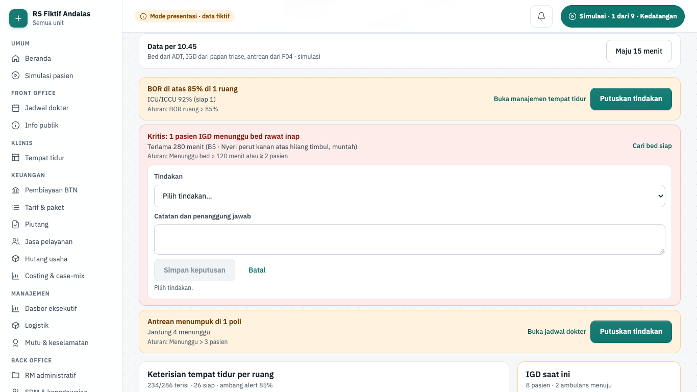

# Fitur kanal dan dasbor

Halaman ini menjelaskan lima layar kanal dan data: Dasbor eksekutif dan Command center untuk direksi, Dataset riset untuk petugas privasi, serta pratinjau aplikasi pasien dan aplikasi dokter. Kedua aplikasi ponsel ditampilkan sebagai pratinjau web di kanvas ponsel 390×844, bukan aplikasi asli. Isinya: apa yang tampil, aturan yang menjaganya, dan di mana kodenya.

> Status 6 Okt 2026: kelima layar hanya berjalan di **mode presentasi** (data dummy fiktif, ADR-0023). Backend fase 9 (dasbor dan aplikasi mobile) belum dibangun; gudang data I11 untuk Dataset riset bahkan tercatat sebagai utang di luar fase 9. Command center dan Dataset riset dibangun agen FE5 dengan pola layar back office (`apps/web/src/components/backoffice/kit.tsx`, lihat [Fitur back office](./16-fitur-back-office.md)); aksinya hanya di keadaan peramban. Aplikasi asli kelak dibuat dengan Expo di `apps/mobile`; pratinjau `/pratinjau/…` tetap khusus mode presentasi (ADR-0023 §8). Di luar mode presentasi rute ini menjawab 404.

## Ringkasan layar

| Layar                       | Rute                         | Peran (mode presentasi)    | Komponen | Status        |
| --------------------------- | ---------------------------- | -------------------------- | -------- | ------------- |
| Dasbor eksekutif            | `/manajemen/dasbor`          | Manajemen                  | I09      | demo · fase 9 |
| Command center              | `/manajemen/command-center`  | Manajemen                  | I09      | demo · fase 9 |
| Dataset riset               | `/manajemen/dataset-riset`   | Petugas privasi, Manajemen | I11      | demo · fase 9 |
| Aplikasi pasien (pratinjau) | `/pratinjau/aplikasi-pasien` | semua posisi               | I07      | demo · fase 9 |
| Aplikasi dokter (pratinjau) | `/pratinjau/aplikasi-dokter` | semua posisi               | I08      | demo · fase 9 |

Dasbor, Command center, dan Dataset riset tampil di kerangka staf (sidebar); dua yang terakhir ada di kelompok menu **Back office**. Dua pratinjau memakai tata letak perangkat: layar penuh tanpa sidebar, kanvas diskalakan agar utuh di layar presentasi (`ScaleToFit`, atribut `data-scale`). Sumber kebenaran: registri `SCREENS` di `apps/web/src/lib/screens.ts`.

## Dasbor eksekutif

| Hal      | Isi                                                                                                                                                                   |
| -------- | --------------------------------------------------------------------------------------------------------------------------------------------------------------------- |
| Rute     | `/manajemen/dasbor` (`?periode=hari-ini`, `bulan`, atau `ytd`)                                                                                                        |
| Pemakai  | manajemen                                                                                                                                                             |
| Komponen | I09 dasbor eksekutif dan command center                                                                                                                               |
| Status   | demo (mode presentasi); backend fase 9 belum dibangun                                                                                                                 |
| Mockup   | `design/mockups/Dasbor.dc.html`                                                                                                                                       |
| Kode web | `apps/web/src/app/(staf)/manajemen/dasbor/` · `apps/web/src/lib/dasbor.ts` · `apps/web/src/lib/server/data/dashboard.ts` · `apps/web/src/lib/demo/fixtures/dasbor.ts` |
| Kode API | belum ada (rencana `modules/executive-dashboard`, `GET /api/v1/executive-dashboard?period=`; `docs/rencana/fase-9-kanal-dasbor-mobile.md`)                            |

**Tujuan.** Direksi melihat kinerja RS dalam satu layar dan langsung tahu apa yang perlu diputuskan.

**Alur.**

1. Buka **Manajemen › Dasbor eksekutif**. Judul "Kinerja rumah sakit · Oktober 2026".
2. Pilih **Rentang**: Hari ini, Bulan berjalan, atau YTD. Pilihan disimpan di URL (`?periode=`), dan judul ikut berubah, mis. "Kinerja rumah sakit · hari ini".
3. Wilayah "Indikator kinerja utama" berisi enam KPI: BOR, ALOS, Kunjungan RJ / hari, Waktu tunggu RJ, Klaim terbayar, dan Kepuasan pasien. Tiap kartu memuat nilai, perubahan (▲/▼ dan pembandingnya), serta sasaran. Contoh: kunjungan RJ 1.148 per hari (bulan berjalan) dan 736 (hari ini).
4. "Pendapatan harian vs anggaran (Rp juta)": grafik 30 hari dengan persen realisasi terhadap anggaran.
5. "Bauran penjamin dan margin": porsi JKN / BPJS, Asuransi swasta, Umum, dan Kerja sama, dengan margin kontribusi bertanda.
6. "Indikator nasional mutu" dan "Kapasitas saat ini" (rawat inap, ICU, IGD, kamar operasi, isolasi).
7. "Perlu keputusan direksi" berisi butir kritis/perhatian, mis. ICU hampir penuh, klaim pending, ALOS pneumonia, stok enoksaparin. Butir bisa punya tautan ke layar terkait (Buka manajemen bed, Lihat klaim pending, Tinjau stok dan PO).
8. Tekan **Tandai ditindaklanjuti** pada butir. Jumlah terbuka berkurang (mis. "4 terbuka" → "3 terbuka") dan butir berlabel "Ditindaklanjuti HH.MM". **Batalkan tanda** membatalkannya.

**Gerbang keselamatan dan aturan bisnis.**

- Warna KPI mengikuti sasaran (hijau di dalam rentang, merah di luar), dan sasaran juga tertulis sebagai teks.
- Angka yang bisa dihitung konsisten: BOR hari ini = kapasitas rawat inap terpakai; judul alert ICU = kapasitas ICU.
- Persen realisasi pendapatan dihitung dari deret (Σ realisasi / Σ anggaran), bukan diketik. Bauran penjamin berjumlah 100%.
- Kapasitas ≥ 90% ditandai merah dan diberi teks "hampir penuh" untuk pembaca layar.
- Grafik SVG tanpa pustaka, dengan tabel tersembunyi untuk pembaca layar.
- Tautan alert hanya muncul bila layar tujuannya sudah ada di registri (bukan `belum`).
- Tanda tindak lanjut di mode presentasi hanya tersimpan di `sessionStorage` browser ini. Versi produksi mencatatnya di log direksi.
- Data dummy divalidasi skema `executiveDashboardSchema`, kontrak yang sama dengan API kelak.

**Rencana backend.** Izin terencana `dashboard.read`. Fase 9 membangun read-model `kpi_daily` dari data operasional (append-only, hari ini dihitung ulang tiap 15 menit), endpoint dasbor, drill-down terbatas yang diaudit, dan aturan alert. Layar memakai polling 60 detik; jalur demo tetap.

## Command center

| Hal      | Isi                                                                                                                                                                                                                                              |
| -------- | ------------------------------------------------------------------------------------------------------------------------------------------------------------------------------------------------------------------------------------------------ |
| Rute     | `/manajemen/command-center`                                                                                                                                                                                                                      |
| Pemakai  | manajemen                                                                                                                                                                                                                                        |
| Komponen | I09 dasbor eksekutif dan command center                                                                                                                                                                                                          |
| Status   | demo (mode presentasi); backend fase 9 belum dibangun                                                                                                                                                                                            |
| Mockup   | tidak ada (gaya mengikuti Dasbor eksekutif dan layar back office FE5)                                                                                                                                                                            |
| Kode web | `apps/web/src/app/(staf)/manajemen/command-center/` · data `apps/web/src/lib/server/data/backoffice.ts` (`getCommandCenter`) · aturan `apps/web/src/lib/command-center.ts` · komponen `apps/web/src/components/command-center/command-board.tsx` |
| Kode API | belum ada (rencana modul `executive-dashboard`, docs/01-arsitektur.md §2)                                                                                                                                                                        |

**Tujuan.** Direksi dan manajer jaga melihat keadaan operasional saat ini (bed, IGD, antrean poli) dan langsung memutuskan tindakan atas alert yang melewati ambang. Dasbor eksekutif menunjukkan tren dan keuangan; command center menunjukkan "sekarang".

**Alur.**

1. Buka **Back office › Command center**. Judul "Command center"; tautan **Dasbor direksi (tren dan keuangan)** di kanan atas.
2. KPI: Tempat tidur terisi, IGD menunggu bed (terlama N menit), Antrean poli, dan Alert keputusan (jumlah kritis).
3. Bar "Data per 10.45" menyebut sumbernya: bed dari ADT, IGD dari papan triase, antrean dari F04 (simulasi).
4. Wilayah "Alert keputusan" berisi alert berbasis aturan. Contoh awal: "BOR di atas 85% di 1 ruang" (ICU/ICCU 92%), "Kritis: 1 pasien IGD menunggu bed rawat inap", dan "Antrean menumpuk di 1 poli". Tiap alert memuat detail, aturan, dan tautan ke layar terkait (**Buka manajemen tempat tidur**, **Cari bed siap**, **Buka jadwal dokter**).
5. Tekan **Putuskan tindakan** pada alert. Pilih **Tindakan** (mis. "Prioritaskan bed siap untuk IGD"), isi **Catatan dan penanggung jawab**, lalu **Simpan keputusan**. Alert berlabel "Ditindaklanjuti 10.45" beserta tindakan dan catatannya. **Batal** menutup isian.
6. Tekan **Maju 15 menit** untuk menjalankan peristiwa simulasi berikutnya: pasien pulang → bed dibersihkan → pasien IGD terlama mendapat bed → ambulans tiba. "Data per" ikut maju (10.45 → 11.00 → …).
7. Setelah tiga kali maju ("Data per 11.30"), alert menunggu bed hilang dan daftar "Peristiwa terbaru" berisi "Pasien IGD terlama mendapat bed rawat inap".
8. Panel lain: "Keterisian tempat tidur per ruang" (terisi, siap, pulang/dibersihkan, BOR), "IGD saat ini" (label bed + keluhan, ambulans menuju), dan "Antrean rawat jalan" per poli.

**Gerbang keselamatan dan aturan bisnis.**

- Aturan alert tetap di kode: BOR ruang > 85% (ruang ≥ 4 bed; kritis bila tidak ada bed siap), pasien IGD menunggu bed > 120 menit atau ≥ 2 pasien (kritis bila > 120 menit), dan antrean poli > 3 pasien. Ambang ini contoh dan berbeda dari Dasbor eksekutif, yang menandai kapasitas ≥ 90% sebagai hampir penuh.
- **Simpan keputusan** nonaktif sampai tindakan dipilih dan catatan minimal 10 huruf ("Pilih tindakan.", "Tulis catatan minimal 10 huruf.").
- Alert kritis diberi awalan teks "Kritis:", tidak hanya warna merah.
- BOR dihitung dari status bed (terisi + rencana pulang ÷ total). Keterisian rawat inap kelas sama dengan Dasbor eksekutif (214/260, dijaga tes).
- IGD hanya menampilkan label bed dan keluhan, tanpa nama pasien.
- Data diambil dari fixture layar asalnya (Tempat tidur, papan IGD, antrean). **Maju 15 menit** deterministik dan hanya mengubah keadaan layar ini; layar Tempat tidur tidak ikut berubah.
- Tautan alert tidak memeriksa posisi: Manajemen yang membuka **Buka manajemen tempat tidur** dapat melihat "Layar ini untuk posisi lain".
- Keputusan hanya tersimpan di keadaan peramban (simulasi, tidak disimpan).

**Rencana backend.** Izin terencana `dashboard.read`. Rencana fase 9 menyiapkan read-model `kpi_daily` dan endpoint `executive-dashboard`; kapasitas real-time lewat SSE tercatat sebagai utang di `docs/rencana/fase-9-kanal-dasbor-mobile.md` §5. Log keputusan direksi dan aturan alert per RS belum dirinci di rencana.

## Dataset riset

| Hal      | Isi                                                                                                                                                                                                                                             |
| -------- | ----------------------------------------------------------------------------------------------------------------------------------------------------------------------------------------------------------------------------------------------- |
| Rute     | `/manajemen/dataset-riset`                                                                                                                                                                                                                      |
| Pemakai  | petugas_privasi, manajemen                                                                                                                                                                                                                      |
| Komponen | I11 data warehouse dan dataset riset                                                                                                                                                                                                            |
| Status   | demo (mode presentasi); backend belum direncanakan (gudang data I11 tercatat sebagai utang fase 9)                                                                                                                                              |
| Mockup   | tidak ada (gaya mengikuti layar back office FE5)                                                                                                                                                                                                |
| Kode web | `apps/web/src/app/(staf)/manajemen/dataset-riset/` · data `apps/web/src/lib/server/data/backoffice.ts` (`getResearchDataset`) · aturan `apps/web/src/lib/dataset-riset.ts` · komponen `apps/web/src/components/dataset-riset/dataset-board.tsx` |
| Kode API | belum ada (rencana modul `warehouse`, docs/01-arsitektur.md §2)                                                                                                                                                                                 |

**Tujuan.** Petugas privasi melepas dataset riset hanya setelah ada persetujuan etik, pengenal langsung dihapus atau disamarkan, kuasi-pengenal lolos uji k-anonimitas, dan rilis disetujui orang selain pemohon. Setiap akses tercatat.

**Alur.**

1. Buka **Back office › Dataset riset**. Judul "Dataset riset ter-de-identifikasi". Permintaan `DSR-2610-003` "Luaran pasien DM tipe 2 dengan hipoglikemia berat, 2024–2026", diajukan dr. Andini Prameswari, kohort 60 pasien. Tahap: Diajukan → Etik → De-identifikasi → Disetujui privasi → Diekstrak.
2. Panel "Persetujuan komite etik": isi **Nomor persetujuan etik** (mis. `KEPK/031/2026`) dan **Berlaku sampai** (TTTT-BB-HH), lalu **Catat persetujuan etik**.
3. Panel "Aturan de-identifikasi per kolom": pilih aturan tiap kolom di "Aturan <kolom>" (Hapus, Pseudonim, Generalisasi, atau Pertahankan). Kolomnya: Nama pasien, Nomor RM, NIK, Nomor telepon (pengenal), Umur, Jenis kelamin, Kecamatan domisili (kuasi-pengenal), serta HbA1c terakhir, Jumlah episode hipoglikemia, dan Terapi insulin (klinis).
4. Bila umur dan kecamatan dipertahankan, **Terapkan de-identifikasi** nonaktif dengan alasan "k-anonimitas N < 5". Ubah Umur menjadi Generalisasi (kelompok 10 tahun) dan hapus Kecamatan domisili, lalu **Terapkan de-identifikasi**.
5. Panel "Persetujuan rilis": pilih **Penyetuju**, lalu **Setujui rilis**.
6. Panel "Ekstrak dataset" (dari replika analitik): tekan **Ekstrak dan kirim tautan**. Panel "Dataset siap" memberi masa berlaku tautan.
7. Tekan **Simulasikan unduhan peneliti**. Daftar "Jejak akses dataset" bertambah "mengunduh dataset (CSV bertanda air)".

**Gerbang keselamatan dan aturan bisnis.**

- Persetujuan etik wajib nomor minimal 6 karakter tanpa spasi dan masa berlaku setelah hari ini.
- Aturan yang boleh per jenis kolom: pengenal langsung hanya Hapus atau Pseudonim; kuasi-pengenal Generalisasi, Pertahankan, atau Hapus; kolom klinis Pertahankan atau Hapus.
- **Terapkan de-identifikasi** nonaktif sampai semua kolom punya aturan, tidak ada pengenal langsung yang bocor, dan k-anonimitas ≥ 5 (ukuran kelompok terkecil dengan kombinasi umur, jenis kelamin, dan wilayah yang sama). Generalisasi wilayah = kota.
- Pemisahan tugas: penyetuju harus berbeda dari pemohon ("Penyetuju harus berbeda dari pemohon dataset."). Pemeriksaan membandingkan nama di pilihan, belum pengguna yang masuk.
- Tautan unduh berlaku 30 hari; CSV bertanda air.
- "Jejak akses" tidak bisa diubah dan ditinjau petugas privasi.
- Kohort adalah data sintetis di fixture; tidak ada data pasien sungguhan.

**Rencana backend.** Izin terencana `dataset.approve`, yang belum ada di katalog izin rencana fase 8 maupun fase 9. Modul `warehouse` (I11: replika analitik per tenant, dataset ter-de-identifikasi) tercatat sebagai utang di `docs/rencana/fase-9-kanal-dasbor-mobile.md` §5, jadi layar ini belum punya fase backend.

## Aplikasi pasien

| Hal      | Isi                                                                                                                                                                                                                                                       |
| -------- | --------------------------------------------------------------------------------------------------------------------------------------------------------------------------------------------------------------------------------------------------------- |
| Rute     | `/pratinjau/aplikasi-pasien`                                                                                                                                                                                                                              |
| Pemakai  | semua posisi (pratinjau)                                                                                                                                                                                                                                  |
| Komponen | I07 aplikasi dan portal pasien                                                                                                                                                                                                                            |
| Status   | demo (mode presentasi); aplikasi Expo dan backend fase 9 belum dibangun                                                                                                                                                                                   |
| Mockup   | `design/mockups/AppPasien.dc.html`                                                                                                                                                                                                                        |
| Kode web | `apps/web/src/app/(perangkat)/pratinjau/aplikasi-pasien/` (akses keluarga di `family-access.tsx`) · `apps/web/src/lib/manajemen-aplikasi.ts` · `apps/web/src/lib/akses-keluarga.ts` · `apps/web/src/components/manajemen/{phone-frame,app-page-view}.tsx` |
| Kode API | belum ada (rencana realm pasien `patient-app` dan `apps/mobile`)                                                                                                                                                                                          |

**Tujuan.** Menunjukkan pengalaman pasien JKN di ponsel: booking, antrean real-time, hasil lab, obat, tagihan, pemantauan gula darah mandiri, dan persetujuan akses keluarga. Pasiennya Tn. Suryo dari skenario rawat jalan.

**Alur.**

1. Buka `/pratinjau/aplikasi-pasien`. Ponsel menampilkan nama RS, sapaan, dan inisial akun.
2. "Antrean aktif" mengikuti kemajuan skenario rawat jalan: kode booking `2610050117` sebelum datang, tiket admisi A-031, lalu antrean poli PD-027 setelah SEP. Kartu menunjukkan nomor yang sedang dilayani, jumlah pasien di depan, dan perkiraan waktu. Tombol **Maju** hanya menyimulasikan antrean bergerak di ponsel ini.
3. Menu delapan ikon: Daftar berobat, Hasil lab, Resume medis, Obat saya, Tagihan, Keluarga, Tanya RS, Data & privasi. Lencana "N baru" atau "N aktif" muncul saat ada isi.
4. "Terbaru untuk Anda" memuat notifikasi dari tugas skenario yang sudah selesai. **Semua** membuka tab Notifikasi.
5. Kartu "Gula darah mandiri": grafik 7 hari dengan pita sasaran dokter. Tekan **Catat hasil hari ini**, isi "Hasil gula darah (mg/dL)", lalu **Simpan**.
6. Navigasi bawah: Beranda, Jadwal, Notifikasi, Profil.
7. Menu **Keluarga** membuka wilayah "Akses keluarga". Kartu "Permintaan akses baru" menyebut pemohon (Bayu Nugroho, anak). Centang "Data yang boleh dilihat" (Jadwal dan posisi antrean, Tagihan dan pembayaran, Hasil laboratorium, Resume medis dan obat), pilih **Berlaku** (30 hari, 6 bulan, atau Sampai saya cabut), lalu centang pernyataan persetujuan.
8. Tekan **Setujui akses** (atau **Tolak**). Status "Akses Bayu Nugroho aktif … sampai …" muncul, dan daftar "Keluarga dengan akses" menampilkan lingkup serta masa berlakunya.
9. Tekan **Cabut akses** pada anggota keluarga (contoh Ny. Ratih Nugroho). Status "Akses Ny. Ratih Nugroho dicabut …; sesi aplikasinya berakhir." **‹ Kembali** kembali ke beranda.

Isi mengikuti milestone skenario: hasil lab baru tampil setelah validasi dokter patologi klinik (sebelumnya "Belum ada hasil yang dirilis untuk Anda."), obat tampil setelah serah terima farmasi, dan jadwal kontrol tampil setelah pasca kunjungan.

**Gerbang keselamatan dan aturan bisnis.**

- Angka gula darah harus dalam jangkauan alat 20–600 mg/dL; di luar itu ditolak dengan pesan.
- Nilai di bawah sasaran memicu peringatan "Gula darah rendah." berisi saran tindakan, karena pasien punya riwayat hipoglikemia berat. Nilai rendah tidak pernah berlabel "di atas sasaran".
- Status gula darah ditulis sebagai teks (di bawah / dalam / di atas sasaran), tidak hanya warna titik grafik. Batas sasaran inklusif.
- Hasil lab tidak tampil sebelum divalidasi. Aplikasi tidak mendahului rekam medis.
- Catatan gula darah hanya di ponsel ini (simulasi, tidak disimpan).
- **Setujui akses** nonaktif dengan alasan tertulis sampai minimal satu jenis data dipilih, masa berlaku dipilih, dan pernyataan dicentang (`grantBlock`).
- Data minimal (UU PDP): data kesehatan (hasil laboratorium, resume medis dan obat) hanya bila dipilih eksplisit. Bila dipilih, label "data kesehatan" tampil dan pernyataan berbunyi "termasuk data kesehatan saya".
- Masa berlaku dihitung dari hari ini; "Sampai saya cabut" tidak punya tanggal akhir. Akses bisa dicabut kapan saja, dan setiap akses tercatat (teks pernyataan).
- Persetujuan dan pencabutan hanya di ponsel ini. Lingkup yang dipilih belum membatasi apa pun karena belum ada realm keluarga (simulasi, tidak disimpan).

**Rencana backend.** Izin terencana `preview.read` (khusus pratinjau). Fase 9 membangun satu aplikasi Expo dua mode di `apps/mobile`, dengan realm pasien terpisah dari staf (login OTP, izin `self.read`, `self.booking`, `self.pay`, `self.observation.write`, `self.privacy`), notifikasi push tanpa PHI, antrean lewat SSE, dan pembayaran lewat TPDI. Tautan keluarga (§9.2a) disimpan di `patient_account_links` dengan lingkup, masa berlaku, dan `consent_id` ke `privacy_consents` jenis `family_access`; ABAC membatasi akses ke diri sendiri atau tautan keluarga sesuai lingkup.

## Aplikasi dokter

| Hal      | Isi                                                                                                  |
| -------- | ---------------------------------------------------------------------------------------------------- |
| Rute     | `/pratinjau/aplikasi-dokter`                                                                         |
| Pemakai  | semua posisi (pratinjau)                                                                             |
| Komponen | I08 aplikasi dokter dan perawat                                                                      |
| Status   | demo (mode presentasi); aplikasi Expo dan backend fase 9 belum dibangun                              |
| Mockup   | `design/mockups/AppDokter.dc.html`                                                                   |
| Kode web | `apps/web/src/app/(perangkat)/pratinjau/aplikasi-dokter/` · `apps/web/src/lib/manajemen-aplikasi.ts` |
| Kode API | belum ada (rencana `clinician-app`, `/api/v1/clinician/inbox`)                                       |

**Tujuan.** Menunjukkan pengalaman dokter jaga di ponsel: menerima nilai kritis dengan read-back, memantau pasien berisiko lewat skor EWS, dan menandatangani CPPT residen.

**Alur.**

1. Buka `/pratinjau/aplikasi-dokter`. Kepala ponsel menampilkan nama dokter jaga dan judul tab.
2. Kartu "Nilai kritis" mengikuti skenario IGD → rawat inap (Tn. Hartono). Sebelum hasil keluar, kartu hanya menyebut status order (belum ada order atau sedang diproses), tanpa nilai.
3. Setelah hasil keluar, kartu menampilkan "Nilai kritis · Kalium 6,8 mmol/L", pasien, RM, lokasi, dan pelapor dari laboratorium.
4. Ketik nilai yang dibacakan ulang di isian "Nilai kalium yang dibacakan ulang (mmol/L)", lalu tekan **Read-back benar**. Kartu berubah menjadi status "read-back tercatat".
5. **Lihat EKG** membuka detail pasien. Di bawah kartu ada ringkasan tugas: Co-sign residen, Order perlu verifikasi, dan Query koder.
6. Tab **Pasien** berisi "Pasien saya" dengan skor EWS (tinggi, sedang, rendah) dan hari rawat. Pilih pasien untuk detail; **Daftar pasien** untuk kembali.
7. Kartu "Co-sign CPPT residen · N menunggu": baca SOAP residen, lalu **Setujui (TTE)** atau **Beri catatan** → isi "Catatan untuk residen" → **Kirim catatan**.
8. Navigasi bawah: Pasien, Tugas, Jadwal, Profil.

**Gerbang keselamatan dan aturan bisnis.**

- **Read-back benar** aktif hanya bila nilai yang diketik sama dengan laporan lab. Selama laporan telepon belum masuk, isian terkunci dengan alasan tertulis.
- Bila tugas skenario `readback` sedang giliran, tombol menjalankan tugas itu di mesin skenario. Tanpa skenario berjalan, penerimaan hanya berlaku di layar ini.
- Aplikasi tidak mendahului cerita IGD: pasien, EKG, nilai, dan hiperkalemia baru muncul setelah langkah skenario terkait selesai.
- Catatan co-sign minimal 5 karakter. CPPT tetap menunggu tanda tangan sampai disetujui.
- Tanda tangan dan catatan di pratinjau tidak disimpan (simulasi).

**Rencana backend.** Izin terencana `preview.read` (khusus pratinjau). Fase 9 membangun mode klinisi di aplikasi Expo: pasien saya, nilai kritis + read-back, co-sign TTE, dan order cepat dengan CDS, dari agregat `/api/v1/clinician/inbox` yang memakai izin dan ABAC modul sumber.

## Tes yang menjaga layar ini

| Tes                                                                           | Yang dijaga                                                                                                                                                                                                       |
| ----------------------------------------------------------------------------- | ----------------------------------------------------------------------------------------------------------------------------------------------------------------------------------------------------------------- |
| `apps/web/e2e/demo/dasbor.spec.ts`                                            | KPI per rentang dan URL `?periode=`, tanda tindak lanjut, tanpa scroll horizontal, posisi lain tidak melihat menu dan mendapat penjelasan                                                                         |
| `apps/web/e2e/demo/manajemen.spec.ts` (pratinjau)                             | Kanvas berskala, antrean `2610050117`, catat gula darah 65 → peringatan rendah, hasil lab belum dirilis, read-back kalium 6,8                                                                                     |
| `apps/web/src/lib/dasbor.test.ts`                                             | Kontrak tiap rentang, BOR = kapasitas, realisasi dihitung, bauran 100%, format KPI                                                                                                                                |
| `apps/web/src/lib/manajemen-aplikasi.test.ts`                                 | Aplikasi pasien mengikuti skenario rawat jalan; aplikasi dokter mengikuti nilai kritis per milestone                                                                                                              |
| `apps/web/src/app/(perangkat)/pratinjau/aplikasi-dokter/doctor-pages.test.ts` | Nilai kritis mengikuti urutan order → hasil → read-back                                                                                                                                                           |
| `apps/web/src/lib/manajemen.test.ts`                                          | Pita gula darah inklusif; nilai rendah tidak pernah "di atas sasaran"                                                                                                                                             |
| `apps/web/e2e/demo/fe5-backoffice.spec.ts` (I09, I11, I07)                    | Command center: alert kritis diputus beralasan, maju waktu memindahkan pasien IGD ke bed; Dataset riset: etik, k-anonimitas, penyetuju ≠ pemohon, ekstrak dan jejak; akses keluarga dengan lingkup dan pencabutan |
| `apps/web/src/lib/command-center.test.ts`                                     | Keterisian rawat inap kelas = Dasbor (214/260); alert awal; maju 15 menit dan peristiwa berputar                                                                                                                  |
| `apps/web/src/lib/dataset-riset.test.ts`                                      | Pengenal langsung hanya hapus/pseudonim; k-anonimitas ≥ 5; etik berlaku; penyetuju ≠ pemohon                                                                                                                      |
| `apps/web/src/lib/akses-keluarga.test.ts`                                     | Butuh lingkup, masa berlaku, dan pernyataan; data kesehatan disebut eksplisit; masa berlaku dari hari ini                                                                                                         |
| `apps/web/src/lib/backoffice-registry.test.ts`                                | Command center dan Dataset riset terdaftar berstatus demo dan punya menu                                                                                                                                          |

## Lihat juga

- [Fitur back office](./16-fitur-back-office.md), indikator mutu yang sama dengan dasbor dan pola layar back office (`kit.tsx`)
- [Fitur klinis: Tempat tidur](./12-fitur-klinis.md#tempat-tidur), sumber keterisian bed di Command center
- [Peta alur semua fase](./20-peta-alur-semua-fase.md)
- [Fitur klinis](./12-fitur-klinis.md) dan [Fitur penunjang](./13-fitur-penunjang.md), sumber nilai kritis, CPPT, dan hasil lab
- [Fitur front office](./11-fitur-front-office.md), sumber booking dan antrean
- [Simulasi dan operasional](./18-simulasi-dan-operasional.md)
- [Cara kode bekerja: mode presentasi dan data dummy](./02-cara-kerja-kode.md#mode-presentasi-dan-data-dummy-adr-0023)
- [Peta kode](./19-peta-kode.md)
- Dokumen desain: `docs/rencana/fase-9-kanal-dasbor-mobile.md`, `docs/adr/0023-mode-presentasi-ui-dulu-dengan-data-dummy.md`
