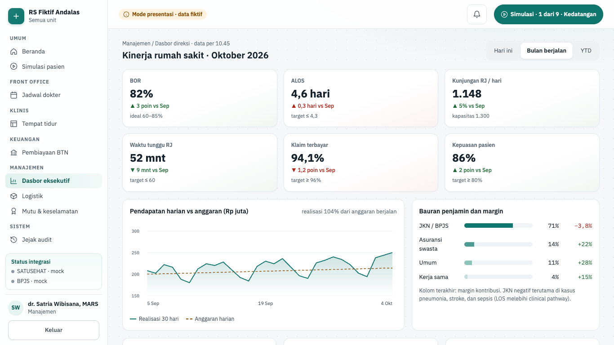
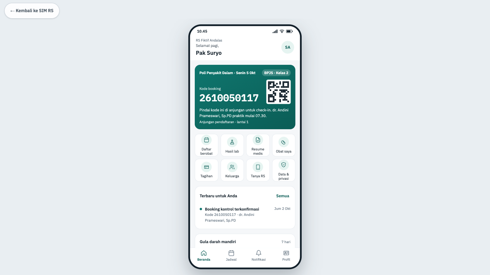
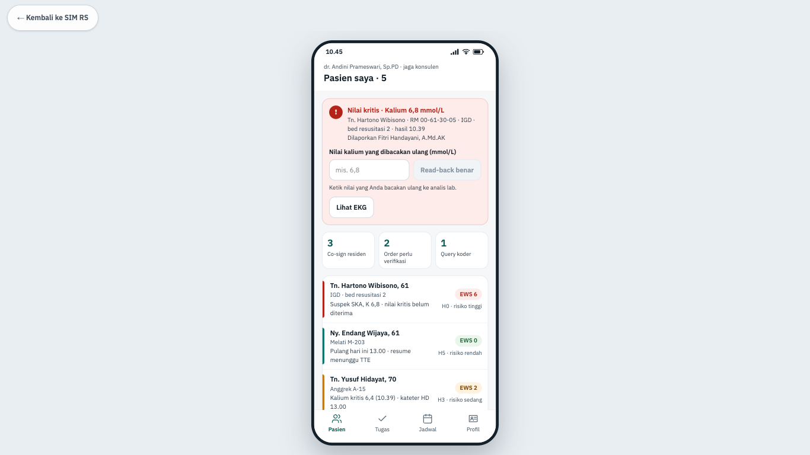

# Fitur kanal dan dasbor

Halaman ini menjelaskan tiga layar kanal: Dasbor eksekutif untuk direksi, serta pratinjau aplikasi pasien dan aplikasi dokter. Kedua aplikasi ponsel ditampilkan sebagai pratinjau web di kanvas ponsel 390×844, bukan aplikasi asli. Isinya: apa yang tampil, aturan yang menjaganya, dan di mana kodenya.

> Status 6 Okt 2026: ketiga layar hanya berjalan di **mode presentasi** (data dummy fiktif, ADR-0023). Backend fase 9 (dasbor dan aplikasi mobile) belum dibangun. Aplikasi asli kelak dibuat dengan Expo di `apps/mobile`; pratinjau `/pratinjau/…` tetap khusus mode presentasi (ADR-0023 §8). Di luar mode presentasi rute ini menjawab 404.

## Ringkasan layar

| Layar                       | Rute                         | Peran (mode presentasi) | Komponen | Status        |
| --------------------------- | ---------------------------- | ----------------------- | -------- | ------------- |
| Dasbor eksekutif            | `/manajemen/dasbor`          | Manajemen               | I09      | demo · fase 9 |
| Aplikasi pasien (pratinjau) | `/pratinjau/aplikasi-pasien` | semua posisi            | I07      | demo · fase 9 |
| Aplikasi dokter (pratinjau) | `/pratinjau/aplikasi-dokter` | semua posisi            | I08      | demo · fase 9 |

Dasbor tampil di kerangka staf (sidebar). Dua pratinjau memakai tata letak perangkat: layar penuh tanpa sidebar, kanvas diskalakan agar utuh di layar presentasi (`ScaleToFit`, atribut `data-scale`). Sumber kebenaran: registri `SCREENS` di `apps/web/src/lib/screens.ts`.

## Dasbor eksekutif

| Hal      | Isi                                                                                                                                                                   |
| -------- | --------------------------------------------------------------------------------------------------------------------------------------------------------------------- |
| Rute     | `/manajemen/dasbor` (`?periode=hari-ini`, `bulan`, atau `ytd`)                                                                                                        |
| Pemakai  | manajemen                                                                                                                                                             |
| Komponen | I09 dasbor eksekutif dan command center                                                                                                                               |
| Status   | demo (mode presentasi); backend fase 9 belum dibangun                                                                                                                 |
| Mockup   | `design/mockups/Dasbor.dc.html`                                                                                                                                       |
| Kode web | `apps/web/src/app/(staf)/manajemen/dasbor/` · `apps/web/src/lib/dasbor.ts` · `apps/web/src/lib/server/data/dashboard.ts` · `apps/web/src/lib/demo/fixtures/dasbor.ts` |
| Kode API | belum ada (rencana `modules/executive-dashboard`, `GET /api/v1/executive-dashboard?period=`; `docs/rencana/fase-9-kanal-dasbor-mobile.md`)                            |

**Tujuan.** Direksi melihat kinerja RS dalam satu layar dan langsung tahu apa yang perlu diputuskan.

**Alur.**

1. Buka **Manajemen › Dasbor eksekutif**. Judul "Kinerja rumah sakit · Oktober 2026".
2. Pilih **Rentang**: Hari ini, Bulan berjalan, atau YTD. Pilihan disimpan di URL (`?periode=`), dan judul ikut berubah, mis. "Kinerja rumah sakit · hari ini".
3. Wilayah "Indikator kinerja utama" berisi enam KPI: BOR, ALOS, Kunjungan RJ / hari, Waktu tunggu RJ, Klaim terbayar, dan Kepuasan pasien. Tiap kartu memuat nilai, perubahan (▲/▼ dan pembandingnya), serta sasaran. Contoh: kunjungan RJ 1.148 per hari (bulan berjalan) dan 736 (hari ini).
4. "Pendapatan harian vs anggaran (Rp juta)": grafik 30 hari dengan persen realisasi terhadap anggaran.
5. "Bauran penjamin dan margin": porsi JKN / BPJS, Asuransi swasta, Umum, dan Kerja sama, dengan margin kontribusi bertanda.
6. "Indikator nasional mutu" dan "Kapasitas saat ini" (rawat inap, ICU, IGD, kamar operasi, isolasi).
7. "Perlu keputusan direksi" berisi butir kritis/perhatian, mis. ICU hampir penuh, klaim pending, ALOS pneumonia, stok enoksaparin. Butir bisa punya tautan ke layar terkait (Buka manajemen bed, Lihat klaim pending, Tinjau stok dan PO).
8. Tekan **Tandai ditindaklanjuti** pada butir. Jumlah terbuka berkurang (mis. "4 terbuka" → "3 terbuka") dan butir berlabel "Ditindaklanjuti HH.MM". **Batalkan tanda** membatalkannya.

**Gerbang keselamatan dan aturan bisnis.**

- Warna KPI mengikuti sasaran (hijau di dalam rentang, merah di luar), dan sasaran juga tertulis sebagai teks.
- Angka yang bisa dihitung konsisten: BOR hari ini = kapasitas rawat inap terpakai; judul alert ICU = kapasitas ICU.
- Persen realisasi pendapatan dihitung dari deret (Σ realisasi / Σ anggaran), bukan diketik. Bauran penjamin berjumlah 100%.
- Kapasitas ≥ 90% ditandai merah dan diberi teks "hampir penuh" untuk pembaca layar.
- Grafik SVG tanpa pustaka, dengan tabel tersembunyi untuk pembaca layar.
- Tautan alert hanya muncul bila layar tujuannya sudah ada di registri (bukan `belum`).
- Tanda tindak lanjut di mode presentasi hanya tersimpan di `sessionStorage` browser ini. Versi produksi mencatatnya di log direksi.
- Data dummy divalidasi skema `executiveDashboardSchema`, kontrak yang sama dengan API kelak.

**Rencana backend.** Izin terencana `dashboard.read`. Fase 9 membangun read-model `kpi_daily` dari data operasional (append-only, hari ini dihitung ulang tiap 15 menit), endpoint dasbor, drill-down terbatas yang diaudit, dan aturan alert. Layar memakai polling 60 detik; jalur demo tetap.

## Aplikasi pasien

| Hal      | Isi                                                                                                                                                                        |
| -------- | -------------------------------------------------------------------------------------------------------------------------------------------------------------------------- |
| Rute     | `/pratinjau/aplikasi-pasien`                                                                                                                                               |
| Pemakai  | semua posisi (pratinjau)                                                                                                                                                   |
| Komponen | I07 aplikasi dan portal pasien                                                                                                                                             |
| Status   | demo (mode presentasi); aplikasi Expo dan backend fase 9 belum dibangun                                                                                                    |
| Mockup   | `design/mockups/AppPasien.dc.html`                                                                                                                                         |
| Kode web | `apps/web/src/app/(perangkat)/pratinjau/aplikasi-pasien/` · `apps/web/src/lib/manajemen-aplikasi.ts` · `apps/web/src/components/manajemen/{phone-frame,app-page-view}.tsx` |
| Kode API | belum ada (rencana realm pasien `patient-app` dan `apps/mobile`)                                                                                                           |

**Tujuan.** Menunjukkan pengalaman pasien JKN di ponsel: booking, antrean real-time, hasil lab, obat, tagihan, dan pemantauan gula darah mandiri. Pasiennya Tn. Suryo dari skenario rawat jalan.

**Alur.**

1. Buka `/pratinjau/aplikasi-pasien`. Ponsel menampilkan nama RS, sapaan, dan inisial akun.
2. "Antrean aktif" mengikuti kemajuan skenario rawat jalan: kode booking `2610050117` sebelum datang, tiket admisi A-031, lalu antrean poli PD-027 setelah SEP. Kartu menunjukkan nomor yang sedang dilayani, jumlah pasien di depan, dan perkiraan waktu. Tombol **Maju** hanya menyimulasikan antrean bergerak di ponsel ini.
3. Menu delapan ikon: Daftar berobat, Hasil lab, Resume medis, Obat saya, Tagihan, Keluarga, Tanya RS, Data & privasi. Lencana "N baru" atau "N aktif" muncul saat ada isi.
4. "Terbaru untuk Anda" memuat notifikasi dari tugas skenario yang sudah selesai. **Semua** membuka tab Notifikasi.
5. Kartu "Gula darah mandiri": grafik 7 hari dengan pita sasaran dokter. Tekan **Catat hasil hari ini**, isi "Hasil gula darah (mg/dL)", lalu **Simpan**.
6. Navigasi bawah: Beranda, Jadwal, Notifikasi, Profil.

Isi mengikuti milestone skenario: hasil lab baru tampil setelah validasi dokter patologi klinik (sebelumnya "Belum ada hasil yang dirilis untuk Anda."), obat tampil setelah serah terima farmasi, dan jadwal kontrol tampil setelah pasca kunjungan.

**Gerbang keselamatan dan aturan bisnis.**

- Angka gula darah harus dalam jangkauan alat 20–600 mg/dL; di luar itu ditolak dengan pesan.
- Nilai di bawah sasaran memicu peringatan "Gula darah rendah." berisi saran tindakan, karena pasien punya riwayat hipoglikemia berat. Nilai rendah tidak pernah berlabel "di atas sasaran".
- Status gula darah ditulis sebagai teks (di bawah / dalam / di atas sasaran), tidak hanya warna titik grafik. Batas sasaran inklusif.
- Hasil lab tidak tampil sebelum divalidasi. Aplikasi tidak mendahului rekam medis.
- Catatan gula darah hanya di ponsel ini (simulasi, tidak disimpan).

**Rencana backend.** Izin terencana `preview.read` (khusus pratinjau). Fase 9 membangun satu aplikasi Expo dua mode di `apps/mobile`, dengan realm pasien terpisah dari staf (login OTP, izin `self.read`, `self.booking`, `self.pay`, `self.observation.write`, `self.privacy`), notifikasi push tanpa PHI, antrean lewat SSE, dan pembayaran lewat TPDI.

## Aplikasi dokter

| Hal      | Isi                                                                                                  |
| -------- | ---------------------------------------------------------------------------------------------------- |
| Rute     | `/pratinjau/aplikasi-dokter`                                                                         |
| Pemakai  | semua posisi (pratinjau)                                                                             |
| Komponen | I08 aplikasi dokter dan perawat                                                                      |
| Status   | demo (mode presentasi); aplikasi Expo dan backend fase 9 belum dibangun                              |
| Mockup   | `design/mockups/AppDokter.dc.html`                                                                   |
| Kode web | `apps/web/src/app/(perangkat)/pratinjau/aplikasi-dokter/` · `apps/web/src/lib/manajemen-aplikasi.ts` |
| Kode API | belum ada (rencana `clinician-app`, `/api/v1/clinician/inbox`)                                       |

**Tujuan.** Menunjukkan pengalaman dokter jaga di ponsel: menerima nilai kritis dengan read-back, memantau pasien berisiko lewat skor EWS, dan menandatangani CPPT residen.

**Alur.**

1. Buka `/pratinjau/aplikasi-dokter`. Kepala ponsel menampilkan nama dokter jaga dan judul tab.
2. Kartu "Nilai kritis" mengikuti skenario IGD → rawat inap (Tn. Hartono). Sebelum hasil keluar, kartu hanya menyebut status order (belum ada order atau sedang diproses), tanpa nilai.
3. Setelah hasil keluar, kartu menampilkan "Nilai kritis · Kalium 6,8 mmol/L", pasien, RM, lokasi, dan pelapor dari laboratorium.
4. Ketik nilai yang dibacakan ulang di isian "Nilai kalium yang dibacakan ulang (mmol/L)", lalu tekan **Read-back benar**. Kartu berubah menjadi status "read-back tercatat".
5. **Lihat EKG** membuka detail pasien. Di bawah kartu ada ringkasan tugas: Co-sign residen, Order perlu verifikasi, dan Query koder.
6. Tab **Pasien** berisi "Pasien saya" dengan skor EWS (tinggi, sedang, rendah) dan hari rawat. Pilih pasien untuk detail; **Daftar pasien** untuk kembali.
7. Kartu "Co-sign CPPT residen · N menunggu": baca SOAP residen, lalu **Setujui (TTE)** atau **Beri catatan** → isi "Catatan untuk residen" → **Kirim catatan**.
8. Navigasi bawah: Pasien, Tugas, Jadwal, Profil.

**Gerbang keselamatan dan aturan bisnis.**

- **Read-back benar** aktif hanya bila nilai yang diketik sama dengan laporan lab. Selama laporan telepon belum masuk, isian terkunci dengan alasan tertulis.
- Bila tugas skenario `readback` sedang giliran, tombol menjalankan tugas itu di mesin skenario. Tanpa skenario berjalan, penerimaan hanya berlaku di layar ini.
- Aplikasi tidak mendahului cerita IGD: pasien, EKG, nilai, dan hiperkalemia baru muncul setelah langkah skenario terkait selesai.
- Catatan co-sign minimal 5 karakter. CPPT tetap menunggu tanda tangan sampai disetujui.
- Tanda tangan dan catatan di pratinjau tidak disimpan (simulasi).

**Rencana backend.** Izin terencana `preview.read` (khusus pratinjau). Fase 9 membangun mode klinisi di aplikasi Expo: pasien saya, nilai kritis + read-back, co-sign TTE, dan order cepat dengan CDS, dari agregat `/api/v1/clinician/inbox` yang memakai izin dan ABAC modul sumber.

## Tes yang menjaga layar ini

| Tes                                                                           | Yang dijaga                                                                                                                               |
| ----------------------------------------------------------------------------- | ----------------------------------------------------------------------------------------------------------------------------------------- |
| `apps/web/e2e/demo/dasbor.spec.ts`                                            | KPI per rentang dan URL `?periode=`, tanda tindak lanjut, tanpa scroll horizontal, posisi lain tidak melihat menu dan mendapat penjelasan |
| `apps/web/e2e/demo/manajemen.spec.ts` (pratinjau)                             | Kanvas berskala, antrean `2610050117`, catat gula darah 65 → peringatan rendah, hasil lab belum dirilis, read-back kalium 6,8             |
| `apps/web/src/lib/dasbor.test.ts`                                             | Kontrak tiap rentang, BOR = kapasitas, realisasi dihitung, bauran 100%, format KPI                                                        |
| `apps/web/src/lib/manajemen-aplikasi.test.ts`                                 | Aplikasi pasien mengikuti skenario rawat jalan; aplikasi dokter mengikuti nilai kritis per milestone                                      |
| `apps/web/src/app/(perangkat)/pratinjau/aplikasi-dokter/doctor-pages.test.ts` | Nilai kritis mengikuti urutan order → hasil → read-back                                                                                   |
| `apps/web/src/lib/manajemen.test.ts`                                          | Pita gula darah inklusif; nilai rendah tidak pernah "di atas sasaran"                                                                     |

## Lihat juga

- [Fitur back office](./16-fitur-back-office.md), indikator mutu yang sama dengan dasbor
- [Fitur klinis](./12-fitur-klinis.md) dan [Fitur penunjang](./13-fitur-penunjang.md), sumber nilai kritis, CPPT, dan hasil lab
- [Fitur front office](./11-fitur-front-office.md), sumber booking dan antrean
- [Simulasi dan operasional](./18-simulasi-dan-operasional.md)
- [Cara kode bekerja: mode presentasi dan data dummy](./02-cara-kerja-kode.md#mode-presentasi-dan-data-dummy-adr-0023)
- [Peta kode](./19-peta-kode.md)
- Dokumen desain: `docs/rencana/fase-9-kanal-dasbor-mobile.md`, `docs/adr/0023-mode-presentasi-ui-dulu-dengan-data-dummy.md`
