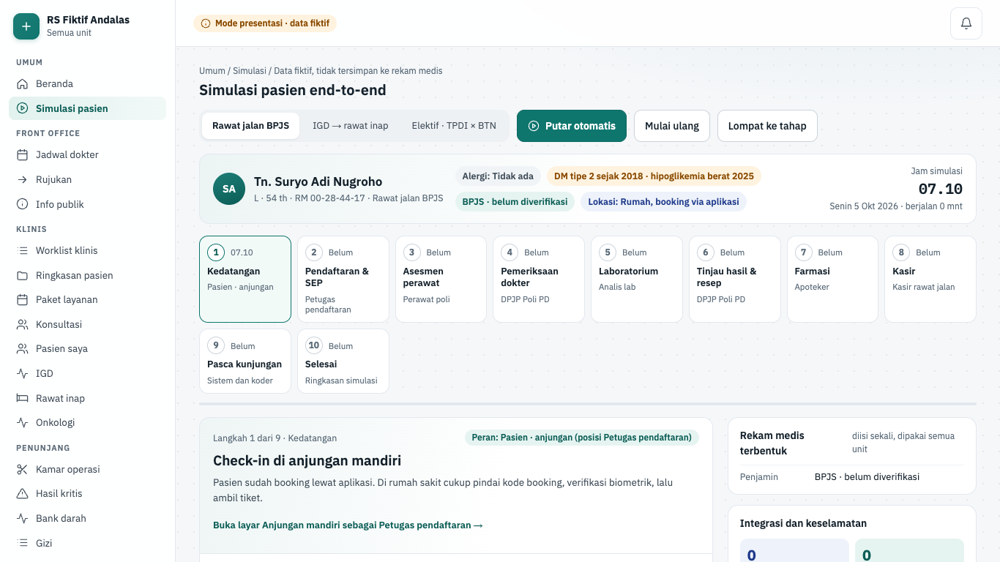
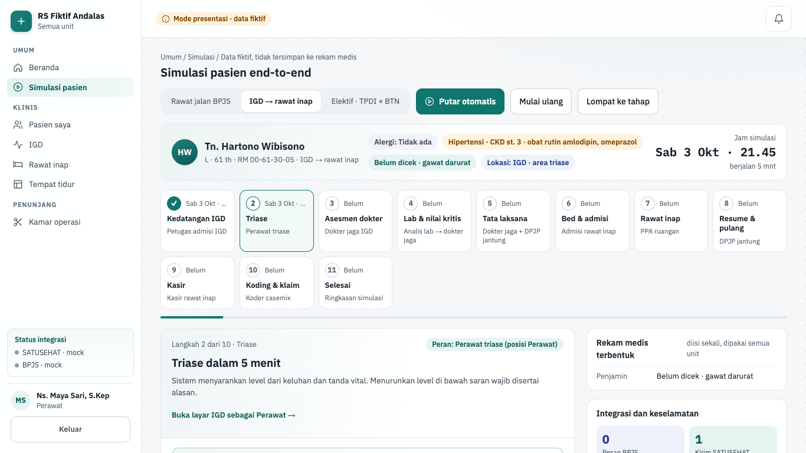
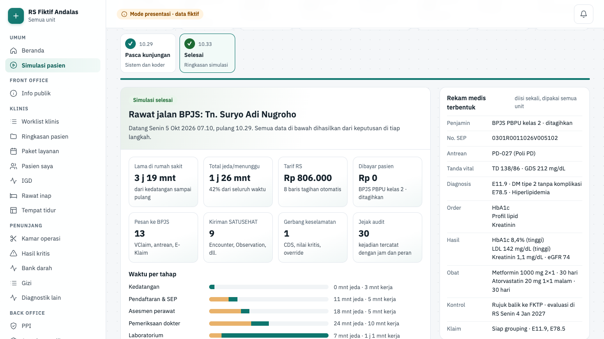
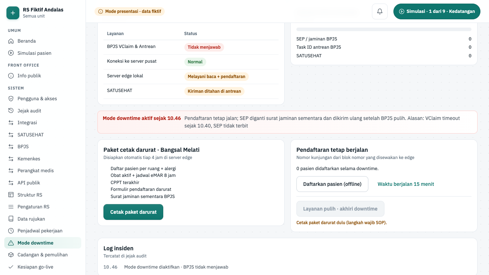
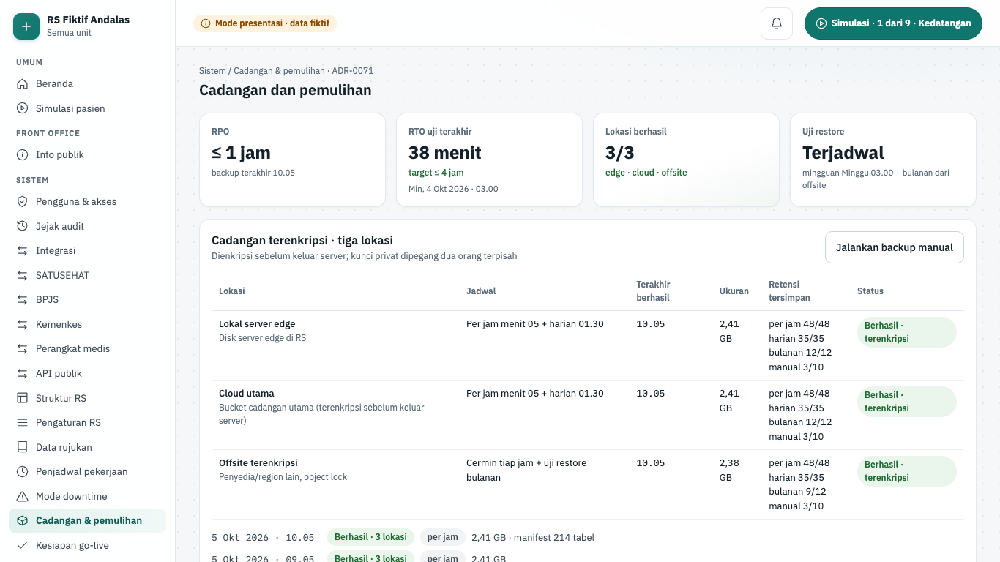
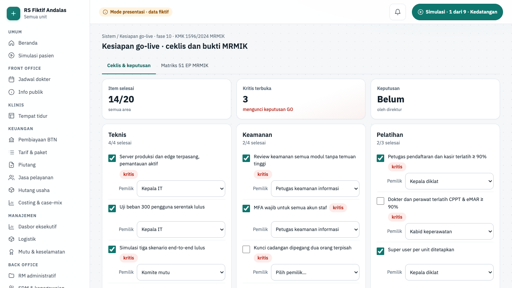
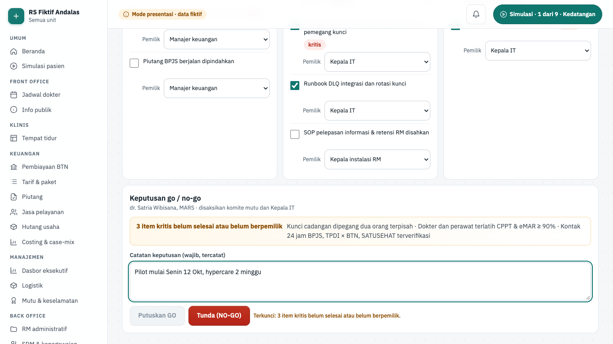

# Simulasi dan operasional

Halaman ini menjelaskan **mode presentasi** (layar dengan data dummy fiktif), layar **Simulasi pasien** yang menjalankan tiga skenario dari kedatangan sampai klaim, cara menyiapkan presentasi, dan **alat tangkap layar** yang membuat gambar di panduan ini.

> Status 6 Okt 2026: semua layar fase 2–10 terbuka di mode presentasi. Mode ini hanya hidup di mesin lokal (`APP_ENV=local` + `DATA_SOURCE=demo`, ADR-0023). Di staging dan produksi layar demo tidak ada (404). Tiga layar operasional fase 10 (Mode downtime, Cadangan & pemulihan, Kesiapan go-live) juga berstatus `demo`; backend downtime dan go-live belum dibangun, sedangkan backup sungguhan berjalan sebagai skrip host ops ([Backup dan restore](./04-backup-restore.md)).

## Ringkasan layar

| Layar                         | Rute               | Peran (mode presentasi)             | Komponen        | Status |
| ----------------------------- | ------------------ | ----------------------------------- | --------------- | ------ |
| Simulasi pasien               | `/simulasi`        | semua posisi                        | semua (fase 10) | demo   |
| Masuk cepat · mode presentasi | `/masuk`           | 16 akun presentasi                  | P02             | demo   |
| Ganti posisi                  | `/akun/posisi`     | semua                               | P03             | api    |
| Mode downtime                 | `/sistem/downtime` | admin_tenant                        | P13             | demo   |
| Cadangan & pemulihan          | `/sistem/cadangan` | admin_tenant                        | — (ADR-0071)    | demo   |
| Kesiapan go-live              | `/sistem/go-live`  | manajemen, admin_tenant, petugas_rm | — (fase 10)     | demo   |

## Mode presentasi

Mode presentasi dibuat agar klien dan direksi bisa melihat **seluruh alur RS** sebelum backend fase 4–9 selesai. Aturannya:

1. Layar dibangun di **rute finalnya**, dengan data dummy fiktif (`apps/web/src/lib/demo/fixtures/`). Saat backend jadi, layar yang sama berpindah ke data API (lihat [Peta kode](./19-peta-kode.md#web-satu-layar-dua-sumber-data)).
2. Header selalu menampilkan lencana **"Mode presentasi · data fiktif"**.
3. Setiap layar punya posisi pemakai (`demoRoles` di `apps/web/src/lib/screens.ts`). Posisi lain tidak melihat menunya; bila membuka rutenya, tampil ajakan **Ganti posisi**.
4. Aksi di layar demo (simpan, validasi, kirim) hanya mengubah tampilan dan keadaan simulasi, dan ditandai "(simulasi, tidak disimpan)". Server Action demo menolak berjalan di luar mode ini (`assertDemo()`).
5. Jam demo tetap: **Sen, 5 Okt 2026 · 10.45** (skenario IGD memakai jamnya sendiri). Tempat setiap pasien fiktif pada jam itu diatur satu kali di `apps/web/src/lib/demo/fixtures/pasien.ts`.

### Menjalankan

| Perintah                               | Kapan                                                                             |
| -------------------------------------- | --------------------------------------------------------------------------------- |
| `pnpm with-pg pnpm db:akun-presentasi` | Sekali (atau bila kredensial perlu diganti): 16 akun per posisi + Superadmin demo |
| `pnpm demo`                            | Presentasi: build produksi lalu jalankan semua layanan (tanpa jeda kompilasi)     |
| `pnpm demo --tanpa-build`              | Sama, memakai build terakhir                                                      |
| `pnpm dev:demo`                        | Latihan atau pengembangan layar demo (mode dev, ada jeda kompilasi)               |
| `pnpm demo:cek`                        | Daftar periksa sebelum tampil; semua butir harus ✓                                |

Naskah presentasi (versi direksi ±20 menit dan versi tim RS ±45 menit) ada di `docs/presentasi/naskah.md`.

### Akun presentasi

Di layar `/masuk` mode presentasi muncul kartu **"Masuk cepat · mode presentasi"**, dikelompokkan per bagian (front office, klinis, penunjang, keuangan dan rekam medis, manajemen dan sistem). Satu klik menjalankan login biasa (sandi + kode verifikasi) di server dengan kredensial lokal `.local/demo-accounts.json`. Kredensial tidak pernah dikirim ke browser.

Semua akun presentasi satu RS **berbagi satu keadaan simulasi**, jadi presenter bisa berganti posisi di tengah skenario tanpa kehilangan langkah. Akun uji E2E memakai berkas dan folder keadaan sendiri (`DEMO_ACCOUNTS_FILE`, `DEMO_STATE_DIR`).

### Superadmin demo · semua layar

Untuk menunjukkan semua fitur dengan satu akun (ADR-0023 keputusan 10):

1. Jalankan `pnpm with-pg pnpm db:akun-presentasi` (akun `presentasi.superadmin-demo` ikut dibuat), lalu `pnpm demo` atau `pnpm dev:demo`.
2. Buka `/masuk`, pilih **Superadmin demo · semua layar** (paling atas di "Masuk cepat").
3. Sidebar memuat semua layar presentasi: front office, klinis (termasuk CPPT, asesmen, diagnosis, CPOE, resume), penunjang, keuangan, manajemen, back office, **Perangkat & pratinjau** (anjungan, tablet persetujuan, aplikasi pasien/dokter), sistem, dan **Panduan**. Layar berparameter dibuka lewat halaman indeksnya yang berisi contoh pasien.
4. Di header ada kontrol **Bertindak sebagai**. Layar yang dipakai beberapa posisi (mis. Rawat inap: dokter, residen, perawat, bidan) menampilkan pilihan; bawaannya pemakai pertama layar. Pilihan ini menentukan tombol yang tersedia, misalnya co-sign dan TTE hanya saat bertindak sebagai Dokter (DPJP). Gerbang keselamatan tetap sama: override tetap wajib alasan.

Batasnya: tanda "semua layar" hanya berlaku di mode presentasi. Di mode api, staging, dan produksi akun ini hanya akun berperan **Manajemen** (hanya-baca): menunya sama dengan akun manajemen biasa, layar data dummy dan panduan 404. API tidak diberi peran atau izin baru.

## Simulasi pasien



| Hal      | Isi                                                                                                                                                 |
| -------- | --------------------------------------------------------------------------------------------------------------------------------------------------- |
| Rute     | `/simulasi`                                                                                                                                         |
| Pemakai  | semua posisi (`demoRoles: 'semua'`)                                                                                                                 |
| Komponen | semua lapisan (fase 10, uji end-to-end)                                                                                                             |
| Status   | demo (mode presentasi)                                                                                                                              |
| Mockup   | `design/mockups/Simulasi.dc.html`                                                                                                                   |
| Kode web | `apps/web/src/app/(staf)/simulasi/` · `apps/web/src/lib/demo/engine/` · `apps/web/src/lib/demo/skenario/` · `apps/web/src/lib/server/demo/store.ts` |
| Kode API | tidak ada (keadaan simulasi disimpan web, hanya urutan aksi)                                                                                        |

**Tujuan.** Menunjukkan perjalanan satu pasien melewati semua layar dalam satu cerita, lengkap dengan rekam medis yang terbentuk, pesan ke BPJS/SATUSEHAT, tagihan berjalan, dan jejak sistem.

**Tiga skenario.**

| Skenario             | Pasien fiktif         | Tahap                                                                                                                                                   |
| -------------------- | --------------------- | ------------------------------------------------------------------------------------------------------------------------------------------------------- |
| Rawat jalan BPJS     | Tn. Suryo Adi Nugroho | check-in anjungan → SEP → asesmen perawat → pemeriksaan + order → lab → resep + CDS → farmasi → tagihan → setelah pulang (9 tahap)                      |
| IGD → rawat inap     | Tn. Hartono Wibisono  | datang nyeri dada → triase → EKG + order set → nilai kritis → tata laksana → tempat tidur + SEP ranap → perawatan → resume → tagihan → klaim (10 tahap) |
| Elektif · TPDI × BTN | Ny. Ratna Sari        | admisi elektif → deposit lewat BTN → laparoskopi → pasca operasi → resume → pelunasan → rekonsiliasi 3 arah → klaim → pembiayaan piutang (9 tahap)      |



**Alur.**

1. Pilih tab skenario. Kartu pasien, lini tahap, dan jam simulasi tampil.
2. Kerjakan tugas berurutan: **aksi** (tombol), **pilihan** (mis. pengenalan wajah atau sidik jari), atau **isian** (mis. tekanan darah). Tugas berikutnya terkunci sampai tugas sebelumnya selesai.
3. Setiap tugas memajukan jam simulasi dan menambah baris di rekam medis, integrasi (task ID BPJS, SATUSEHAT), tagihan, dan jejak sistem.
4. Panel panduan (pil hijau di kanan bawah, juga di layar lain) menunjukkan langkah aktif dan bisa membuka layar posisi yang tepat dengan berganti akun.
5. **Lompat ke tahap** mengerjakan tugas sebelumnya dengan pilihan bawaan; **Putar otomatis** menjalankan skenario sendiri; **Mulai ulang** mengosongkan skenario.
6. Di tahap terakhir, **Selesaikan simulasi** menampilkan ringkasan: lama layanan, waktu tunggu per tahap, dan total tarif tertangkap otomatis.



**Gerbang keselamatan dan aturan bisnis.**

- Gerbang merah di tugas skenario sama dengan di layar asli: CDS resep (riwayat hipoglikemia berat pada sulfonilurea), triase di bawah saran sistem wajib alasan minimal 10 karakter, nilai kritis wajib read-back.
- Isian divalidasi server (mis. format tekanan darah sistolik/diastolik); isian bebas dibatasi 120 karakter (`MAX_INPUT_LENGTH`).
- Aksi dari tab yang sudah basi ditolak (nomor revisi keadaan), sehingga dua perangkat tidak saling menimpa.
- Mesin skenario murni: keadaan = urutan aksi yang diputar ulang dari awal (`runScenario`), jadi tampilan selalu sama untuk urutan yang sama. Definisi skenario berversi (`SCENARIO_DEF_VERSION`); keadaan lama dengan versi lain dimulai ulang.

**Mode api.** Tidak ada. `/simulasi` hanya untuk lingkungan non-produksi (docs/08 §4). Rencana fase 10 menambah simulasi end-to-end lewat API (`docs/rencana/fase-10-simulasi-ketahanan-pilot.md`).

## Mode downtime


| Hal      | Isi                                                                                                                                                                                                                                                               |
| -------- | ----------------------------------------------------------------------------------------------------------------------------------------------------------------------------------------------------------------------------------------------------------------- |
| Rute     | `/sistem/downtime`                                                                                                                                                                                                                                                |
| Pemakai  | admin_tenant                                                                                                                                                                                                                                                      |
| Komponen | P13 Edge sync dan mode downtime                                                                                                                                                                                                                                   |
| Status   | demo (mode presentasi); backend fase 10 (potongan 10.5a, 10.5b, 10.6) belum dibangun                                                                                                                                                                              |
| Mockup   | tidak ada (gaya mengikuti `design/mockups/Fondasi.dc.html` dan docs/08)                                                                                                                                                                                           |
| Kode web | `apps/web/src/app/(staf)/sistem/downtime/` · data `apps/web/src/lib/server/data/platform.ts` (fixture `lib/demo/fixtures/operasional.ts`) · aturan `apps/web/src/lib/operasional-downtime.ts` · komponen `apps/web/src/components/operasional/downtime-board.tsx` |
| Kode API | belum ada (rencana `GET /system/status`, sinkron `/api/v1/sync/{changes,ack}`; ADR-0070, ADR-0075)                                                                                                                                                                |

**Tujuan.** Latihan dan pencatatan gangguan: RS menyatakan downtime dengan alasan, mencetak paket darurat, tetap mendaftarkan pasien di server edge, memasukkan formulir kertas sebagai entri susulan setelah pulih, lalu mengosongkan antrean kirim sampai ringkasan insiden (MRMIK 13.1c).

**Alur.**

1. Buka menu **SISTEM → Mode downtime**. Lini **Tahap downtime**: Normal → Downtime aktif → Pulih · entri susulan → Sinkronisasi → Selesai. Tabel **Status layanan** menulis keadaan BPJS, koneksi ke server pusat, server edge lokal, dan SATUSEHAT.
2. Di panel **Aktifkan mode downtime**, pilih **Penyebab** (**BPJS tidak menjawab** atau **Jaringan ke server pusat putus**). Isi **Alasan dan dampak (tercatat di log insiden)**.
3. **Aktifkan mode downtime** → dialog "Aktifkan mode downtime?" → **Ya, aktifkan**. Alert "Mode downtime aktif sejak HH.MM" memuat alasan dan dampaknya ke pendaftaran.
4. Panel **Paket cetak darurat · Bangsal Melati** ("Disiapkan otomatis tiap 4 jam di server edge"): **Cetak paket darurat**. Lembar contoh bertanda "DICETAK HH.MM OLEH <NAMA> · RAHASIA · tercatat audit".
5. Panel **Pendaftaran tetap berjalan**: **Daftarkan pasien (offline)** (maks. 3 contoh) dan **Waktu berjalan 15 menit**. Panel **Antrean kirim tertunda** menghitung SEP, Task ID antrean BPJS, dan SATUSEHAT yang menunggu.
6. **Layanan pulih · akhiri downtime** → dialog "Nyatakan layanan pulih?" → **Ya, layanan pulih**.
7. Panel **Entri susulan dari formulir kertas**: periksa **Alasan entri susulan (berlaku untuk semua baris)** (terisi bawaan), lalu tekan **Masukkan** di tiap baris (pendaftaran darurat, eMAR kertas, tanda vital, CPPT kertas). Baris yang masuk bertanda **Entri susulan** dengan waktu klinis aslinya.
8. **Mulai sinkronisasi antrean** → **Kirim batch berikutnya (sisa N)** berulang sampai antrean kosong.
9. Panel **Ringkasan insiden**: "Downtime selesai · antrean kirim kosong" dengan lama gangguan, lama pemulihan, jumlah pesan tersinkron, dan "data hilang 0 (RPO 0)". **Mulai latihan baru** mengulang.
10. **Log insiden** mencatat setiap langkah (aktif, cetak, pendaftaran offline, pulih, entri susulan, batch).



**Gerbang keselamatan dan aturan bisnis.**

- Aktivasi wajib alasan dan dampak minimal 10 huruf ("Tulis alasan dan dampak minimal 10 huruf.").
- Layanan tidak bisa dinyatakan pulih sebelum paket darurat dicetak: "Cetak paket darurat dulu (langkah wajib SOP).". Paket hanya dicetak sekali per downtime.
- Paket darurat memuat daftar pasien per ruang + alergi, obat aktif + jadwal eMAR 8 jam, CPPT terakhir, formulir pendaftaran darurat, dan surat jaminan sementara BPJS.
- Entri susulan hanya setelah pulih, sekali per formulir, dengan alasan minimal 10 huruf, dan membawa waktu klinis asli dari kertas.
- Sinkronisasi terkunci sampai semua formulir kertas dimasukkan ("N formulir kertas belum dimasukkan.").
- Antrean kirim dikirim per batch 12 pesan (`SYNC_BATCH`), berurutan, dengan kunci idempoten.
- Jam layar adalah jam simulasi (menit sejak latihan dimulai), sehingga lama gangguan dan pemulihan terbaca wajar saat presentasi.

**Rencana backend.** Izin rencana `system.downtime.manage` (belum ada di `PERMISSION_CATALOG`; namanya sama dengan rencana fase 10 §10.6). Rencana backend:

- status sistem `GET /system/status` + banner web, dan guard baca-saja yang menolak tulis dengan `503 SYSTEM_READ_ONLY`;
- entri susulan bertanda `back_entry` + `downtime_incident_id`, muncul di laporan entri terlambat B09;
- halaman cetak darurat `(staf)/darurat/cetak` dengan izin `print.emergency` (juga belum di katalog), paket disiapkan job P11 tiap 4 jam di edge;
- sinkron edge ↔ cloud lewat `sync_changes` dan `/api/v1/sync/{changes,ack}` (ADR-0070), blok nomor RM/kunjungan yang disewa edge.

Rincian rencana: `docs/rencana/fase-10-simulasi-ketahanan-pilot.md` §10.5a–10.6.

## Cadangan & pemulihan



| Hal      | Isi                                                                                                                                                                                                                                                             |
| -------- | --------------------------------------------------------------------------------------------------------------------------------------------------------------------------------------------------------------------------------------------------------------- |
| Rute     | `/sistem/cadangan`                                                                                                                                                                                                                                              |
| Pemakai  | admin_tenant                                                                                                                                                                                                                                                    |
| Komponen | — (lintas platform; ADR-0071, MRMIK 5)                                                                                                                                                                                                                          |
| Status   | demo (mode presentasi); skrip backup dan uji restore host ops sudah ada (fase 10 potongan 10.7), layar belum disambungkan                                                                                                                                       |
| Mockup   | tidak ada (gaya mengikuti `design/mockups/Fondasi.dc.html` dan docs/08)                                                                                                                                                                                         |
| Kode web | `apps/web/src/app/(staf)/sistem/cadangan/` · data `apps/web/src/lib/server/data/platform.ts` (fixture `lib/demo/fixtures/operasional.ts`) · aturan `apps/web/src/lib/operasional-backup.ts` · komponen `apps/web/src/components/operasional/cadangan-board.tsx` |
| Kode API | belum ada untuk layar ini · skrip `infra/backup/` (`pnpm backup:jalankan`, `pnpm backup:uji-restore`), tabel `backup_runs` dan `restore_tests`, fungsi `app_backup_status()`                                                                                    |

**Tujuan.** Menunjukkan kepada RS bahwa data dicadangkan terenkripsi di tiga lokasi dan bisa dipulihkan: status tiap lokasi, retensi, riwayat backup, dan uji restore bertahap dengan RTO terukur. Cara menjalankan sungguhan ada di [Backup dan restore](./04-backup-restore.md).

**Alur.**

1. Buka menu **SISTEM → Cadangan & pemulihan**. Baca KPI **Ringkasan cadangan**: **RPO** (≤ 1 jam), **RTO uji terakhir** (target ≤ 4 jam), **Lokasi berhasil** (3/3), dan **Uji restore** (Terjadwal atau Terlambat).
2. Tabel **Lokasi cadangan**: Lokal server edge, Cloud utama, Offsite terenkripsi, dengan jadwal, waktu terakhir berhasil, ukuran, retensi tersimpan, dan status.
3. **Jalankan backup manual** → dialog "Jalankan backup manual sekarang?" → isi **Alasan backup manual** → **Ya, jalankan backup**.
4. Chip "Backup manual berjalan sejak HH.MM", lalu stempel "Backup manual selesai · HH.MM · tersimpan di 3 lokasi, manifest berisi hash + jumlah baris". **Riwayat backup** mendapat baris "Manual: <alasan>".
5. Panel **Uji restore ke database bersih**. Untuk menguji gagal aman, centang **Simulasikan kunci privat yang salah**.
6. **Mulai uji restore**, lalu **Jalankan langkah N** satu per satu: ambil backup → periksa manifest → cocokkan kunci privat → dekripsi → pulihkan ke database bersih → cek versi skema → cocokkan jumlah baris → layanan siap + verifikasi rantai audit.
7. Kunci salah: berhenti di langkah kunci dengan alert **Uji restore gagal (gagal aman)** ("… Berhenti sebelum ada plaintext, kontainer, atau berkas yang ditimpa."). **Ulang uji** mengosongkan uji.
8. Uji lulus: tabel **Jumlah baris manifest dan hasil pulih** (mis. jejak audit 1.284.551 baris) dan alert **Uji restore lulus** dengan RTO terukur (36 menit pada contoh). **Log uji restore** mencatat tiap langkah.

**Gerbang keselamatan dan aturan bisnis.**

- Lokasi dianggap terlambat bila salinan berhasil terakhir lebih tua dari 2 jam (`BACKUP_STALE_HOURS`, sama dengan layar Integrasi). Uji restore terlambat bila lebih dari 8 hari (`RESTORE_TEST_STALE_DAYS`).
- Retensi per lokasi: 48 per jam, 35 harian, 12 bulanan, 10 manual. Salinan manual tidak pernah melebihi 10; yang tertua dibuang.
- Backup manual wajib alasan minimal 10 huruf.
- Uji restore berurutan dan berhenti di galat pertama. Kunci privat salah gagal sebelum ada plaintext.
- RTO terukur = jumlah menit langkah yang lolos; target 240 menit (`RTO_TARGET_MINUTES`).
- Panel lokasi menegaskan "Dienkripsi sebelum keluar server; kunci privat dipegang dua orang terpisah". Host backup hanya memegang kunci publik.

**Rencana backend.** Izin rencana `backup.read` (belum ada di `PERMISSION_CATALOG`). Backup dan uji restore sungguhan sudah berjalan sebagai skrip host ops (cron), bukan tombol web: hasilnya di `backup_runs` dan `restore_tests` (tenant PLATFORM), dan ringkasannya untuk RS lewat `app_backup_status()` di layar Integrasi. Bedanya dengan demo:

- Uji restore runbook punya 14 langkah, demo meringkasnya jadi 8 ([6. Uji restore](./04-backup-restore.md#6-uji-restore)).
- Tombol backup manual dari web belum direncanakan. Host aplikasi tidak memegang kunci privat, jadi uji restore dari web tidak mungkin tanpa keputusan baru (ADR).

Rincian: [Backup dan restore](./04-backup-restore.md), [5. Retensi](./04-backup-restore.md#5-retensi), [9. Pemantauan dan bukti](./04-backup-restore.md#9-pemantauan-dan-bukti).

## Kesiapan go-live



| Hal      | Isi                                                                                                                                                                                                                                         |
| -------- | ------------------------------------------------------------------------------------------------------------------------------------------------------------------------------------------------------------------------------------------- |
| Rute     | `/sistem/go-live`                                                                                                                                                                                                                           |
| Pemakai  | manajemen, admin_tenant, petugas_rm                                                                                                                                                                                                         |
| Komponen | — (fase 10; bukti 51 EP MRMIK, KMK 1596/2024)                                                                                                                                                                                               |
| Status   | demo (mode presentasi); dokumen go-live fase 10 potongan 10.10 belum dibuat                                                                                                                                                                 |
| Mockup   | tidak ada (gaya mengikuti `design/mockups/Fondasi.dc.html` dan docs/08)                                                                                                                                                                     |
| Kode web | `apps/web/src/app/(staf)/sistem/go-live/` · data `apps/web/src/lib/server/data/platform.ts` (fixture `lib/demo/fixtures/golive.ts`) · aturan `apps/web/src/lib/golive.ts` · komponen `apps/web/src/components/operasional/golive-board.tsx` |
| Kode API | belum ada (rencana dokumen `docs/go-live/*` dan `docs/MRMIK-MATRIX.md`, fase 10 §10.10)                                                                                                                                                     |

**Tujuan.** Direksi memutuskan GO atau NO-GO pilot berdasarkan ceklis runbook berpemilik, dan melihat matriks 51 elemen penilaian (EP) MRMIK beserta buktinya di sistem.

**Alur.**

1. Buka menu **SISTEM → Kesiapan go-live**. Tab **Ceklis & keputusan**: KPI **Item selesai**, **Kritis terbuka**, dan **Keputusan**.
2. Ceklis per area: Teknis, Keamanan, Pelatihan, Data migrasi, Runbook & SOP, Kontak darurat. Tiap item punya kotak centang selesai dan pilihan **Pemilik: <item>**.
3. Panel **Keputusan go / no-go** (direktur, disaksikan komite mutu dan Kepala IT) menampilkan alert "N item kritis belum selesai atau belum berpemilik" beserta daftarnya.
4. Isi **Catatan keputusan (wajib, tercatat)**. **Putuskan GO** tetap terkunci: "Terkunci: 3 item kritis belum selesai atau belum berpemilik.".
5. Centang item kritis yang terbuka (mis. **Kunci cadangan dipegang dua orang terpisah**, **Dokter dan perawat terlatih CPPT & eMAR ≥ 90%**, **Kontak 24 jam BPJS, TPDI × BTN, SATUSEHAT terverifikasi**) dan pilih pemiliknya. Alert berubah "Semua item kritis selesai dan berpemilik".
6. **Putuskan GO** → dialog "Putuskan GO go-live?" → **Ya, putuskan GO**. Alert "Keputusan GO · HH.MM" memuat catatan dan nama direktur. **Tunda (NO-GO)** mencatat penundaan; **Buka kembali keputusan** membatalkan tampilan keputusan.
7. Tab **Matriks 51 EP MRMIK**: **Ringkasan MRMIK** "21 kunci · 16 pendukung · 14 tata kelola" dan KPI **EP sistem terpenuhi**, **EP kunci terbuka**, **Belum ada bukti**.
8. Saring dengan **Saring klasifikasi** (Kunci, Pendukung, Tata kelola) dan **Saring status** (Terpenuhi, Sebagian, Belum, Ranah RS). Contoh: Kunci + Belum menyisakan MRMIK 10b (hak akses pelepasan informasi RM).



**Gerbang keselamatan dan aturan bisnis.**

- GO terkunci sampai semua item kritis **selesai dan berpemilik**. Item selesai tanpa pemilik tetap dihitung terbuka.
- Catatan keputusan minimal 10 huruf, untuk GO maupun NO-GO. NO-GO tidak menunggu item kritis.
- Status dan bukti EP di matriks adalah **isi demo untuk presentasi**, bukan hasil audit `/cek-mrmik`. EP tata kelola selalu "Ranah RS" dengan templat dokumen.
- EP dikelompokkan dari nomornya: manajemen informasi (1–2), dokumen dan penyebaran data (3–4), rekam medis elektronik (5–12), SIMRS dan downtime (13).

**Rencana backend.** Izin rencana `golive.read` (belum ada di `PERMISSION_CATALOG`). Rencana fase 10 §10.10 berupa dokumen, bukan modul: runbook, `docs/MRMIK-MATRIX.md` berformat `/cek-mrmik`, rencana pilot, DPIA, dan NFR. Belum ada rencana penyimpanan keputusan GO/NO-GO maupun pembatasan siapa yang boleh memutuskan: di demo semua posisi pemakai (termasuk petugas_rm) bisa menekan **Putuskan GO**.

## Tangkap layar dokumentasi

Semua gambar `.png` di `docs/panduan/gambar/` dibuat otomatis oleh Playwright, bukan disunting tangan. Diagram `diagram-*.svg` ditulis tangan (teks dan warna mengikuti token Klinis Bersih, terbaca di tema terang dan gelap).

### Menjalankan ulang

```bash
pnpm docs:gambar                                   # semua layar (mode presentasi + mode api)
pnpm docs:gambar -- --project=docs                 # mode presentasi saja
pnpm docs:gambar -- --project=docs-api             # layar tersambung API saja
pnpm docs:gambar -- --project=docs --grep kasir    # sebagian layar
pnpm with-pg pnpm docs:gambar                      # tanpa Docker (Postgres portabel)
```

Di salinan repo (git worktree) pakai slot E2E sendiri, misalnya:

```bash
E2E_API_PORT=4080 E2E_WEB_PORT=3080 E2E_DEMO_PORT=3081 E2E_MOCK_PORT=4180 E2E_TMP_NAME=simrs-demo-e2e-docs \
  pnpm docs:gambar
```

Perintah ini menyalakan stack E2E sendiri (mock, API, worker, build web mode api + mode presentasi) di database tes, persis seperti `pnpm --filter @simrs/web test:e2e`. Selesai menangkap, skrip mencetak jumlah gambar, total ukuran, dan gambar di atas 300 KB. Periksa `git diff --stat docs/panduan/gambar` sebelum commit.

### Cara kerjanya

| Berkas                                        | Isi                                                                                                      |
| --------------------------------------------- | -------------------------------------------------------------------------------------------------------- |
| `scripts/docs-gambar.mjs`                     | Skrip root: `DOCS_CAPTURE=1` + proyek Playwright `docs` dan `docs-api`, lalu ringkasan ukuran            |
| `apps/web/e2e/docs/capture.ts`                | `openAs` (akun uji baru per peran, nama persona fiktif), `shoot` (1366×768, animasi mati), `watchErrors` |
| `apps/web/e2e/docs/tangkap-layar.spec.ts`     | Mode presentasi: satu gambar per layar `demo` di `SCREENS` + langkah kunci alur                          |
| `apps/web/e2e/docs/tangkap-layar-api.spec.ts` | Mode api: masuk, akses, audit, MPI, formulir, notifikasi, PIN, kendali antrean, panduan                  |
| `apps/web/playwright.config.ts`               | Proyek `docs` (server mode presentasi) dan `docs-api` (server mode api), viewport 1366×768               |

Aturan:

- Tanpa `DOCS_CAPTURE=1` spesifikasi di `e2e/docs/` dilewati, dan proyek E2E lain mengabaikan folder itu. `pnpm test:e2e` biasa tidak menimpa gambar.
- **Layar baru di registri tertangkap otomatis** sebagai `<id>.png` dengan posisi pemakai pertama di `demoRoles` ('semua' → dokter). Rute contoh untuk layar tanpa indeks bermakna ada di `MAIN_PATH`.
- Langkah kunci (gerbang CDS, read-back nilai kritis, gelang eMAR, time out kamar operasi, item manual kasir, SEP, tiket anjungan, DLQ, simulasi) ditulis sebagai tes terpisah bernama `<id>--<langkah>.png`. Satu langkah yang gagal tidak menghentikan tangkapan lain.
- Setiap tangkapan memeriksa status HTTP 200, tanpa galat JavaScript, dan tanpa ajakan "ganti posisi". Gambar dari layar rusak tidak tersimpan diam-diam.
- Nama berkas hanya huruf kecil, angka, dan `-` (pola sama dengan penyaji panduan). Ukuran sasaran ≤ 300 KB per gambar; tes unit menolak PNG > 400 KB.

### Menambah gambar ke panduan

1. Tambahkan tes langkah di `tangkap-layar.spec.ts` (atau biarkan otomatis untuk layar baru), lalu jalankan `pnpm docs:gambar -- --grep <nama>`.
2. Rujuk di Markdown dengan path relatif: ``. Path ini terbaca di GitHub maupun di `/superadmin/panduan`.
3. Teks alt **wajib** dan deskriptif (apa yang terlihat). Gambar tanpa alt, gambar luar, atau path di luar `gambar/` tidak dirender; yang tampil hanya keterangan penolakan.
4. `pnpm --filter @simrs/web test` memeriksa setiap gambar yang dirujuk ada, ber-alt, dan setiap SVG bebas skrip serta punya `<title>` dan gaya mode gelap.

### Cara gambar disajikan di web

- Penyaji Markdown (`apps/web/src/components/markdown.tsx`) mengubah `./gambar/<nama>` menjadi rute `/superadmin/panduan/gambar/<nama>` (`rewriteGuideImageSrc` di `apps/web/src/lib/guide.ts`). HTML mentah di Markdown tetap tidak dirender.
- Rute `apps/web/src/app/(staf)/superadmin/panduan/gambar/[file]/route.ts` memakai gerbang yang sama dengan halaman panduan (hanya operator platform; selain itu 404), mencocokkan nama dengan pola ketat sebelum menyentuh disk (tanpa path traversal, tanpa symlink), dan mengirim `Content-Type` yang benar, `X-Content-Type-Options: nosniff`, serta CSP `sandbox` tanpa skrip.
- SVG selalu dipakai sebagai ``, tidak disisipkan inline, sehingga skrip di dalamnya tidak pernah jalan. Gambar dimuat dari origin sendiri, patuh CSP `img-src 'self'`.

## QA visual sebelum presentasi

`QA_VISUAL=1 pnpm --filter @simrs/web test:e2e` menyimpan tangkapan semua layar demo di 1366×768, 1920×1080, dan ukuran tablet ke `.local/qa-visual/` (tidak masuk repo), ditambah layar fase 2 mode api (`e2e/qa-visual-fase2.spec.ts`). Berbeda dengan `pnpm docs:gambar`, tangkapan ini halaman penuh untuk tinjauan tata letak, bukan untuk dokumentasi.

## Tes yang menjaga layar ini

- `apps/web/e2e/demo/simulasi.spec.ts`: tugas berurutan, jam berjalan, lompat ke akhir, ringkasan; gerbang triase IGD; panel panduan di layar lain.
- `apps/web/e2e/demo/akun-presentasi.spec.ts`: masuk cepat per posisi, panduan berganti akun, keadaan simulasi bersama.
- `apps/web/e2e/demo/semua-layar.spec.ts`: jaring pengaman semua layar demo (tanpa galat, tanpa scroll horizontal).
- `apps/web/e2e/demo/superadmin-demo.spec.ts`: Superadmin demo membuka setiap layar registri dari satu sidebar, "Bertindak sebagai", dan panduan; `apps/web/e2e/superadmin-demo-api.spec.ts`: di mode api akun yang sama tanpa kuasa tambahan. Unit: `apps/web/src/lib/server/demo/all-access.test.ts`, `screens.test.ts`, `nav.test.ts`, `packages/db/test/presentation.test.ts`.
- `apps/web/e2e/demo/fe1-platform.spec.ts`: Mode downtime (aktif beralasan, cetak paket wajib, entri susulan, sinkron sampai nol), Cadangan (backup manual beralasan, uji restore gagal aman lalu lulus), Kesiapan go-live (GO terkunci, keputusan tercatat, matriks tersaring).
- `apps/web/src/lib/operasional-downtime.test.ts`, `apps/web/src/lib/operasional-backup.test.ts`, `apps/web/src/lib/golive.test.ts`: aturan murni tiga layar operasional.
- `apps/web/src/lib/demo/engine/run.test.ts`, `apps/web/src/lib/demo/skenario/skenario.test.ts`, `apps/web/src/lib/server/demo/store.test.ts`.
- `apps/web/src/lib/guide.test.ts`, `apps/web/src/components/markdown.test.tsx`, `apps/web/e2e/panduan.spec.ts`: penyajian panduan dan gambar.

## Lihat juga

- [Peta kode](./19-peta-kode.md): struktur demo vs api dan pola menambah layar.
- [Fitur front office](./11-fitur-front-office.md), [Fitur klinis](./12-fitur-klinis.md), [Fitur keuangan](./14-fitur-keuangan.md): layar yang dilewati skenario.
- [Cara kode bekerja](./02-cara-kerja-kode.md#mode-presentasi-dan-data-dummy-adr-0023): mekanisme mode presentasi.
- [Backup dan restore](./04-backup-restore.md): runbook backup tiga lokasi dan uji restore di balik layar Cadangan & pemulihan.
- [Fitur platform](./10-fitur-platform.md): Penjadwal pekerjaan (P11) dan layar platform mode presentasi lain.
- [Peta alur semua fase](./20-peta-alur-semua-fase.md)
- `docs/adr/0023-mode-presentasi-ui-dulu-dengan-data-dummy.md`, `docs/presentasi/naskah.md`.
