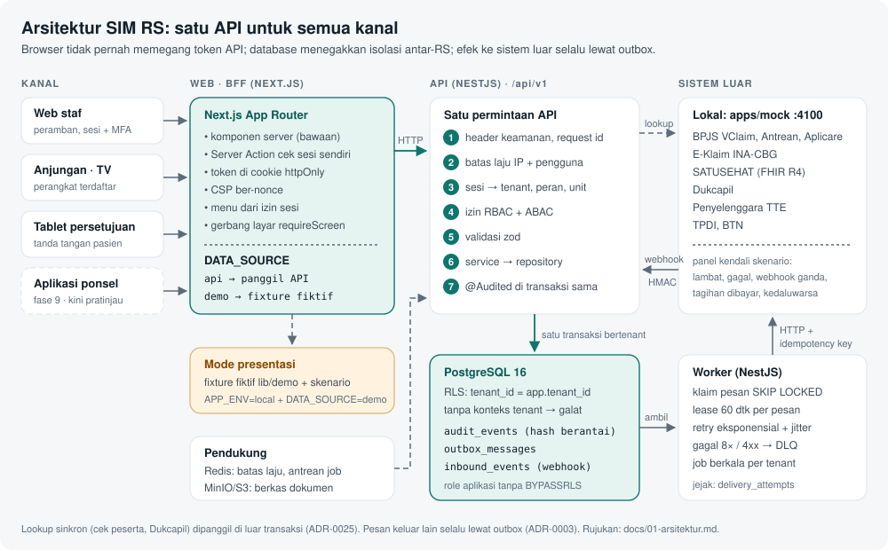
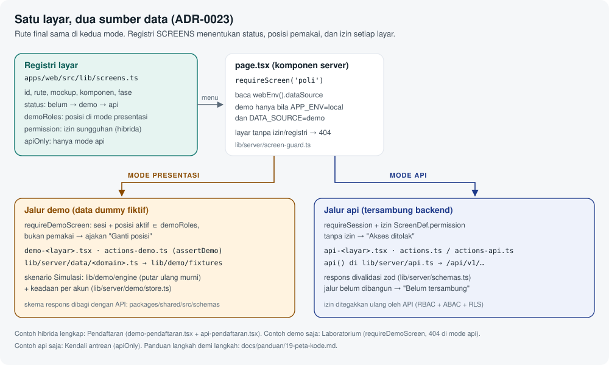
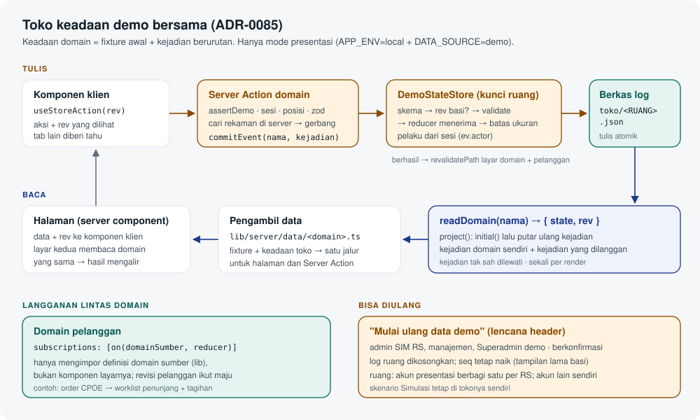
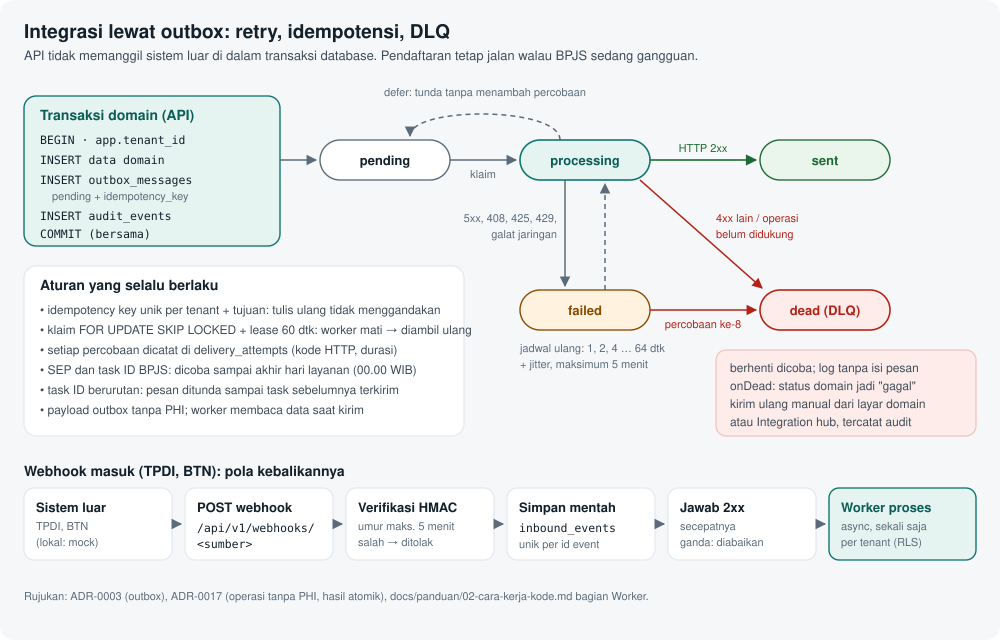

# Peta kode

Halaman ini memetakan **di mana kode tiap fitur berada** dan **seberapa matang** tiap bagian. Bacalah setelah [Cara kerja backend](./07-cara-kerja-backend.md) (gambaran lintas modul) dan [Cara kode bekerja](./02-cara-kerja-kode.md), yang menjelaskan mekanismenya (permintaan API, RLS, outbox, sesi web). Penjelasan per layar ada di halaman fitur, mulai dari [Fitur platform](./10-fitur-platform.md).

> Status 7 Okt 2026: fase 0–2 selesai, fase 3 (klinis RME) berjalan dengan API potongan 3.1–3.8 tergabung; backend dilanjutkan penuh (sisa fase 3, lalu fase 4–10). Registri `SCREENS` berisi **80 layar**: 48 demo, 31 hibrida (demo + api), 1 khusus api. 49 layar demo baru (FE1–FE5) menutup semua komponen katalog yang punya layar; backend-nya menyusul per fase. Peta per fase: [Peta alur semua fase](./20-peta-alur-semua-fase.md). Status resmi selalu di `docs/PROGRESS.md`.

## Gambaran besar



| Bagian          | Folder                 | Isi singkat                                                                            |
| --------------- | ---------------------- | -------------------------------------------------------------------------------------- |
| Web (BFF)       | `apps/web/src`         | Halaman Next.js, Server Action, gerbang layar, data dummy mode presentasi              |
| API             | `apps/api/src/modules` | 40 modul per bounded context; fondasi di `src/common` dan `src/infra`                  |
| Worker          | `apps/worker/src`      | Pengirim outbox (`outbox/`), job berkala (`jobs/`), jangkar audit, rotasi kunci        |
| Mock            | `apps/mock/src`        | Tiruan BPJS, E-Klaim, SATUSEHAT, Dukcapil, TTE, TPDI, BTN + panel kendali (`panel/`)   |
| Kontrak bersama | `packages/shared/src`  | Skema zod, izin, komponen, uang, tanggal, mesin aturan klinis (`clinical/`)            |
| Database        | `packages/db`          | Skema Prisma multi-berkas, migrasi dengan RLS, seed, `withTenant`, helper tes          |
| UI              | `packages/ui/src`      | Token desain dan komponen dasar (`AppShell`, `PatientBanner`, `SafetyGate`, `Tabs`, …) |
| PDF             | `packages/pdf`         | PDF klinis deterministik (resep, resume) untuk TTE                                     |

## Web: satu layar, dua sumber data



Setiap layar fase 2–10 tinggal di **rute finalnya**. Sumber datanya ditentukan saat permintaan, bukan saat build:

1. `webEnv().dataSource` bernilai `demo` hanya bila `APP_ENV=local` **dan** `DATA_SOURCE=demo` (`apps/web/src/lib/server/web-env.ts`). Di luar itu `api`.
2. Registri `SCREENS` (`apps/web/src/lib/screens.ts`) menyimpan untuk tiap layar: `id`, `route`, `mockup`, `components`, `phase`, `status` (`belum` → `demo` → `api`), `demoRoles` (posisi pemakai di mode presentasi), `permission` (izin sungguhan untuk layar hibrida), dan `apiOnly`.
3. Menu (`apps/web/src/lib/nav.ts`) dan gerbang halaman membaca registri yang sama lewat `screenOpen()`.

### Tiga jenis layar

| Jenis          | Gerbang di `page.tsx`                                | Contoh                                                                                                                                               | Mode api                                    |
| -------------- | ---------------------------------------------------- | ---------------------------------------------------------------------------------------------------------------------------------------------------- | ------------------------------------------- |
| Hibrida (31)   | `requireScreen(id)` (`lib/server/screen-guard.ts`)   | Pendaftaran, Jadwal, Anjungan, Display; 17 layar klinis fase 3 (semua tersambung API); 10 layar penunjang fase 4 ("Belum tersambung" sampai 4.2–4.9) | Sesi + izin; tanpa izin → "Akses ditolak"   |
| Demo saja (48) | `requireDemoScreen(id)` (`lib/server/demo-guard.ts`) | Semua layar fase 5–10, 5 layar platform FE1, Rujukan, Info publik                                                                                    | 404, menu redup                             |
| Api saja (1)   | `requireScreen(id)` + `apiOnly: true` di registri    | Kendali antrean (`/antrean`)                                                                                                                         | Terbuka sesuai izin; di mode presentasi 404 |

Layar fase 1 (Akses, Audit, MPI, Formulir, Notifikasi, PIN) bukan bagian registri: halamannya langsung memanggil `requireSession()` dan API.

### Berkas per layar hibrida

Contoh lengkap: `apps/web/src/app/(staf)/pendaftaran/`.

| Berkas                          | Peran                                                                                      |
| ------------------------------- | ------------------------------------------------------------------------------------------ |
| `page.tsx`                      | Komponen server: `requireScreen`, lalu cabang demo atau api                                |
| `demo-<layar>.tsx`              | Jalur mode presentasi (dibekukan saat jalur api dibangun)                                  |
| `actions-demo.ts`               | Server Action demo; setiap action memanggil `assertDemo()` (action = endpoint POST publik) |
| `api-<layar>.tsx`               | Jalur api (komponen server yang memanggil `api()`)                                         |
| `actions.ts` / `actions-api.ts` | Server Action api: cek sesi + input sendiri, panggil API lewat BFF                         |
| `*-client.tsx`, panel           | Bagian interaktif (`'use client'`); tidak membaca env atau rahasia                         |

Layar hibrida yang jalur api-nya belum dibangun (kini hanya sepuluh layar penunjang fase 4, 4.0c) menampilkan `ScreenNotConnected` ("Belum tersambung", `components/screen-gate.tsx`), contohnya `app/(staf)/penunjang/lab/page.tsx`. Semua layar klinis fase 3 sudah tersambung (W1–W5b). Layar yang sudah tersambung tetap berstatus `demo` + `permission` di registri (jalur demo dipertahankan), contohnya Pendaftaran, CPOE (W2: `components/klinis/cpoe-api-*.tsx`), tablet Persetujuan (W5a: `tablet/persetujuan/api-*.tsx`), dan Rawat inap (W4: `app/(staf)/klinis/rawat-inap/api-*.tsx`, `[encounterId]/actions-api.ts`, BFF SSE `events/route.ts`).

### Data dummy dan aturan murni

| Lapisan               | Lokasi                                                                                      | Catatan                                                                            |
| --------------------- | ------------------------------------------------------------------------------------------- | ---------------------------------------------------------------------------------- |
| Pengambil data        | `lib/server/data/<domain>.ts`, `front-office/*`, `klinis/*`                                 | Memilih fixture (demo) atau API; divalidasi skema `packages/shared/src/schemas/`   |
| Fixture               | `lib/demo/fixtures/*.ts`                                                                    | Pasien fiktif (`pasien.ts`, roster satu tempat per pasien), staf, RS, waktu demo   |
| ID fixture            | `lib/demo/fixtures/ids.ts`                                                                  | UUID v7 konstan; layar dan E2E mengimpornya, tidak menulis literal                 |
| Aturan bisnis murni   | `lib/<domain>.ts` (mis. `klinis-cds.ts`, `rawat-inap.ts`, `keuangan.ts`, `penunjang-ok.ts`) | Tanpa I/O, diuji unit; aturan klinis memanggil mesin `@simrs/shared/clinical`      |
| Mesin skenario        | `lib/demo/engine/` (`run.ts` putar ulang murni)                                             | Tiga skenario di `lib/demo/skenario/` (rawat jalan, IGD → rawat inap, elektif BTN) |
| Keadaan simulasi      | `lib/server/demo/store.ts`                                                                  | Berkas JSON per akun demo (`DEMO_STATE_DIR`), berisi urutan aksi saja              |
| Toko demo bersama     | `lib/demo/store/` (murni), `lib/server/demo/state*.ts` (berkas, Server Action)              | Log kejadian per ruang data, reducer per domain; lihat bagian toko di bawah        |
| Akun presentasi       | `lib/server/demo/accounts.ts`, `login.ts`                                                   | "Masuk cepat · mode presentasi" di `/masuk`                                        |
| Komponen bersama demo | `components/{klinis,rawat-inap,penunjang,keuangan,btn,manajemen,front-office}/`             | Dipakai layar demo per domain                                                      |

Penjelasan pemakaian mode presentasi untuk presentasi ada di [Simulasi dan operasional](./18-simulasi-dan-operasional.md).

### Pola bersama layar lanjutan (FE1–FE5)

Layar demo putaran 2 memakai beberapa bagian bersama. Pakai ulang bagian ini untuk layar baru di domain yang sama.

| Bagian                   | Lokasi                                                                                                                                                                                              | Dipakai untuk                                                                                                                                                    |
| ------------------------ | --------------------------------------------------------------------------------------------------------------------------------------------------------------------------------------------------- | ---------------------------------------------------------------------------------------------------------------------------------------------------------------- |
| Kit back office          | `components/backoffice/kit.tsx`                                                                                                                                                                     | `Panel` berjudul, `FlashLine` umpan balik berjam, `StageTrack` jejak tahap yang tidak bisa dilompati, tombol nonaktif beralasan, konfirmasi beralasan (fase 8–9) |
| Kepala bagan RME         | `components/rme/chart-header.tsx` (`RmeChartHeader`), `patient-picker.tsx`, `feedback.tsx`                                                                                                          | Judul + banner pasien wajib (nama, umur, RM, alergi, penjamin) + konteks kunjungan + navigasi antarlayar RME untuk pasien yang sama                              |
| Sub-menu integrasi       | `components/integrasi/integrasi-subnav.tsx` (`IntegrasiSubnav`, `INTEGRASI_LINKS`)                                                                                                                  | Hub + satu layar per konektor (SATUSEHAT, BPJS, Kemenkes, perangkat, API publik)                                                                                 |
| Jurnal berpasangan       | `components/keuangan/jurnal-pasangan.tsx` (`JurnalPasangan`), `alasan-form.tsx`                                                                                                                     | Setiap mutasi uang menampilkan akun, debit, kredit, total, dan "Seimbang (debit = kredit)" dalam teks; nilai `bigint` rupiah                                     |
| Bagian platform          | `components/platform/parts.tsx`, `codes.tsx`                                                                                                                                                        | Papan struktur, pengaturan, data rujukan, dokumen, penjadwal                                                                                                     |
| Tahap penunjang          | `components/penunjang/stage-steps.tsx`                                                                                                                                                              | Tahap berurutan (kultur, ekspertise, crossmatch) di layar penunjang lanjutan                                                                                     |
| Data server per kelompok | `lib/server/data/penunjang/<layar>.ts`, `keuangan-lanjut.ts`, `integrasi-lanjut.ts`, `backoffice.ts`, `platform.ts`, `klinis/rme.ts`                                                                | Pengambil data mode presentasi; setiap fungsi memanggil `assertDemo()`. Hasil kritis membaca keadaan skenario (`scenarioRuns`)                                   |
| Aturan murni per layar   | `lib/rme-*.ts`, `lib/penunjang-*.ts`, `lib/keuangan-*.ts`, `lib/integrasi-*.ts`, `lib/platform-*.ts`, `lib/operasional-*.ts`, dan satu berkas per layar back office (`lib/sdm.ts`, `lib/ppi.ts`, …) | Gerbang dan perhitungan tanpa I/O, masing-masing dengan `*.test.ts`                                                                                              |
| Fixture per layar        | `lib/demo/fixtures/<layar>.ts` (mis. `rme-cppt.ts`, `penunjang-depo.ts`, `kas-bank.ts`, `golive.ts`)                                                                                                | Data dummy fiktif; ID tetap dari `ids.ts`                                                                                                                        |

## Pola menambah layar baru

1. **Daftarkan** layar di `SCREENS` (`apps/web/src/lib/screens.ts`): `id` sama dengan id menu, `route` final dari `docs/08-desain-ui.md` §4, `mockup`, `components`, `phase`, `status: 'belum'`, `plannedPermission`, `demoRoles`, `layout`.
2. **Menu**: tambah item di `NAV_GROUPS` (`apps/web/src/lib/nav.ts`) dengan id yang sama. Status `belum` membuatnya redup.
3. **Data**: skema respons di `packages/shared/src/schemas/<domain>.ts`, fixture fiktif di `lib/demo/fixtures/` (ID dari `ids.ts`, pasien baru juga masuk `ROSTER`), pengambil data di `lib/server/data/<domain>.ts`.
4. **Aturan**: logika murni (total, gerbang, validasi) di `lib/<domain>.ts` + tes unit `lib/<domain>.test.ts`. Gerbang keselamatan memakai `SafetyGate` dari `@simrs/ui`; alasan override minimal sesuai `SAFETY_REASON_MIN`.
5. **Halaman**: `app/(staf)/<rute>/page.tsx` memanggil `requireDemoScreen('<id>')` (atau `requireScreen` bila layar hibrida). Bila `allowed=false`, tampilkan ajakan ganti posisi (`components/demo-access-denied.tsx`). Server Action di `actions.ts` memanggil `assertDemo()`.
6. **Nyalakan**: ubah `status` ke `demo`. E2E jaring pengaman `e2e/demo/semua-layar.spec.ts` otomatis menguji layar baru itu.
7. **Tes alur**: spesifikasi di `apps/web/e2e/demo/<domain>.spec.ts` untuk alur utama dan gerbang keselamatan.
8. **Dokumentasi**: jalankan `pnpm docs:gambar` agar `docs/panduan/gambar/<id>.png` tertangkap otomatis (langkah kunci: tambahkan tes di `apps/web/e2e/docs/tangkap-layar.spec.ts`), lalu tambahkan bagian layar di halaman fitur `docs/panduan/1x-fitur-*.md`.
9. **Saat backend jadi**: tambahkan izin ke `PERMISSION_CATALOG`, isi `permission` di registri, buat `api-<layar>.tsx` + `actions.ts`, pindahkan jalur demo ke `demo-<layar>.tsx`, lalu ubah `status` ke `api` bila jalur demo tidak dipertahankan.

Langkah membangun layar dari mockup dijelaskan juga di [Tutorial](./03-tutorial.md#5-membuat-layar-web-dari-mockup).

## Toko keadaan demo bersama (ADR-0085)

Pola untuk membuat aksi layar demo **bertahan** (muat ulang, ganti posisi, perangkat lain), **mengalir** ke layar lain, dan **bisa diulang** ("Mulai ulang data demo"). Hanya mode presentasi; tanpa API backend, migrasi, atau dependensi baru.



| Bagian                  | Lokasi                                       | Isi                                                                                                  |
| ----------------------- | -------------------------------------------- | ---------------------------------------------------------------------------------------------------- |
| Definisi domain (murni) | `lib/demo/store/define.ts`                   | `defineDomain`, `on` (langganan), `project` (putar ulang log → `{ state, rev }`)                     |
| Format log + batas      | `lib/demo/store/log.ts`                      | Berkas per ruang, `appendEvent` (5.000 kejadian, 16 KB/kejadian, 4 MB/berkas), `resetLog`            |
| Registri                | `lib/demo/store/registry.ts`                 | Nama → definisi; tipe `StateOf<N>`, `EventOf<N>`                                                     |
| Hak mulai ulang         | `lib/demo/store/access.ts`                   | `canResetDemoData`: admin SIM RS, manajemen, Superadmin demo                                         |
| Klien                   | `lib/demo/store/client.ts`                   | `useStoreAction(rev)`, `useDemoDispatch(name, rev)`                                                  |
| Berkas + kunci          | `lib/server/demo/state-store.ts`             | `DemoStateStore`: baca, tulis atomik, `commit` (skema → rev → `validate` → reducer → batas), `reset` |
| API server              | `lib/server/demo/state.ts`                   | `readDomain`, `commitEvent`, `demoSpace`, `demoActor`, `revalidateDomain`                            |
| Server Action           | `lib/server/demo/state-actions.ts`           | `dispatchDemoEventAction` (generik), `resetDemoDataAction`, `demoDataSummaryAction`                  |
| Menu "Data demo"        | `components/demo-data-menu.tsx`              | Lencana "Mode presentasi · data fiktif" → ringkasan + "Mulai ulang data demo" berkonfirmasi          |
| Contoh domain           | `lib/penunjang-kritis.ts` (`criticalDomain`) | `hasil-kritis`: `laporan.dicatat` dari Lab dan Pusat hasil kritis                                    |

Aturan dasar:

- **Ruang data**: semua akun presentasi (`presentasi.*`, termasuk Superadmin demo) berbagi satu ruang per RS; akun lain (akun uji, akun pengembang) punya ruang sendiri. Berkas: `<DEMO_STATE_DIR>/toko/<RUANG>.json` (lokal `.local/demo-state`, E2E folder `E2E_TMP_NAME`).
- **Pelaku selalu dari sesi** (`ev.actor`: id, nama, posisi yang dibawakan, penugasan asli bila "Bertindak sebagai"). Jangan menerima nama pelaku dari klien.
- **Revisi**: halaman meneruskan `rev` dari `readDomain` ke komponen; aksi membawa `rev` itu. Berbeda dari revisi terkini → ditolak basi, layar dimuat ulang.
- **Skenario Simulasi tetap terpisah**: pasien skenario diproyeksikan dari mesin skenario dan dimajukan lewat tugas skenario; Server Action toko menolak pasien skenario. Data fixture lain disimpan di toko.

### Menambah domain

1. Di `lib/<domain>.ts` milik Anda, tulis skema kejadian zod (union berdiskriminan `type`, `strictObject`), tipe keadaan, lalu:

   ```ts
   export const bedDomain = defineDomain<BedState, BedEvent>('tempat-tidur', {
     initial: () => ({ status: {} }), // fixture awal; jangan mengubah fixture bersama
     eventSchema: bedEventSchema,
     screens: ['bed', 'ranap'], // id registri layar: dasar revalidatePath + hak aksi generik
     validate: (s, ev, actor) =>
       s.status[ev.bedId] === 'kotor' && ev.type === 'bed.diisi' ? 'Bed masih kotor.' : null,
     reduce: (s, ev) => ({ status: { ...s.status, [ev.data.bedId]: next(ev.data) } }),
   });
   ```

   Reducer murni: tanpa `Date.now()`, tanpa I/O; waktu dari `ev.at` atau dari isi kejadian yang dihitung server. Melempar galat = kejadian tidak sah (dilewati saat diputar ulang, ditolak saat dicatat).

2. Tambah **satu baris** di `DEMO_DOMAINS` (`lib/demo/store/registry.ts`), urut abjad. Jangan mengubah baris domain lain.
3. Tes unit reducer + gerbang di `lib/<domain>.test.ts` (pakai `project(def, { seq, resetSeq: 0, events })`).

### Menambah kejadian (aksi layar)

1. **Pengambil data** (`lib/server/data/<domain>.ts`) menerapkan keadaan toko ke fixture: `const { state } = await readDomain('<nama>')`, lalu gabungkan. Halaman, Server Action (`find*`), dan layar lain membaca jalur yang sama.
2. **Halaman** meneruskan `rev` (`(await readDomain('<nama>')).rev`) ke komponen klien.
3. **Server Action** domain: `assertDemo` + sesi + posisi (pola `penunjangSession`), validasi zod input, cari rekaman di server, jalankan gerbang, lalu `commitEvent('<nama>', kejadian, { rev, session })`. Kembalikan `{ ok, message, stale }`; umpan balik tanpa label "(simulasi, tidak disimpan)". Contoh: `app/(staf)/penunjang/lab/actions.ts` (`reportCriticalAction`).
4. **Komponen klien**: `const { run, pending } = useStoreAction(rev)`, lalu `run((r) => aksiServer({ ..., rev: r }), (hasil) => …)`. Jangan menyimpan hasil aksi di `useState` sebagai sumber kebenaran: data baru datang dari server setelah `revalidatePath`.
5. Domain yang aturannya cukup skema + `validate` boleh memakai `generic: true` dan `useDemoDispatch('<nama>', rev).dispatch(kejadian)` tanpa Server Action sendiri. Jangan memakai `generic` bila gerbangnya butuh data server: klien bisa mengirim kejadian apa pun ke aksi generik.

### Menambah aliran antardomain

Domain tujuan melanggan domain sumber, tanpa mengimpor komponen sumber:

```ts
export const chargeDomain = defineDomain<ChargeState, ChargeEvent>('tagihan', {
  // …
  subscriptions: [on(orderDomain, (s, ev) => (ev.data.type === 'order.dibuat' ? addCharge(s, ev) : s))],
});
```

Kejadian sumber memajukan revisi pelanggan dan memuat ulang layar pelanggan. Pelanggan tidak menulis ke domain sumber; bila perlu balasan, terbitkan kejadian di domain sendiri.

### Aliran front office dan platform (CD-3)

Domain yang tersedia untuk dilanggan domain lain (kontrak kejadian; skema zod di berkas `lib` masing-masing):

| Domain · kejadian                             | Berkas                             | Isi penting                                                                                                                                                                                                                                 | Pelanggan yang diharapkan                                                 |
| --------------------------------------------- | ---------------------------------- | ------------------------------------------------------------------------------------------------------------------------------------------------------------------------------------------------------------------------------------------- | ------------------------------------------------------------------------- |
| `pendaftaran` · `kunjungan.terdaftar`         | `lib/front-office-pendaftaran.ts`  | `visitId`, `patientId`, `rm`, `payer`, `poliCode`, `doctorId`/`doctorName`, `sessionId`, `queueNo`, `sepNo`, `diagnosis`, `ticketNo`, `charge { itemCode: 'ADM-RJ', amount: '30000' }` (rupiah utuh sebagai string digit; `BigInt(amount)`) | Poli/worklist dokter (CD-2), charge capture/kasir (CX-2), antrean (sudah) |
| `pendaftaran` · `sep.diterbitkan`             | idem                               | `patientId`, `referralId`, `diagnosis`, `sepNo`                                                                                                                                                                                             | Klaim/integrasi BPJS (CX-1/CX-2)                                          |
| `antrean` · `antrean.dipanggil`               | `lib/front-office-antrean.ts`      | `queueNo`, `poliCode`, `via: 'display' \| 'poli'`                                                                                                                                                                                           | Poli (CD-2): pasien dipanggil ke ruang periksa                            |
| `antrean` · `tiket.diambil`/`tiket.dipanggil` | idem                               | tiket anjungan (`service: 'loket' \| 'farmasi'`) dan panggilan loket                                                                                                                                                                        | Command center (CX-3), farmasi (CX-1) untuk tiket `F-…`                   |
| `jadwal` · `cuti.dicatat`/`kuota.diubah`      | `lib/front-office-jadwal.ts`       | `slotId` (= `scheduleCellId(dokter, tanggal)`), pengganti, alasan                                                                                                                                                                           | Aplikasi pasien (CX-3) untuk booking                                      |
| `struktur` · `simpul.dinonaktifkan`           | `lib/platform-struktur-toko.ts`    | `id` simpul (turunannya ikut nonaktif)                                                                                                                                                                                                      | Papan tempat tidur (CD-2)                                                 |
| `pengaturan` · `modul.disimpan`               | `lib/platform-pengaturan-toko.ts`  | modul aktif per RS; bacaan: `readActiveModules()` + `screenHiddenByModules()`                                                                                                                                                               | Menu/sidebar (CD-0)                                                       |
| `downtime` · (keadaan)                        | `lib/operasional-downtime-toko.ts` | bacaan: `readDowntimeBanner()` (server) / `<DowntimeBanner />` (`components/operasional/downtime-banner.tsx`)                                                                                                                               | Layout staf/perangkat (CD-0), layar mana pun                              |

Bacaan gabungan front office ada di `lib/server/data/front-office/toko.ts` (`frontOfficeStore`, `scheduleOf`, `quotasOf`, `deskOf`, `loketOf`, `boardOf`, `displayOf`): fixture + kemajuan skenario + tiga domain di atas, satu jalur untuk halaman, Server Action, dan info publik. Kejadian yang isinya dihitung server dari keadaan terkini (nomor tiket anjungan, panggilan papan berikutnya, centang ceklis go-live) dicatat dengan revisi terkini (`commitFresh`, Server Action go-live), bukan revisi tampilan, agar perangkat yang berbeda tidak saling menolak sebagai basi; gerbangnya tetap di toko. Papan TV dan info publik memperbarui diri dengan `DemoPolling` (`components/front-office/demo-polling.tsx`, `router.refresh()` berkala saat tab terlihat).

### Aliran klinis (CD-2): kontrak kejadian

Domain klinis menerbitkan kejadian berikut. Pemilik domain tujuan melanggannya dengan `on(<domain>, …)` dari `lib/<berkas>.ts` yang disebut, tanpa mengimpor komponen klinis. Semua kejadian membawa `ev.actor` (pengguna sesi) dan `ev.at` (jam server); uang = string rupiah utuh.

| Domain · berkas                                  | Kejadian                                             | Field utama                                                                                                                                                                                                                                                                                              | Pelanggan (pemilik)                                             |
| ------------------------------------------------ | ---------------------------------------------------- | -------------------------------------------------------------------------------------------------------------------------------------------------------------------------------------------------------------------------------------------------------------------------------------------------------- | --------------------------------------------------------------- |
| `klinis-order` · `lib/klinis-order-toko.ts`      | `order.ditandatangani`                               | `encounterId`, `patientId`, `rm`, `patientName`, `setting` (`rawat-jalan`/`igd`), `payer`, `signedAt`, `lines[]` {`lineId`, `catalogId`, `kind`, `name`, `detail`, `code` {LOINC/KFA/ICD-9-CM}, `coverage`, `priority`, `tariff`, `override`, `dest` (`lab`/`radiologi`/`farmasi`/`tindakan`/`kontrol`)} | Worklist Lab, Radiologi, Farmasi (CX-1); charge capture (CX-2)  |
| `klinis-igd` · `lib/klinis-igd-toko.ts`          | `triase.disimpan`                                    | `encounterId`, `level`, `suggestedLevel`, `overrideReason`, `orders[]`, `chiefComplaint`, `at`                                                                                                                                                                                                           | Command center, Dasbor (CX-3)                                   |
|                                                  | `admisi.diminta`                                     | `encounterId`, `requestId`, `patientId`, `patientName`, `rm`, `sex`, `ageYears`, `from`, `need`, `kelas`, `at`                                                                                                                                                                                           | Tempat tidur (CD-2, sudah dilanggan); command center (CX-3)     |
|                                                  | `pasien.meninggal`                                   | `encounterId`, `patientId`, `patientName`, `diedAt`, `causeCode` (ICD-10 seed), `causeLabel`, `certificateNo`, `at`                                                                                                                                                                                      | RM administratif, mutu (CX-3); klaim (CX-2)                     |
|                                                  | `pasien.datang`, `dokter.ditetapkan`                 | id sementara pasien datang sendiri; dokter penanggung jawab (relasi K-1)                                                                                                                                                                                                                                 | (internal)                                                      |
| `tempat-tidur` · `lib/rawat-inap-bed-toko.ts`    | `bed.dialokasikan`                                   | `requestId`, `bedCode`, `wardCode`, `patientLabel`, `encounterId`, `from`, `at`                                                                                                                                                                                                                          | Command center, Dasbor BOR (CX-3)                               |
|                                                  | `bed.status`                                         | `bedCode`, `from`, `to`, `note`, `clear` (pasien keluar), `encounterId`, `at`                                                                                                                                                                                                                            | Command center, Dasbor BOR (CX-3); tagihan kamar (CX-2)         |
| `rekam-medis` · `lib/rme-toko.ts`                | `emar.diberikan`                                     | `encounterId`, `medicationId`, `time`, `at`, `givenAt`, `name`, `kfa`, `late`, `lateReason`, `doubleCheckedBy`, `override`, `overrideReason`, `via` (`ranap`/`askep`)                                                                                                                                    | Tagihan obat rawat inap (CX-2); stok depo (CX-1)                |
|                                                  | `diagnosis.dicatat`                                  | `encounterId`, `dx[]` (ICD-10, versi), `procs[]` (ICD-9-CM), `problems[]`, `allergies[]`, `nkda`                                                                                                                                                                                                         | Koding (CX-2)                                                   |
|                                                  | `kunjungan.ditutup`                                  | `encounterId`, `disposition` (`pulang`/`rujuk`/`aps`/`meninggal`), `at`                                                                                                                                                                                                                                  | RM administratif (CX-3)                                         |
| `resume-medis` · `lib/rawat-inap-resume-toko.ts` | `resume.final`                                       | `encounterId`, `patientId`, `rm`, `patientName`, `guarantor`, `admittedAt`, `dischargeAt`, `los`, `dischargeMethod`, `condition`, `dpjp`, `codes[]` {`system`, `code`, `label`, `primary`}, `signedAt`                                                                                                   | Klaim + koding INA-CBG (CX-2); tempat tidur, kelengkapan (CD-2) |
| `persetujuan` · `lib/rawat-inap-consent-toko.ts` | `consent.final`                                      | `consentId`, `encounterId`, `patientId`, `procedure`, `doctor`, `patient`/`witness` {`method`, `name`}, `staffWitness`, `finalAt`                                                                                                                                                                        | Kamar operasi sign-in (CX-1); kelengkapan (CD-2)                |
|                                                  | `consent.ditolak`                                    | `consentId`, `encounterId`, `patientId`, `procedure`, `reason`, `at`                                                                                                                                                                                                                                     | Kamar operasi (CX-1)                                            |
| `klinis-poli` · `lib/klinis-poli-toko.ts`        | `antrean.dipanggil`                                  | `patientId`, `at` (HH.MM), `paused[]`                                                                                                                                                                                                                                                                    | Display/kendali antrean (CD-3)                                  |
|                                                  | `cppt.ditandatangani` (`final: true`), `cppt.cosign` | `encounterId`, `patientId`, `diagnosisCodes[]`, `at`: kunjungan rawat jalan selesai                                                                                                                                                                                                                      | Kasir (CX-2)                                                    |
| `onkologi` · `lib/onkologi-toko.ts`              | `siklus.diverifikasi` (`n: 2`)                       | `cycle`, `verifier`, `doses` {obat → mg}, `at`: order sitostatika siap diracik                                                                                                                                                                                                                           | Farmasi peracikan (CX-1)                                        |

Aliran masuk ke domain klinis: laporan nilai kritis domain `hasil-kritis` dibaca langsung oleh pengambil data Worklist, Ringkasan, dan Rawat inap (`lib/server/data/klinis/worklist.ts`, `criticalNotices`). Domain `rekam-medis` tidak melanggan `hasil-kritis` karena daftar layar yang dimuat ulang kejadian itu dikunci tes CD-1; halaman klinis tetap membaca keadaan terbaru tiap kali dibuka. Permintaan ke CX-1: terbitkan `obat.diserahkan` (dispensing → eMAR) dan `hasil.divalidasi` (hasil lab/radiologi → Ringkasan, Worklist); CD-2 akan melanggannya.

### Aliran keuangan dan BTN (CX-2)

Sebelas domain keuangan (berkas `lib/keuangan-*-toko.ts`, `lib/btn-*-toko.ts`; Server Action per layar di `app/(staf)/keuangan/*/actions.ts`, bantuan `lib/server/data/keuangan-toko.ts`). Setiap kejadian yang memutasi uang membawa `jurnal` (array `autoJurnalSchema` di `lib/keuangan-jurnal.ts`, ditolak bila debit ≠ kredit) dan `at` (jam demo server, hari 5 Okt 2026); domain `akuntansi` melanggan semuanya lewat `journalSubscription` dan menomori jurnal setelah `JOURNAL_COUNT`. Mutasi uang bertanggal periode tertutup ditolak (`periodLock`).

| Domain · kejadian keluar                                                                                      | Isi penting                                                                                                                                                                                      | Pelanggan                                                                                                                     |
| ------------------------------------------------------------------------------------------------------------- | ------------------------------------------------------------------------------------------------------------------------------------------------------------------------------------------------ | ----------------------------------------------------------------------------------------------------------------------------- |
| `tagihan` · `tagihan.bayar`                                                                                   | `invoiceId`, `invoiceNo`, `patient`, `method` (6 metode), `amount`, `reference`, `tenor`, `settlement` {skema, tarif RS, penjamin, pasien, selisih, `cbg`, `sep`, `dpjp`, `diagnosis`}, `jurnal` | `akuntansi`, `klaim` (BPJS), `piutang` (asuransi), `pembayaran-btn` (QRIS/VA), `kas-bank` (tunai), `pembiayaan-btn` (cicilan) |
| `tagihan` · `tagihan.tutup`                                                                                   | sama tanpa metode (tanggungan pasien Rp 0 / tertutup deposit)                                                                                                                                    | `akuntansi`, `klaim`, `piutang`                                                                                               |
| `klaim` · `klaim.verifikasi`                                                                                  | `claimId`, `patient`, `sep`, `kind`, `amount` (tarif INA-CBG final)                                                                                                                              | `pembiayaan-btn` (batch pool layak bayar)                                                                                     |
| `pembayaran-btn` · `rekonsiliasi`                                                                             | `reconKeys` (`tpdi:<invoice>`) yang cocok tiga arah                                                                                                                                              | `akuntansi` (jurnal QRIS/VA terposting)                                                                                       |
| `piutang`, `kas-bank`, `hutang`, `jasa-pelayanan`, `pembayaran-btn`, `pembiayaan-btn` · kejadian ber-`jurnal` | pelunasan, penyesuaian, tutup laci, padanan, faktur, bayar, akrual, refund, pencairan, pembayaran BPJS                                                                                           | `akuntansi`                                                                                                                   |

Aliran masuk yang dilanggan: `pendaftaran` · `kunjungan.terdaftar` (tagihan rawat jalan `INV-2610-024xx` + event charge capture ADM-RJ), `klinis-order` · `order.ditandatangani` (baris ber-`tariff` ke tagihan berjalan pasien; `tariff` null = event tertahan), `rekam-medis` · `emar.diberikan` (jasa pemberian obat per dosis), `klinis-poli` · CPPT final/co-sign (konsultasi KNS-SP dari master tarif; kode diagnosis ke klaim), `resume-medis` · `resume.final` (berkas klaim RI), `rekam-medis` · `diagnosis.dicatat` (kode RME ke workbench koder). Charge penunjang tidak diambil dari domain `penunjang` karena tarifnya sudah tertagih saat order CPOE ditandatangani (mencegah tagihan ganda).

Kontrak masuk dari Logistik (CX-3) yang disepakati: `logistik` · `penerimaan.dicatat` {`grn`, `po`, `supplier`, `title`, `items`, `total` (string rupiah), `poTotal`, `tanggal`, `jatuhTempo`} → faktur draf Hutang lewat `applyReceipt` (`lib/keuangan-hutang-toko.ts`, skema `receiptContractSchema`). Langganannya satu baris `on(logisticsDomain, (s, ev) => ev.data.type === 'penerimaan.dicatat' ? applyReceipt(s, ev.data) : s)` di `hutangDomain` setelah domain `logistik` ada di registri (tes registri menolak sumber yang belum terdaftar).

Gerbang dari pengguna sesi (id, bukan nama): penyetuju kedua pemetaan jurnal, penyetuju penyesuaian piutang, tarif, faktur (pemverifikasi ≠ tingkat 1 ≠ tingkat 2), rekap jasa pelayanan, dan refund (pengaju ≠ tingkat 1 ≠ tingkat 2). Tutup periode diblokir selama ada jurnal menunggu penyetuju kedua (usulan K-2, menunggu konfirmasi pemilik produk).

### Aliran back office, manajemen, dan aplikasi (CX-3)

Delapan belas domain toko demo (satu berkas `lib/<domain>-toko.ts` masing-masing, plus `lib/backoffice-toko.ts` untuk jam demo, pelaku tersimpan, dan pemisahan tugas `sameUserBlock`/`roleBlock`). Komponen klien memakai `useTokoAction(nama, rev)` (`components/backoffice/use-toko.ts`): kirim kejadian lewat Server Action generik, umpan balik dari gerbang server. Logistik, aplikasi pasien (booking), dan aplikasi dokter (read-back) memakai Server Action sendiri karena isinya dihitung server (nomor PO/GRN, harga, slot jadwal, nilai kritis).

Pemisahan tugas memakai **ID pengguna sesi** (termasuk satu orang yang berganti posisi atau Superadmin demo "Bertindak sebagai"), bukan nama dari dropdown: pengusul PO ≠ penyetuju (Logistik), penyusun run gaji ≠ penyetuju (Penggajian), pemverifikasi ≠ penyetuju ROI dan pengusul ≠ direktur pemusnahan (RM administratif), penyusun ≠ penyetuju dokumen (Dokumen regulasi; versi baru disusun pengguna yang memulai tinjau ulang), penyusun de-identifikasi ≠ penyetuju rilis (Dataset riset), penelaah ≠ rapat komite (Kredensial), penyelesai perbaikan ≠ konfirmasi unit (Aset). Langkah berperan: PPRA hanya Apoteker/Dokter dan bukan penulis resep; telaah/komite kredensial Dokter, RKK Manajemen; logbook dan tingkat supervisi Dokter; keputusan alert Command center dan Dasbor Manajemen.

Kejadian yang **diterbitkan** (kontrak untuk domain lain):

| Domain · kejadian                                                       | Berkas                                       | Isi penting                                                                                                                                                                                                                                                                                                             | Pelanggan yang diharapkan                                                                                                       |
| ----------------------------------------------------------------------- | -------------------------------------------- | ----------------------------------------------------------------------------------------------------------------------------------------------------------------------------------------------------------------------------------------------------------------------------------------------------------------------- | ------------------------------------------------------------------------------------------------------------------------------- |
| `logistik` · `penerimaan.dicatat`                                       | `lib/logistik-toko.ts`                       | `grn` (`GRN-2610-0145`…), `po`, `supplier`, `title`, `items[]` {`itemId`, `name`, `unit`, `ordered`, `received`, `batch`, `expiry`, `unitPrice`, `subtotal`}, `total`, `poTotal` (rupiah string digit), `coldChainOk`, `tanggal`, `jatuhTempo` (+30 hari), `jam`. Dihitung Server Action dan diperiksa ulang `validate` | Hutang usaha (CX-2, sudah dilanggan: `applyReceipt` → faktur draf `INV/<GRN>`); jurnal Dr 1-1410 / Cr 2-1120 (`receiptJournal`) |
| `logistik` · `po.diajukan`/`po.disetujui`/`po.diterbitkan`/`po.dikirim` | idem                                         | nomor PO, baris `{itemId, qty}`, `total`                                                                                                                                                                                                                                                                                | (Dasbor sudah membaca tahap PO enoksaparin)                                                                                     |
| `penggajian` · `run.diposting`                                          | `lib/penggajian-toko.ts`                     | `number`, `journal[]` {`account`, `debit`, `credit`} rupiah string, seimbang                                                                                                                                                                                                                                            | Akuntansi (CX-2) bila ingin membukukan                                                                                          |
| `aplikasi-pasien` · `booking.dibuat`                                    | `lib/aplikasi-pasien-toko.ts`                | `code` (`BK-2610-041`…), `patientId`, `slotId` (= `scheduleCellId`), `doctorId`, `doctorName`, `poliCode`, `poliName`, `date`, `start`                                                                                                                                                                                  | Pendaftaran/anjungan + kuota Jadwal (CD-3)                                                                                      |
| `aplikasi-dokter` · `cosign.ditandatangani`                             | `lib/aplikasi-dokter-toko.ts`                | `noteId` (`COSIGN_NOTE_ID`), `patientName`, `rm`                                                                                                                                                                                                                                                                        | CPPT/Kelengkapan (CD-2)                                                                                                         |
| `pendidikan` · `tingkat.dinaikkan`                                      | `lib/pendidikan-toko.ts`                     | `traineeId`, `level`, `reason`                                                                                                                                                                                                                                                                                          | Aturan co-sign CPPT/CPOE (CD-2)                                                                                                 |
| `sdm` · `sip.diperbarui`                                                | `lib/sdm-toko.ts`                            | `employeeId`, `number`, `until`                                                                                                                                                                                                                                                                                         | Kredensial (sudah dilanggan); CPOE `orderGuard` (CD-2)                                                                          |
| `ppra` · (keadaan `moduleOn`) dan `kredensial` · (keadaan `granted`)    | `lib/ppra-toko.ts`, `lib/kredensial-toko.ts` | modul PPRA aktif per RS; RKK berlaku                                                                                                                                                                                                                                                                                    | CPOE `orderHold`/`orderGuard` (CD-2)                                                                                            |

Kejadian yang **dilanggan**: `jadwal/cuti.dicatat` (booking aplikasi pasien ditandai), `sdm/sip.diperbarui` (kredensial), `resume-medis/resume.final` (mutu: resume ≤ 1×24 jam), `klinis-igd/pasien.meninggal` (mutu, RM administratif), `rekam-medis/kunjungan.ditutup` (RM administratif). Aplikasi dokter menulis `hasil-kritis/laporan.dicatat` (Server Action sendiri; penerima = dokter sesi, `recipientRole` "Dokter · read-back aplikasi dokter", `via: 'pusat'` karena enum `via` milik CX-1 belum punya nilai aplikasi).

Bacaan lintas domain (tanpa menulis ke domain lain): Command center, Dasbor, dan Mutu membaca papan Tempat tidur (`getBedBoard`), papan IGD (`getEdBoard`), papan antrean (`boardOf`/`loketOf`), PPI, pengaduan, dan logistik lewat `lib/server/data/manajemen-live.ts` (`liveCapacity`, `liveComputedIndicators`), sehingga angka yang sama di layar berbeda tidak bertentangan. Aplikasi pasien membaca posisi antrean poli hidup dari papan antrean (`applyLiveQueue`) dan slot booking dari Jadwal dokter (`bookableSlots`). Command center, aplikasi pasien, dan aplikasi dokter memperbarui diri dengan `DemoPolling`.

### Tes

- Unit: reducer dan gerbang domain; pola toko di `lib/demo/store/*.test.ts`, `lib/server/demo/state-*.test.ts` (atomik, rev basi, ukuran, mulai ulang, mode api menolak).
- E2E: aksi → `page.reload()` → masih ada → layar kedua → (opsional) mulai ulang. Akun uji (`createAccount`) punya ruang data sendiri, jadi tes paralel aman. Acuan: `e2e/demo/toko-demo.spec.ts`.

## Peta modul API

Semua modul ada di `apps/api/src/modules/<modul>/`, terdaftar sekali di `AppModule`. Pola: `controller` (tipis) → `service` (aturan) → `repository` (Prisma, transaksi bertenant). Tes integrasi API ada di `apps/api/test/*.test.ts` (bukan di folder modul).

Tingkat kematangan:

- **Selesai**: endpoint lengkap, tes integrasi (termasuk isolasi tenant dan izin), dipakai layar mode api.
- **API jadi**: endpoint dan tes ada, tetapi layar web mode api belum tersambung (layar masih demo).
- **Sebagian**: sebagian fungsi katalog sudah ada; sisanya menunggu potongan berikutnya.
- **Kerangka**: modul kosong yang sudah didaftarkan agar potongan berikutnya tidak mengubah `AppModule`.

### Platform (fase 0–1)

| Modul           | Komponen | Endpoint utama                            | Kematangan | Catatan                                                            |
| --------------- | -------- | ----------------------------------------- | ---------- | ------------------------------------------------------------------ |
| `tenancy`       | P01      | `/tenancy`                                | Selesai    | Konteks tenant + baca tenant aktif                                 |
| `facility`      | P01      | `/facility`                               | Selesai    | Faskes, unit, ruang → kamar → bed; dipakai registrasi dan ADT      |
| `auth`          | P02      | `/auth`, `/auth/pin`, `/auth/pin/devices` | Selesai    | Login, MFA TOTP, sesi buram, kode cadangan, PIN perangkat          |
| `iam`           | P02/P03  | `/iam`                                    | Selesai    | Pengguna, penugasan, matriks izin per RS                           |
| `authz`         | P03      | `/authz`                                  | Selesai    | Akses darurat (break-the-glass) + ABAC akses pasien                |
| `devices`       | P02      | `/iam/devices`, `/devices`                | Selesai    | Prinsipal perangkat anjungan dan display (ADR-0027)                |
| `audit`         | P04      | `/audit`                                  | Selesai    | Jejak, verifikasi rantai + jangkar, anomali, akses darurat, ekspor |
| `mpi`           | P05      | `/mpi`, `/patients`                       | Selesai    | Identitas terenkripsi, cari, rekam medis ganda, gabung berjejak    |
| `ref`           | P06      | `/ref`                                    | Selesai    | ICD-10, ICD-9-CM, LOINC, KFA, wilayah (skema `ref`, hanya baca)    |
| `forms`         | P07      | `/forms`                                  | Selesai    | Definisi formulir berversi + isian append-only                     |
| `documents`     | P08      | `/documents…`, `/verification`            | Selesai    | Berkas pasien, TTE lewat outbox, verifikasi QR publik              |
| `numbering`     | P08      | (tanpa endpoint)                          | Selesai    | Layanan penomoran per tenant untuk modul lain                      |
| `notifications` | P09      | `/notifications`                          | Selesai    | In-app + email/WhatsApp lewat outbox, tanpa PHI                    |
| `settings`      | P10/P12  | `/settings`                               | Selesai    | Pengaturan per RS (mis. PIN, kanal kode cadangan)                  |
| `dev-tools`     | —        | `/dev`                                    | Selesai    | Hanya `APP_ENV` lokal/staging; tidak terdaftar di produksi         |

### Front office (fase 2)

| Modul                    | Komponen | Endpoint utama                            | Kematangan | Catatan                                                             |
| ------------------------ | -------- | ----------------------------------------- | ---------- | ------------------------------------------------------------------- |
| `scheduling`             | F01      | `/scheduling`                             | Selesai    | Jadwal, kuota, cuti/pengganti, sinkron HFIS                         |
| `booking`                | F02      | `/booking/appointments`                   | API jadi   | Belum ada layar web booking (dipakai Mobile JKN/aplikasi lewat API) |
| `registration`           | F03      | `/registration`, `/patients/:id/contacts` | Selesai    | Rawat jalan, IGD, admisi rawat inap; Idempotency-Key                |
| `queue`                  | F04      | `/queue`, `/queue/displays`               | Selesai    | Antrean, task ID BPJS 1–7, papan display + SSE                      |
| `kiosk`                  | F05      | `/kiosk`                                  | Selesai    | Anjungan dengan prinsipal perangkat                                 |
| `sep`                    | F06      | `/sep`                                    | Selesai    | SEP berversi, kirim ulang, batal; SEP IGD/ranap otomatis            |
| `referral`               | F07      | `/referrals`                              | Selesai    | Rujukan, SPRI, rencana kontrol                                      |
| `patient-portal-gateway` | F08      | `/public/:tenantCode`                     | Selesai    | Informasi publik tanpa PHI + batas laju                             |

### Klinis RME (fase 3)

| Modul           | Komponen | Endpoint utama                    | Kematangan | Catatan                                                                                                                        |
| --------------- | -------- | --------------------------------- | ---------- | ------------------------------------------------------------------------------------------------------------------------------ |
| `encounter`     | K02      | `/encounters`                     | API jadi   | Konteks kunjungan + banner; SEP IGD otomatis                                                                                   |
| `drafts`        | K        | `/drafts`                         | API jadi   | Draf klinis per penulis (ADR-0028), dibersihkan job worker                                                                     |
| `diagnosis`     | K08      | `/encounters/…`, `/diagnosis`     | API jadi   | ICD-10, ICD-9-CM, problem list, alergi + NKDA                                                                                  |
| `results`       | K08      | `/results`                        | API jadi   | Muara hasil penunjang (observasi, laporan)                                                                                     |
| `summary`       | K14      | `/summary`, `/encounters/…`       | API jadi   | Ringkasan pasien (hanya membaca modul lain)                                                                                    |
| `nursing`       | K12      | `/nursing`, `/encounters/…`       | Selesai    | Tanda vital + NEWS2 + eskalasi; eMAR, cek ganda, askep, balans cairan (3.5, ADR-0077); dipakai layar Rawat inap (W4, ADR-0096) |
| `cppt`          | K07      | `/cppt`, `/encounters/…`          | API jadi   | CPPT multi-PPA, co-sign residen, verifikasi DPJP, serah terima SBAR                                                            |
| `assessment`    | K06      | `/encounters/…`                   | API jadi   | Asesmen lewat formulir P07 dengan `encounterId`                                                                                |
| `worklist`      | K01/K04  | `/worklist`, `/inpatients`        | API jadi   | Pasien per DPJP/unit/shift + tugas pribadi; daftar rawat inap ber-ABAC untuk layar W4                                          |
| `adt`           | K04/K05  | `/adt`, `/encounters/…`           | API jadi   | Admisi, transfer, papan bed, gelang, Aplicare (potongan 3.3)                                                                   |
| `triage`        | K03      | `/triage`, `/encounters/…`        | API jadi   | Saran ATS dari server, triase berversi, papan IGD + SSE                                                                        |
| `orders`        | K09      | `/orders`, `/encounters/…`        | Selesai    | Katalog, order set, pratinjau CDS, kirim (Idempotency-Key), batal, tinjauan DPJP order residen, resep PDF ber-TTE; layar W2    |
| `cds`           | K09      | `/cds`                            | API jadi   | Evaluasi CDS dengan basis pengetahuan per RS (ADR-0030)                                                                        |
| `consent`       | K11      | `/consents`, `/encounters/…`      | API jadi   | Draf tablet, tanda tangan PNG, saksi petugas, final/penolakan/pencabutan ber-TTE (3.7, ADR-0058)                               |
| `discharge`     | K13      | `/discharge`, `/encounters/…`     | API jadi   | Resume + rekonsiliasi + addendum ber-TTE, surat kematian, tutup kunjungan, `FullDischargeGate` (3.6, ADR-0093)                 |
| `consult`       | K10      | `/consults`, `/encounters/…`      | API jadi   | Konsul berversi, jawab hanya konsultan, akses konsultan 24 jam, rawat bersama/alih rawat/serah DPJP (3.8, ADR-0059)            |
| `care-packages` | K15      | `/care-packages`, `/encounters/…` | API jadi   | Paket formulir per setting + kelengkapan kunjungan (3.8, ADR-0059)                                                             |

Fondasi klinis bersama ada di `apps/api/src/infra/clinical/` (`ClinicalRecordService`: versi, koreksi, salah entri, addendum, kunci TTE; `ClinicalSigningService`; `CareTeamService`; staging SATUSEHAT `held` dan `billable_events`). Penjelasannya: [Cara kerja backend](./07-cara-kerja-backend.md#pola-entri-klinis-berversi) dan ADR-0028.

### Lapisan berikutnya (fase 4–9)

Belum ada modul API. Fase 4 sudah punya kontrak bersama (4.0a) di `packages/shared`: izin + matriks bawaan (termasuk peran `ahli_gizi`), event domain, `SUPPORT_ERRORS`, `schemas/penunjang-api.ts`, `schemas/kamar-operasi.ts`, aturan murni `rules/*`, dan parser HL7 ORU `integrations/lis/hl7.ts` (PID/NK1 diredaksi sebelum disimpan, perangkat ber-HMAC). Skema DB fase 4 (4.0b) juga sudah ada: 59 tabel di `packages/db/prisma/schema/{support-master,lab,radiology,pharmacy,surgery,nutrition-blood}.prisma`, migrasi `20261008100000_support_services`, seed `seed-support.ts`; gerbang keselamatannya di database (ADR-0034–0037). Layarnya sudah ada di mode presentasi; nama modul yang direncanakan ada di `docs/01-arsitektur.md` §2:

| Lapisan     | Modul rencana                                                                                                                                                                  | Layar mode presentasi                                                                                            |
| ----------- | ------------------------------------------------------------------------------------------------------------------------------------------------------------------------------ | ---------------------------------------------------------------------------------------------------------------- |
| Penunjang   | `lab`, `micro-pa`, `radiology`, `pharmacy-clinical`, `dispensing`, `surgery`, `nutrition`, `blood-bank`, `critical-results`, `diagnostics`                                     | Lab, Radiologi, Farmasi, Kamar operasi, Hasil kritis, Depo, Bank darah, Gizi, Mikrobiologi & PA, Diagnostik lain |
| Keuangan    | `tariff`, `charge-capture`, `billing`, `guarantor`, `claims`, `coding`, `accounting`, `fee-sharing`, `cash-bank`, `payables`                                                   | Kasir, Klaim, Akuntansi, Tarif, Charge capture, Piutang, Workbench koder, Jasa pelayanan, Kas & bank, Hutang     |
| Pembayaran  | `payments`, `financing` (TPDI × BTN)                                                                                                                                           | Pembayaran digital, Pembiayaan BTN                                                                               |
| Integrasi   | `integration-hub`, `satusehat`, `bpjs`, `kemenkes`, `device-gateway`, `fhir-server`                                                                                            | Integrasi, SATUSEHAT, BPJS, Kemenkes, Perangkat medis, API publik                                                |
| Back office | `supply-chain`, `assets`, `hr`, `credentialing`, `payroll`, `quality`, `ipc`, `ams`, `medical-records-admin`, `education`, `oncology`, `regulatory-docs`, `patient-experience` | 13 layar fase 8 ([Fitur back office](./16-fitur-back-office.md))                                                 |
| Kanal       | `executive-dashboard`, `costing`, `warehouse`, aplikasi `apps/mobile`                                                                                                          | Dasbor, Command center, Costing, Dataset riset, pratinjau aplikasi pasien dan dokter                             |

Modul klinis fase 3 yang API-nya sudah ada (worklist, CPPT, asesmen, diagnosis, ringkasan) juga punya layar demo baru (FE2); layar itu belum memanggil API sampai potongan W fase 3 menyambungkannya.

## Fondasi API, worker, dan mock

| Lokasi                    | Isi                                                                                                                                 |
| ------------------------- | ----------------------------------------------------------------------------------------------------------------------------------- |
| `apps/api/src/common/`    | Decorator `@Audited`, `@RequirePermission`, `@TenantScoped`, `@RequireModule`, pipa zod, filter galat, idempotensi, paginasi        |
| `apps/api/src/infra/`     | Penulis audit, sesi + guard, lookup sinkron (`lookup/`), SSE (`realtime/`), event domain (`events/`), penyimpanan objek, batas laju |
| `apps/worker/src/outbox/` | Penjadwal + dispatcher outbox, konektor HTTP/BPJS, operasi per tujuan (SEP, antrean, HFIS, Aplicare, Dukcapil, TTE, notifikasi)     |
| `apps/worker/src/jobs/`   | Job berkala per tenant (sesi jadwal, booking no-show, pembersihan draf klinis)                                                      |
| `apps/worker/src/audit/`  | Jangkar hash audit tiap jam + ringkasan harian anomali                                                                              |
| `apps/mock/src/systems/`  | Tiruan tiap sistem luar; `panel/` = panel kendali skenario                                                                          |



## Tes per lapisan

| Lapisan                     | Lokasi                            | Perintah                                    |
| --------------------------- | --------------------------------- | ------------------------------------------- |
| Unit paket bersama          | `packages/*/src/**/*.test.ts`     | `pnpm test`                                 |
| Integrasi API (Postgres)    | `apps/api/test/*.test.ts`         | `pnpm --filter @simrs/api test`             |
| Unit web (aturan, komponen) | `apps/web/src/**/*.test.{ts,tsx}` | `pnpm --filter @simrs/web test`             |
| E2E mode api                | `apps/web/e2e/*.spec.ts`          | `pnpm --filter @simrs/web test:e2e`         |
| E2E mode presentasi         | `apps/web/e2e/demo/*.spec.ts`     | idem (proyek `demo-desktop`, `demo-tablet`) |
| Tangkap layar dokumentasi   | `apps/web/e2e/docs/*.spec.ts`     | `pnpm docs:gambar`                          |

## Utang dari mode front end dulu

Mode presentasi (ADR-0023) membangun layar sebelum backend. Akibatnya ada keputusan yang baru "dipinjam" di web dan wajib dibayar saat backend fase itu dibangun. Daftar ini disusun dari `apps/web/src/lib/screens.ts`, `apps/web/src/lib/*.ts`, fixture, dan komentar kode per 6 Okt 2026. Periksa ulang daftar ini di awal setiap fase.

### Izin rencana yang belum ada di katalog

58 dari 80 layar memakai `plannedPermission` yang **belum ada** di `PERMISSION_CATALOG` (`packages/shared`). Di mode presentasi layar dibatasi per posisi (`demoRoles`) hanya di UI. Saat backend dibangun: tambahkan sumber + aksi ke katalog, beri ke peran di matriks bawaan, jalankan `pnpm db:sync-permissions`, lalu isi `permission` di registri.

| Fase | Izin rencana (layar)                                                                                                                                                                                                                                                                                                         |
| ---- | ---------------------------------------------------------------------------------------------------------------------------------------------------------------------------------------------------------------------------------------------------------------------------------------------------------------------------- |
| 1    | `jobs.manage` (penjadwal)                                                                                                                                                                                                                                                                                                    |
| 3    | `cppt.write` (cppt), `diagnosis.write` (diagnosis), `consult.write` (konsul), `education.write` (edukasi, juga pendidikan), `nursing.write` (askep), `care-package.write` (paket)                                                                                                                                            |
| 4    | `lab.write` (lab, mikro), `radiology.write` (rad), `pharmacy.write` (farmasi), `surgery.write` (ok), `critical_result.report` (kritis), `stock.write` (depo), `blood.write` (bank-darah), `nutrition.write` (gizi), `diagnostic.write` (diagnostik)                                                                          |
| 5    | `billing.write` (kasir), `billing.read` (charge), `claim.write` (klaim, koding), `accounting.write` (akuntansi), `tariff.write` (tarif), `receivable.write` (piutang), `fee_sharing.read` (jaspel), `cashbank.write` (kas-bank), `payable.write` (hutang)                                                                    |
| 6    | `payment.write` (pembayaran), `financing.write` (pembiayaan)                                                                                                                                                                                                                                                                 |
| 7    | `integration.read` (integrasi), `integration.manage` (satusehat, bpjs, kemenkes, perangkat, api-publik)                                                                                                                                                                                                                      |
| 8    | `inventory.write` (logistik), `quality.read` (mutu), `record.release.read` (rm-adm), `hr.read` (sdm), `credential.verify` (kredensial), `ipc.read` (ppi), `asset.write` (aset), `payroll.approve` (penggajian), `ams.approve` (ppra), `regdoc.approve` (regdok), `complaint.write` (pengaduan), `oncology.verify` (onkologi) |
| 9    | `dashboard.read` (dasbor, command-center), `costing.read` (costing), `dataset.approve` (dataset-riset), `preview.read` (app-pasien, app-dokter; pratinjau, kemungkinan tidak perlu izin sungguhan); `dataset.approve` belum ada di katalog rencana fase 8 maupun 9 (I11 tercatat sebagai utang fase 9 §5)                    |
| 10   | `simulation.use` (simulasi; hanya non-produksi), `system.downtime.manage` (downtime), `backup.read` (cadangan), `golive.read` (golive); rencana fase 10 §10.6 juga menyebut `print.emergency` (paket cetak darurat)                                                                                                          |

Catatan: beberapa layar memakai satu aksi untuk banyak langkah (mis. `claim.write` untuk klaim dan koding, `education.write` untuk edukasi pasien dan pendidikan klinik). Saat katalog dibuat, pisahkan aksi yang butuh pemisahan tugas (menyusun ≠ menyetujui), seperti yang sudah ditegakkan di aturan web (`lib/keuangan-tarif.ts`, `lib/penggajian.ts`, `lib/dataset-riset.ts`, regdok).

### Peran yang belum ada di katalog

Katalog `SYSTEM_ROLES` berisi 17 peran (fase 4 menambah `ahli_gizi`, kode sama dengan peta PPA CPPT fase 3, menggantikan rencana `nutrisionis`). Rencana fase menambah peran berikut; sampai itu layar dibuka untuk peran pengganti:

| Peran rencana      | Sumber keputusan                        | Layar terdampak (mode presentasi) | Pengganti sementara di `demoRoles` |
| ------------------ | --------------------------------------- | --------------------------------- | ---------------------------------- |
| `petugas_logistik` | rencana fase 8 (ADR-0063, direncanakan) | Logistik                          | manajemen, apoteker                |
| `petugas_sdm`      | rencana fase 8                          | SDM, Penggajian                   | manajemen, akuntan                 |
| `komite_medik`     | rencana fase 8                          | Kredensial, Pendidikan klinik     | manajemen, dokter                  |
| `komite_ppi`       | rencana fase 8                          | PPI                               | auditor mutu, perawat              |
| `tim_ppra`         | rencana fase 8                          | PPRA                              | apoteker, dokter                   |

Layar back office juga menyebut jabatan yang belum direncanakan sebagai peran (komite keperawatan di Kredensial, teknisi IPSRS di Aset, IPCN/IPCLN di PPI, perawat onkologi sebagai verifikator di Onkologi, komite RM di RM administratif); putuskan apakah cukup lewat penugasan unit atau perlu peran sendiri. ADR-0063 yang dirujuk rencana fase 8 belum ditulis.

Posisi di `demoRoles` juga belum selalu cocok dengan matriks izin bawaan yang sudah ada: manajemen hanya `facility.read` tetapi melihat tombol ubah di Struktur RS; koder dan petugas RM hanya `ref.read` tetapi bisa mengimpor di Data rujukan; petugas RM tanpa `documents.write` di Dokumen & TTE; dokter tanpa izin `referral.*` di Rujukan; semua posisi di Kesiapan go-live bisa menekan "Putuskan GO".

Menambah peran berarti: kode di `SYSTEM_ROLES`, matriks izin bawaan, seed staf fiktif, persona akun presentasi (`PRESENTATION_PERSONAS`), dan `docs/05-keamanan.md` §2.

### Kode akun (COA) baru dari layar keuangan lanjutan

Layar FE4 memakai 16 kode akun yang belum ada di fixture akuntansi sebelumnya. Bagan akun sungguhan (U07) wajib memuatnya, atau memetakannya ke akun RS:

| Kode   | Nama di fixture                              | Kode   | Nama di fixture                          |
| ------ | -------------------------------------------- | ------ | ---------------------------------------- |
| 1-1110 | Kas kasir (laci loket)                       | 2-1440 | Utang jasa pelayanan                     |
| 1-1140 | Bank mitra ••••7730 (penggajian dan pemasok) | 2-1430 | Utang PPh 21 (bersama Penggajian)        |
| 1-1210 | Piutang settlement EDC                       | 4-1300 | Pendapatan layanan non-JKN               |
| 1-1340 | Piutang asuransi swasta                      | 4-1950 | Potongan dan penyesuaian tagihan         |
| 1-1350 | Piutang perusahaan kerja sama                | 4-3100 | Pendapatan lain-lain (selisih lebih kas) |
| 2-1120 | Utang penerimaan belum difakturkan           | 5-1100 | Beban jasa pelayanan                     |
| 2-1290 | Titipan dana belum teridentifikasi           | 6-1200 | Beban administrasi bank (MDR EDC)        |
|        |                                              | 6-1210 | Beban administrasi rekening bank         |
|        |                                              | 6-1300 | Beban selisih kurang kas                 |

**Konflik diselesaikan (CX-2):** Penggajian (`lib/penggajian.ts`) memakai 2-1410 "Utang gaji", 2-1420 "Utang iuran BPJS", dan 2-1430 "Utang PPh 21"; jasa pelayanan kini memakai 2-1440 "Utang jasa pelayanan" dan PPh 21 bersama 2-1430 (`AKUN_LANJUT` di `lib/keuangan-jurnal.ts`). Penggajian juga menambah 6-1100. Beberapa kode juga diulang di lebih dari satu berkas (`AKUN_LANJUT` di `lib/keuangan-jurnal.ts`, `lib/keuangan-piutang.ts`, `lib/keuangan-kasbank.ts`, `lib/demo/fixtures/kas-bank.ts`) dan 1-1320 punya dua nama; satukan ke satu bagan akun saat U07 dibangun. Kode lama yang dipakai bersama (1-1120, 1-1130, 1-13xx, 1-1410, 2-1110, 2-1210, 2-1310, 4-1x00, 6-2100, 6-3100) ada di `lib/demo/fixtures/keuangan.ts`. Semua kode di atas fiktif untuk demo; COA tiap RS dikonfigurasi saat implementasi.

### Tipe web yang harus menjadi skema zod

58 berkas aturan baru di `apps/web/src/lib/` (mis. `rme-*.ts`, `penunjang-*.ts`, `keuangan-*.ts`, `integrasi-*.ts`, `platform-*.ts`, `operasional-*.ts`, dan satu berkas per layar back office) mengekspor sekitar 350 `interface`/`type` TypeScript, **tanpa** skema zod. Layar putaran 1 sudah memakai kontrak di `packages/shared/src/schemas/`; layar putaran 2 belum. Saat backend sebuah layar dibangun:

1. Pindahkan bentuk data respons ke `packages/shared/src/schemas/<domain>.ts` sebagai skema zod (`strictObject` untuk input), lalu turunkan tipe dengan `z.infer`.
2. Uang tetap `bigint` rupiah di kontrak (bukan `number`), ID UUID v7, waktu ISO 8601.
3. Aturan murni di `lib/<domain>.ts` yang juga berlaku di server (gerbang, perhitungan) pindah ke `packages/shared` agar API dan web memakai satu sumber.

### Keadaan antarlayar yang tidak tersimpan

- Aksi di 49 layar demo baru hanya mengubah keadaan React di peramban (`useState`), ditandai "(simulasi, tidak disimpan)". Muat ulang halaman mengembalikan data awal.
- Keadaan tidak mengalir antarlayar. Contoh: co-sign di CPPT tidak mengubah butir di Kelengkapan rekam medis; pemberian obat di Asuhan keperawatan tidak tercatat di Rawat inap; penerimaan barang di Logistik tidak menambah stok Depo; jurnal kas-bank tidak masuk buku besar Akuntansi; alert command center tidak mengubah papan Tempat tidur.
- Keadaan bersama: mesin skenario Simulasi (`lib/server/demo/store.ts`) dan, sejak CD-1, toko demo bersama (ADR-0085, bagian [Toko keadaan demo bersama](#toko-keadaan-demo-bersama-adr-0085)). Alur pertama yang sudah tersimpan: pelaporan nilai kritis Laboratorium → Pusat hasil kritis. CD-3 menyimpan front office (anjungan → loket → kunjungan → papan TV, jadwal/kuota/cuti, info publik) dan platform (Struktur, Pengaturan, Data rujukan, Dokumen & TTE, Penjadwal, Rujukan, Downtime, Cadangan, Go-live); lihat [Aliran front office dan platform](#aliran-front-office-dan-platform-cd-3). Domain lain dimigrasikan per tugas CD-2, CX-1–CX-3 (`docs/13-pembagian-tugas-cd-cx.md`). CX-3 menyimpan back office, manajemen, dan aplikasi (Logistik → Hutang, Penggajian, RM administratif, Dokumen, Dataset riset, PPRA, Kredensial ← SDM, PPI → Mutu, Aset, Pengaduan → Mutu, Pendidikan, Command center/Dasbor/Mutu dari toko, aplikasi pasien/dokter); lihat [Aliran back office, manajemen, dan aplikasi](#aliran-back-office-manajemen-dan-aplikasi-cx-3).
- Sejak CD-2 seluruh layar klinis tersimpan dan saling mencerminkan (domain `rekam-medis`, `klinis-order`, `klinis-igd`, `tempat-tidur`, `resume-medis`, `persetujuan`, `klinis-poli`, `onkologi`; kontrak di [Aliran klinis](#aliran-klinis-cd-2-kontrak-kejadian)): co-sign di Worklist/CPPT/Kelengkapan/Rawat inap adalah satu rekam; pemberian obat di Asuhan keperawatan tercatat di eMAR Rawat inap; permintaan bed IGD tampil di papan Tempat tidur dan alokasinya di IGD serta Rawat inap; resume final membuka pemulangan bed dan butir Kelengkapan. Pasien skenario Simulasi tetap mengikuti tugas skenario.
- Contoh lain: penerimaan barang di Logistik tidak sampai ke Hutang usaha; observasi PPI tidak masuk Mutu; jasa pelayanan di Penggajian ditulis tetap di fixture, bukan dari layar Jasa pelayanan; kenaikan tingkat supervisi di Pendidikan klinik tidak mengubah aturan co-sign CPPT; lingkup akses keluarga di Aplikasi pasien belum membatasi apa pun; validasi koding tidak sampai ke Klaim; event charge capture yang ditahan tidak menahan finalisasi di Kasir; layar Mode downtime memakai jam simulasinya sendiri.
- Saat backend dibangun, aliran ini menjadi event domain (mis. `MedicationAdministered` → charge capture, lihat `docs/01-arsitektur.md` §2), bukan panggilan antarlayar.

### Gerbang yang baru dijaga di peramban

Gerbang keselamatan di layar demo sudah benar secara alur, tetapi sebagian hanya dijaga komponen klien. Backend wajib menegakkannya ulang dari data server, bukan dari tanda yang dikirim klien:

- Server Action demo menerima tanda boolean dari klien, mis. `preSigned`/`signInConfirmed` (anestesi), `verified`/`screened` (gizi), `fixed` (SATUSEHAT), `fixedChecks` (Kemenkes), `gram` (mikrobiologi). Saldo depo dan kecocokan crossmatch per kantong saat transfusi tidak diperiksa server.
- Urutan tahap (kultur → uji kepekaan → TTE, jadwal → ekspertise diagnostik) dijaga hanya oleh layar.
- Sejak CD-2 layar RME FE2 punya Server Action yang memeriksa ulang gerbangnya di server dari rekam toko demo (co-sign/verifikasi hanya DPJP pasien, gelang eMAR per dosis, tutup kunjungan, override gerbang lab paket/onkologi beralasan oleh PPA klinis, diagnosis akhir hanya DPJP). Backend tetap wajib menegakkannya ulang dari data server.
- Celah pemisahan tugas di demo yang harus ditutup backend: verifikator kemoterapi dan perawat pemeriksa kedua masih dipilih dari daftar nama (bukan pengguna kedua yang masuk); penerima serah terima SBAR masih nama staf fixture (konfirmasi dicatat atas nama pengguna sesi); relasi DPJP di demo = posisi dokter yang membawakan DPJP persona. Jawaban konsul (konsultan yang dituju), diagnosis akhir (DPJP), override lab paket (PPA klinis), dan cek ganda askep (bukan pemberi obat) sudah diperiksa server sejak CD-2.
- Keuangan lanjutan (FE4): pemeriksaan pembuat ≠ penyetuju membandingkan nama tampilan, bukan ID pengguna; persetujuan hutang tingkat 1 dan 2 sama-sama peran `manajemen`; saksi supervisor selisih kas berupa centang, bukan identitas kedua; penolakan penyesuaian piutang tanpa alasan. Delapan layar FE4 tidak punya Server Action.
- Keputusan rencana fase 5 yang didahului layar demo: Jasa pelayanan (#17: tanpa layar, akrual saat tutup periode, dibayar lewat penggajian B05; demo mengakru saat disetujui dan belum menjurnal pos kebersamaan), Kas & bank dan Hutang (5.8: "API saja"; Tutup laci tumpang tindih dengan Tutup shift di Kasir), dan tanggal berlaku tarif (5.2 mengizinkan hari ini, demo menolak).
- Back office (FE5): sejak CX-3 pemisahan tugas (penyetuju RM, penggajian, dokumen akreditasi, penyetuju dataset, komite kredensial, penutupan tiket aset, penulis resep vs PPRA) diperiksa di toko demo dengan ID pengguna sesi; backend tetap wajib menegakkannya ulang dengan izin dan relasi (verifikator onkologi milik CD-2).
- Gerbang kewenangan klinis (`orderGuard`, B04) dan restriksi antibiotik (`orderHold`, B08) baru dipanggil di layarnya sendiri; layar CPOE belum memakainya.
- Layar platform (FE1) berbeda dari API fase 1 yang sudah ada: nonaktifkan node struktur RS di demo bertingkat ke semua turunan, API menolak bila masih ada anak aktif; dependensi modul (`MODULE_DEPENDS`) hanya di web, API mengubah satu modul tanpa alasan; data rujukan di API global dan diimpor operator platform (ADR-0018), demo memperlihatkan staf RS mengimpor CSV (butuh ADR sebelum disambung); halaman verifikasi QR sungguhan tidak menampilkan identitas pasien sama sekali, pratinjau demo menampilkan nama tersamar; batas percobaan cek booking demo 5/menit per perangkat, API 10 tanggal lahir salah per kode per 24 jam; nomor rujukan internal `RI-…` di fixture vs `RIN-…` di API.
- Tombol backup/uji restore manual dan keputusan GO/NO-GO belum punya tempat simpan maupun ADR (host aplikasi tidak memegang kunci privat backup, ADR-0071).
- Edukasi tindakan yang dipahami belum menjadi syarat di tablet Persetujuan tindakan (hanya tampil di layar Edukasi).
- Posisi di `demoRoles` belum cocok dengan matriks izin API: apoteker menulis CPPT di demo tetapi matriks bawaan hanya memberi baca klinis; petugas RM di Kelengkapan tidak memegang `clinical.sign` atau `documents.write`. Modul API CPPT, diagnosis, asesmen, dan worklist yang sudah ada memakai `clinical.read/write/correct/cosign`, bukan izin rencana `cppt.write`/`diagnosis.write`.
- Pemisahan tugas TTE belum ada: di demo, analis menandatangani atas nama Sp.PK/Sp.PA fiktif, dokter atau perawat atas nama Sp.JP, dan posisi apa pun di Kamar operasi atas nama Sp.An. Backend harus memeriksa profesi dan kewenangan klinis (B04) penanda tangan.
- Timer hasil kritis memakai jam peramban; rencana fase 4 memakai jam server. Eskalasi hasil kritis baru berupa teks, belum notifikasi (P09).
- Beberapa layar demo mendahului keputusan rencana fase 4 (#1: mikrobiologi sebagai tab di Lab, S10 di panel hasil, gizi dan bank darah tanpa layar sendiri; 4.6a: stok depo sebagai kolom Farmasi; #22 darah darurat golongan O belum ada). Putuskan ulang bentuk layar saat potongan fase 4 direncanakan rinci.
- Nama izin di registri belum mengikuti rencana fase 4 (mis. `blood.write` vs `blood_bank`, `diagnostic.write` vs `diagnostics`); samakan saat katalog dibuat.

### Ambang contoh yang wajib divalidasi komite

Angka klinis dan keuangan berikut ditulis di kode web sebagai contoh agar gerbang bisa didemokan. Semuanya **wajib** ditinjau komite (komite medik, PPI, farmasi dan terapi, mutu) lalu dipindah ke konfigurasi per RS atau basis pengetahuan CDS (ADR-0030) sebelum dipakai pasien sungguhan:

| Ambang contoh                                                                                                                                                                                                                                                                         | Lokasi kode                                                                       | Komite / pemilik                  |
| ------------------------------------------------------------------------------------------------------------------------------------------------------------------------------------------------------------------------------------------------------------------------------------- | --------------------------------------------------------------------------------- | --------------------------------- |
| Batas kritis lab: kalium < 2,5 atau > 6,0 mmol/L; natrium < 120 atau > 160; glukosa < 40 atau > 500 mg/dL; Hb < 7 atau > 20 g/dL; trombosit < 20.000/µL                                                                                                                               | `lib/demo/fixtures/penunjang-kritis.ts` (`CRITICAL_RULES`)                        | Komite medik + laboratorium       |
| Batas lapor hasil kritis 30 menit, eskalasi berjenjang pada batas dan batas + 30 menit                                                                                                                                                                                                | `lib/penunjang-skenario.ts` (`CRITICAL_LIMIT_MINUTES`), `lib/penunjang-kritis.ts` | Komite mutu (sasaran KP)          |
| Gerbang pra-kemoterapi: Hb ≥ 10 g/dL, leukosit ≥ 3.000/µL, trombosit ≥ 100.000/µL                                                                                                                                                                                                     | `lib/demo/fixtures/rme-paket.ts`, `lib/rme-paket.ts`                              | Komite medik (onkologi)           |
| Gerbang onkologi: neutrofil absolut ≥ 1.500/µL, trombosit ≥ 100.000/µL, klirens kreatinin ≥ 30 mL/menit                                                                                                                                                                               | `lib/demo/fixtures/onkologi.ts`, `lib/onkologi.ts`                                | Komite medik + farmasi dan terapi |
| Tindak lanjut skor asesmen (contoh Morse ≥ 45 / ≥ 25, nyeri ≥ 7 / ≥ 4, skrining gizi ≥ 2) dan batas asesmen awal 24 jam                                                                                                                                                               | `lib/rme-asesmen.ts` (`scoreFollowUp`, `INITIAL_WITHIN_HOURS`)                    | Komite keperawatan + komite medik |
| Jawaban konsul cito ≤ 1 jam, rutin ≤ 24 jam; akses rekam konsultan 24 jam; reasesmen Morse 24 jam, nyeri 8 jam, MST 7 hari                                                                                                                                                            | `lib/rme-konsul.ts`, `lib/rme-asesmen.ts`                                         | Komite medik + komite keperawatan |
| Verifikasi CPPT oleh DPJP ≤ 24 jam                                                                                                                                                                                                                                                    | `lib/rme-cppt.ts` (`VERIFY_WITHIN_HOURS`)                                         | Komite medik / rekam medis        |
| Skrining gizi MST ≥ 2 → asuhan gizi ≤ 24 jam                                                                                                                                                                                                                                          | `lib/penunjang-gizi.ts`                                                           | Tim asuhan gizi                   |
| Kriteria HAIs (kateter urine / ventilator > 2 hari, ILO ≤ 30 hari pasca-operasi)                                                                                                                                                                                                      | `lib/ppi.ts`                                                                      | Komite PPI                        |
| Persetujuan antibiotik PPRA kedaluwarsa 24 jam                                                                                                                                                                                                                                        | `lib/ppra.ts` (`APPROVAL_EXPIRY_HOURS`)                                           | Tim PPRA                          |
| Jadwal TTV transfusi (sebelum, 15 menit, 1 jam, selesai)                                                                                                                                                                                                                              | `lib/penunjang-bank-darah.ts` (`VITALS_PLAN`)                                     | Komite medik + bank darah         |
| Reaksi transfusi: suhu naik ≥ 1 °C atau sistolik turun ≥ 30 mmHg                                                                                                                                                                                                                      | `lib/penunjang-bank-darah.ts`                                                     | Komite medik + bank darah         |
| Peringatan intraoperasi: SpO₂ < 92, sistolik < 90 atau > 180, nadi < 50 atau > 120, EtCO₂ di luar 30–45                                                                                                                                                                               | `lib/penunjang-anestesi.ts`                                                       | Komite medik (anestesi)           |
| Sasaran kepatuhan lapor kritis 7 hari ≥ 95%                                                                                                                                                                                                                                           | `lib/penunjang-kritis.ts`                                                         | Komite mutu                       |
| Aturan keuangan contoh: kenaikan tarif > 20% perlu perhatian, faktor penjamin asuransi +10% / perusahaan −5%, naik kelas VIP 75% CBG Kelas 1, selisih kas > Rp 50.000 perlu supervisor, MDR EDC 1,5%, hutang > Rp 50 juta perlu tingkat 2, jasa pelayanan 60/25/10/5 + PPh 21 flat 5% | `lib/keuangan-*.ts`                                                               | Komite keuangan + direksi         |
| Target HAIs (ISK 4,7‰, IDO 2%, VAP 5,8‰, flebitis 5‰), kebersihan tangan dan bundle 85%                                                                                                                                                                                               | `lib/ppi.ts`, `lib/demo/fixtures/ppi.ts`                                          | Komite PPI                        |
| Kenaikan tingkat supervisi setelah 5 tindakan terverifikasi                                                                                                                                                                                                                           | `lib/pendidikan.ts`                                                               | Komite medik (pendidikan)         |
| Iuran dan batas penggajian (simulasi)                                                                                                                                                                                                                                                 | `lib/penggajian.ts`                                                               | Bagian SDM + keuangan             |
| Batas hampir kedaluwarsa obat 90 hari                                                                                                                                                                                                                                                 | `lib/penunjang-depo.ts` (`NEAR_EXPIRY_DAYS`)                                      | Farmasi dan terapi                |
| Alert command center: BOR > 85% (Dasbor eksekutif memakai ≥ 90% "hampir penuh"; samakan), boarding IGD > 120 menit, antrean ≥ 3                                                                                                                                                       | `lib/command-center.ts`                                                           | Manajemen + komite mutu           |

Angka ini contoh demo, bukan standar klinis yang disahkan. Di backend, ambang klinis menjadi data berversi (pengaturan RS atau KB CDS) dengan pemilik dan tanggal berlaku, sama seperti formulir P07.

## Lihat juga

- [Cara kode bekerja](./02-cara-kerja-kode.md): mekanisme rinci tiap bagian.
- [Peta alur semua fase](./20-peta-alur-semua-fase.md): setiap layar per fase dengan rute dan sumber datanya.
- [Tutorial](./03-tutorial.md): menyiapkan mesin, membuat modul dan layar.
- [Simulasi dan operasional](./18-simulasi-dan-operasional.md): mode presentasi dan tangkap layar.
- `docs/PROGRESS.md`: status potongan dan utang teknis terbaru.
