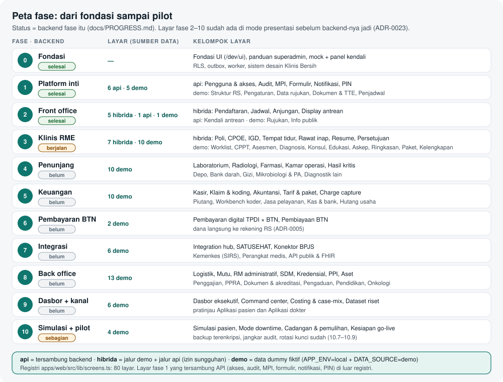

# Peta alur semua fase

Halaman ini memetakan **setiap fase** rencana kerja ke **layar web**, rutenya, dan sumber datanya hari ini. Gunakan sebagai daftar isi seluruh aplikasi: dari sini buka halaman fitur untuk alur dan gerbang keselamatan tiap layar.

> Status 6 Okt 2026: registri `apps/web/src/lib/screens.ts` berisi 80 layar (68 demo, 11 hibrida demo + api, 1 khusus api), ditambah 11 layar platform yang langsung tersambung API di luar registri. Backend fase 0–2 selesai, fase 3 berjalan (API 3.1–3.5 dan 3.7 tergabung; sejak 7 Okt 2026 backend dilanjutkan penuh, lihat [Cara kerja backend](./07-cara-kerja-backend.md)), fase 4–9 belum dibangun; semua layarnya sudah bisa dicoba di mode presentasi (`pnpm demo`). Status resmi tiap potongan ada di `docs/PROGRESS.md`; kriteria selesai fase di `docs/09-rencana-fase.md`.

## Cara membaca

| Sumber data | Arti                                                                                                                                                           |
| ----------- | -------------------------------------------------------------------------------------------------------------------------------------------------------------- |
| api         | Tersambung backend. Tampil di semua lingkungan; izin ditegakkan API.                                                                                           |
| hibrida     | Satu rute, dua jalur: data dummy di mode presentasi, API sungguhan di mode api (izin `ScreenDef.permission`). Jalur api layar klinis masih "Belum tersambung". |
| demo        | Data dummy fiktif. Hanya hidup bila `APP_ENV=local` dan `DATA_SOURCE=demo`; di staging dan produksi 404.                                                       |

Kolom "Panduan" menautkan halaman fitur yang menjelaskan layar itu. Cara kerja kedua jalur ada di [Peta kode](./19-peta-kode.md). Alur pasien lintas layar dijalankan skenario Simulasi: rawat jalan BPJS, IGD → rawat inap, dan elektif TPDI × BTN ([Simulasi dan operasional](./18-simulasi-dan-operasional.md)).

## Alur besar lintas fase

1. **Masuk dan identitas** (fase 1): login + MFA, posisi, PIN; data pasien di MPI.
2. **Kedatangan** (fase 2): booking/anjungan → pendaftaran + SEP → antrean dan TV.
3. **Pelayanan klinis** (fase 3): worklist → pemeriksaan/IGD → CPPT, asesmen, diagnosis → CPOE + CDS → rawat inap, askep, eMAR → resume, kelengkapan, tutup kunjungan.
4. **Penunjang** (fase 4): lab, radiologi, hasil kritis + read-back, farmasi + depo, bank darah, gizi, kamar operasi.
5. **Keuangan** (fase 5–6): charge capture → kasir → klaim + koding → piutang, kas-bank, akuntansi; pembayaran digital TPDI × BTN dan pembiayaan.
6. **Integrasi** (fase 7): outbox ke BPJS, SATUSEHAT, Kemenkes, perangkat, API publik.
7. **Tata kelola** (fase 8): logistik, mutu, PPI, PPRA, SDM, kredensial, RM administratif, dokumen akreditasi.
8. **Kanal dan keputusan** (fase 9): dasbor, command center, costing, dataset riset, aplikasi pasien dan dokter.
9. **Kesiapan operasi** (fase 10): simulasi, downtime, cadangan, go-live.

## Fase 0 · Fondasi

Backend: ✅ selesai. Layar: 1.

| Layar      | Rute      | Komponen | Sumber data      | Panduan                            |
| ---------- | --------- | -------- | ---------------- | ---------------------------------- |
| Fondasi UI | `/dev/ui` | —        | api (superadmin) | [Platform](./10-fitur-platform.md) |

## Fase 1 · Platform inti

Backend: ✅ selesai. Layar: 15.

| Layar                          | Rute                      | Komponen | Sumber data      | Panduan                            |
| ------------------------------ | ------------------------- | -------- | ---------------- | ---------------------------------- |
| Masuk + MFA                    | `/masuk`                  | P02      | api              | [Platform](./10-fitur-platform.md) |
| Pengguna dan akses             | `/sistem/akses`           | P02 P03  | api              | [Platform](./10-fitur-platform.md) |
| Perangkat anjungan dan display | `/sistem/akses/perangkat` | P02      | api              | [Platform](./10-fitur-platform.md) |
| Jejak audit                    | `/sistem/audit`           | P04      | api              | [Platform](./10-fitur-platform.md) |
| Rekam medis ganda (MPI)        | `/rekam-medis/mpi`        | P05      | api              | [Platform](./10-fitur-platform.md) |
| Formulir klinis                | `/sistem/formulir`        | P07      | api              | [Platform](./10-fitur-platform.md) |
| Notifikasi                     | `/notifikasi`             | P09      | api              | [Platform](./10-fitur-platform.md) |
| PIN masuk cepat                | `/akun/pin`               | P02      | api              | [Platform](./10-fitur-platform.md) |
| Verifikasi QR dokumen          | `/verifikasi/[code]`      | P08      | api (publik)     | [Platform](./10-fitur-platform.md) |
| Panduan superadmin             | `/superadmin/panduan`     | —        | api (superadmin) | [Platform](./10-fitur-platform.md) |
| Struktur RS                    | `/sistem/struktur`        | P01      | demo             | [Platform](./10-fitur-platform.md) |
| Pengaturan RS                  | `/sistem/pengaturan`      | P10 P12  | demo             | [Platform](./10-fitur-platform.md) |
| Data rujukan                   | `/sistem/terminologi`     | P06      | demo             | [Platform](./10-fitur-platform.md) |
| Dokumen & TTE                  | `/rekam-medis/dokumen`    | P08      | demo             | [Platform](./10-fitur-platform.md) |
| Penjadwal pekerjaan            | `/sistem/penjadwal`       | P11      | demo             | [Platform](./10-fitur-platform.md) |

## Fase 2 · Front office

Backend: ✅ selesai. Layar: 7.

| Layar                   | Rute                     | Komponen | Sumber data          | Panduan                                    |
| ----------------------- | ------------------------ | -------- | -------------------- | ------------------------------------------ |
| Pendaftaran             | `/pendaftaran`           | F03 F06  | hibrida (demo + api) | [Front office](./11-fitur-front-office.md) |
| Jadwal dokter           | `/jadwal`                | F01      | hibrida (demo + api) | [Front office](./11-fitur-front-office.md) |
| Anjungan mandiri        | `/kiosk`                 | F05      | hibrida (demo + api) | [Front office](./11-fitur-front-office.md) |
| Display antrean         | `/display/antrean`       | F04      | hibrida (demo + api) | [Front office](./11-fitur-front-office.md) |
| Kendali antrean         | `/antrean`               | F04      | api                  | [Front office](./11-fitur-front-office.md) |
| Rujukan                 | `/rujukan`               | F07 F06  | demo                 | [Front office](./11-fitur-front-office.md) |
| Info publik (pratinjau) | `/pratinjau/info-publik` | F08      | demo                 | [Front office](./11-fitur-front-office.md) |

## Fase 3 · Klinis RME

Backend: 🟨 berjalan. Layar: 17.

| Layar                      | Rute                         | Komponen    | Sumber data          | Panduan                        |
| -------------------------- | ---------------------------- | ----------- | -------------------- | ------------------------------ |
| Pemeriksaan poli           | `/klinis/poli`               | K01 K02     | hibrida (demo + api) | [Klinis](./12-fitur-klinis.md) |
| Order & resep (CPOE)       | `/klinis/order`              | K09         | hibrida (demo + api) | [Klinis](./12-fitur-klinis.md) |
| IGD                        | `/klinis/igd`                | K03         | hibrida (demo + api) | [Klinis](./12-fitur-klinis.md) |
| Tempat tidur               | `/klinis/tempat-tidur`       | K05         | hibrida (demo + api) | [Klinis](./12-fitur-klinis.md) |
| Rawat inap                 | `/klinis/rawat-inap`         | K04 K07 K12 | hibrida (demo + api) | [Klinis](./12-fitur-klinis.md) |
| Resume medis               | `/klinis/resume`             | K13         | hibrida (demo + api) | [Klinis](./12-fitur-klinis.md) |
| Persetujuan tindakan       | `/tablet/persetujuan`        | K11         | hibrida (demo + api) | [Klinis](./12-fitur-klinis.md) |
| Worklist klinis            | `/klinis/worklist`           | K01         | demo                 | [Klinis](./12-fitur-klinis.md) |
| CPPT & serah terima        | `/klinis/cppt`               | K07         | demo                 | [Klinis](./12-fitur-klinis.md) |
| Asesmen & skrining         | `/klinis/asesmen`            | K06         | demo                 | [Klinis](./12-fitur-klinis.md) |
| Diagnosis & problem list   | `/klinis/diagnosis`          | K08         | demo                 | [Klinis](./12-fitur-klinis.md) |
| Konsultasi & rawat bersama | `/klinis/konsultasi`         | K10         | demo                 | [Klinis](./12-fitur-klinis.md) |
| Edukasi pasien             | `/klinis/edukasi`            | K11         | demo                 | [Klinis](./12-fitur-klinis.md) |
| Asuhan keperawatan         | `/klinis/asuhan-keperawatan` | K12         | demo                 | [Klinis](./12-fitur-klinis.md) |
| Ringkasan pasien           | `/klinis/ringkasan`          | K14         | demo                 | [Klinis](./12-fitur-klinis.md) |
| Paket layanan khusus       | `/klinis/paket-layanan`      | K15         | demo                 | [Klinis](./12-fitur-klinis.md) |
| Kelengkapan rekam medis    | `/klinis/kelengkapan`        | K13         | demo                 | [Klinis](./12-fitur-klinis.md) |

## Fase 4 · Penunjang

Backend: ⬜ belum. Layar: 10.

| Layar               | Rute                       | Komponen | Sumber data | Panduan                              |
| ------------------- | -------------------------- | -------- | ----------- | ------------------------------------ |
| Laboratorium        | `/penunjang/lab`           | S01 S09  | demo        | [Penunjang](./13-fitur-penunjang.md) |
| Radiologi           | `/penunjang/radiologi`     | S03      | demo        | [Penunjang](./13-fitur-penunjang.md) |
| Farmasi             | `/penunjang/farmasi`       | S04 S05  | demo        | [Penunjang](./13-fitur-penunjang.md) |
| Kamar operasi       | `/penunjang/kamar-operasi` | S06      | demo        | [Penunjang](./13-fitur-penunjang.md) |
| Pusat hasil kritis  | `/penunjang/hasil-kritis`  | S09      | demo        | [Penunjang](./13-fitur-penunjang.md) |
| Depo & stok farmasi | `/penunjang/depo`          | S05      | demo        | [Penunjang](./13-fitur-penunjang.md) |
| Bank darah          | `/penunjang/bank-darah`    | S08      | demo        | [Penunjang](./13-fitur-penunjang.md) |
| Gizi                | `/penunjang/gizi`          | S07      | demo        | [Penunjang](./13-fitur-penunjang.md) |
| Mikrobiologi & PA   | `/penunjang/mikrobiologi`  | S02      | demo        | [Penunjang](./13-fitur-penunjang.md) |
| Diagnostik lain     | `/penunjang/diagnostik`    | S10      | demo        | [Penunjang](./13-fitur-penunjang.md) |

## Fase 5 · Keuangan

Backend: ⬜ belum. Layar: 10.

| Layar                | Rute                       | Komponen    | Sumber data | Panduan                            |
| -------------------- | -------------------------- | ----------- | ----------- | ---------------------------------- |
| Kasir                | `/keuangan/kasir`          | U02 U03     | demo        | [Keuangan](./14-fitur-keuangan.md) |
| Klaim & koding       | `/keuangan/klaim`          | U05 U06     | demo        | [Keuangan](./14-fitur-keuangan.md) |
| Akuntansi            | `/keuangan/akuntansi`      | U04 U07 U09 | demo        | [Keuangan](./14-fitur-keuangan.md) |
| Tarif & paket        | `/keuangan/tarif`          | U01         | demo        | [Keuangan](./14-fitur-keuangan.md) |
| Charge capture       | `/keuangan/charge-capture` | U02         | demo        | [Keuangan](./14-fitur-keuangan.md) |
| Penjaminan & piutang | `/keuangan/piutang`        | U04         | demo        | [Keuangan](./14-fitur-keuangan.md) |
| Workbench koder      | `/keuangan/koding`         | U06         | demo        | [Keuangan](./14-fitur-keuangan.md) |
| Jasa pelayanan       | `/keuangan/jasa-pelayanan` | U08         | demo        | [Keuangan](./14-fitur-keuangan.md) |
| Kas & bank           | `/keuangan/kas-bank`       | U09         | demo        | [Keuangan](./14-fitur-keuangan.md) |
| Hutang usaha         | `/keuangan/hutang`         | U10         | demo        | [Keuangan](./14-fitur-keuangan.md) |

## Fase 6 · Pembayaran TPDI × BTN + pembiayaan

Backend: ⬜ belum. Layar: 2.

| Layar              | Rute                   | Komponen | Sumber data | Panduan                            |
| ------------------ | ---------------------- | -------- | ----------- | ---------------------------------- |
| Pembayaran digital | `/keuangan/pembayaran` | I05 U09  | demo        | [Keuangan](./14-fitur-keuangan.md) |
| Pembiayaan BTN     | `/keuangan/pembiayaan` | U04      | demo        | [Keuangan](./14-fitur-keuangan.md) |

## Fase 7 · Integration hub + SATUSEHAT

Backend: ⬜ belum. Layar: 6.

| Layar             | Rute                           | Komponen                | Sumber data | Panduan                              |
| ----------------- | ------------------------------ | ----------------------- | ----------- | ------------------------------------ |
| Integrasi         | `/sistem/integrasi`            | I01 I02 I03 I04 I05 I06 | demo        | [Integrasi](./15-fitur-integrasi.md) |
| SATUSEHAT         | `/sistem/integrasi/satusehat`  | I02                     | demo        | [Integrasi](./15-fitur-integrasi.md) |
| Konektor BPJS     | `/sistem/integrasi/bpjs`       | I03                     | demo        | [Integrasi](./15-fitur-integrasi.md) |
| Kemenkes (SIRS)   | `/sistem/integrasi/kemenkes`   | I04                     | demo        | [Integrasi](./15-fitur-integrasi.md) |
| Perangkat medis   | `/sistem/integrasi/perangkat`  | I06                     | demo        | [Integrasi](./15-fitur-integrasi.md) |
| API publik & FHIR | `/sistem/integrasi/api-publik` | I12                     | demo        | [Integrasi](./15-fitur-integrasi.md) |

## Fase 8 · Back office

Backend: ⬜ belum. Layar: 13.

| Layar                   | Rute                        | Komponen | Sumber data | Panduan                                  |
| ----------------------- | --------------------------- | -------- | ----------- | ---------------------------------------- |
| Logistik                | `/manajemen/logistik`       | B01      | demo        | [Back office](./16-fitur-back-office.md) |
| Mutu & keselamatan      | `/manajemen/mutu`           | B06      | demo        | [Back office](./16-fitur-back-office.md) |
| RM administratif        | `/rekam-medis/administrasi` | B09      | demo        | [Back office](./16-fitur-back-office.md) |
| SDM & kepegawaian       | `/manajemen/sdm`            | B03      | demo        | [Back office](./16-fitur-back-office.md) |
| Kredensial & kewenangan | `/manajemen/kredensial`     | B04      | demo        | [Back office](./16-fitur-back-office.md) |
| PPI                     | `/manajemen/ppi`            | B07      | demo        | [Back office](./16-fitur-back-office.md) |
| Aset & pemeliharaan     | `/manajemen/aset`           | B02      | demo        | [Back office](./16-fitur-back-office.md) |
| Penggajian              | `/manajemen/penggajian`     | B05      | demo        | [Back office](./16-fitur-back-office.md) |
| PPRA                    | `/manajemen/ppra`           | B08      | demo        | [Back office](./16-fitur-back-office.md) |
| Dokumen & akreditasi    | `/manajemen/dokumen`        | B12      | demo        | [Back office](./16-fitur-back-office.md) |
| Pengalaman pasien       | `/manajemen/pengaduan`      | B13      | demo        | [Back office](./16-fitur-back-office.md) |
| Pendidikan klinik       | `/manajemen/pendidikan`     | B10      | demo        | [Back office](./16-fitur-back-office.md) |
| Onkologi                | `/klinis/onkologi`          | B11      | demo        | [Back office](./16-fitur-back-office.md) |

## Fase 9 · Dasbor + aplikasi mobile

Backend: ⬜ belum. Layar: 6.

| Layar                       | Rute                         | Komponen | Sumber data | Panduan                                        |
| --------------------------- | ---------------------------- | -------- | ----------- | ---------------------------------------------- |
| Costing & case-mix          | `/keuangan/costing`          | I10      | demo        | [Keuangan](./14-fitur-keuangan.md)             |
| Dasbor eksekutif            | `/manajemen/dasbor`          | I09      | demo        | [Kanal dan dasbor](./17-fitur-kanal-dasbor.md) |
| Aplikasi pasien (pratinjau) | `/pratinjau/aplikasi-pasien` | I07      | demo        | [Kanal dan dasbor](./17-fitur-kanal-dasbor.md) |
| Aplikasi dokter (pratinjau) | `/pratinjau/aplikasi-dokter` | I08      | demo        | [Kanal dan dasbor](./17-fitur-kanal-dasbor.md) |
| Command center              | `/manajemen/command-center`  | I09      | demo        | [Kanal dan dasbor](./17-fitur-kanal-dasbor.md) |
| Dataset riset               | `/manajemen/dataset-riset`   | I11      | demo        | [Kanal dan dasbor](./17-fitur-kanal-dasbor.md) |

## Fase 10 · Simulasi, ketahanan, pilot

Backend: 🟨 sebagian (10.7–10.9 lebih awal). Layar: 4.

| Layar                | Rute               | Komponen | Sumber data | Panduan                                                      |
| -------------------- | ------------------ | -------- | ----------- | ------------------------------------------------------------ |
| Simulasi pasien      | `/simulasi`        | —        | demo        | [Simulasi dan operasional](./18-simulasi-dan-operasional.md) |
| Mode downtime        | `/sistem/downtime` | P13      | demo        | [Simulasi dan operasional](./18-simulasi-dan-operasional.md) |
| Cadangan & pemulihan | `/sistem/cadangan` | —        | demo        | [Simulasi dan operasional](./18-simulasi-dan-operasional.md) |
| Kesiapan go-live     | `/sistem/go-live`  | —        | demo        | [Simulasi dan operasional](./18-simulasi-dan-operasional.md) |

## Lihat juga

- [Peta kode](./19-peta-kode.md): registri layar, pola demo vs api, peta modul API, dan utang mode front end dulu.
- [Cara sistem bekerja](./01-cara-kerja-sistem.md#peta-fase): ringkasan fase.
- `docs/09-rencana-fase.md` dan `docs/rencana/fase-*.md`: rencana dan kriteria selesai tiap fase.
